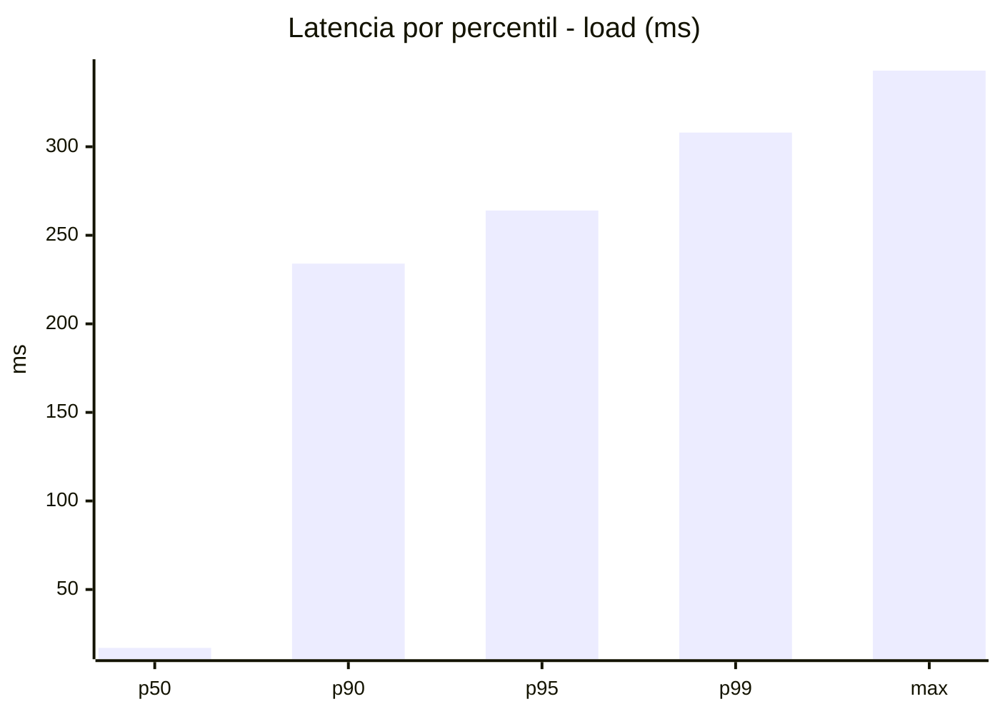
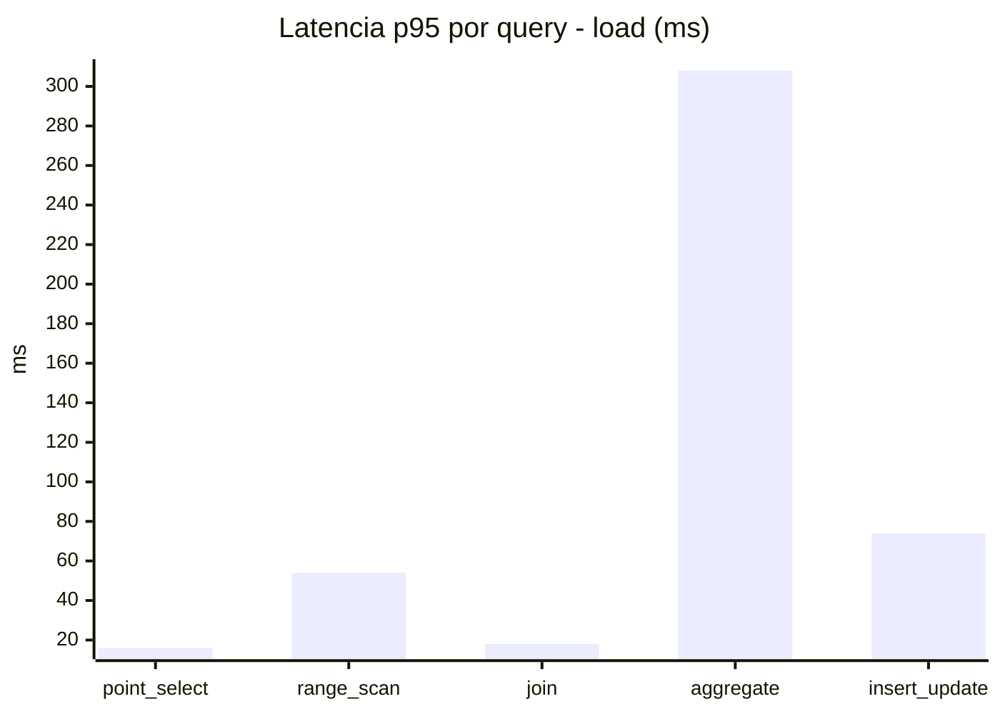
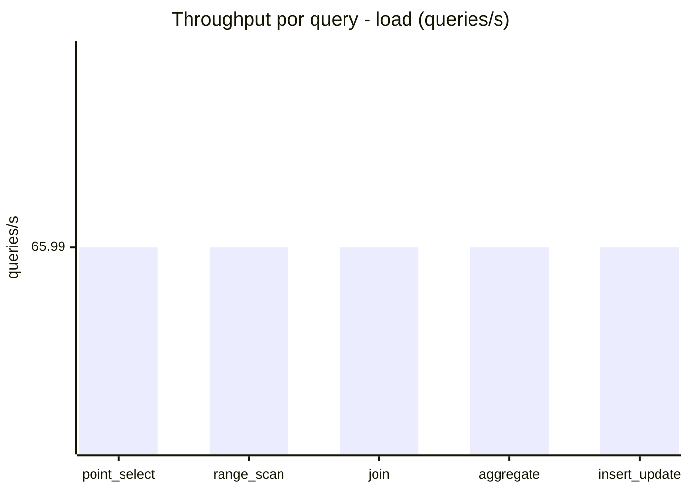
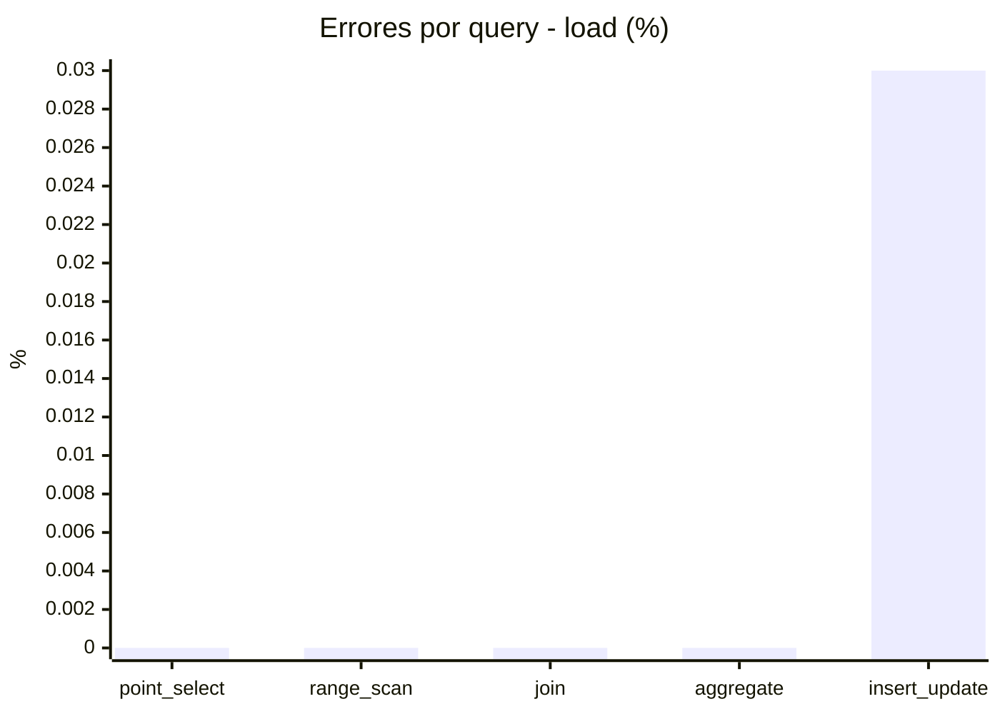
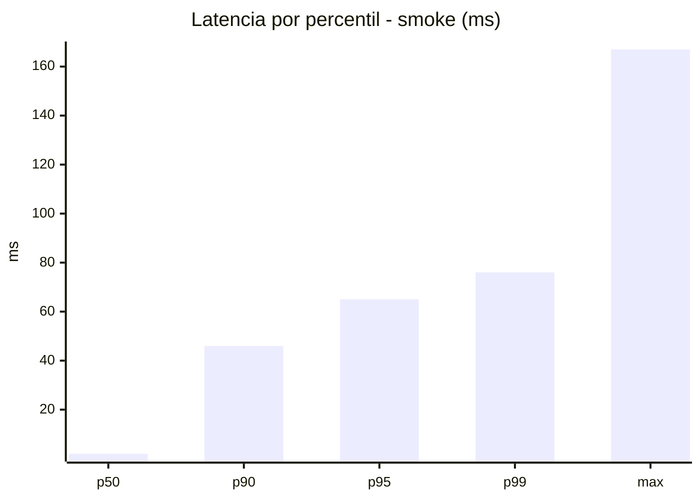
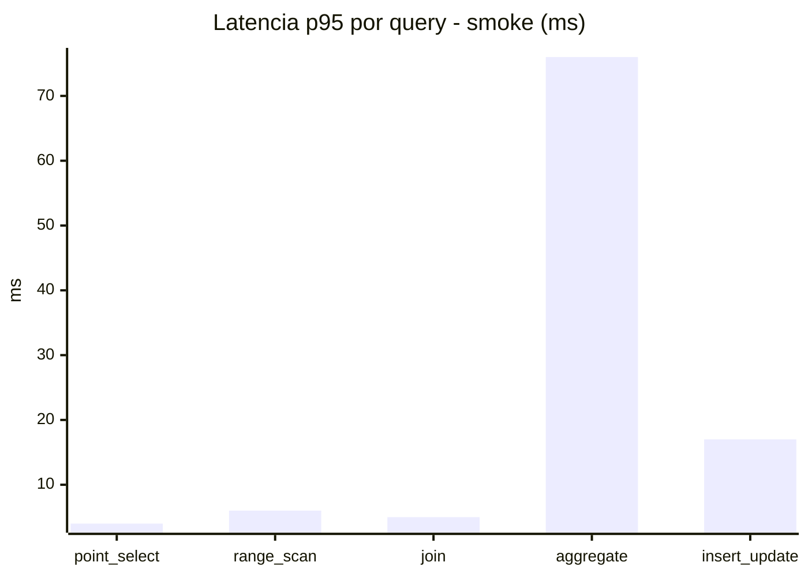
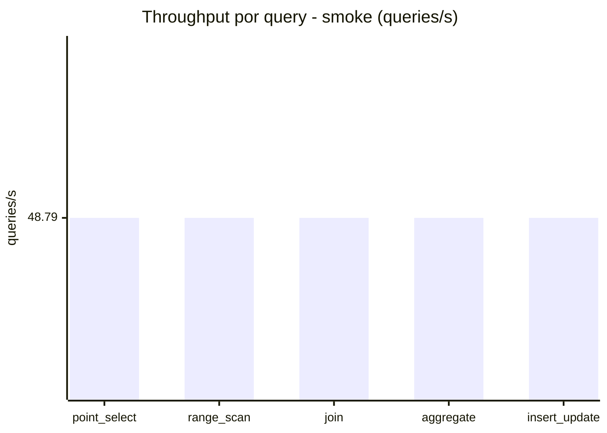
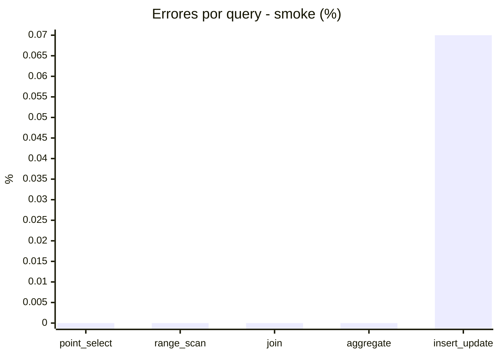

# Reporte de performance - SQL Server (k6)

**Fecha:** 2026-10-11 18:13 UTC  
**Veredicto (SLO):** `WARN`  
**Corrida:** [ver en GitHub Actions](https://github.com/lrbg/k6-sqlserver-lab/actions/runs/38162776226)  

## Analisis del agente de IA

WARN (fallback por umbrales)

- Error maximo: 0.01%
- p95 maximo: 264 ms

## Resultados

### Escenario: `load`

| Metrica | Valor |
| --- | --- |
| Queries ejecutadas | 19855 |
| Errores | 1 (0.01%) |
| Latencia media | 60.5 ms |
| p50 / p90 / p95 / p99 | 17 / 234 / 264 / 308 ms |
| Min / Max | 0 / 343 ms |
| Throughput | 329.96 queries/s |
| Duracion | 60.2 s |

Detalle por query

| Query | Ejecuciones | Error % | avg | p95 | p99 | q/s |
| --- | --- | --- | --- | --- | --- | --- |
| point_select | 3971 | 0% | 6 | 16 | 21 | 65.99 |
| range_scan | 3971 | 0% | 23.6 | 54 | 77.3 | 65.99 |
| join | 3971 | 0% | 8.7 | 18 | 21 | 65.99 |
| aggregate | 3971 | 0% | 228.6 | 308 | 322 | 65.99 |
| insert_update | 3971 | 0.03% | 35.5 | 74 | 94 | 65.99 |

### Escenario: `smoke`

| Metrica | Valor |
| --- | --- |
| Queries ejecutadas | 7325 |
| Errores | 1 (0.01%) |
| Latencia media | 12.3 ms |
| p50 / p90 / p95 / p99 | 2 / 46 / 65 / 76 ms |
| Min / Max | 0 / 167 ms |
| Throughput | 243.95 queries/s |
| Duracion | 30 s |

Detalle por query

| Query | Ejecuciones | Error % | avg | p95 | p99 | q/s |
| --- | --- | --- | --- | --- | --- | --- |
| point_select | 1465 | 0% | 0.9 | 4 | 5 | 48.79 |
| range_scan | 1465 | 0% | 3 | 6 | 8.4 | 48.79 |
| join | 1465 | 0% | 1.7 | 5 | 5 | 48.79 |
| aggregate | 1465 | 0% | 50.7 | 76 | 81.4 | 48.79 |
| insert_update | 1465 | 0.07% | 5.1 | 17 | 25 | 48.79 |

