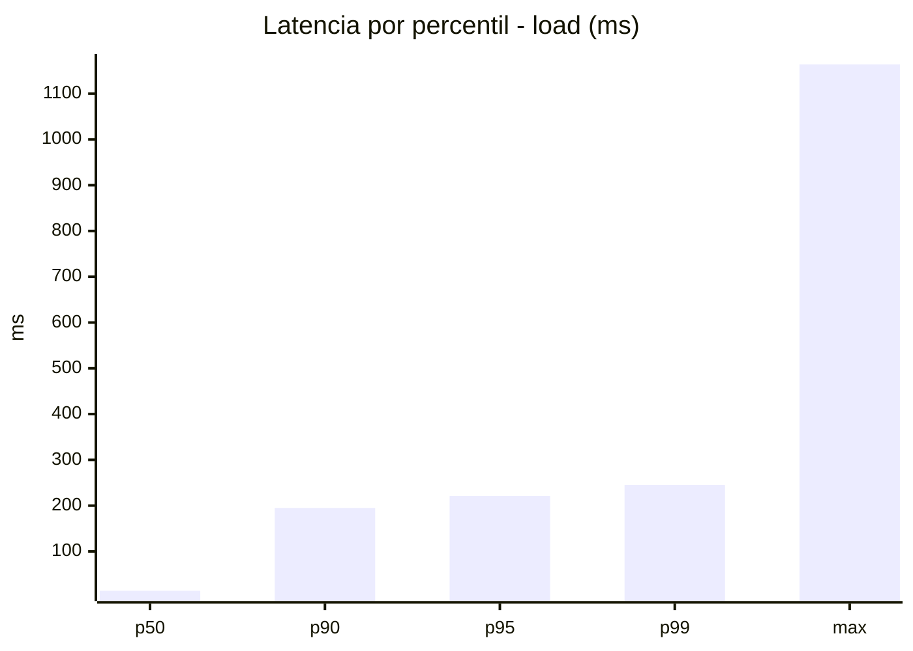
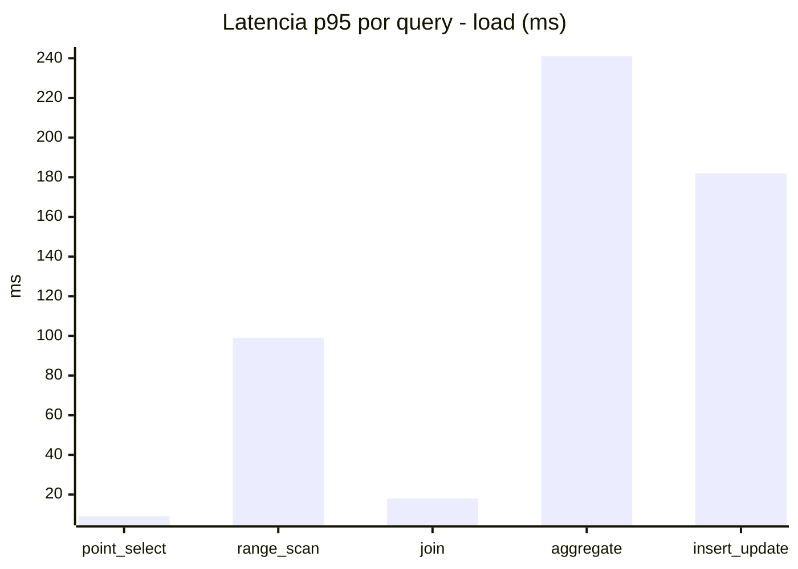
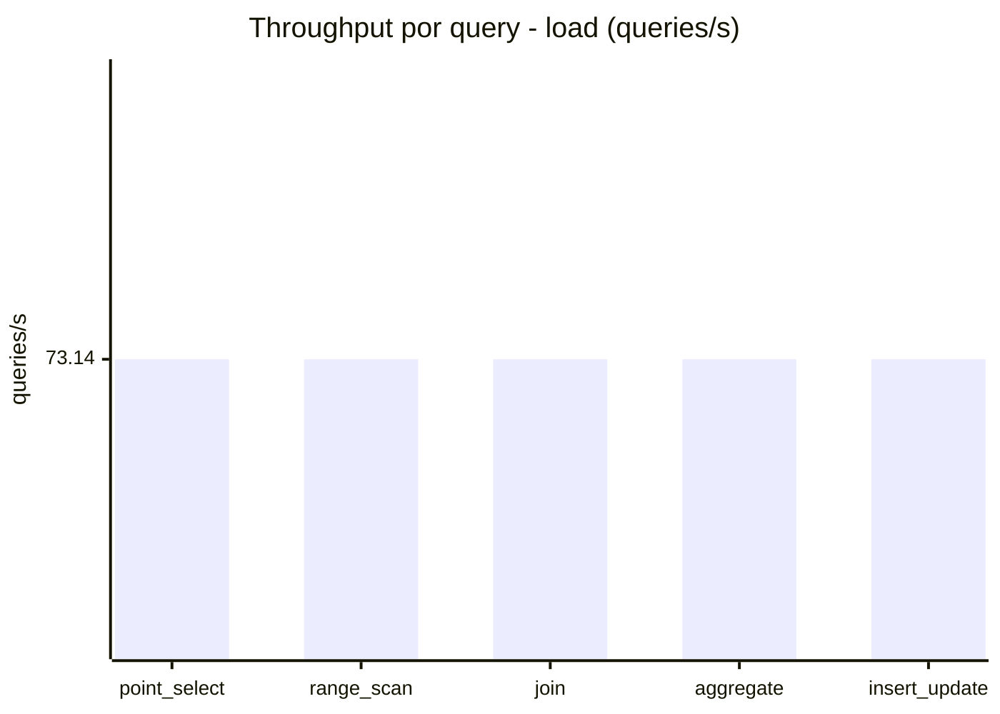
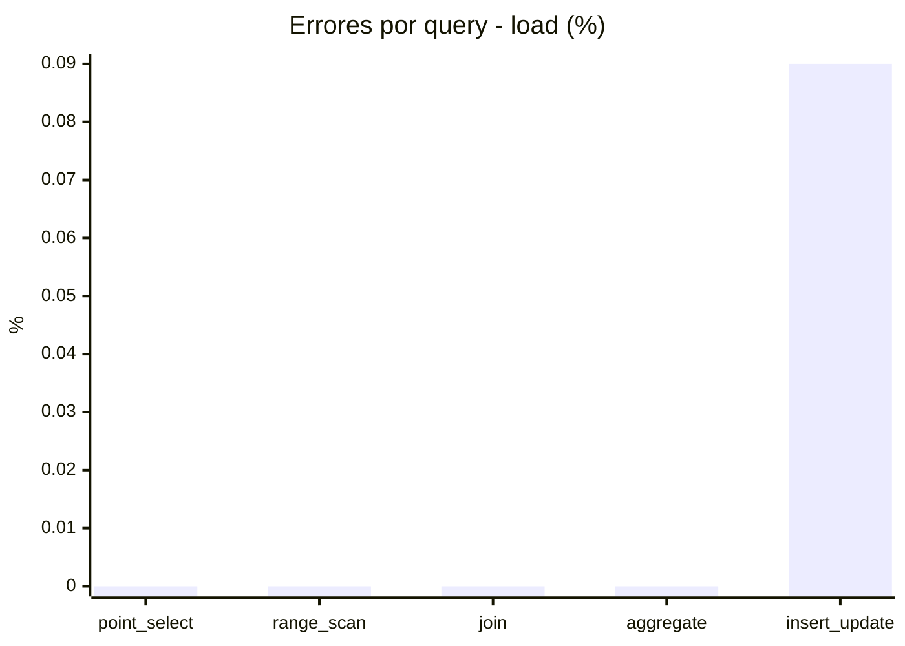
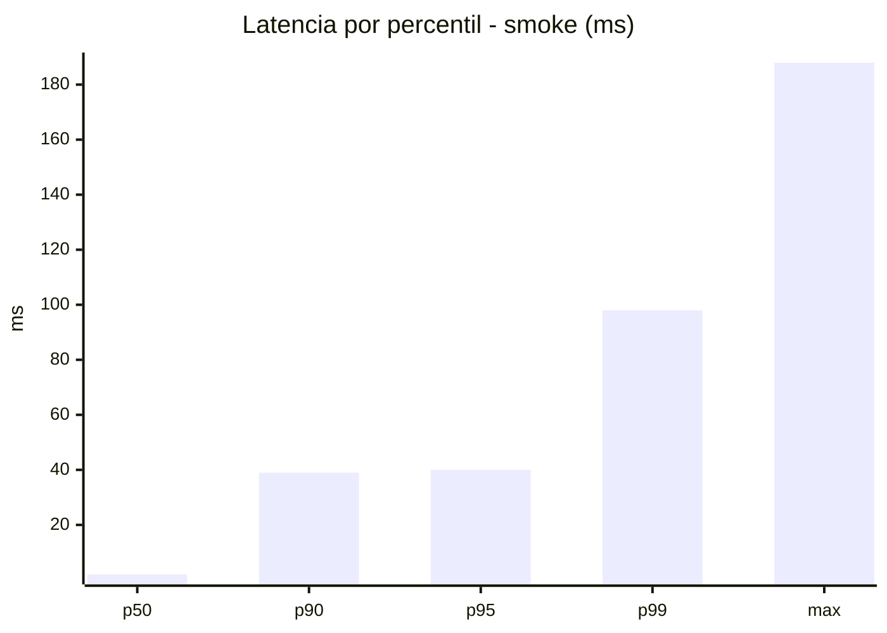
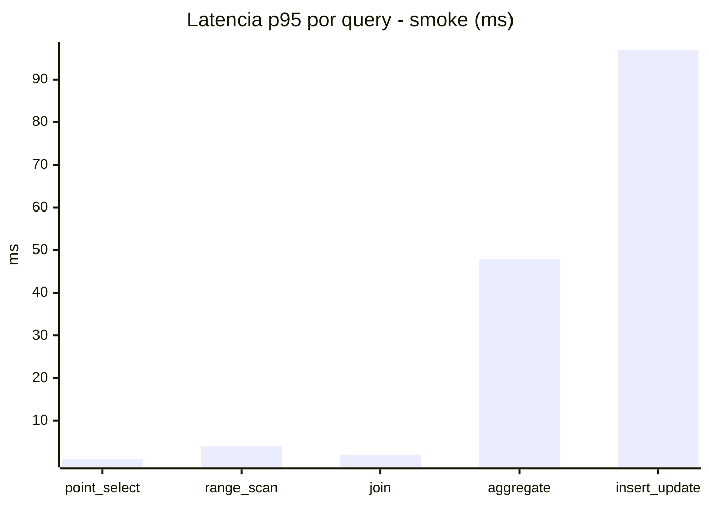
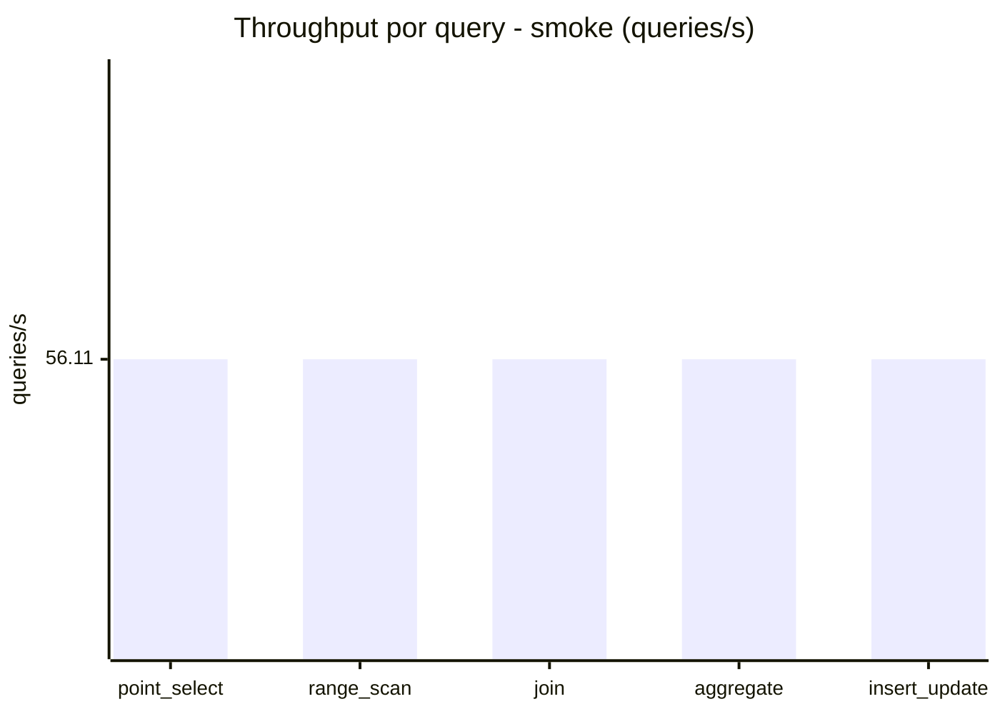
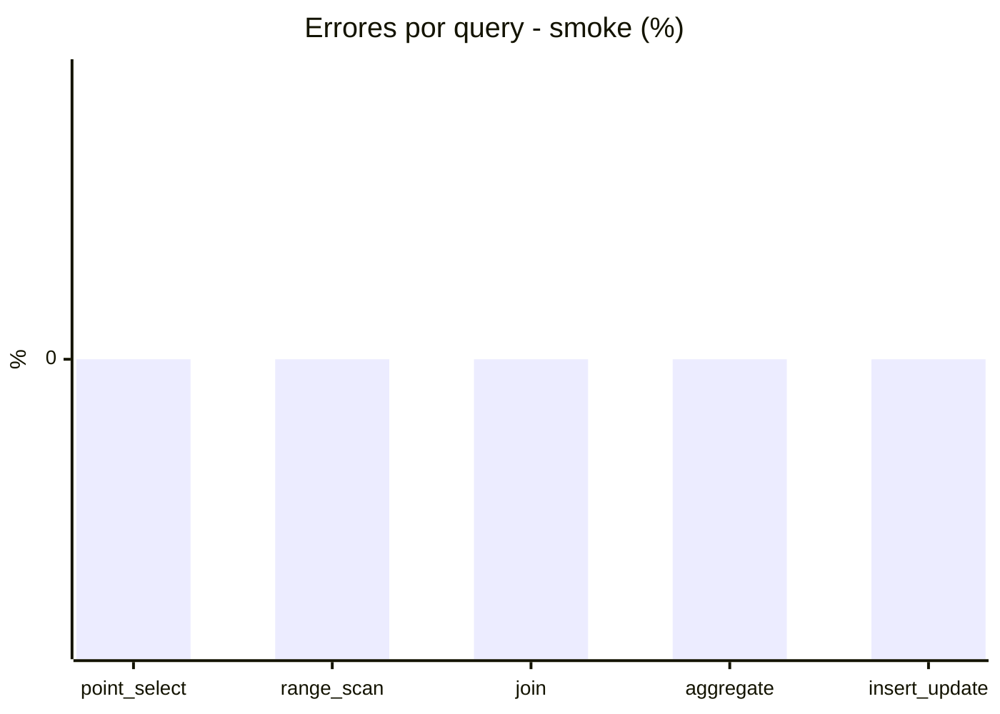

# Reporte de performance - SQL Server (k6)

**Fecha:** 2026-10-12 21:49 UTC  
**Veredicto (SLO):** `WARN`  
**Corrida:** [ver en GitHub Actions](https://github.com/lrbg/k6-sqlserver-lab/actions/runs/38312774634)  

## Analisis del agente de IA

WARN (fallback por umbrales)

- Error maximo: 0.02%
- p95 maximo: 221 ms

## Resultados

### Escenario: `load`

| Metrica | Valor |
| --- | --- |
| Queries ejecutadas | 21985 |
| Errores | 4 (0.02%) |
| Latencia media | 54.6 ms |
| p50 / p90 / p95 / p99 | 14 / 195 / 221 / 245 ms |
| Min / Max | 0 / 1164 ms |
| Throughput | 365.72 queries/s |
| Duracion | 60.1 s |

Detalle por query

| Query | Ejecuciones | Error % | avg | p95 | p99 | q/s |
| --- | --- | --- | --- | --- | --- | --- |
| point_select | 4397 | 0% | 3.2 | 9 | 18 | 73.14 |
| range_scan | 4397 | 0% | 24.9 | 99 | 189 | 73.14 |
| join | 4397 | 0% | 7.2 | 18 | 22 | 73.14 |
| aggregate | 4397 | 0% | 176.5 | 241 | 254 | 73.14 |
| insert_update | 4397 | 0.09% | 61.3 | 182 | 315 | 73.14 |

### Escenario: `smoke`

| Metrica | Valor |
| --- | --- |
| Queries ejecutadas | 8420 |
| Errores | 0 (0%) |
| Latencia media | 10.7 ms |
| p50 / p90 / p95 / p99 | 2 / 39 / 40 / 98 ms |
| Min / Max | 0 / 188 ms |
| Throughput | 280.57 queries/s |
| Duracion | 30 s |

Detalle por query

| Query | Ejecuciones | Error % | avg | p95 | p99 | q/s |
| --- | --- | --- | --- | --- | --- | --- |
| point_select | 1684 | 0% | 0.5 | 1 | 2 | 56.11 |
| range_scan | 1684 | 0% | 2.9 | 4 | 18 | 56.11 |
| join | 1684 | 0% | 0.8 | 2 | 5 | 56.11 |
| aggregate | 1684 | 0% | 33.5 | 48 | 58 | 56.11 |
| insert_update | 1684 | 0% | 15.6 | 97 | 159 | 56.11 |

