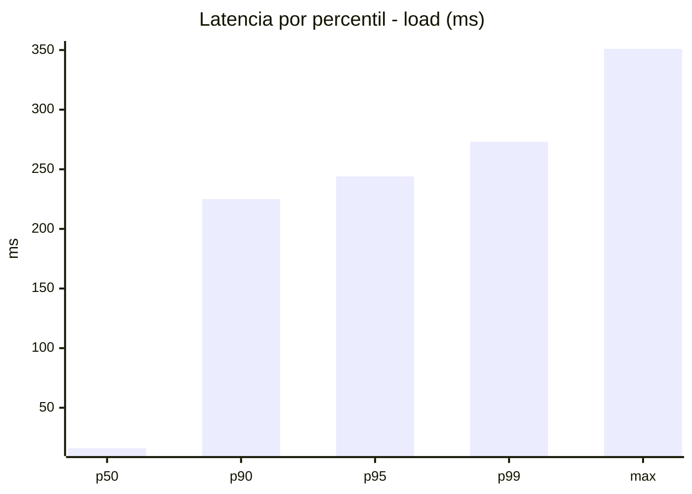
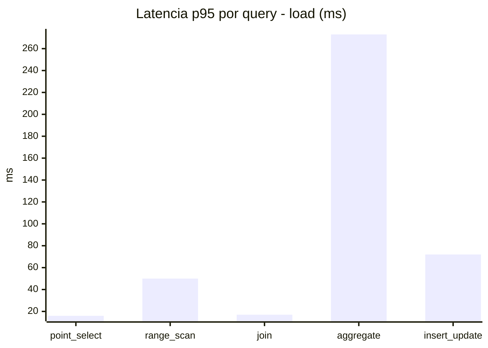
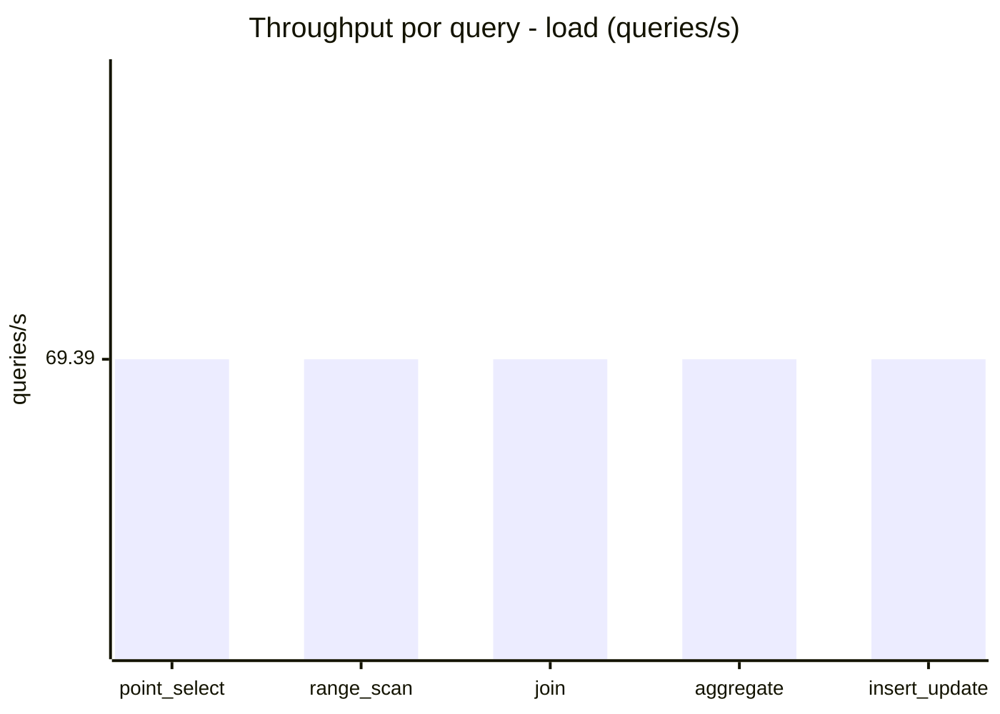
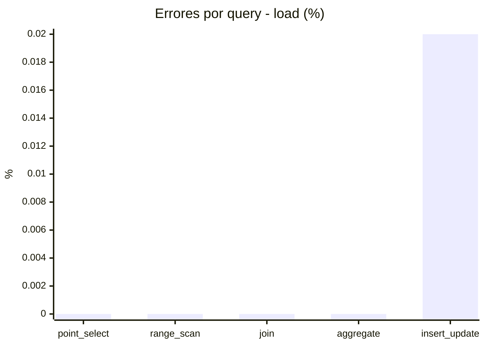
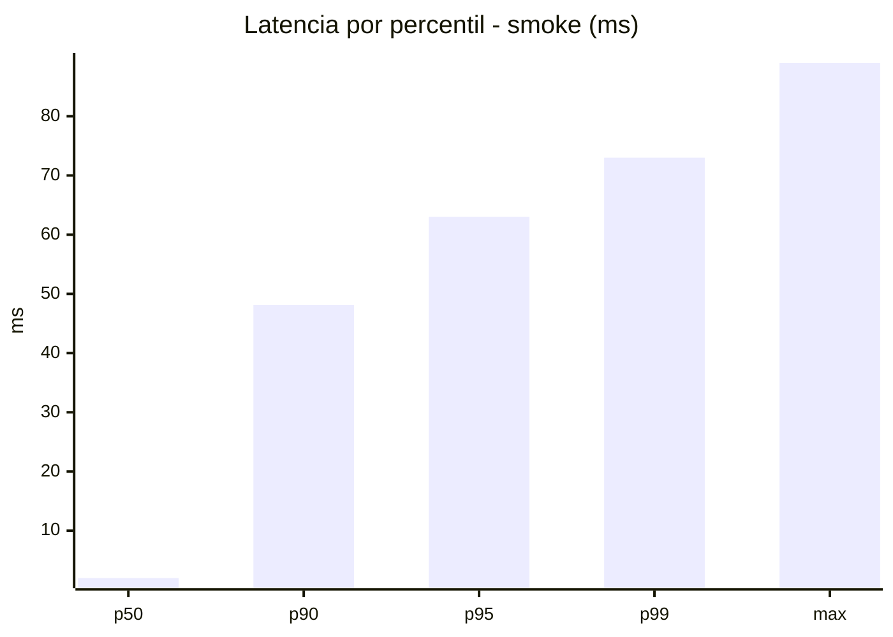
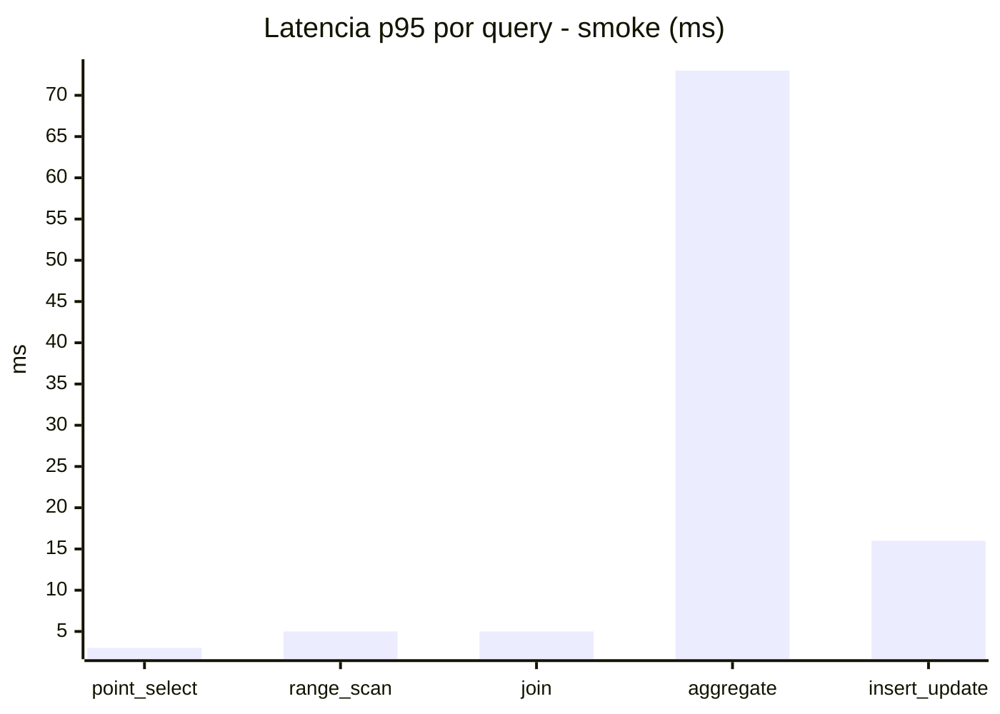
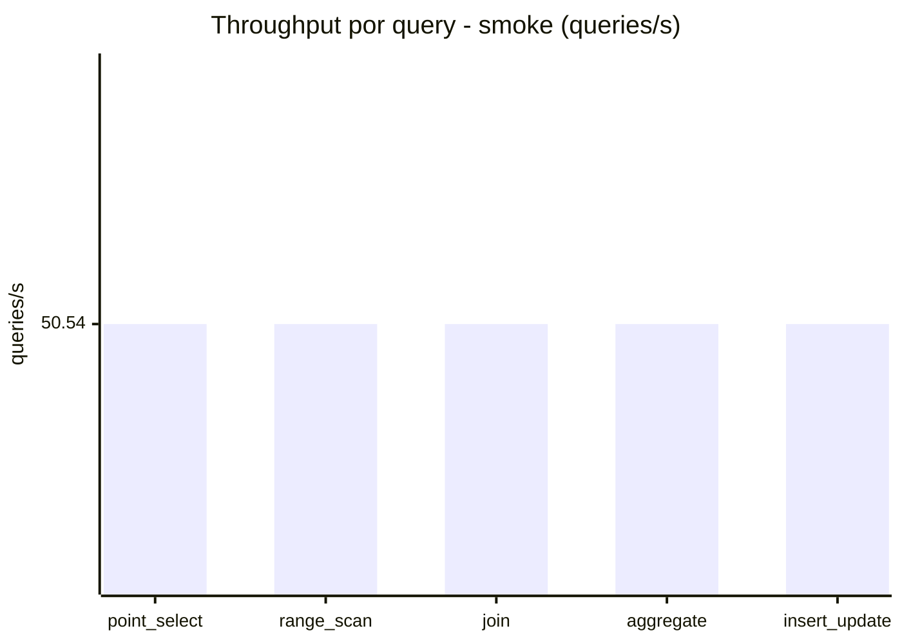
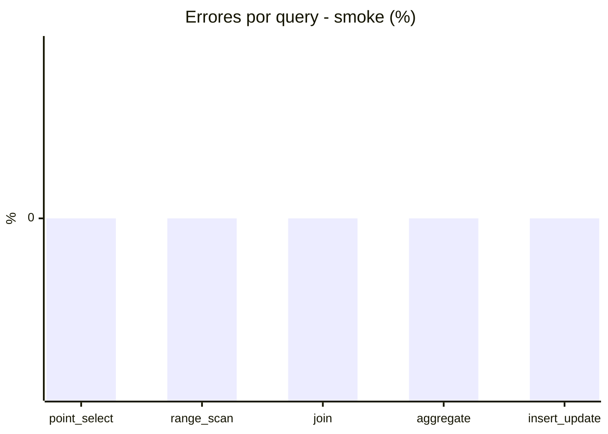

# Reporte de performance - SQL Server (k6)

**Fecha:** 2026-10-13 19:55 UTC  
**Veredicto (SLO):** `WARN`  
**Corrida:** [ver en GitHub Actions](https://github.com/lrbg/k6-sqlserver-lab/actions/runs/38458462171)  

## Analisis del agente de IA

WARN (fallback por umbrales)

- Error maximo: 0%
- p95 maximo: 244 ms

## Resultados

### Escenario: `load`

| Metrica | Valor |
| --- | --- |
| Queries ejecutadas | 20865 |
| Errores | 1 (0%) |
| Latencia media | 57.6 ms |
| p50 / p90 / p95 / p99 | 16 / 225 / 244 / 273 ms |
| Min / Max | 0 / 351 ms |
| Throughput | 346.97 queries/s |
| Duracion | 60.1 s |

Detalle por query

| Query | Ejecuciones | Error % | avg | p95 | p99 | q/s |
| --- | --- | --- | --- | --- | --- | --- |
| point_select | 4173 | 0% | 5.7 | 16 | 19 | 69.39 |
| range_scan | 4173 | 0% | 22.2 | 50 | 66 | 69.39 |
| join | 4173 | 0% | 8.5 | 17 | 21 | 69.39 |
| aggregate | 4173 | 0% | 217.8 | 273 | 298 | 69.39 |
| insert_update | 4173 | 0.02% | 33.6 | 72 | 85 | 69.39 |

### Escenario: `smoke`

| Metrica | Valor |
| --- | --- |
| Queries ejecutadas | 7590 |
| Errores | 0 (0%) |
| Latencia media | 11.8 ms |
| p50 / p90 / p95 / p99 | 2 / 48.1 / 63 / 73 ms |
| Min / Max | 0 / 89 ms |
| Throughput | 252.7 queries/s |
| Duracion | 30 s |

Detalle por query

| Query | Ejecuciones | Error % | avg | p95 | p99 | q/s |
| --- | --- | --- | --- | --- | --- | --- |
| point_select | 1518 | 0% | 0.8 | 3 | 5 | 50.54 |
| range_scan | 1518 | 0% | 2.8 | 5 | 7 | 50.54 |
| join | 1518 | 0% | 1.7 | 5 | 5 | 50.54 |
| aggregate | 1518 | 0% | 49.2 | 73 | 78 | 50.54 |
| insert_update | 1518 | 0% | 4.7 | 16 | 22 | 50.54 |

