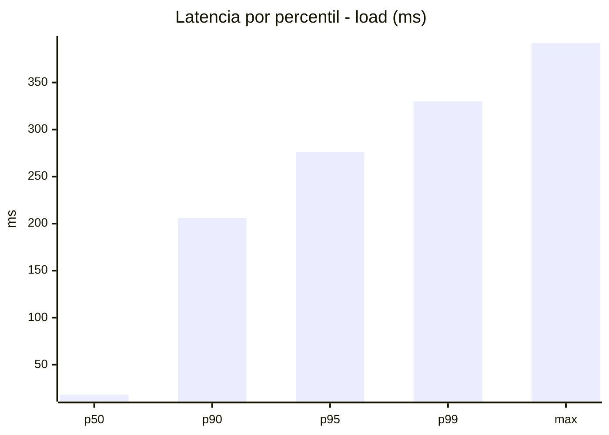
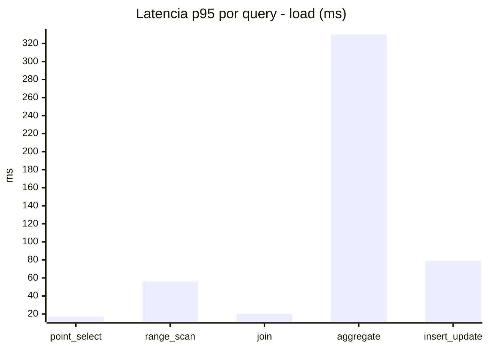
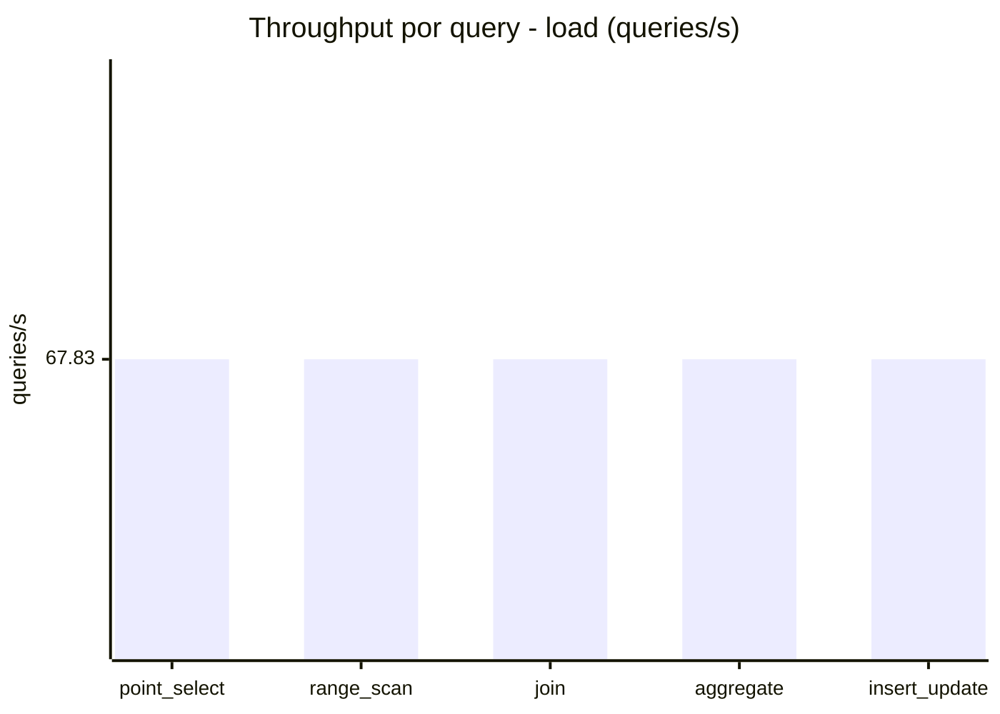
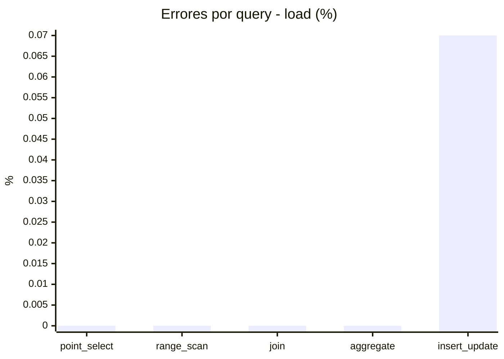
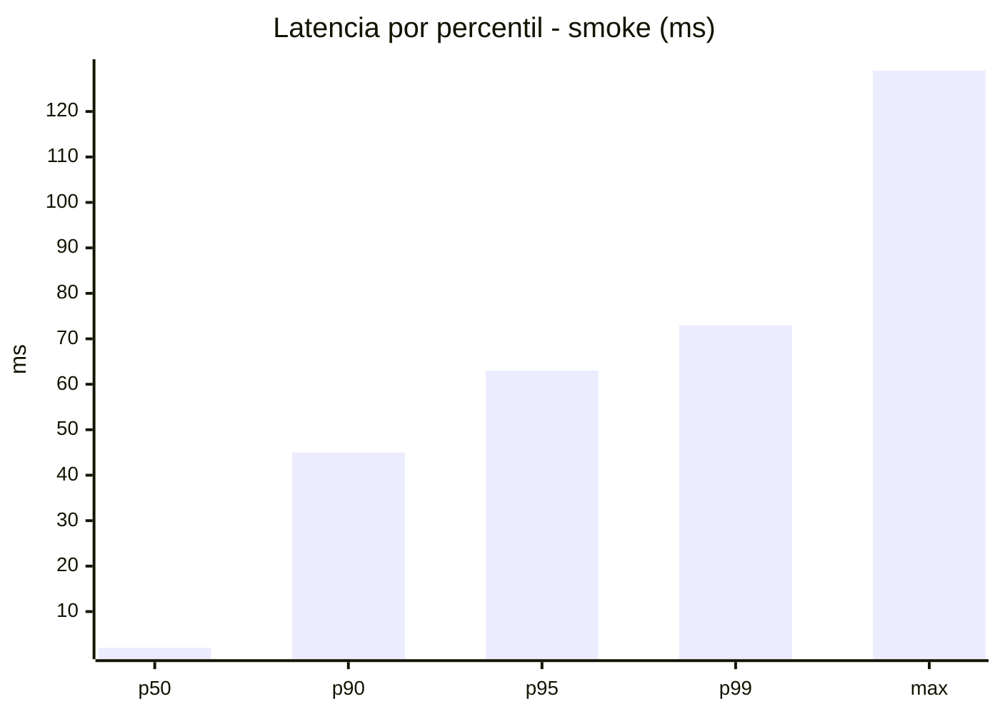
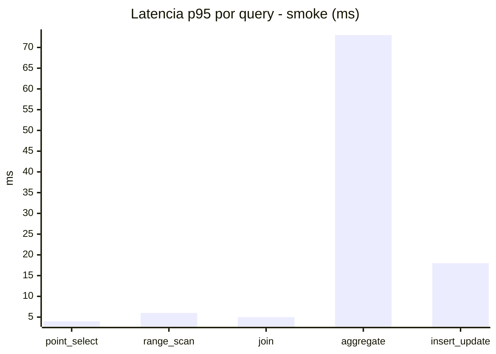
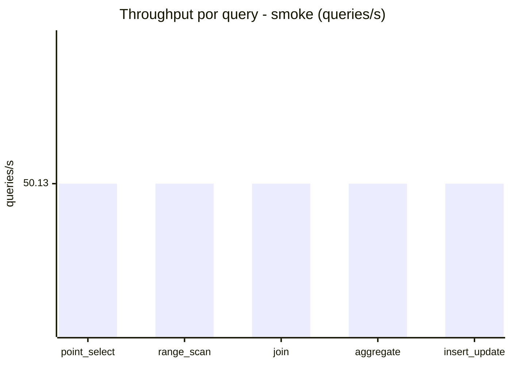
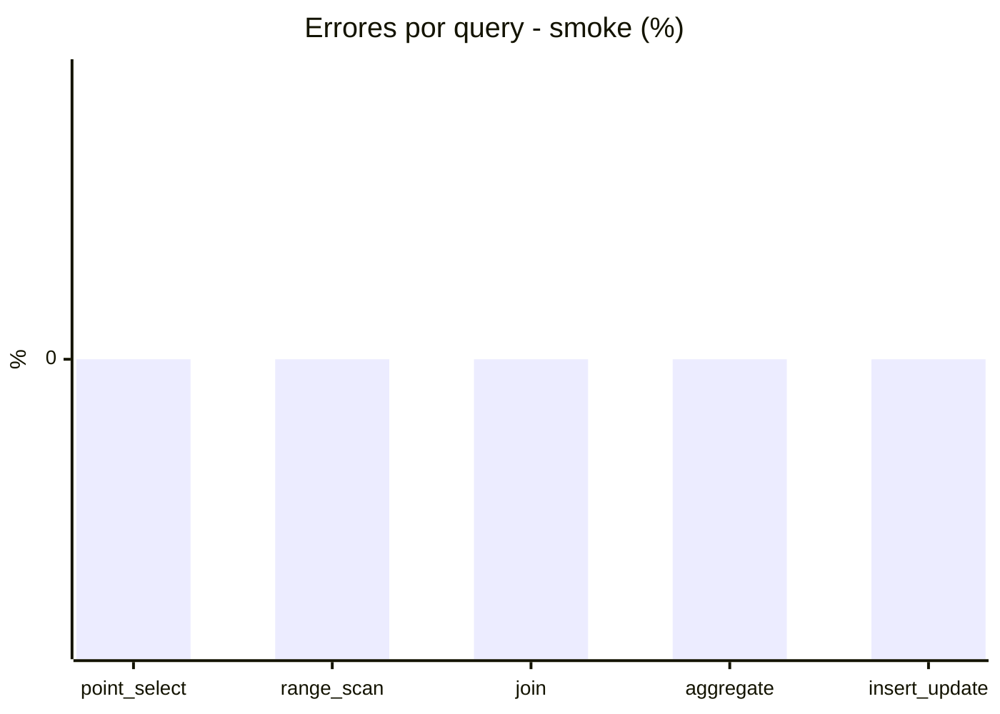

# Reporte de performance - SQL Server (k6)

**Fecha:** 2026-10-14 18:06 UTC  
**Veredicto (SLO):** `WARN`  
**Corrida:** [ver en GitHub Actions](https://github.com/lrbg/k6-sqlserver-lab/actions/runs/38612038173)  

## Analisis del agente de IA

WARN (fallback por umbrales)

- Error maximo: 0.01%
- p95 maximo: 276 ms

## Resultados

### Escenario: `load`

| Metrica | Valor |
| --- | --- |
| Queries ejecutadas | 20435 |
| Errores | 3 (0.01%) |
| Latencia media | 58.8 ms |
| p50 / p90 / p95 / p99 | 18 / 206 / 276 / 330 ms |
| Min / Max | 0 / 392 ms |
| Throughput | 339.13 queries/s |
| Duracion | 60.3 s |

Detalle por query

| Query | Ejecuciones | Error % | avg | p95 | p99 | q/s |
| --- | --- | --- | --- | --- | --- | --- |
| point_select | 4087 | 0% | 6 | 17 | 21 | 67.83 |
| range_scan | 4087 | 0% | 24.3 | 56 | 82.1 | 67.83 |
| join | 4087 | 0% | 8.7 | 20 | 23 | 67.83 |
| aggregate | 4087 | 0% | 219.1 | 330 | 356.1 | 67.83 |
| insert_update | 4087 | 0.07% | 36 | 79 | 101 | 67.83 |

### Escenario: `smoke`

| Metrica | Valor |
| --- | --- |
| Queries ejecutadas | 7530 |
| Errores | 0 (0%) |
| Latencia media | 11.9 ms |
| p50 / p90 / p95 / p99 | 2 / 45 / 63 / 73 ms |
| Min / Max | 0 / 129 ms |
| Throughput | 250.66 queries/s |
| Duracion | 30 s |

Detalle por query

| Query | Ejecuciones | Error % | avg | p95 | p99 | q/s |
| --- | --- | --- | --- | --- | --- | --- |
| point_select | 1506 | 0% | 1 | 4 | 5 | 50.13 |
| range_scan | 1506 | 0% | 3 | 6 | 8 | 50.13 |
| join | 1506 | 0% | 1.7 | 5 | 5 | 50.13 |
| aggregate | 1506 | 0% | 48.8 | 73 | 78 | 50.13 |
| insert_update | 1506 | 0% | 5.2 | 18 | 24 | 50.13 |

