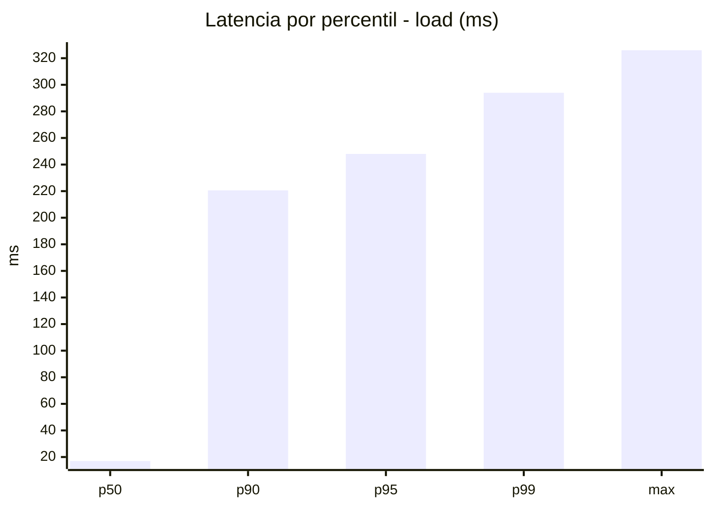
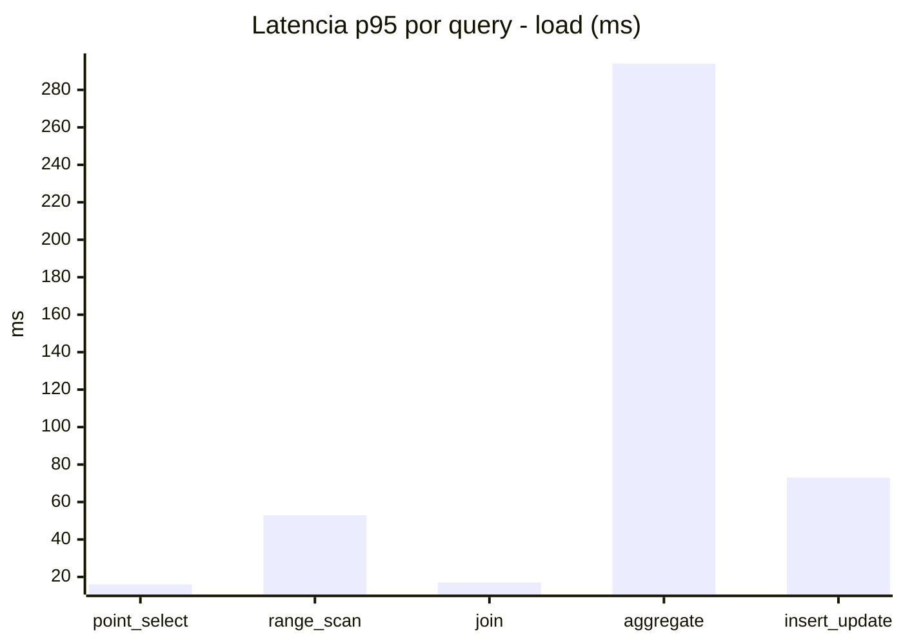
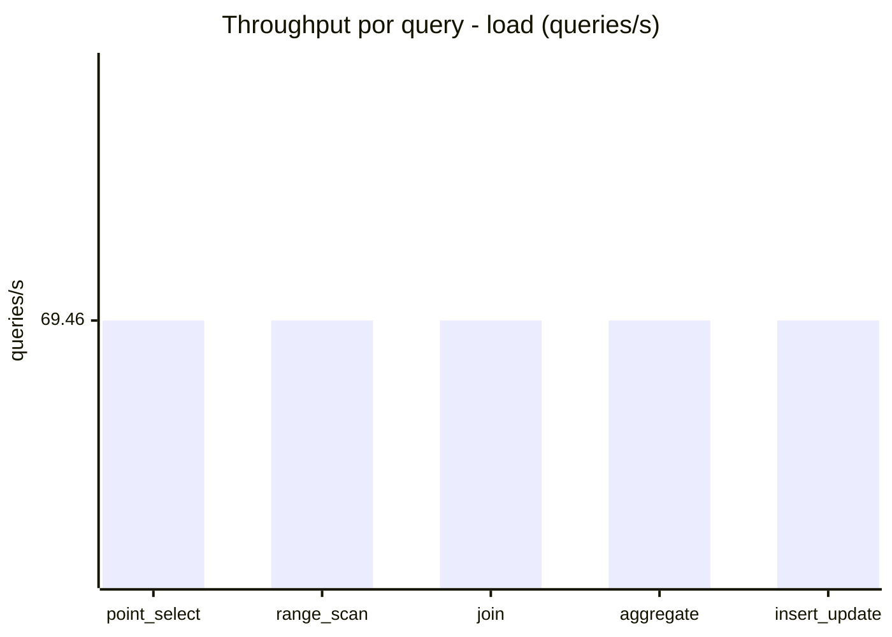
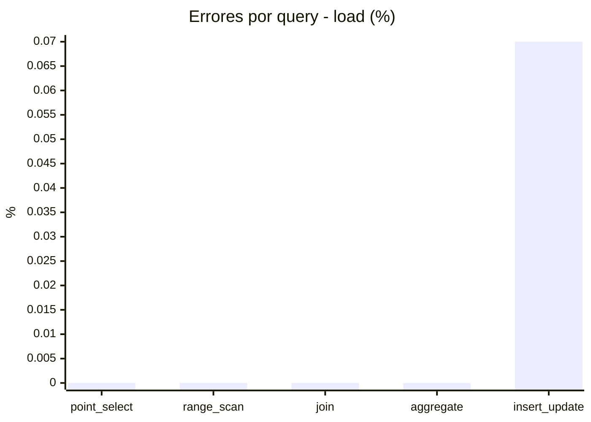
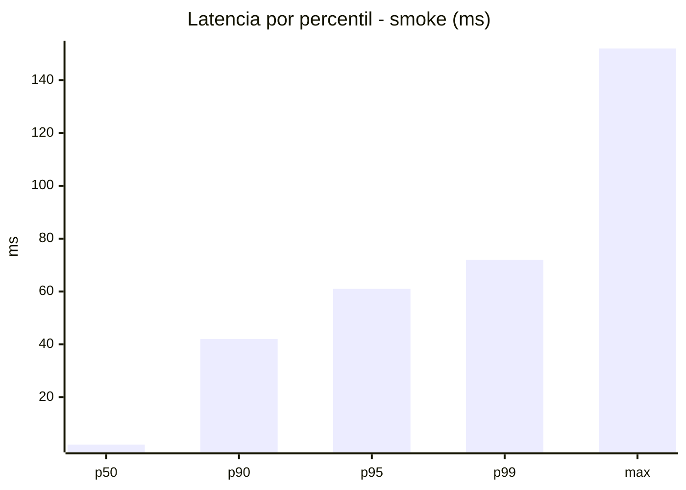
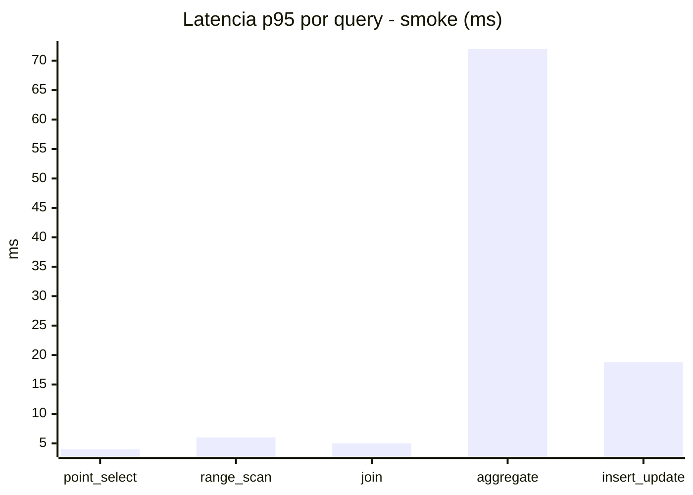
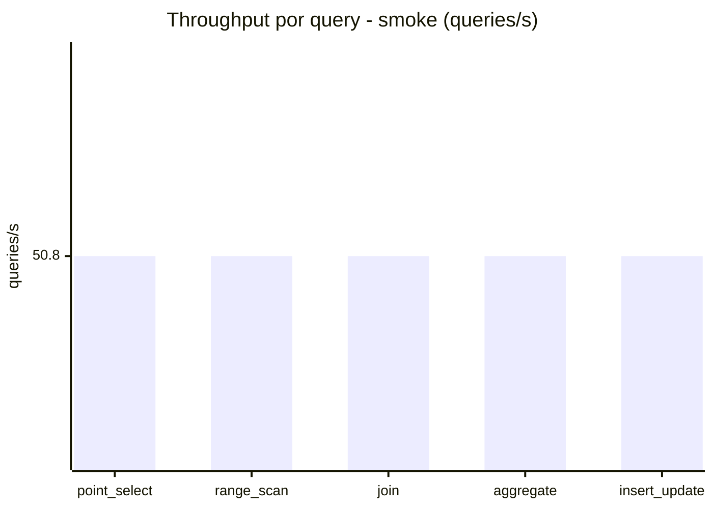
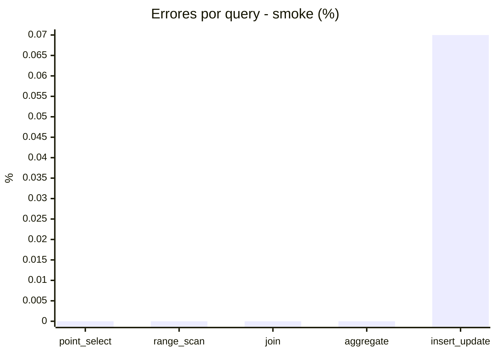

# Reporte de performance - SQL Server (k6)

**Fecha:** 2026-10-15 17:51 UTC  
**Veredicto (SLO):** `WARN`  
**Corrida:** [ver en GitHub Actions](https://github.com/lrbg/k6-sqlserver-lab/actions/runs/38780436935)  

## Analisis del agente de IA

WARN (fallback por umbrales)

- Error maximo: 0.01%
- p95 maximo: 248 ms

## Resultados

### Escenario: `load`

| Metrica | Valor |
| --- | --- |
| Queries ejecutadas | 20905 |
| Errores | 3 (0.01%) |
| Latencia media | 57.5 ms |
| p50 / p90 / p95 / p99 | 17 / 220.6 / 248 / 294 ms |
| Min / Max | 0 / 326 ms |
| Throughput | 347.28 queries/s |
| Duracion | 60.2 s |

Detalle por query

| Query | Ejecuciones | Error % | avg | p95 | p99 | q/s |
| --- | --- | --- | --- | --- | --- | --- |
| point_select | 4181 | 0% | 5.8 | 16 | 20 | 69.46 |
| range_scan | 4181 | 0% | 22.9 | 53 | 74.2 | 69.46 |
| join | 4181 | 0% | 8.4 | 17 | 21 | 69.46 |
| aggregate | 4181 | 0% | 215.7 | 294 | 314 | 69.46 |
| insert_update | 4181 | 0.07% | 34.5 | 73 | 91.2 | 69.46 |

### Escenario: `smoke`

| Metrica | Valor |
| --- | --- |
| Queries ejecutadas | 7630 |
| Errores | 1 (0.01%) |
| Latencia media | 11.8 ms |
| p50 / p90 / p95 / p99 | 2 / 42 / 61 / 72 ms |
| Min / Max | 0 / 152 ms |
| Throughput | 254 queries/s |
| Duracion | 30 s |

Detalle por query

| Query | Ejecuciones | Error % | avg | p95 | p99 | q/s |
| --- | --- | --- | --- | --- | --- | --- |
| point_select | 1526 | 0% | 0.9 | 4 | 5 | 50.8 |
| range_scan | 1526 | 0% | 3.1 | 6 | 11 | 50.8 |
| join | 1526 | 0% | 1.6 | 5 | 5 | 50.8 |
| aggregate | 1526 | 0% | 47.8 | 72 | 77 | 50.8 |
| insert_update | 1526 | 0.07% | 5.5 | 18.8 | 24.8 | 50.8 |

