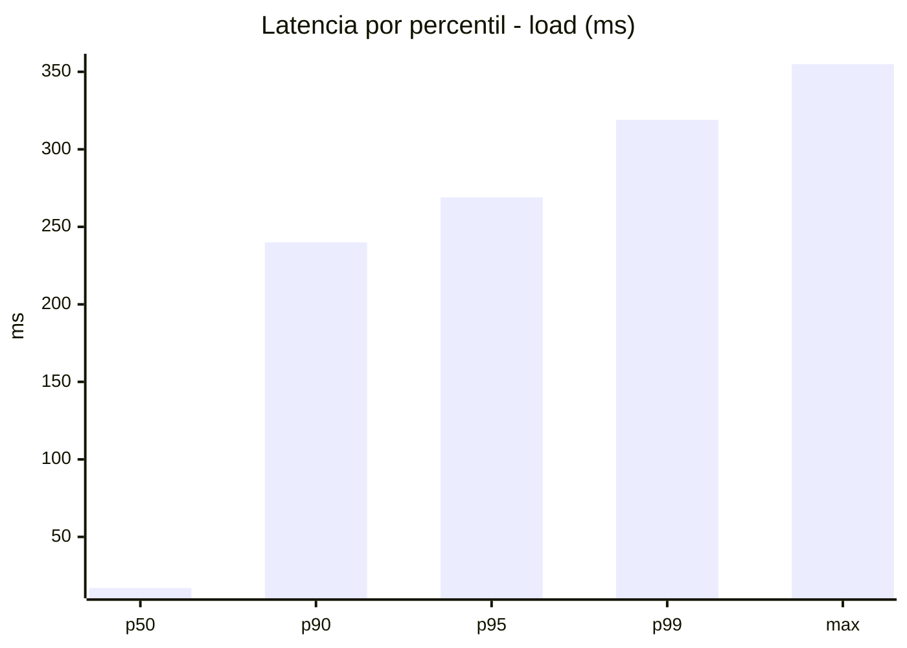
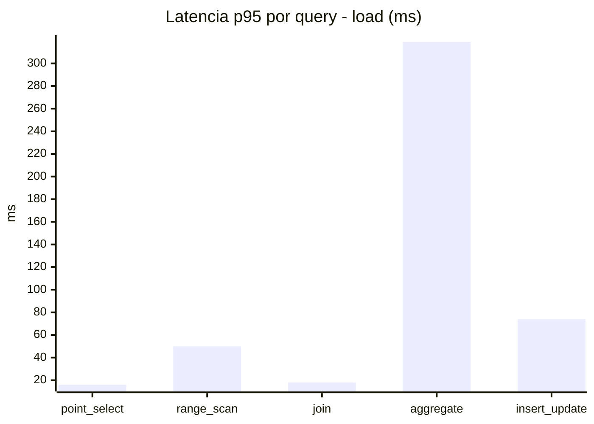
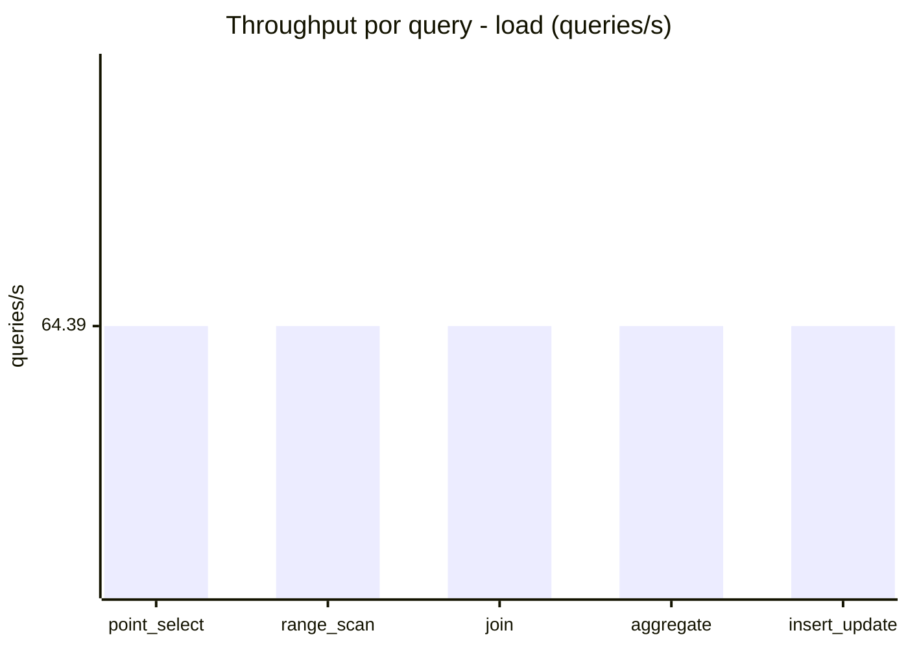
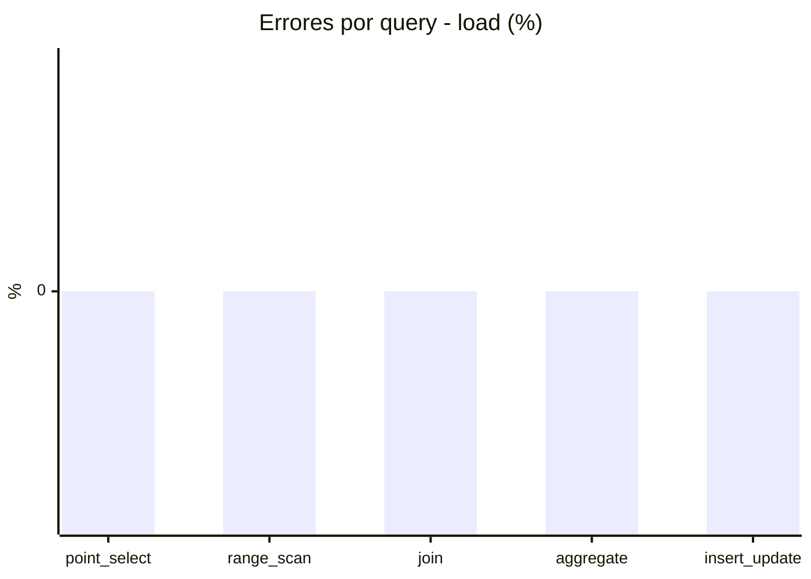
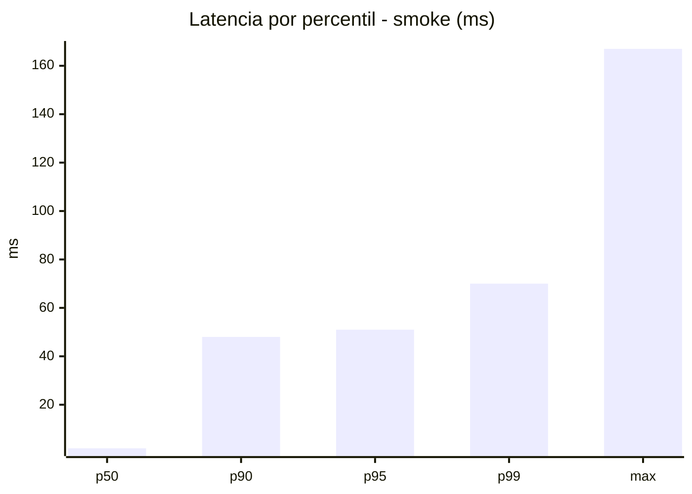
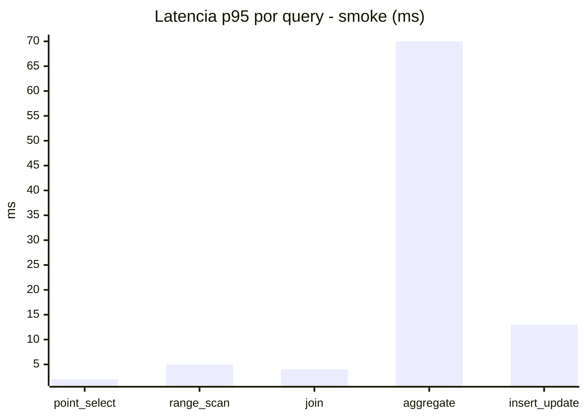
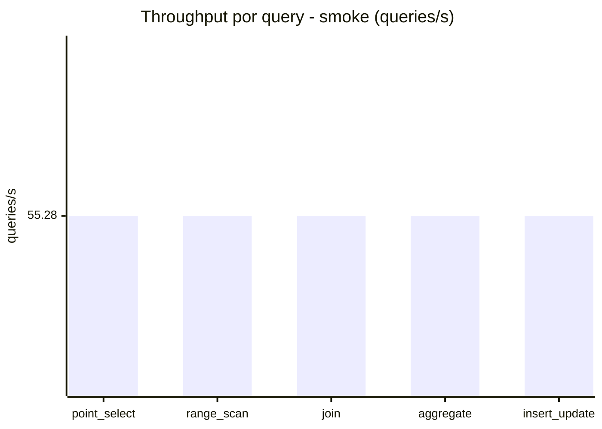
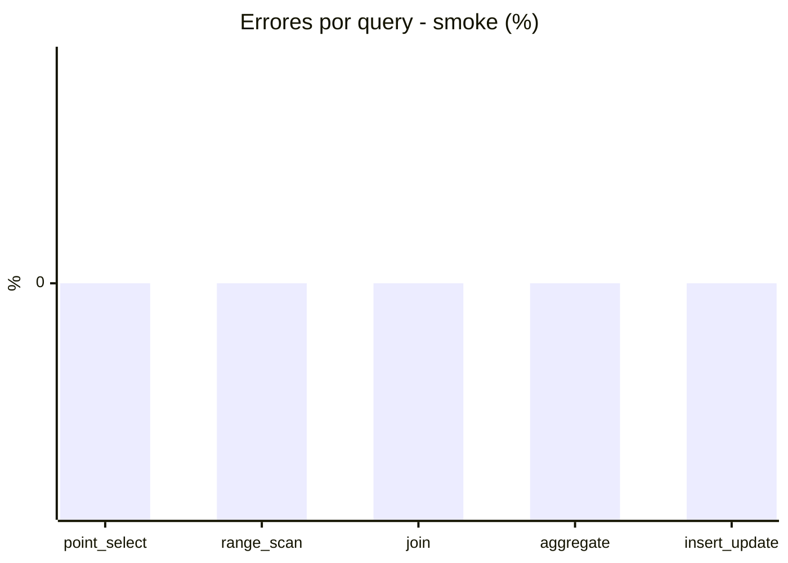

# Reporte de performance - SQL Server (k6)

**Fecha:** 2026-10-16 17:34 UTC  
**Veredicto (SLO):** `WARN`  
**Corrida:** [ver en GitHub Actions](https://github.com/lrbg/k6-sqlserver-lab/actions/runs/38940496645)  

## Analisis del agente de IA

WARN (fallback por umbrales)

- Error maximo: 0%
- p95 maximo: 269 ms

## Resultados

### Escenario: `load`

| Metrica | Valor |
| --- | --- |
| Queries ejecutadas | 19380 |
| Errores | 0 (0%) |
| Latencia media | 62 ms |
| p50 / p90 / p95 / p99 | 17 / 240 / 269 / 319 ms |
| Min / Max | 0 / 355 ms |
| Throughput | 321.94 queries/s |
| Duracion | 60.2 s |

Detalle por query

| Query | Ejecuciones | Error % | avg | p95 | p99 | q/s |
| --- | --- | --- | --- | --- | --- | --- |
| point_select | 3876 | 0% | 6.4 | 16 | 20 | 64.39 |
| range_scan | 3876 | 0% | 22.5 | 50 | 72.3 | 64.39 |
| join | 3876 | 0% | 9 | 18 | 21 | 64.39 |
| aggregate | 3876 | 0% | 237.9 | 319 | 334.3 | 64.39 |
| insert_update | 3876 | 0% | 34.3 | 74 | 94 | 64.39 |

### Escenario: `smoke`

| Metrica | Valor |
| --- | --- |
| Queries ejecutadas | 8300 |
| Errores | 0 (0%) |
| Latencia media | 10.8 ms |
| p50 / p90 / p95 / p99 | 2 / 48 / 51 / 70 ms |
| Min / Max | 0 / 167 ms |
| Throughput | 276.38 queries/s |
| Duracion | 30 s |

Detalle por query

| Query | Ejecuciones | Error % | avg | p95 | p99 | q/s |
| --- | --- | --- | --- | --- | --- | --- |
| point_select | 1660 | 0% | 0.8 | 2 | 5 | 55.28 |
| range_scan | 1660 | 0% | 3 | 5 | 10 | 55.28 |
| join | 1660 | 0% | 1.2 | 4 | 5 | 55.28 |
| aggregate | 1660 | 0% | 45 | 70 | 78.4 | 55.28 |
| insert_update | 1660 | 0% | 4 | 13 | 23.4 | 55.28 |

