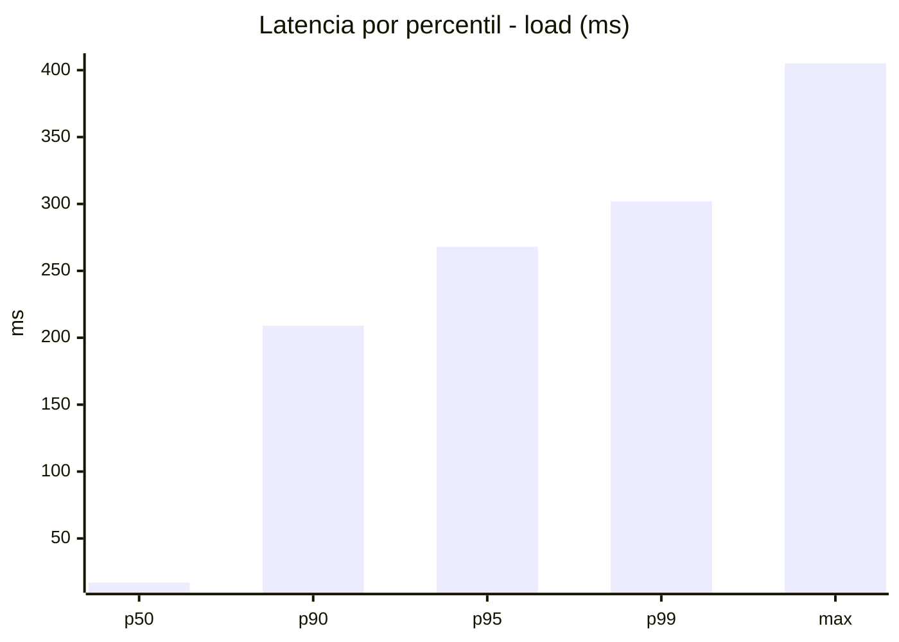
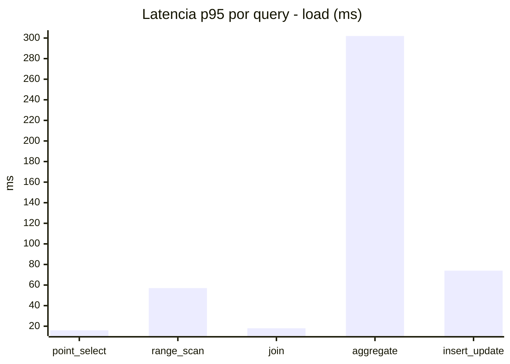
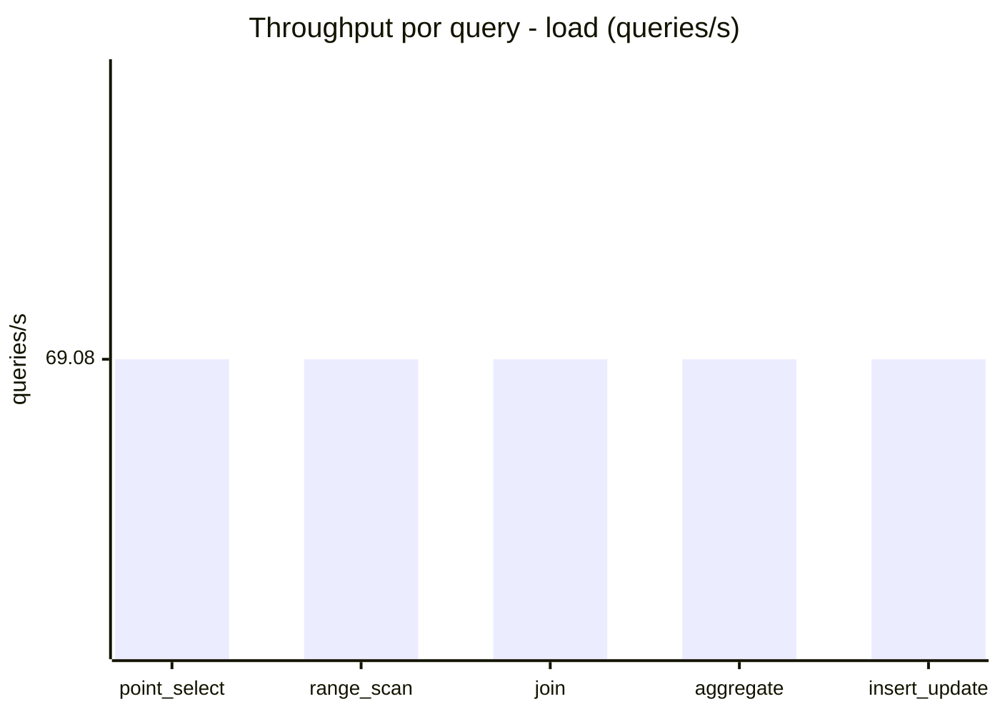
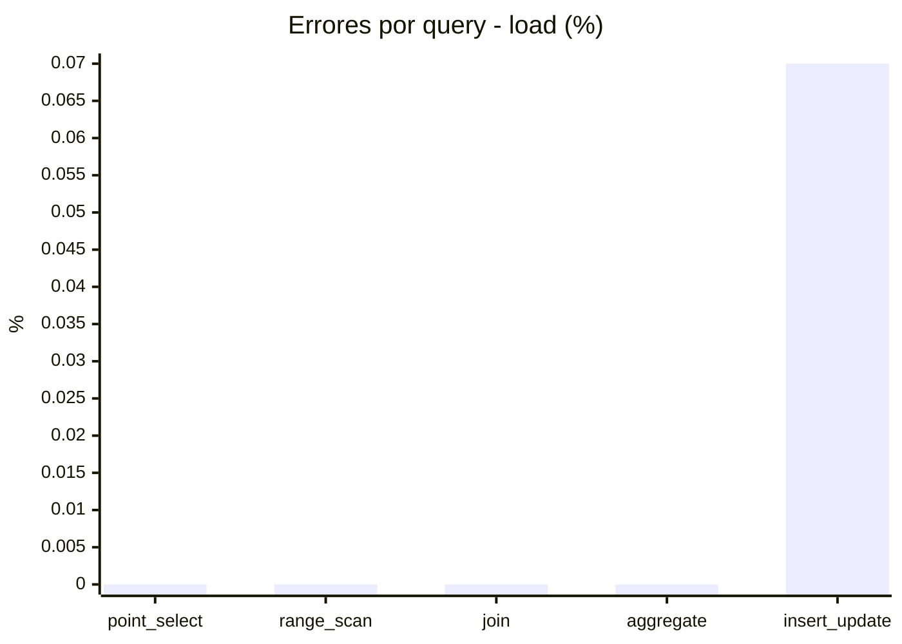
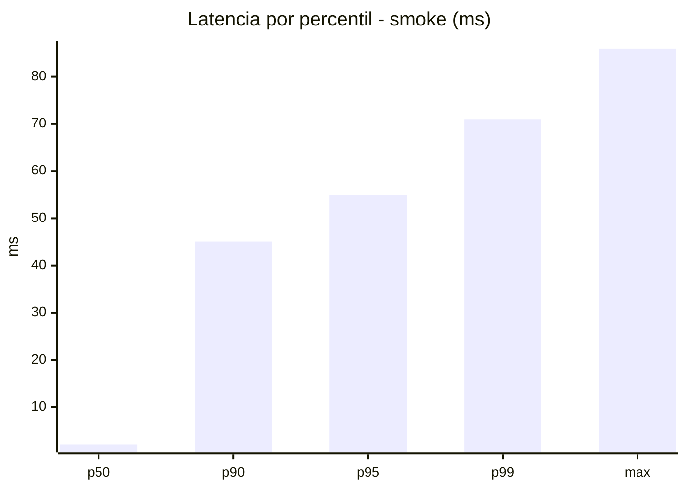
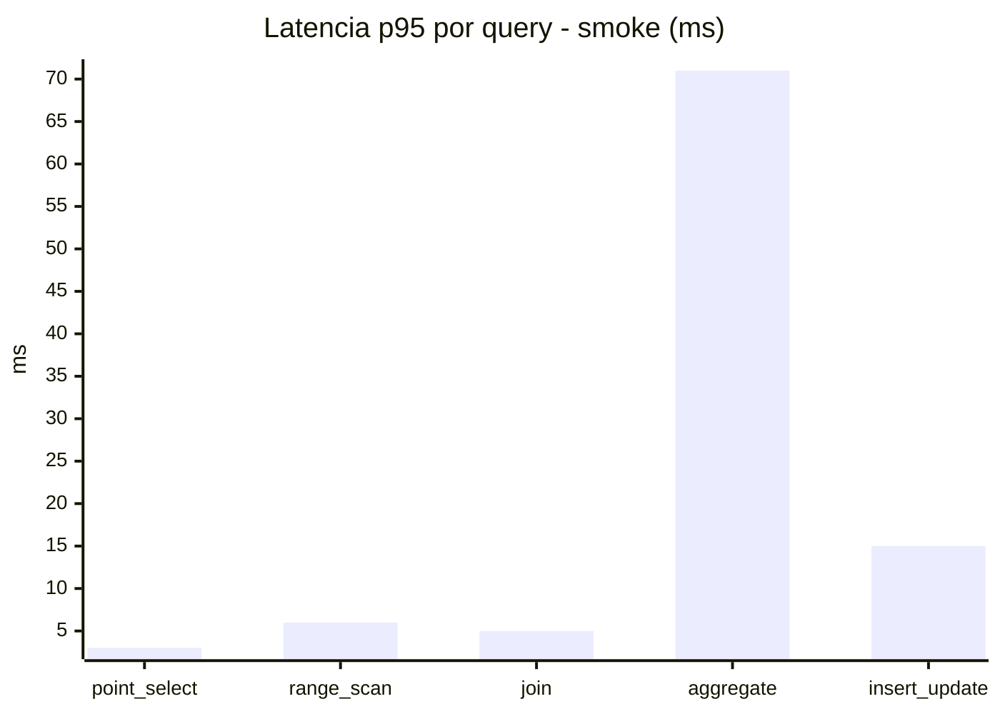
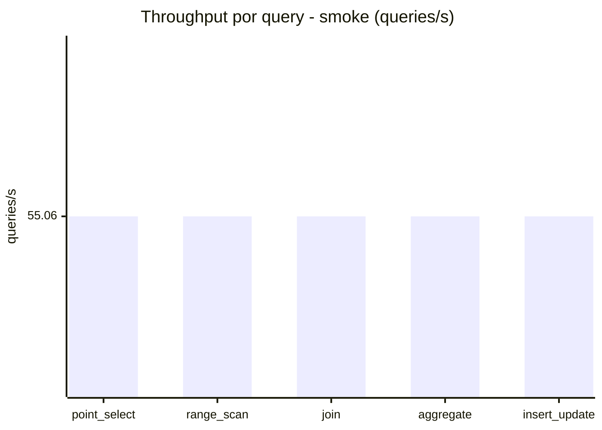
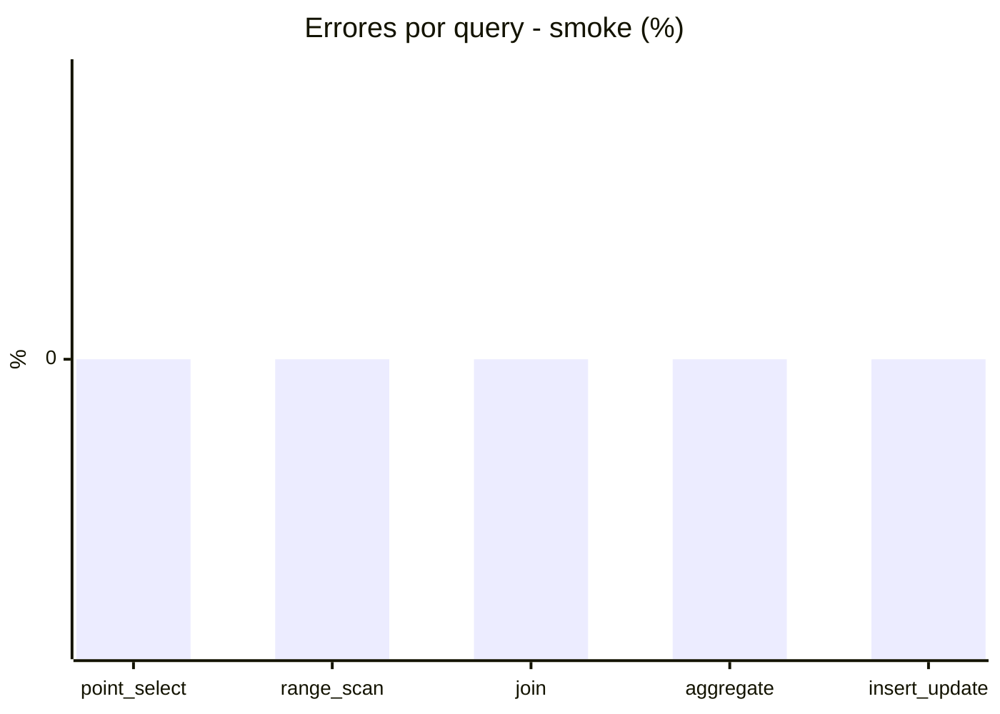

# Reporte de performance - SQL Server (k6)

**Fecha:** 2026-10-17 16:33 UTC  
**Veredicto (SLO):** `WARN`  
**Corrida:** [ver en GitHub Actions](https://github.com/lrbg/k6-sqlserver-lab/actions/runs/39049779959)  

## Analisis del agente de IA

WARN (fallback por umbrales)

- Error maximo: 0.01%
- p95 maximo: 268 ms

## Resultados

### Escenario: `load`

| Metrica | Valor |
| --- | --- |
| Queries ejecutadas | 20765 |
| Errores | 3 (0.01%) |
| Latencia media | 57.8 ms |
| p50 / p90 / p95 / p99 | 17 / 209 / 268 / 302 ms |
| Min / Max | 0 / 405 ms |
| Throughput | 345.4 queries/s |
| Duracion | 60.1 s |

Detalle por query

| Query | Ejecuciones | Error % | avg | p95 | p99 | q/s |
| --- | --- | --- | --- | --- | --- | --- |
| point_select | 4153 | 0% | 5.4 | 16 | 20 | 69.08 |
| range_scan | 4153 | 0% | 23.7 | 57 | 76.5 | 69.08 |
| join | 4153 | 0% | 8.2 | 18 | 21 | 69.08 |
| aggregate | 4153 | 0% | 217.3 | 302 | 318 | 69.08 |
| insert_update | 4153 | 0.07% | 34.6 | 74 | 93.5 | 69.08 |

### Escenario: `smoke`

| Metrica | Valor |
| --- | --- |
| Queries ejecutadas | 8270 |
| Errores | 0 (0%) |
| Latencia media | 10.9 ms |
| p50 / p90 / p95 / p99 | 2 / 45.1 / 55 / 71 ms |
| Min / Max | 0 / 86 ms |
| Throughput | 275.28 queries/s |
| Duracion | 30 s |

Detalle por query

| Query | Ejecuciones | Error % | avg | p95 | p99 | q/s |
| --- | --- | --- | --- | --- | --- | --- |
| point_select | 1654 | 0% | 0.7 | 3 | 4 | 55.06 |
| range_scan | 1654 | 0% | 2.9 | 6 | 10 | 55.06 |
| join | 1654 | 0% | 1.4 | 5 | 5 | 55.06 |
| aggregate | 1654 | 0% | 45.1 | 71 | 77 | 55.06 |
| insert_update | 1654 | 0% | 4.3 | 15 | 23 | 55.06 |

