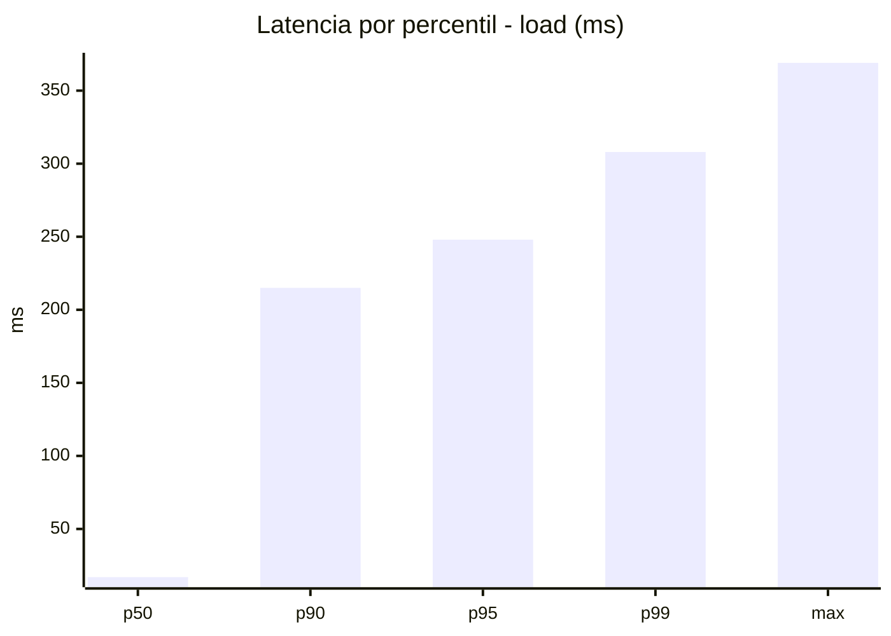
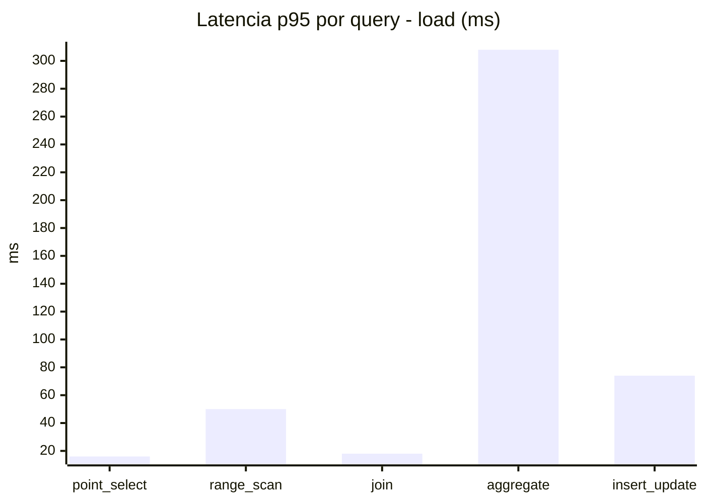
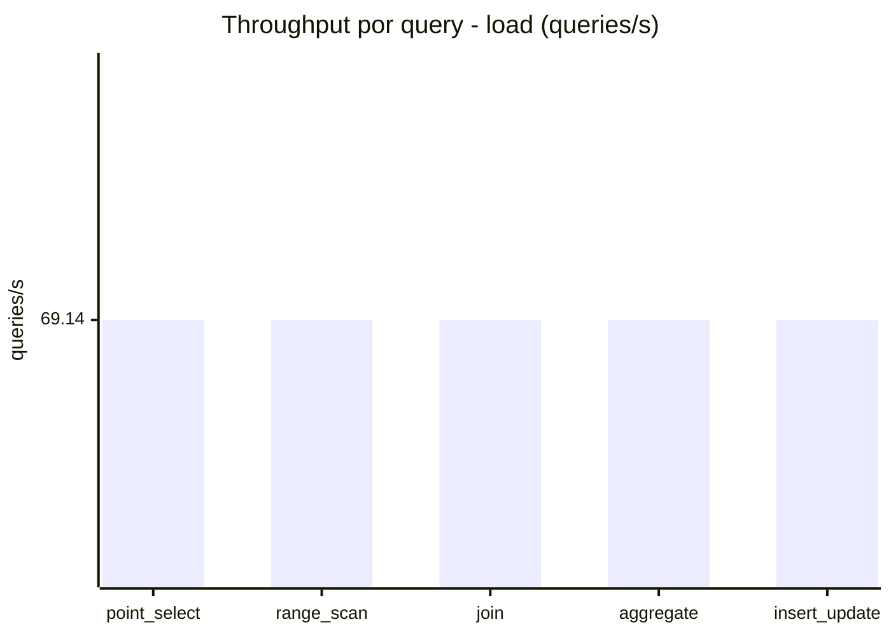
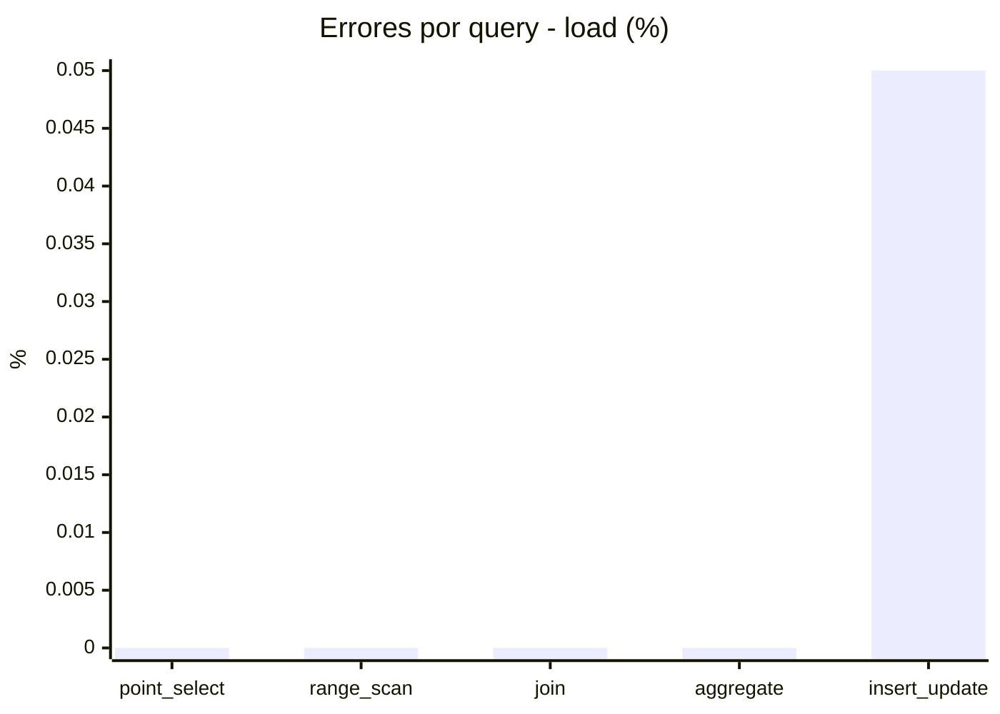
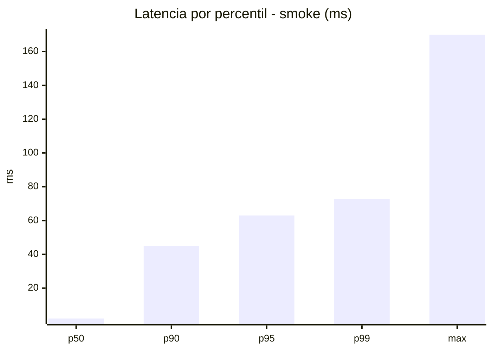
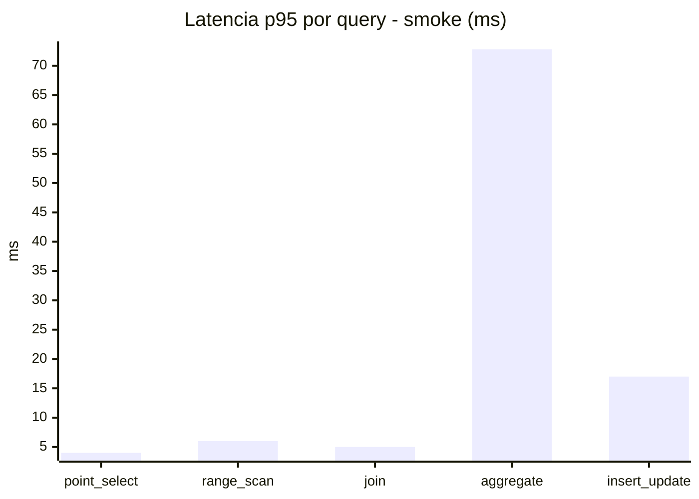
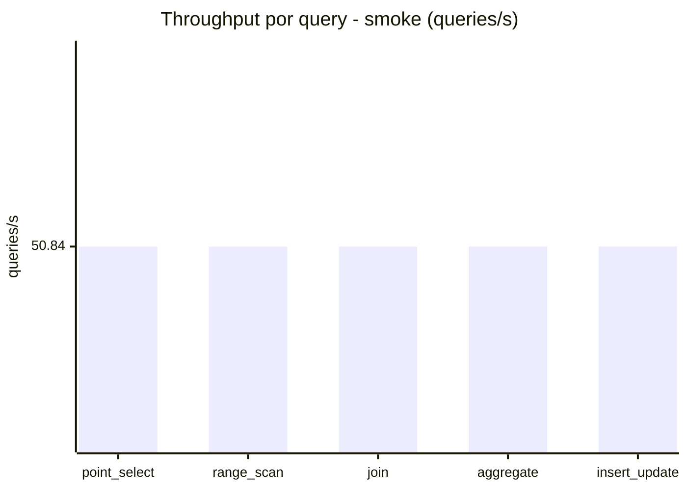
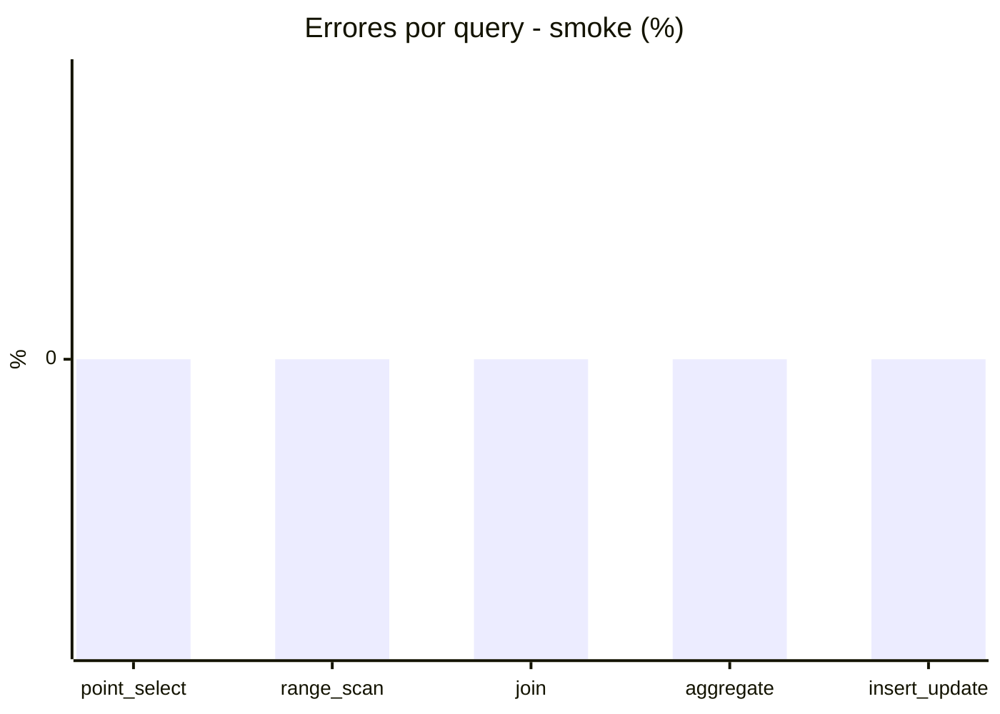

# Reporte de performance - SQL Server (k6)

**Fecha:** 2026-10-18 16:39 UTC  
**Veredicto (SLO):** `WARN`  
**Corrida:** [ver en GitHub Actions](https://github.com/lrbg/k6-sqlserver-lab/actions/runs/39145844815)  

## Analisis del agente de IA

WARN (fallback por umbrales)

- Error maximo: 0.01%
- p95 maximo: 248 ms

## Resultados

### Escenario: `load`

| Metrica | Valor |
| --- | --- |
| Queries ejecutadas | 20800 |
| Errores | 2 (0.01%) |
| Latencia media | 57.8 ms |
| p50 / p90 / p95 / p99 | 17 / 215 / 248 / 308 ms |
| Min / Max | 0 / 369 ms |
| Throughput | 345.72 queries/s |
| Duracion | 60.2 s |

Detalle por query

| Query | Ejecuciones | Error % | avg | p95 | p99 | q/s |
| --- | --- | --- | --- | --- | --- | --- |
| point_select | 4160 | 0% | 6.1 | 16 | 21 | 69.14 |
| range_scan | 4160 | 0% | 22.3 | 50 | 69 | 69.14 |
| join | 4160 | 0% | 8.6 | 18 | 22 | 69.14 |
| aggregate | 4160 | 0% | 217.2 | 308 | 346 | 69.14 |
| insert_update | 4160 | 0.05% | 34.5 | 74 | 97 | 69.14 |

### Escenario: `smoke`

| Metrica | Valor |
| --- | --- |
| Queries ejecutadas | 7630 |
| Errores | 0 (0%) |
| Latencia media | 11.8 ms |
| p50 / p90 / p95 / p99 | 2 / 45 / 63 / 72.7 ms |
| Min / Max | 0 / 170 ms |
| Throughput | 254.2 queries/s |
| Duracion | 30 s |

Detalle por query

| Query | Ejecuciones | Error % | avg | p95 | p99 | q/s |
| --- | --- | --- | --- | --- | --- | --- |
| point_select | 1526 | 0% | 0.9 | 4 | 4 | 50.84 |
| range_scan | 1526 | 0% | 2.9 | 6 | 7 | 50.84 |
| join | 1526 | 0% | 1.6 | 5 | 5 | 50.84 |
| aggregate | 1526 | 0% | 48.7 | 72.8 | 78 | 50.84 |
| insert_update | 1526 | 0% | 4.8 | 17 | 24 | 50.84 |

