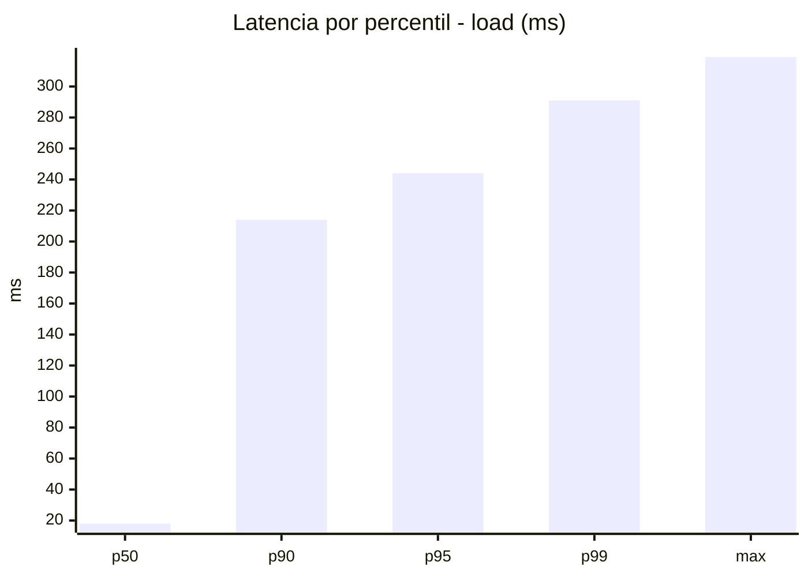
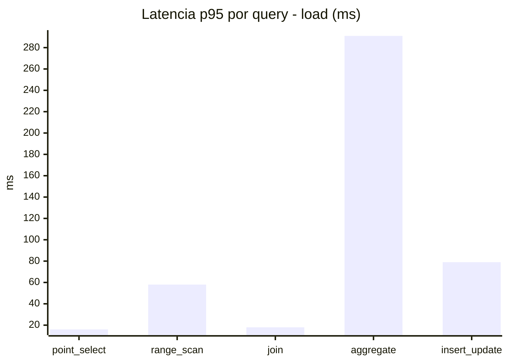
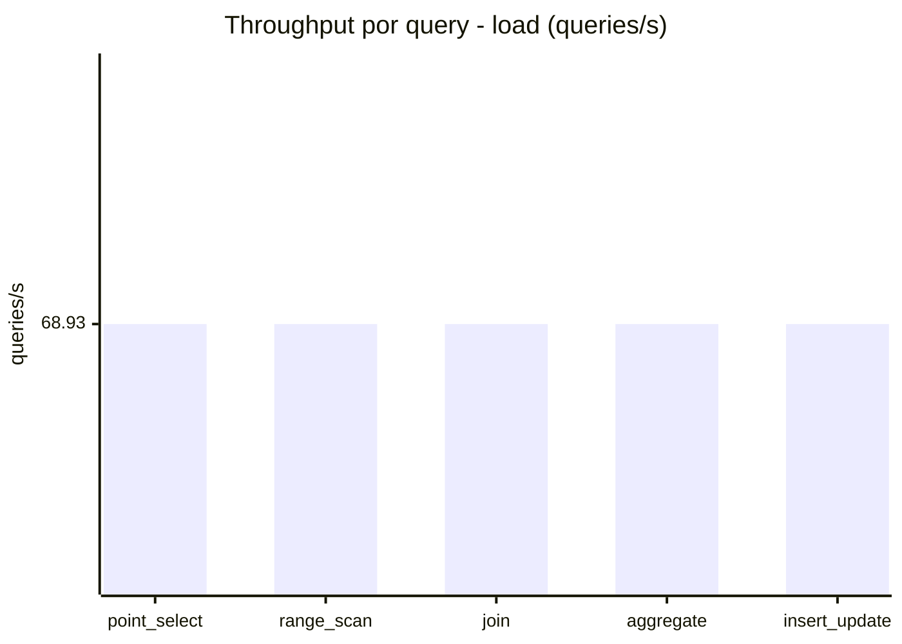
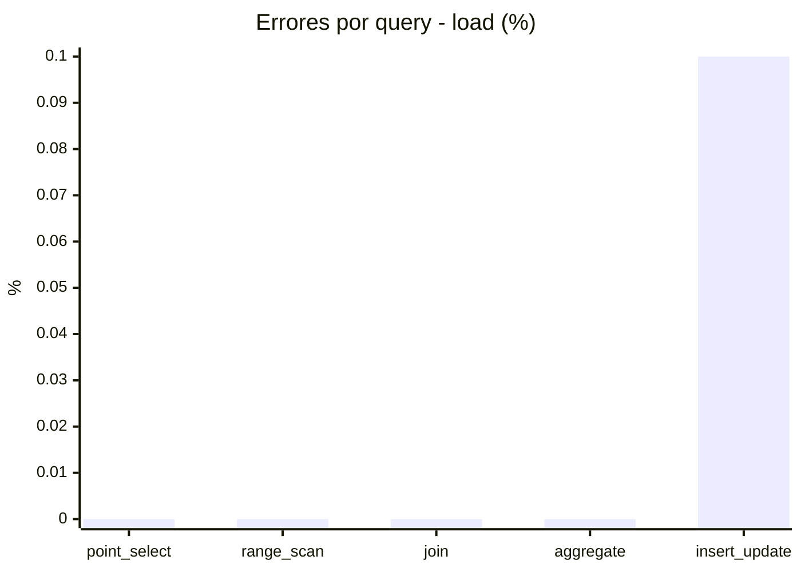
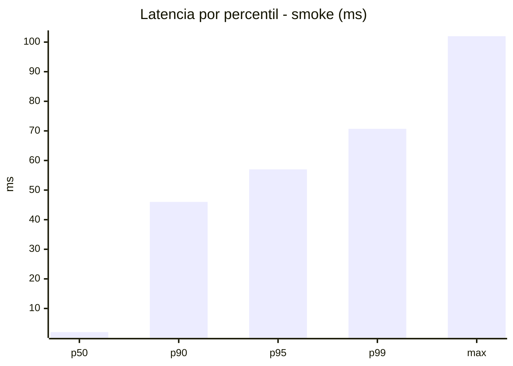
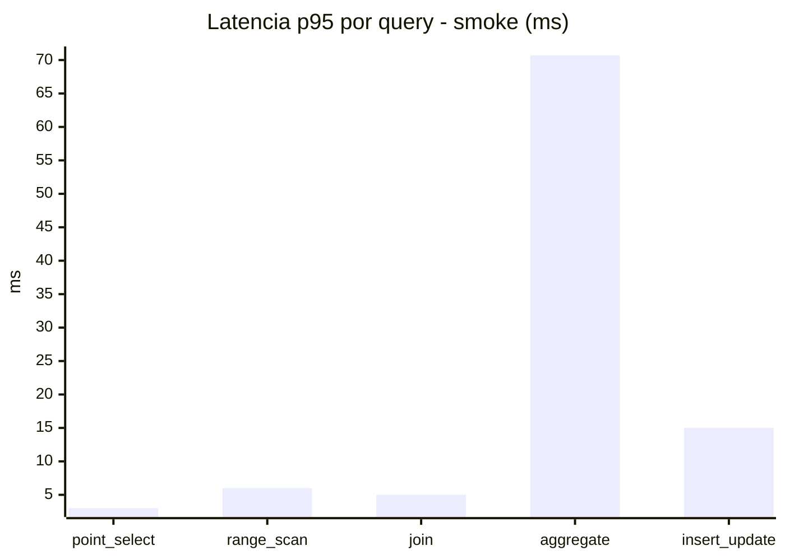
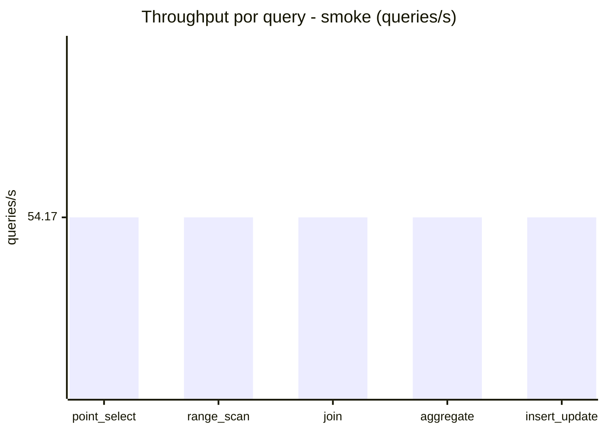
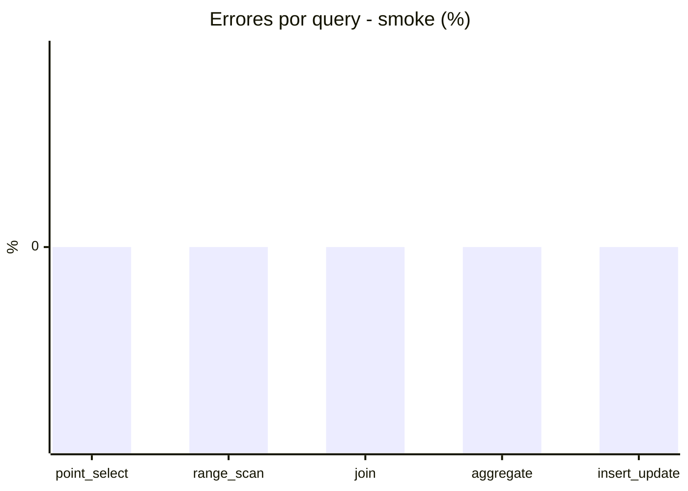

# Reporte de performance - SQL Server (k6)

**Fecha:** 2026-10-19 19:24 UTC  
**Veredicto (SLO):** `WARN`  
**Corrida:** [ver en GitHub Actions](https://github.com/lrbg/k6-sqlserver-lab/actions/runs/39310493164)  

## Analisis del agente de IA

WARN (fallback por umbrales)

- Error maximo: 0.02%
- p95 maximo: 244 ms

## Resultados

### Escenario: `load`

| Metrica | Valor |
| --- | --- |
| Queries ejecutadas | 20755 |
| Errores | 4 (0.02%) |
| Latencia media | 58 ms |
| p50 / p90 / p95 / p99 | 18 / 214 / 244 / 291 ms |
| Min / Max | 0 / 319 ms |
| Throughput | 344.65 queries/s |
| Duracion | 60.2 s |

Detalle por query

| Query | Ejecuciones | Error % | avg | p95 | p99 | q/s |
| --- | --- | --- | --- | --- | --- | --- |
| point_select | 4151 | 0% | 6.1 | 16 | 21 | 68.93 |
| range_scan | 4151 | 0% | 25.9 | 58 | 79 | 68.93 |
| join | 4151 | 0% | 8.4 | 18 | 21 | 68.93 |
| aggregate | 4151 | 0% | 211.6 | 291 | 304.5 | 68.93 |
| insert_update | 4151 | 0.1% | 37.8 | 79 | 101 | 68.93 |

### Escenario: `smoke`

| Metrica | Valor |
| --- | --- |
| Queries ejecutadas | 8135 |
| Errores | 0 (0%) |
| Latencia media | 11 ms |
| p50 / p90 / p95 / p99 | 2 / 46 / 57 / 70.7 ms |
| Min / Max | 0 / 102 ms |
| Throughput | 270.86 queries/s |
| Duracion | 30 s |

Detalle por query

| Query | Ejecuciones | Error % | avg | p95 | p99 | q/s |
| --- | --- | --- | --- | --- | --- | --- |
| point_select | 1627 | 0% | 0.8 | 3 | 5 | 54.17 |
| range_scan | 1627 | 0% | 3 | 6 | 11 | 54.17 |
| join | 1627 | 0% | 1.4 | 5 | 5 | 54.17 |
| aggregate | 1627 | 0% | 45.3 | 70.7 | 78 | 54.17 |
| insert_update | 1627 | 0% | 4.7 | 15 | 23 | 54.17 |

