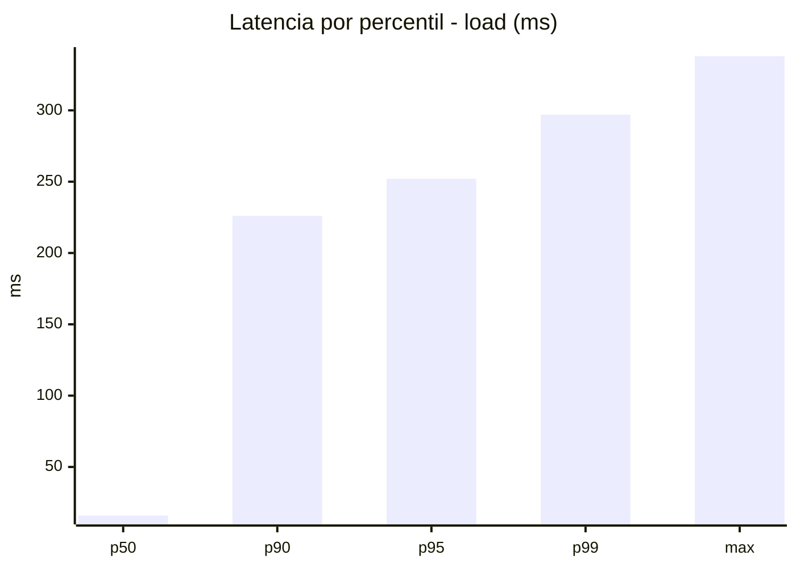
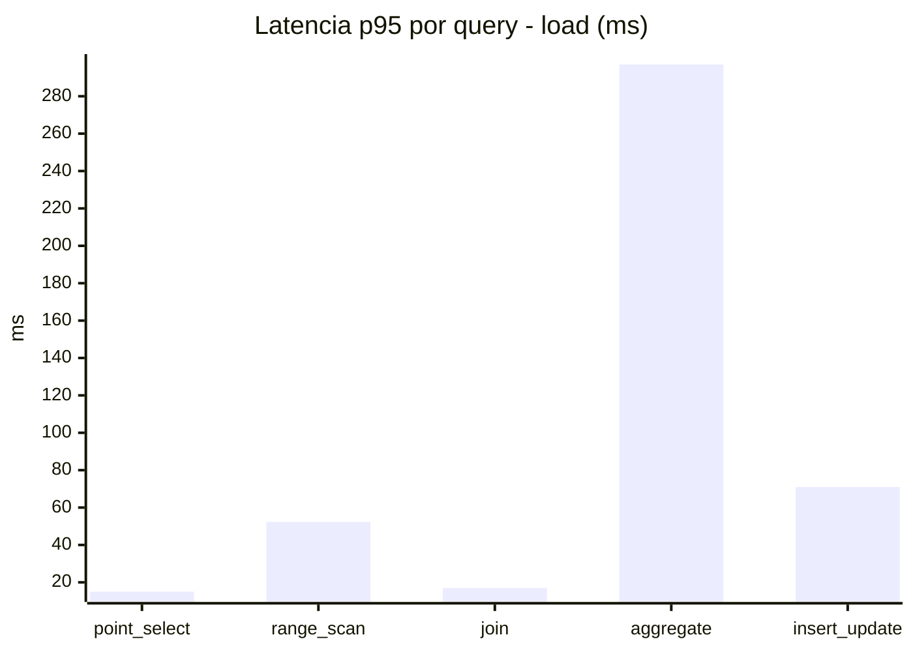
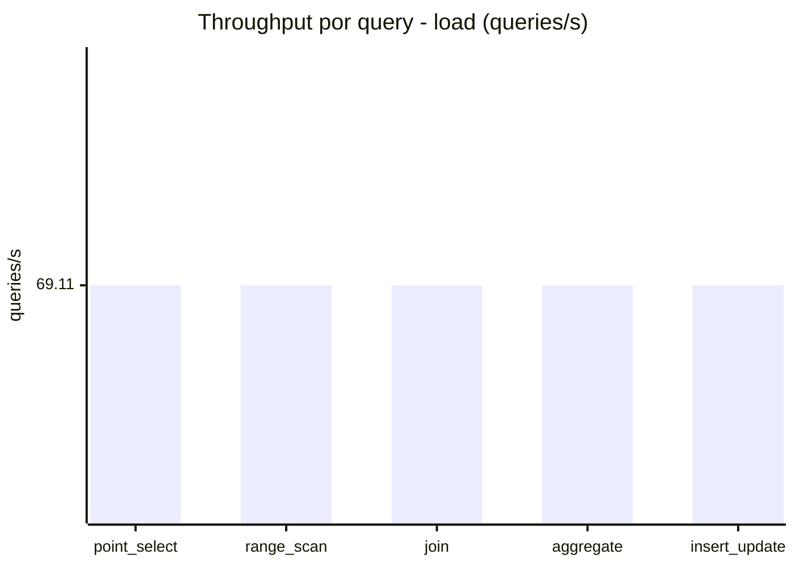
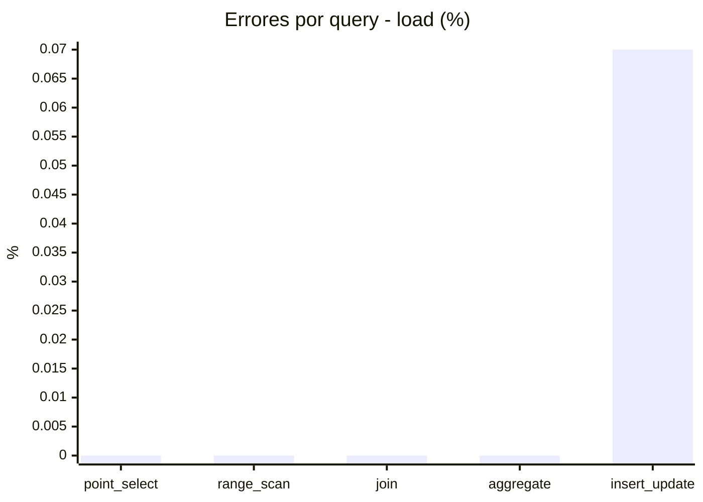
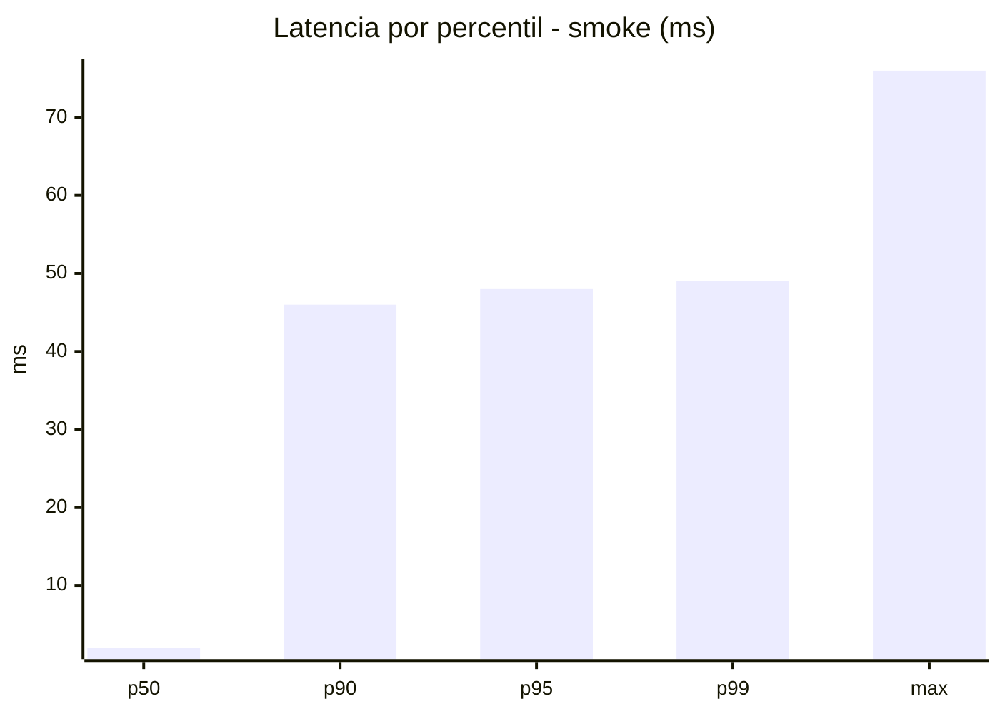
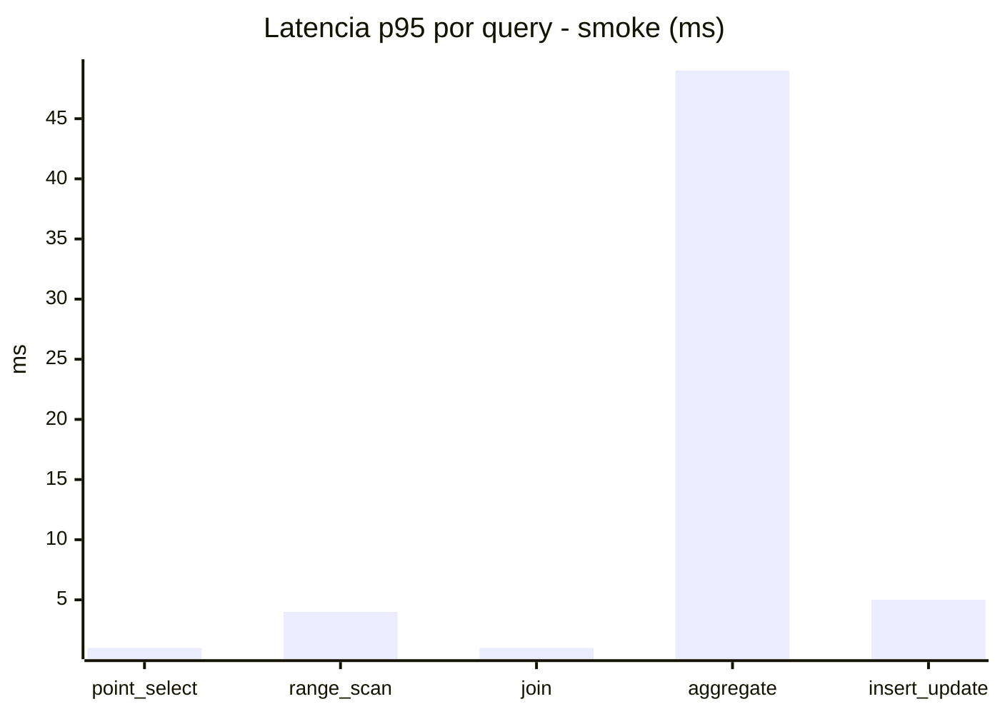
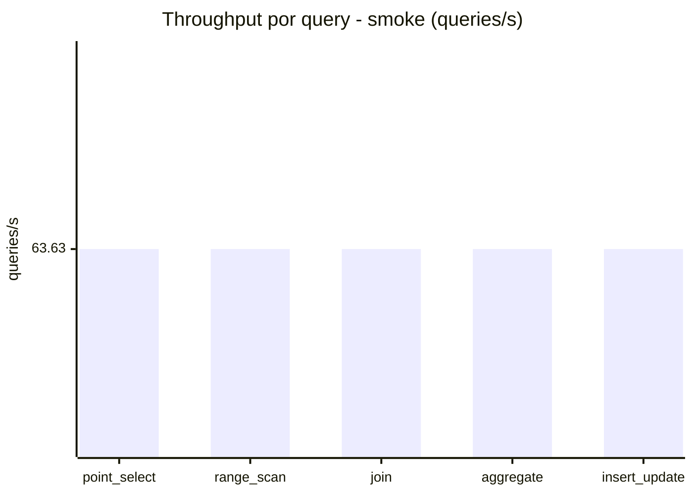
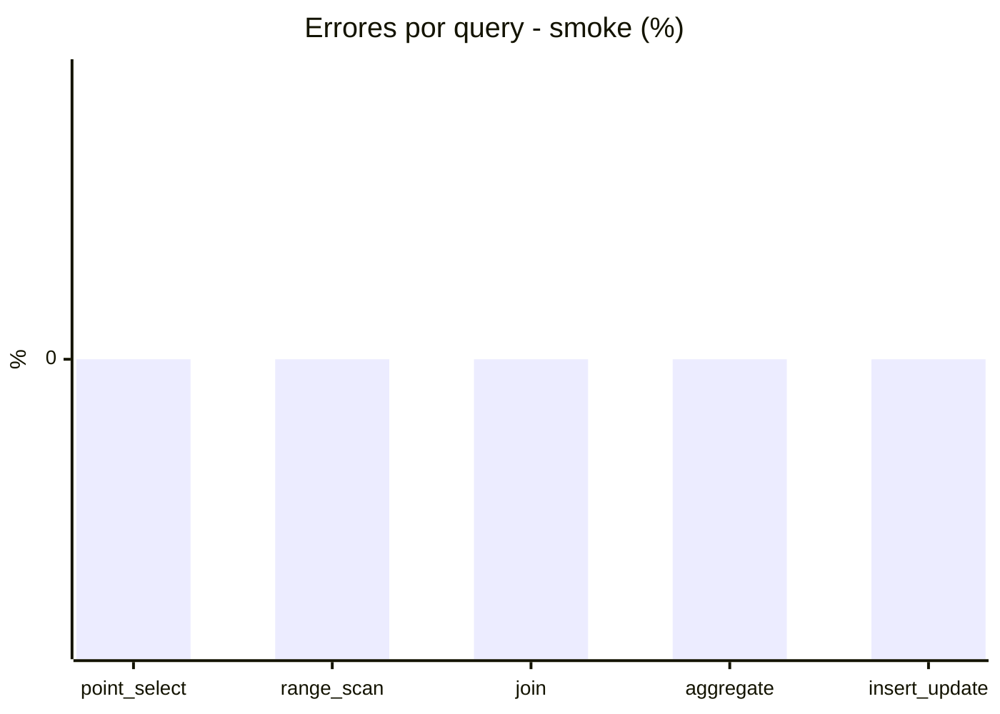

# Reporte de performance - SQL Server (k6)

**Fecha:** 2026-10-20 18:04 UTC  
**Veredicto (SLO):** `WARN`  
**Corrida:** [ver en GitHub Actions](https://github.com/lrbg/k6-sqlserver-lab/actions/runs/39471244169)  

## Analisis del agente de IA

WARN (fallback por umbrales)

- Error maximo: 0.01%
- p95 maximo: 252 ms

## Resultados

### Escenario: `load`

| Metrica | Valor |
| --- | --- |
| Queries ejecutadas | 20770 |
| Errores | 3 (0.01%) |
| Latencia media | 57.8 ms |
| p50 / p90 / p95 / p99 | 16 / 226 / 252 / 297 ms |
| Min / Max | 0 / 338 ms |
| Throughput | 345.56 queries/s |
| Duracion | 60.1 s |

Detalle por query

| Query | Ejecuciones | Error % | avg | p95 | p99 | q/s |
| --- | --- | --- | --- | --- | --- | --- |
| point_select | 4154 | 0% | 5.4 | 15 | 20 | 69.11 |
| range_scan | 4154 | 0% | 22 | 52.3 | 74.5 | 69.11 |
| join | 4154 | 0% | 8.3 | 17 | 21 | 69.11 |
| aggregate | 4154 | 0% | 220.9 | 297 | 315.5 | 69.11 |
| insert_update | 4154 | 0.07% | 32.4 | 71 | 90.5 | 69.11 |

### Escenario: `smoke`

| Metrica | Valor |
| --- | --- |
| Queries ejecutadas | 9555 |
| Errores | 0 (0%) |
| Latencia media | 9.4 ms |
| p50 / p90 / p95 / p99 | 2 / 46 / 48 / 49 ms |
| Min / Max | 0 / 76 ms |
| Throughput | 318.13 queries/s |
| Duracion | 30 s |

Detalle por query

| Query | Ejecuciones | Error % | avg | p95 | p99 | q/s |
| --- | --- | --- | --- | --- | --- | --- |
| point_select | 1911 | 0% | 0.5 | 1 | 2 | 63.63 |
| range_scan | 1911 | 0% | 2.7 | 4 | 5 | 63.63 |
| join | 1911 | 0% | 0.9 | 1 | 3 | 63.63 |
| aggregate | 1911 | 0% | 40 | 49 | 50.9 | 63.63 |
| insert_update | 1911 | 0% | 2.8 | 5 | 7 | 63.63 |

