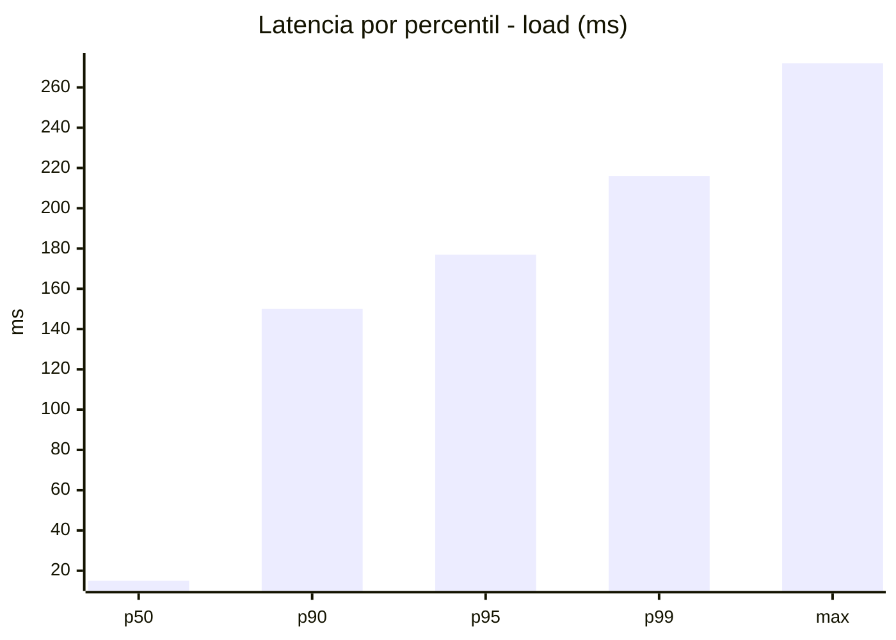
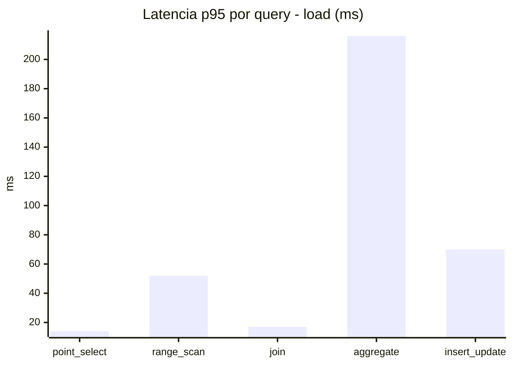
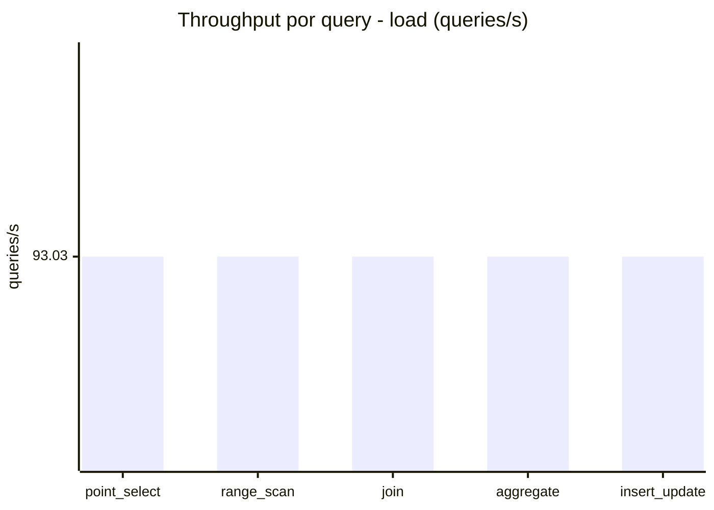
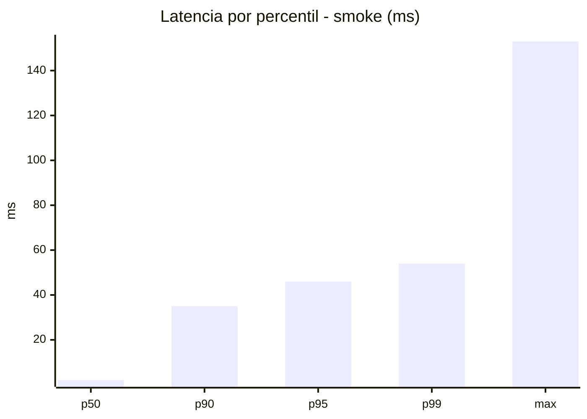
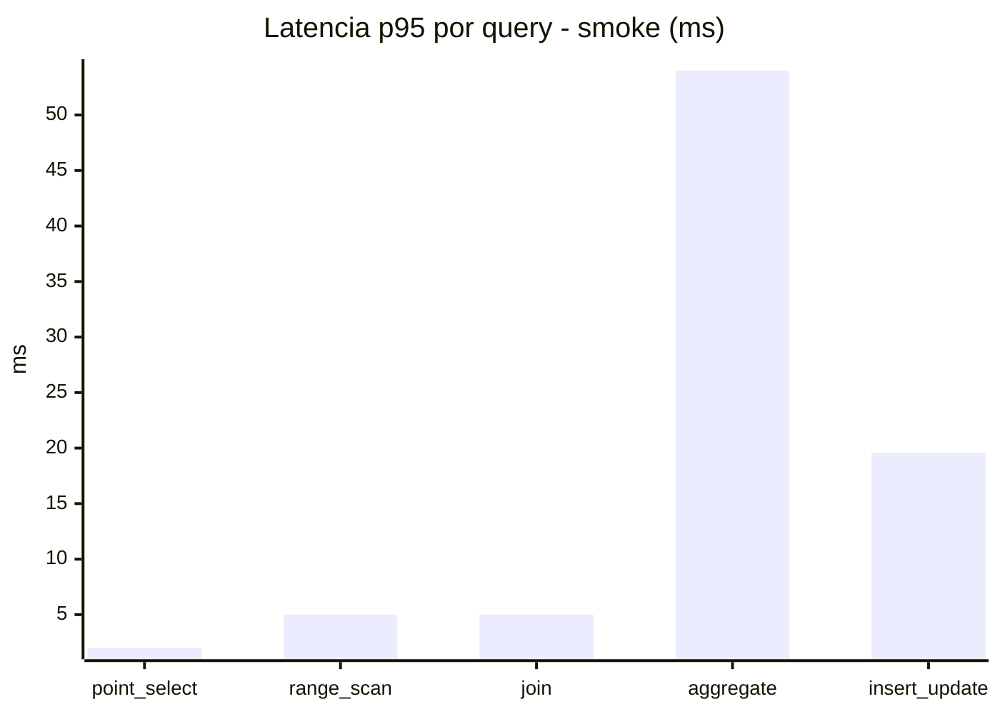
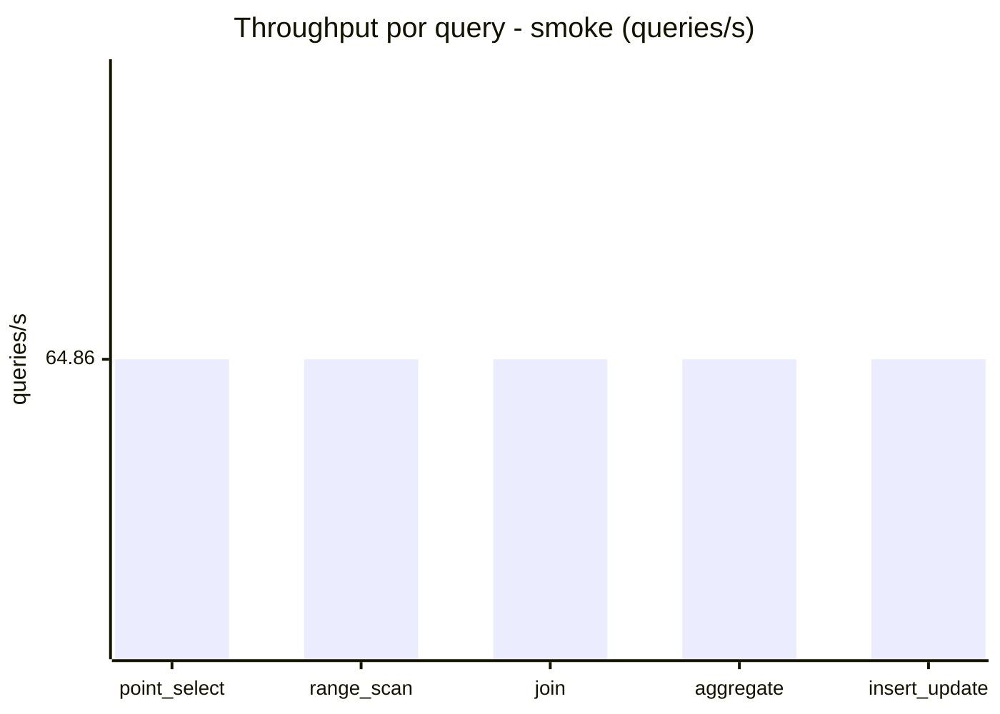
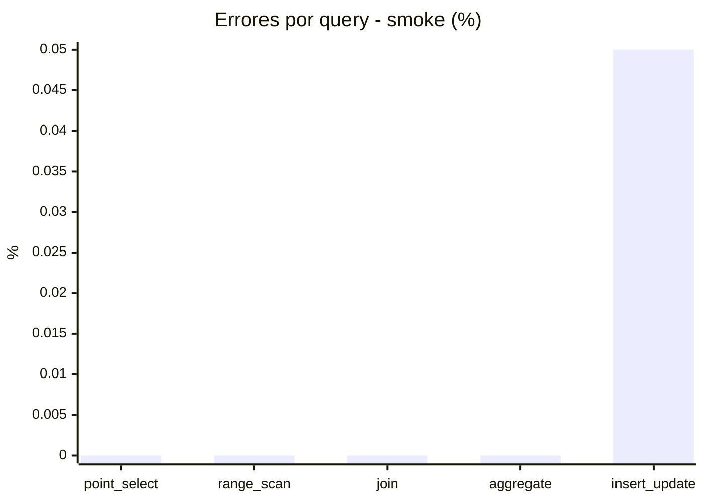

# Reporte de performance - SQL Server (k6)

**Fecha:** 2026-10-21 18:10 UTC  
**Veredicto (SLO):** `PASS`  
**Corrida:** [ver en GitHub Actions](https://github.com/lrbg/k6-sqlserver-lab/actions/runs/39649979139)  

## Analisis del agente de IA

PASS (fallback por umbrales)

- Error maximo: 0.01%
- p95 maximo: 177 ms

## Resultados

### Escenario: `load`

| Metrica | Valor |
| --- | --- |
| Queries ejecutadas | 27920 |
| Errores | 3 (0.01%) |
| Latencia media | 43 ms |
| p50 / p90 / p95 / p99 | 15 / 150 / 177 / 216 ms |
| Min / Max | 0 / 272 ms |
| Throughput | 465.15 queries/s |
| Duracion | 60 s |

Detalle por query

| Query | Ejecuciones | Error % | avg | p95 | p99 | q/s |
| --- | --- | --- | --- | --- | --- | --- |
| point_select | 5584 | 0% | 4.8 | 14 | 20 | 93.03 |
| range_scan | 5584 | 0% | 22.1 | 52 | 69 | 93.03 |
| join | 5584 | 0% | 7.3 | 17 | 22 | 93.03 |
| aggregate | 5584 | 0% | 148.4 | 216 | 246.2 | 93.03 |
| insert_update | 5584 | 0.05% | 32.3 | 70 | 86 | 93.03 |

### Escenario: `smoke`

| Metrica | Valor |
| --- | --- |
| Queries ejecutadas | 9745 |
| Errores | 1 (0.01%) |
| Latencia media | 9.2 ms |
| p50 / p90 / p95 / p99 | 2 / 35 / 46 / 54 ms |
| Min / Max | 0 / 153 ms |
| Throughput | 324.32 queries/s |
| Duracion | 30 s |

Detalle por query

| Query | Ejecuciones | Error % | avg | p95 | p99 | q/s |
| --- | --- | --- | --- | --- | --- | --- |
| point_select | 1949 | 0% | 0.6 | 2 | 4 | 64.86 |
| range_scan | 1949 | 0% | 2.5 | 5 | 13 | 64.86 |
| join | 1949 | 0% | 1.5 | 5 | 5 | 64.86 |
| aggregate | 1949 | 0% | 35.6 | 54 | 59 | 64.86 |
| insert_update | 1949 | 0.05% | 5.9 | 19.6 | 26 | 64.86 |

