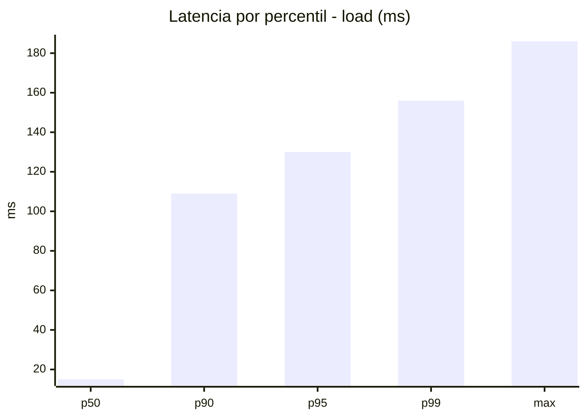
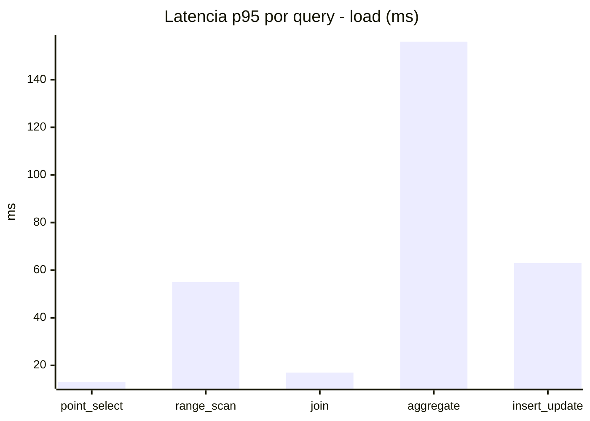
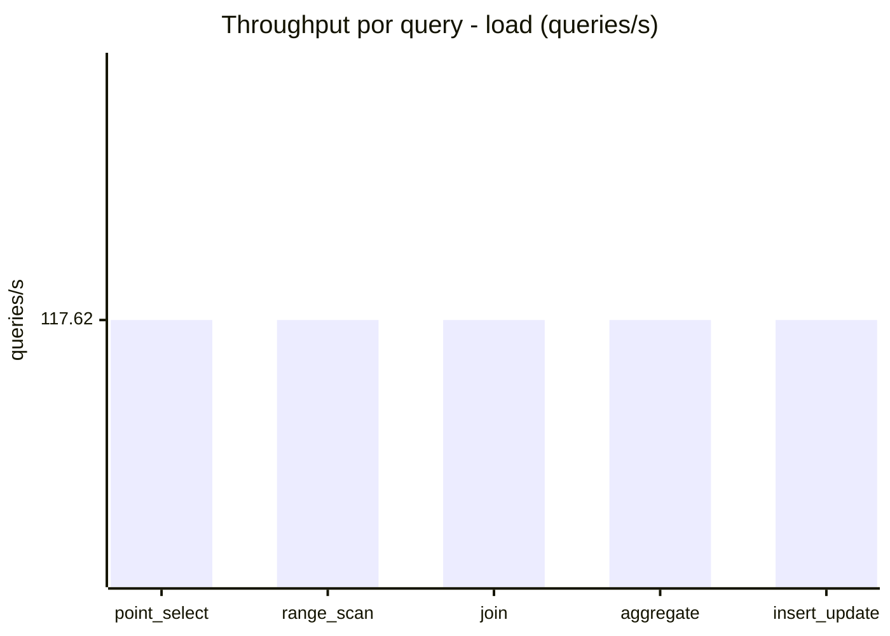
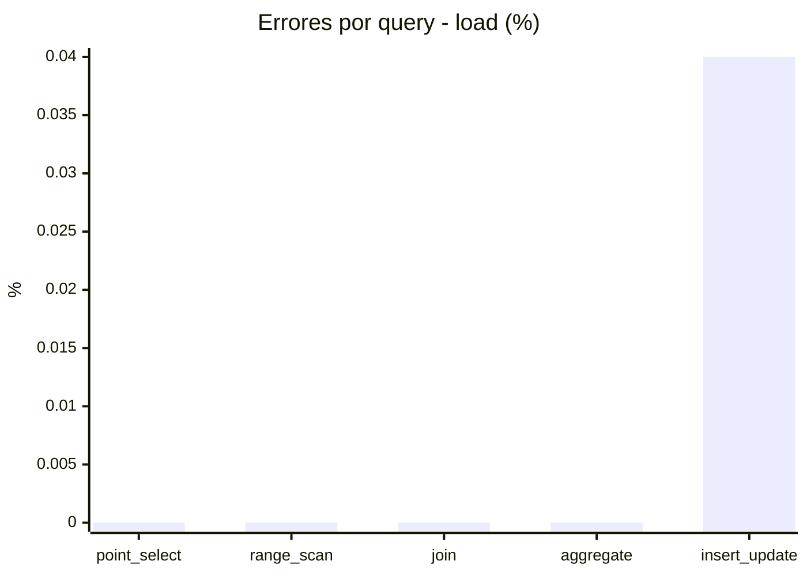
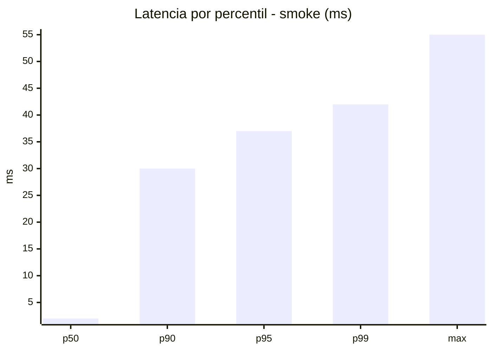
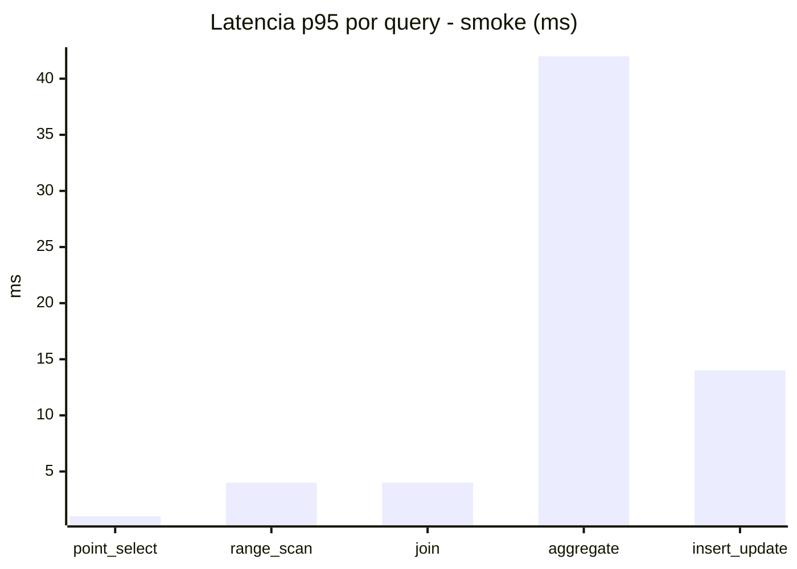
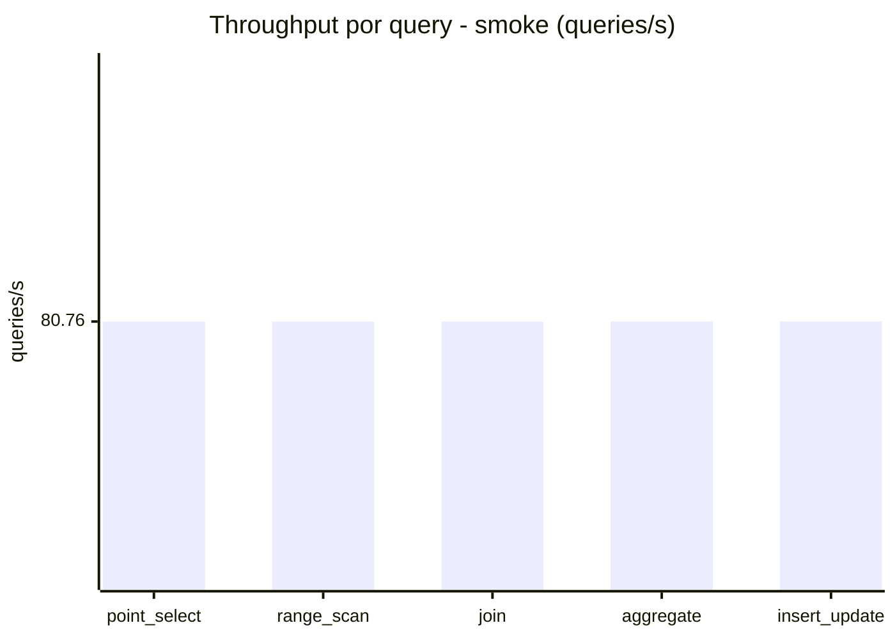
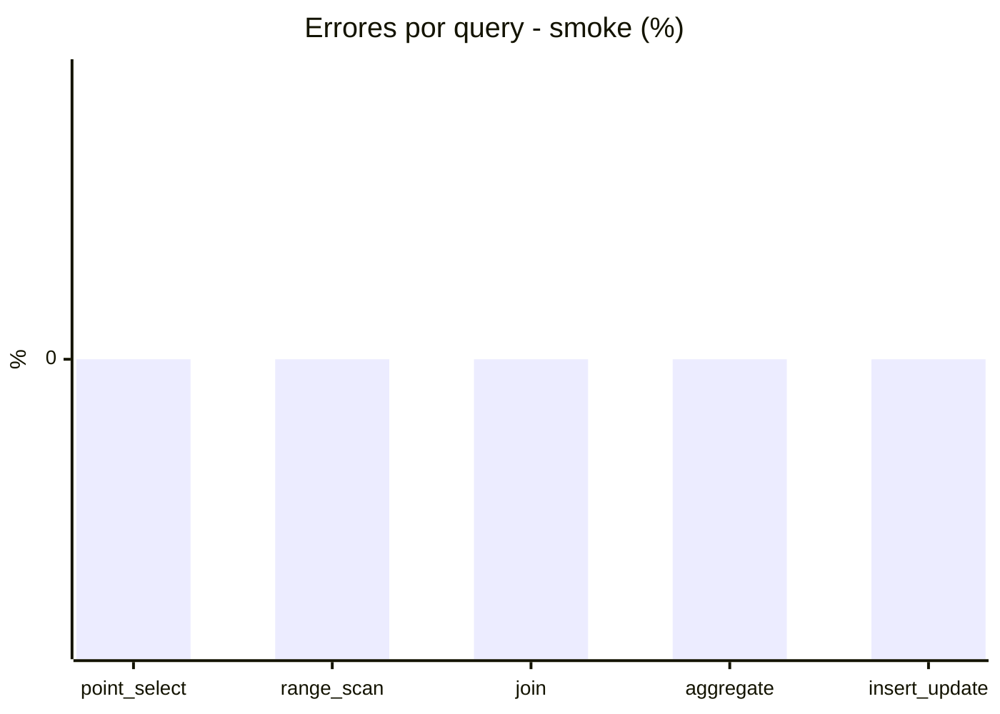

# Reporte de performance - SQL Server (k6)

**Fecha:** 2026-10-22 18:05 UTC  
**Veredicto (SLO):** `PASS`  
**Corrida:** [ver en GitHub Actions](https://github.com/lrbg/k6-sqlserver-lab/actions/runs/39827994715)  

## Analisis del agente de IA

PASS (fallback por umbrales)

- Error maximo: 0.01%
- p95 maximo: 130 ms

## Resultados

### Escenario: `load`

| Metrica | Valor |
| --- | --- |
| Queries ejecutadas | 35360 |
| Errores | 3 (0.01%) |
| Latencia media | 34 ms |
| p50 / p90 / p95 / p99 | 15 / 109 / 130 / 156 ms |
| Min / Max | 0 / 186 ms |
| Throughput | 588.12 queries/s |
| Duracion | 60.1 s |

Detalle por query

| Query | Ejecuciones | Error % | avg | p95 | p99 | q/s |
| --- | --- | --- | --- | --- | --- | --- |
| point_select | 7072 | 0% | 3.8 | 13 | 19 | 117.62 |
| range_scan | 7072 | 0% | 22.4 | 55 | 74 | 117.62 |
| join | 7072 | 0% | 6.4 | 17 | 21 | 117.62 |
| aggregate | 7072 | 0% | 107.1 | 156 | 171.3 | 117.62 |
| insert_update | 7072 | 0.04% | 30.1 | 63 | 81.3 | 117.62 |

### Escenario: `smoke`

| Metrica | Valor |
| --- | --- |
| Queries ejecutadas | 12130 |
| Errores | 0 (0%) |
| Latencia media | 7.4 ms |
| p50 / p90 / p95 / p99 | 2 / 30 / 37 / 42 ms |
| Min / Max | 0 / 55 ms |
| Throughput | 403.82 queries/s |
| Duracion | 30 s |

Detalle por query

| Query | Ejecuciones | Error % | avg | p95 | p99 | q/s |
| --- | --- | --- | --- | --- | --- | --- |
| point_select | 2426 | 0% | 0.5 | 1 | 3 | 80.76 |
| range_scan | 2426 | 0% | 2.1 | 4 | 10 | 80.76 |
| join | 2426 | 0% | 1.3 | 4 | 5 | 80.76 |
| aggregate | 2426 | 0% | 28.8 | 42 | 45 | 80.76 |
| insert_update | 2426 | 0% | 4.4 | 14 | 21 | 80.76 |

