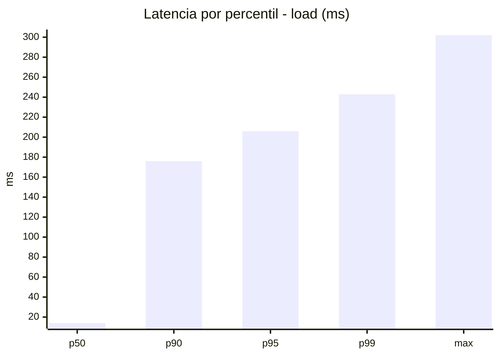
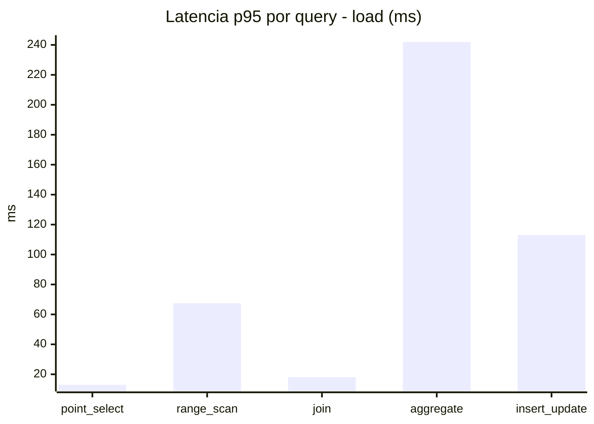
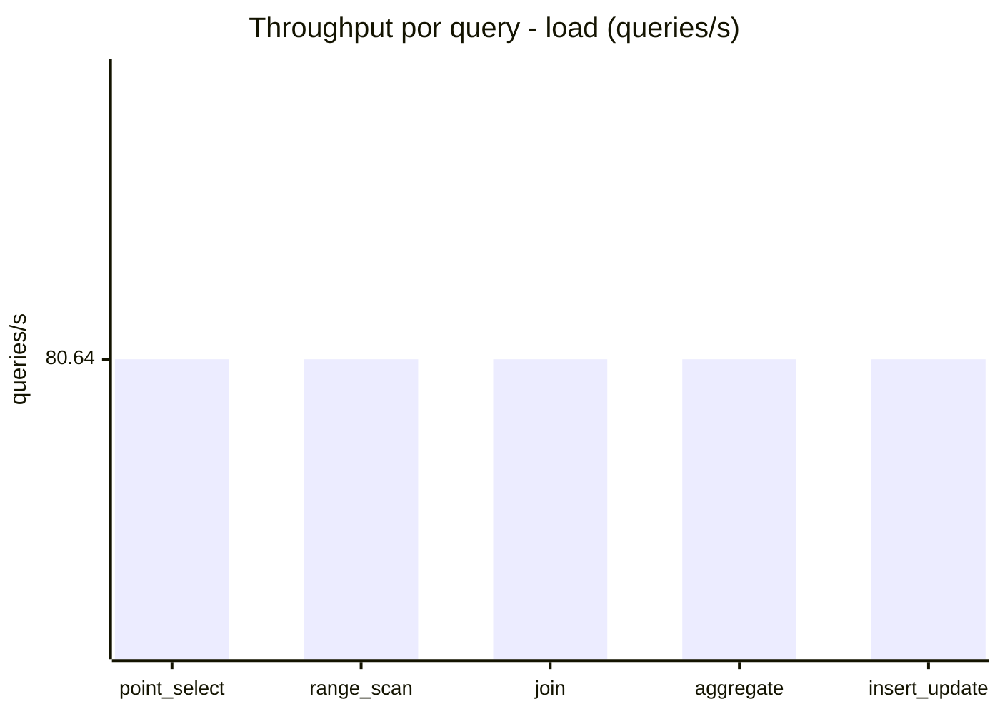
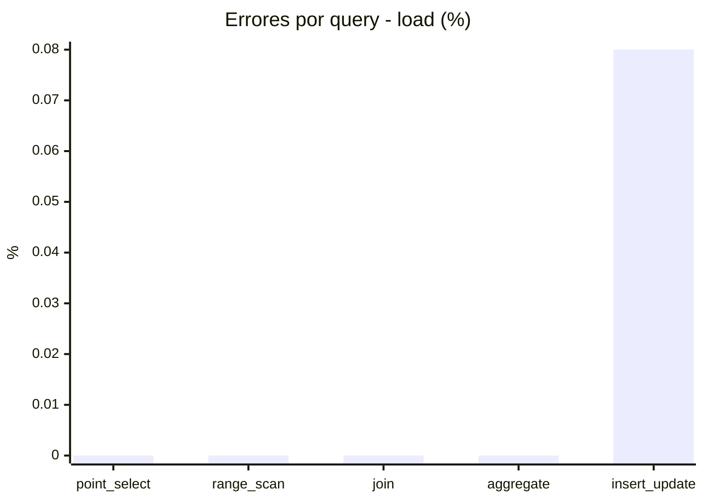
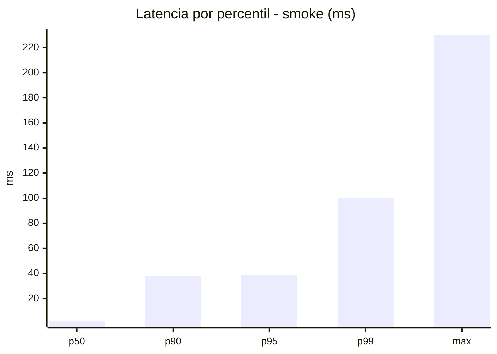
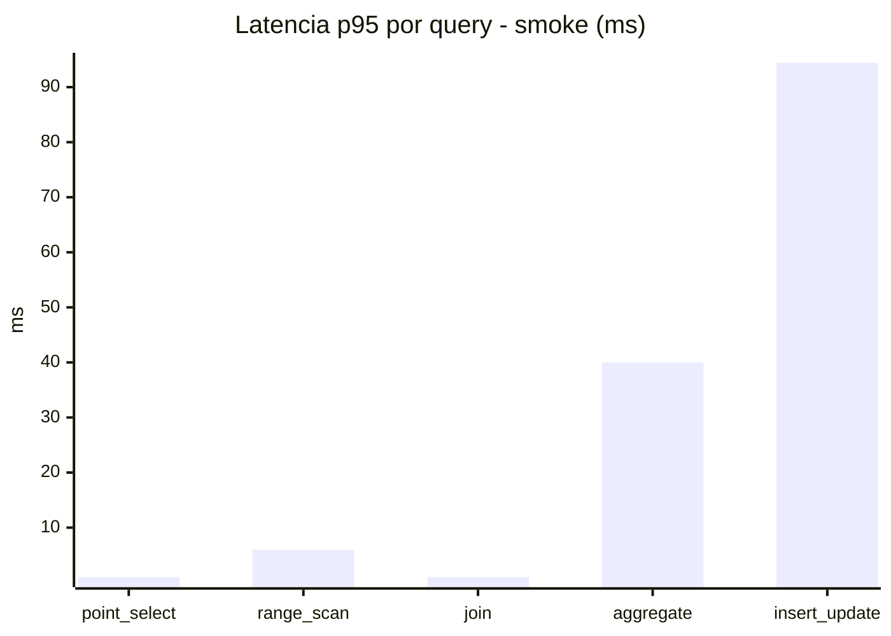
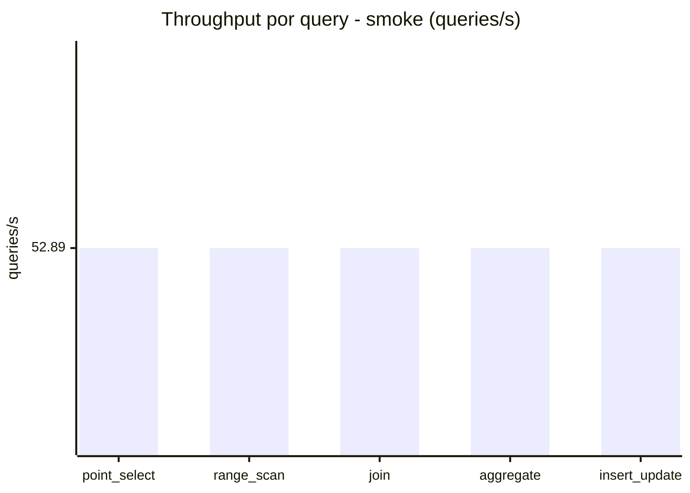
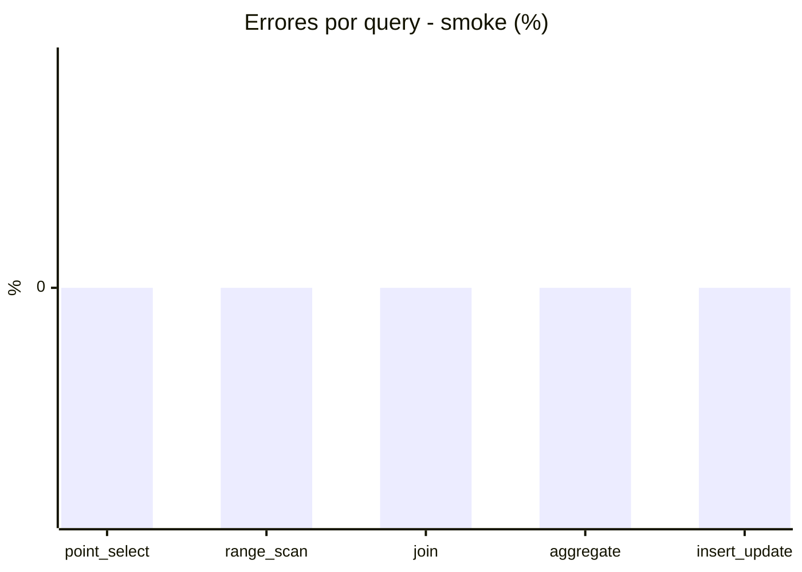

# Reporte de performance - SQL Server (k6)

**Fecha:** 2026-10-23 17:57 UTC  
**Veredicto (SLO):** `WARN`  
**Corrida:** [ver en GitHub Actions](https://github.com/lrbg/k6-sqlserver-lab/actions/runs/39998928335)  

## Analisis del agente de IA

WARN (fallback por umbrales)

- Error maximo: 0.02%
- p95 maximo: 206 ms

## Resultados

### Escenario: `load`

| Metrica | Valor |
| --- | --- |
| Queries ejecutadas | 24260 |
| Errores | 4 (0.02%) |
| Latencia media | 49.5 ms |
| p50 / p90 / p95 / p99 | 14 / 176 / 206 / 243 ms |
| Min / Max | 0 / 302 ms |
| Throughput | 403.22 queries/s |
| Duracion | 60.2 s |

Detalle por query

| Query | Ejecuciones | Error % | avg | p95 | p99 | q/s |
| --- | --- | --- | --- | --- | --- | --- |
| point_select | 4852 | 0% | 3.5 | 13 | 18 | 80.64 |
| range_scan | 4852 | 0% | 21.8 | 67.4 | 162 | 80.64 |
| join | 4852 | 0% | 7.4 | 18 | 22 | 80.64 |
| aggregate | 4852 | 0% | 174.7 | 242 | 267 | 80.64 |
| insert_update | 4852 | 0.08% | 40 | 113 | 190.5 | 80.64 |

### Escenario: `smoke`

| Metrica | Valor |
| --- | --- |
| Queries ejecutadas | 7945 |
| Errores | 0 (0%) |
| Latencia media | 11.3 ms |
| p50 / p90 / p95 / p99 | 2 / 38 / 39 / 100.1 ms |
| Min / Max | 0 / 230 ms |
| Throughput | 264.46 queries/s |
| Duracion | 30 s |

Detalle por query

| Query | Ejecuciones | Error % | avg | p95 | p99 | q/s |
| --- | --- | --- | --- | --- | --- | --- |
| point_select | 1589 | 0% | 0.6 | 1 | 1 | 52.89 |
| range_scan | 1589 | 0% | 3.5 | 6 | 36 | 52.89 |
| join | 1589 | 0% | 0.8 | 1 | 2 | 52.89 |
| aggregate | 1589 | 0% | 32.3 | 40 | 40 | 52.89 |
| insert_update | 1589 | 0% | 19.5 | 94.4 | 159.1 | 52.89 |

