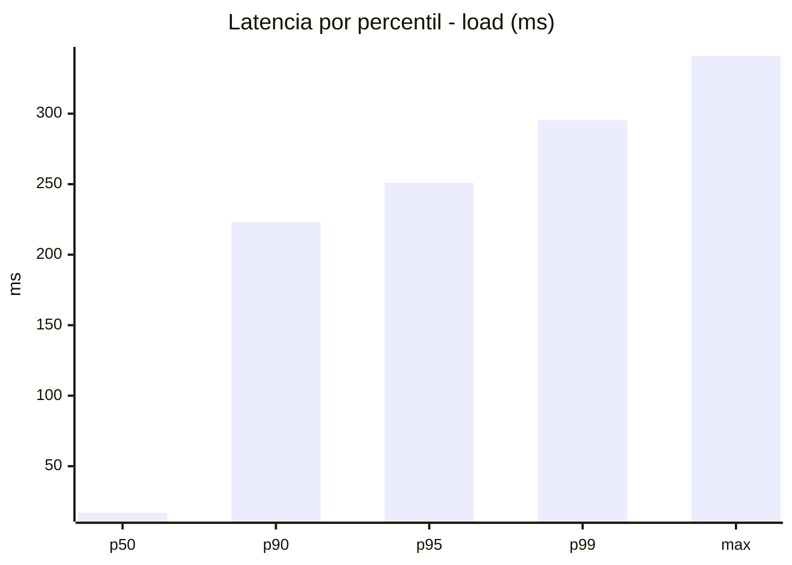
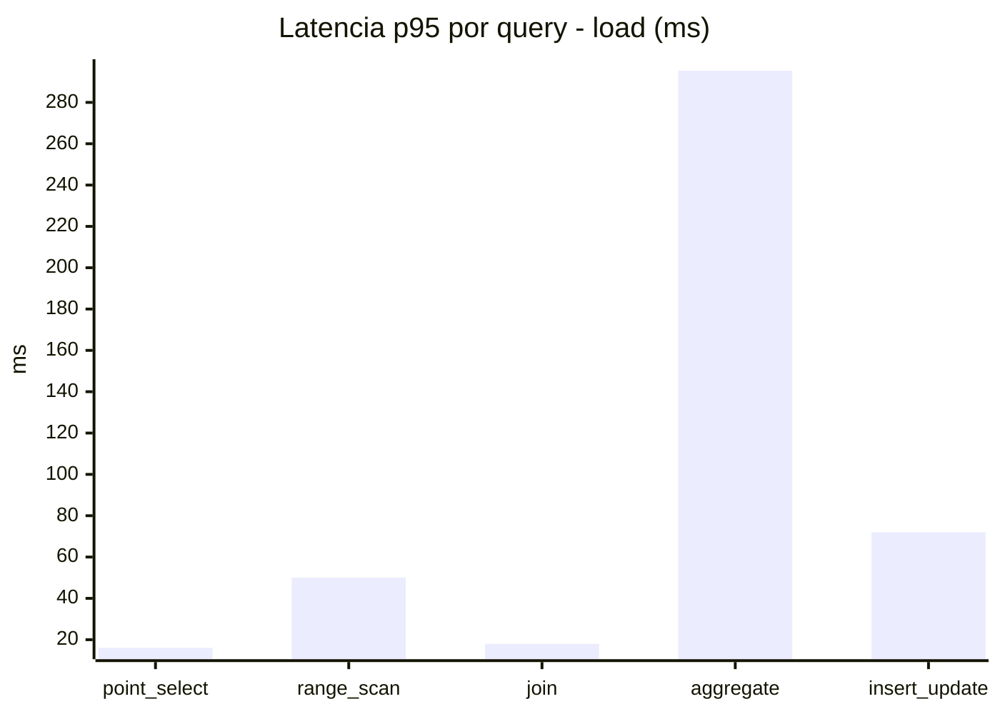
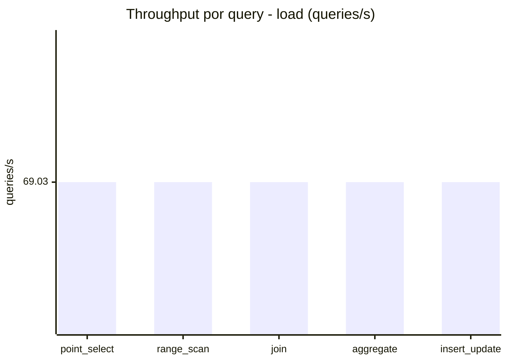
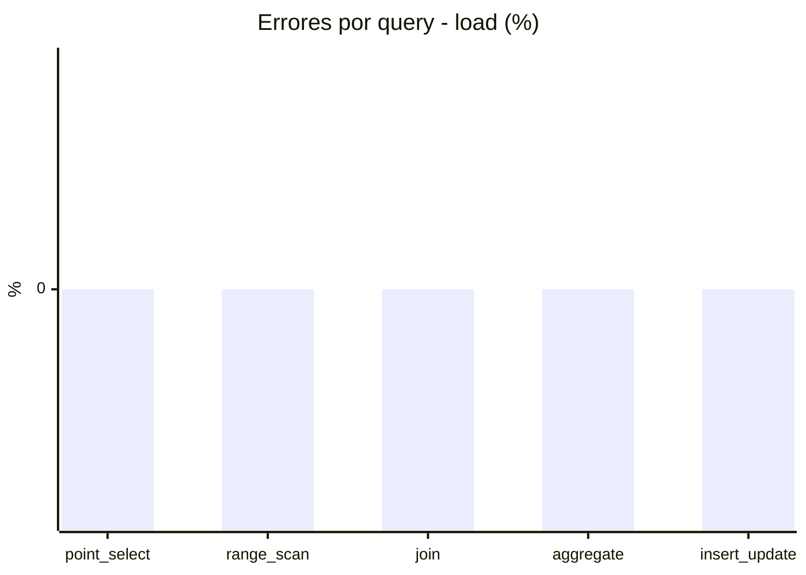
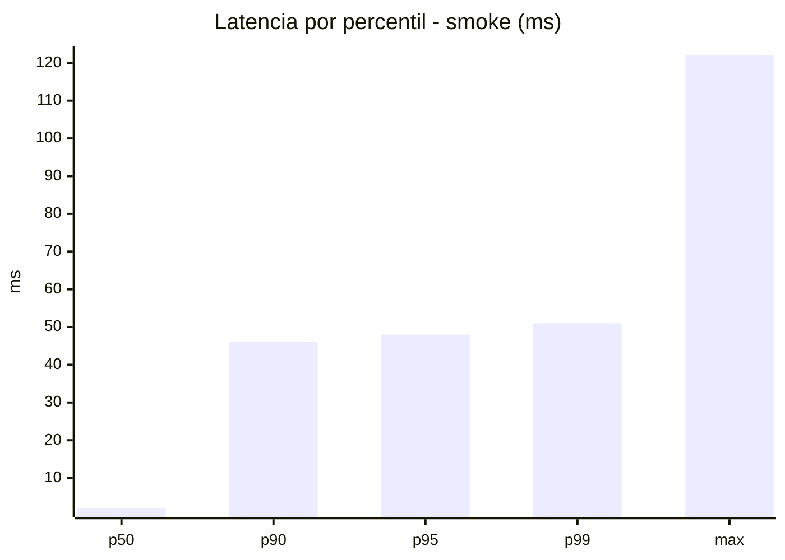
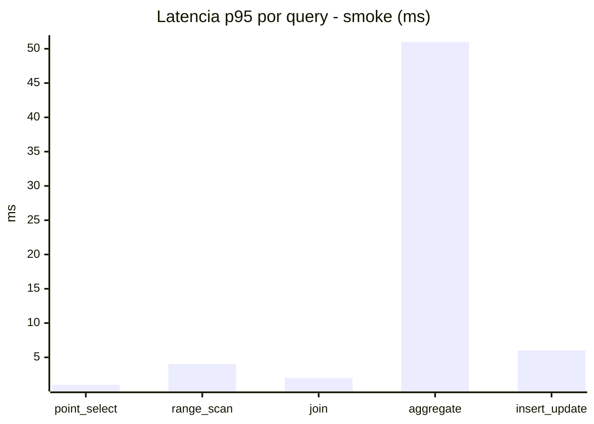
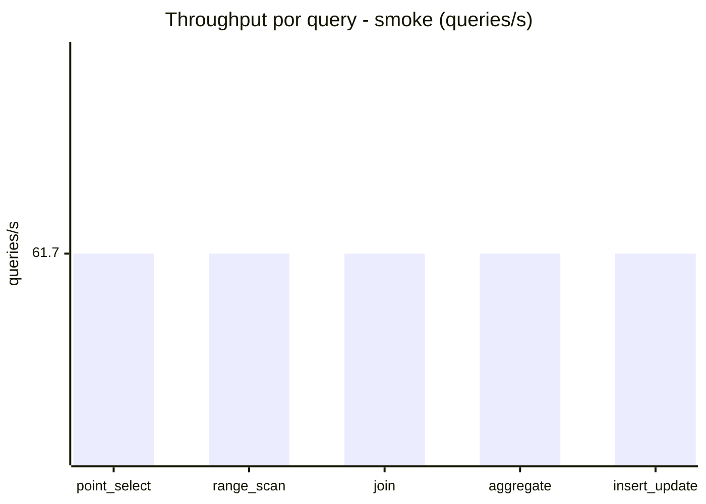
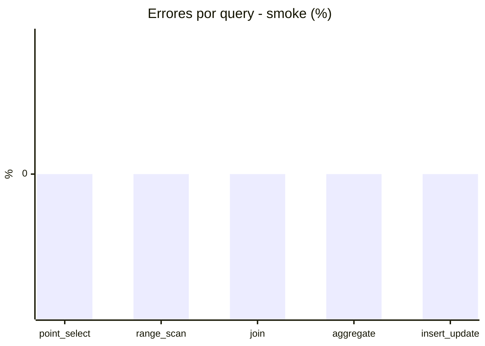

# Reporte de performance - SQL Server (k6)

**Fecha:** 2026-10-24 16:46 UTC  
**Veredicto (SLO):** `WARN`  
**Corrida:** [ver en GitHub Actions](https://github.com/lrbg/k6-sqlserver-lab/actions/runs/40112941913)  

## Analisis del agente de IA

WARN (fallback por umbrales)

- Error maximo: 0%
- p95 maximo: 251 ms

## Resultados

### Escenario: `load`

| Metrica | Valor |
| --- | --- |
| Queries ejecutadas | 20760 |
| Errores | 0 (0%) |
| Latencia media | 57.9 ms |
| p50 / p90 / p95 / p99 | 17 / 223 / 251 / 295.4 ms |
| Min / Max | 0 / 341 ms |
| Throughput | 345.15 queries/s |
| Duracion | 60.1 s |

Detalle por query

| Query | Ejecuciones | Error % | avg | p95 | p99 | q/s |
| --- | --- | --- | --- | --- | --- | --- |
| point_select | 4152 | 0% | 5.8 | 16 | 20 | 69.03 |
| range_scan | 4152 | 0% | 22.6 | 50 | 71 | 69.03 |
| join | 4152 | 0% | 8.5 | 18 | 21 | 69.03 |
| aggregate | 4152 | 0% | 217.9 | 295.4 | 312.5 | 69.03 |
| insert_update | 4152 | 0% | 34.5 | 72 | 93 | 69.03 |

### Escenario: `smoke`

| Metrica | Valor |
| --- | --- |
| Queries ejecutadas | 9265 |
| Errores | 0 (0%) |
| Latencia media | 9.7 ms |
| p50 / p90 / p95 / p99 | 2 / 46 / 48 / 51 ms |
| Min / Max | 0 / 122 ms |
| Throughput | 308.48 queries/s |
| Duracion | 30 s |

Detalle por query

| Query | Ejecuciones | Error % | avg | p95 | p99 | q/s |
| --- | --- | --- | --- | --- | --- | --- |
| point_select | 1853 | 0% | 0.7 | 1 | 2 | 61.7 |
| range_scan | 1853 | 0% | 2.7 | 4 | 8 | 61.7 |
| join | 1853 | 0% | 1 | 2 | 4.5 | 61.7 |
| aggregate | 1853 | 0% | 41.1 | 51 | 69 | 61.7 |
| insert_update | 1853 | 0% | 3.1 | 6 | 13 | 61.7 |

