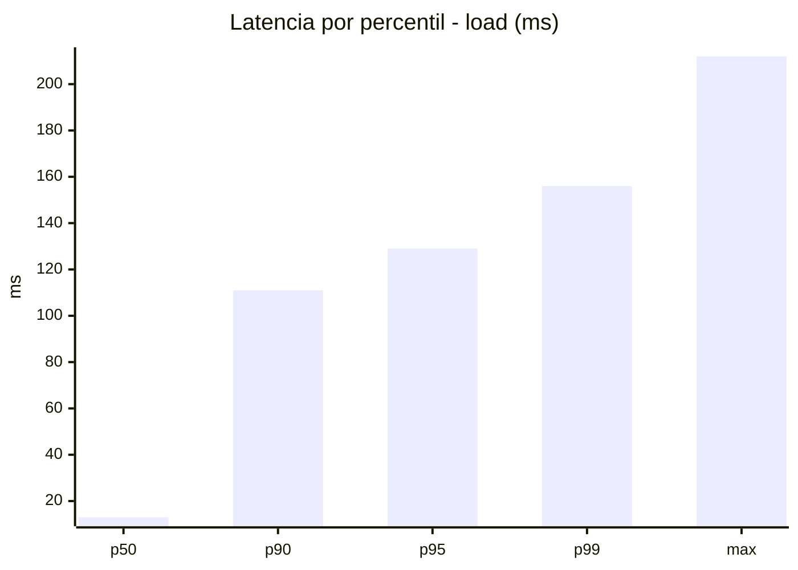
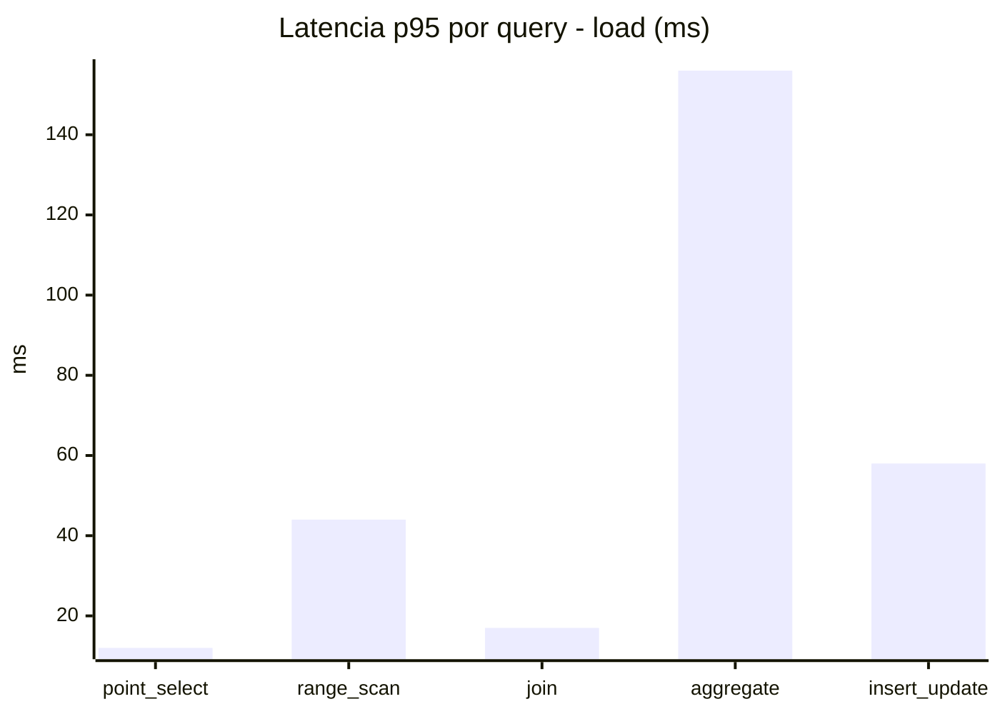
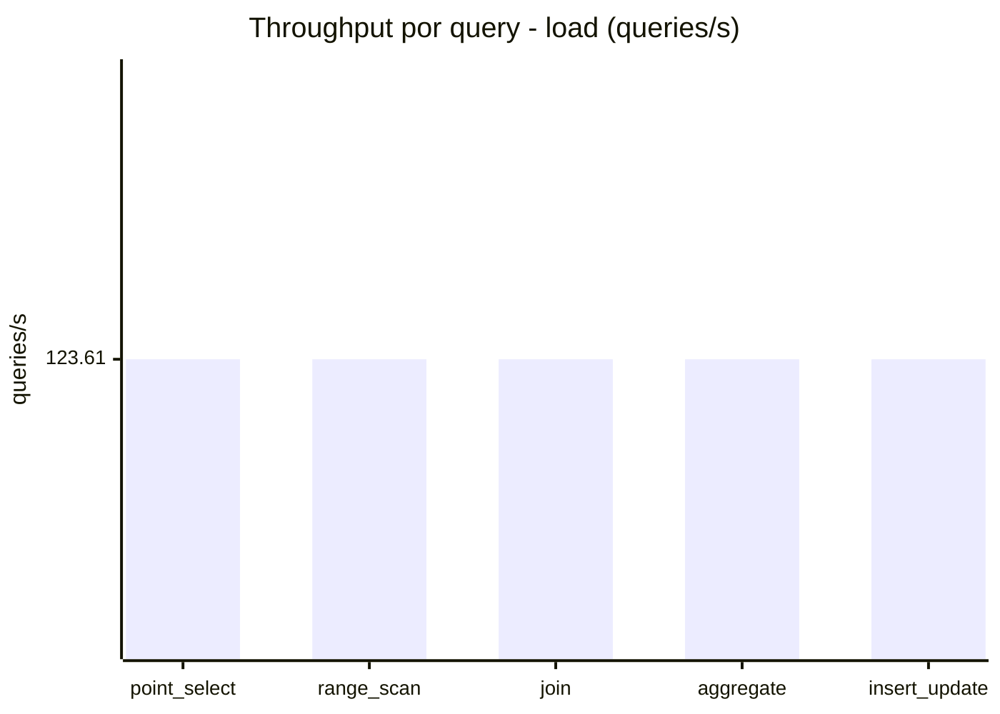
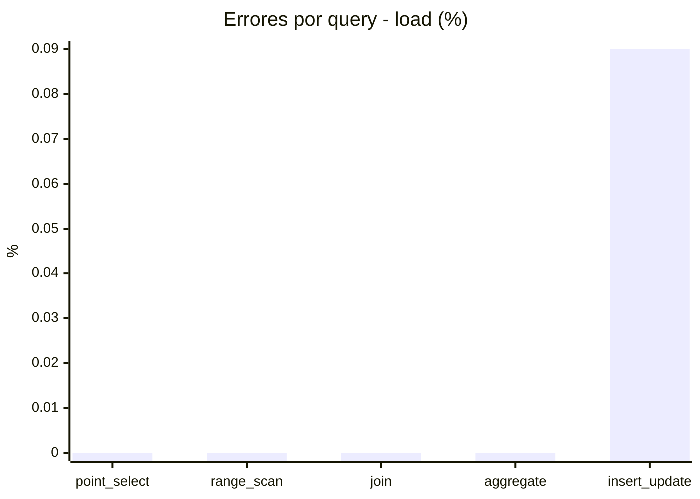
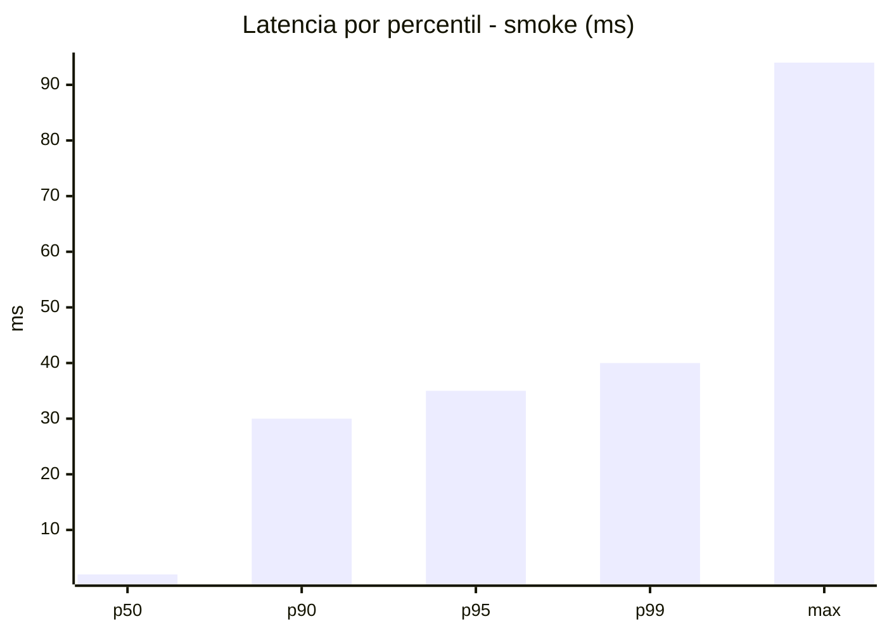
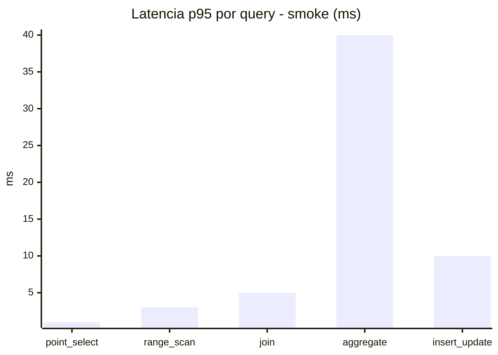
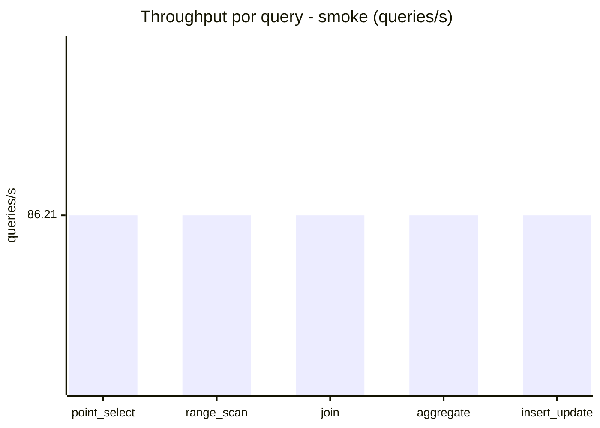
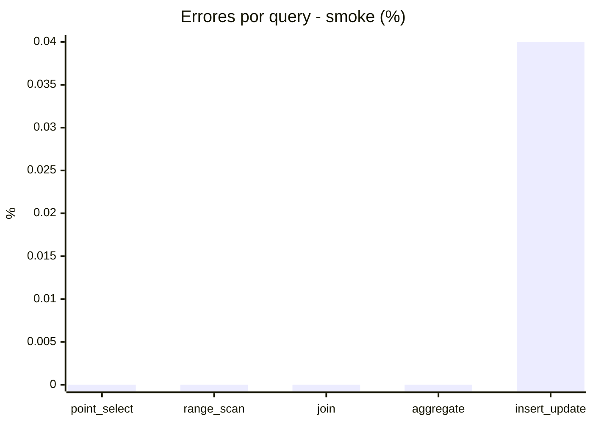

# Reporte de performance - SQL Server (k6)

**Fecha:** 2026-10-25 17:08 UTC  
**Veredicto (SLO):** `PASS`  
**Corrida:** [ver en GitHub Actions](https://github.com/lrbg/k6-sqlserver-lab/actions/runs/40214869468)  

## Analisis del agente de IA

PASS (fallback por umbrales)

- Error maximo: 0.02%
- p95 maximo: 129 ms

## Resultados

### Escenario: `load`

| Metrica | Valor |
| --- | --- |
| Queries ejecutadas | 37130 |
| Errores | 7 (0.02%) |
| Latencia media | 32.3 ms |
| p50 / p90 / p95 / p99 | 13 / 111 / 129 / 156 ms |
| Min / Max | 0 / 212 ms |
| Throughput | 618.06 queries/s |
| Duracion | 60.1 s |

Detalle por query

| Query | Ejecuciones | Error % | avg | p95 | p99 | q/s |
| --- | --- | --- | --- | --- | --- | --- |
| point_select | 7426 | 0% | 3.6 | 12 | 17 | 123.61 |
| range_scan | 7426 | 0% | 18.2 | 44 | 59 | 123.61 |
| join | 7426 | 0% | 6.4 | 17 | 21 | 123.61 |
| aggregate | 7426 | 0% | 108.1 | 156 | 174 | 123.61 |
| insert_update | 7426 | 0.09% | 25.3 | 58 | 74 | 123.61 |

### Escenario: `smoke`

| Metrica | Valor |
| --- | --- |
| Queries ejecutadas | 12945 |
| Errores | 1 (0.01%) |
| Latencia media | 6.9 ms |
| p50 / p90 / p95 / p99 | 2 / 30 / 35 / 40 ms |
| Min / Max | 0 / 94 ms |
| Throughput | 431.07 queries/s |
| Duracion | 30 s |

Detalle por query

| Query | Ejecuciones | Error % | avg | p95 | p99 | q/s |
| --- | --- | --- | --- | --- | --- | --- |
| point_select | 2589 | 0% | 0.5 | 1 | 2 | 86.21 |
| range_scan | 2589 | 0% | 1.9 | 3 | 6 | 86.21 |
| join | 2589 | 0% | 1.3 | 5 | 5 | 86.21 |
| aggregate | 2589 | 0% | 27.7 | 40 | 43 | 86.21 |
| insert_update | 2589 | 0.04% | 3.3 | 10 | 14 | 86.21 |

