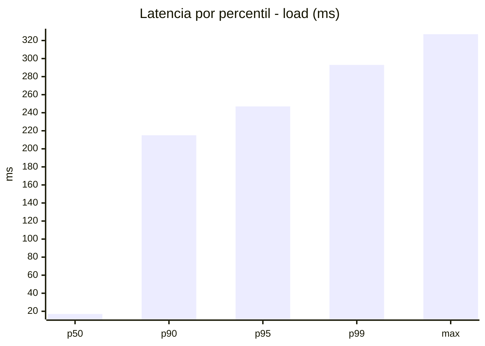
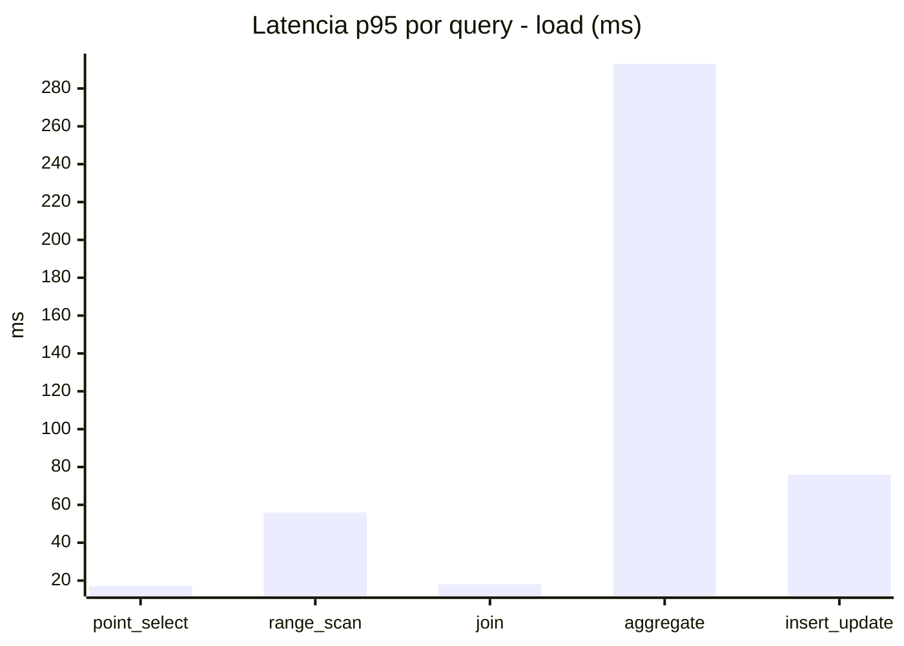
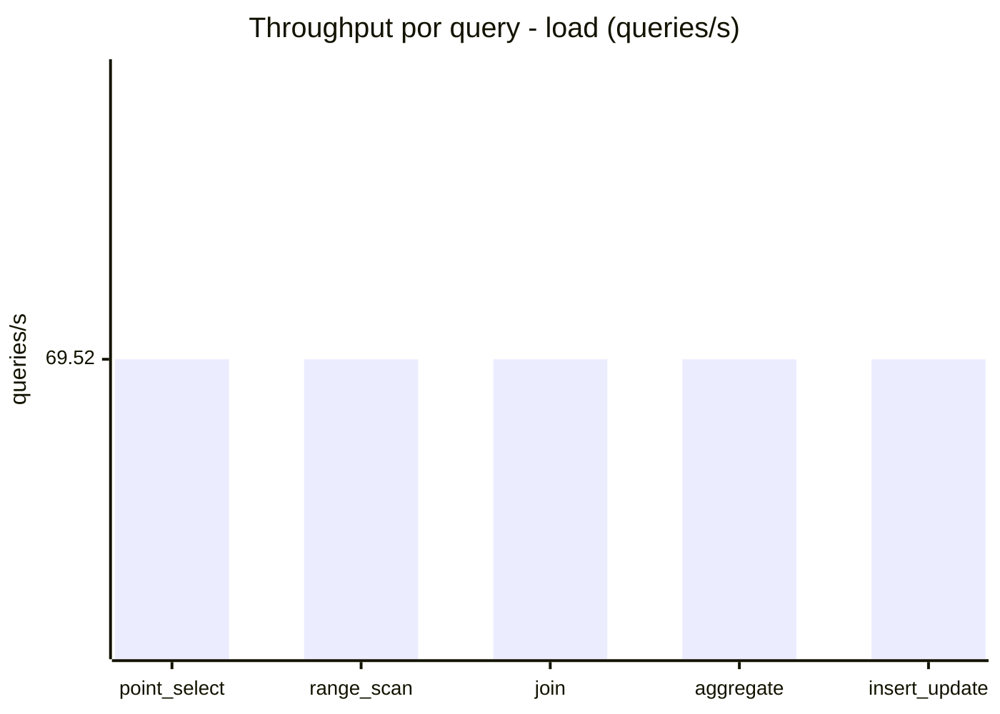
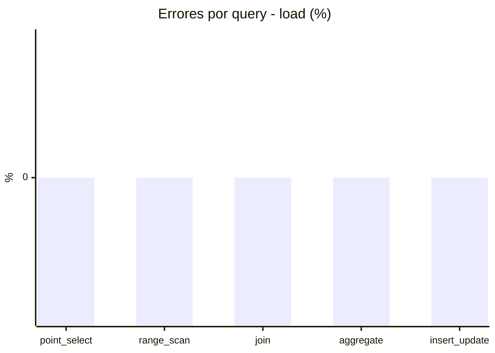
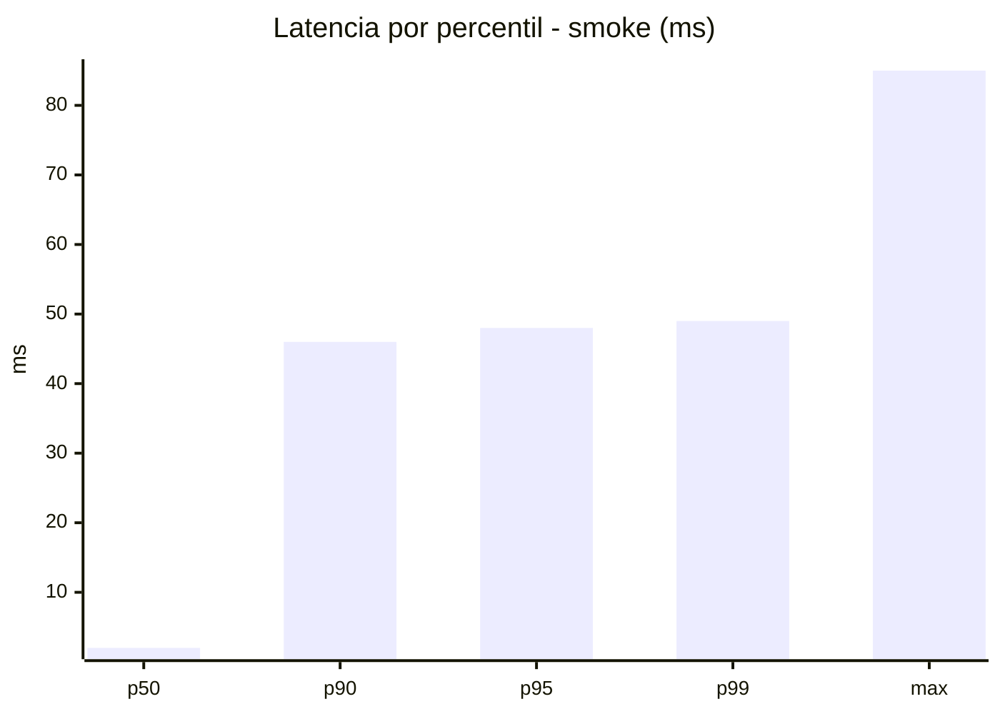
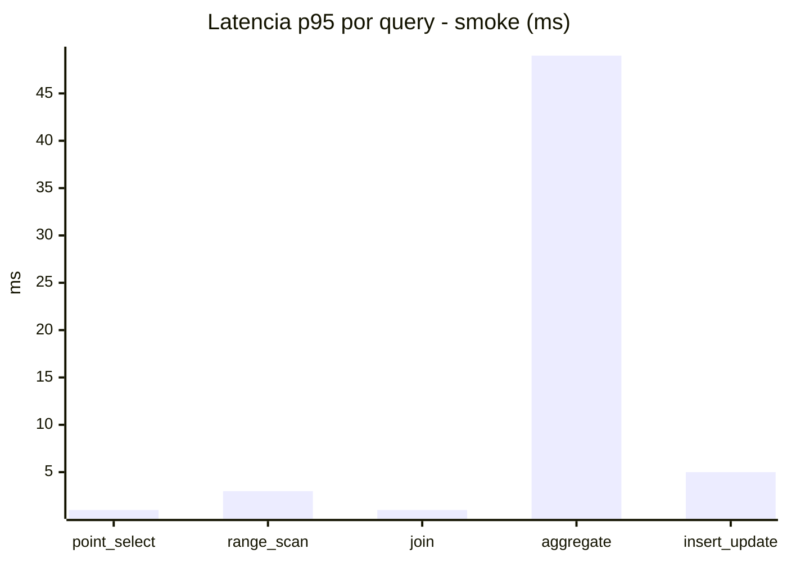
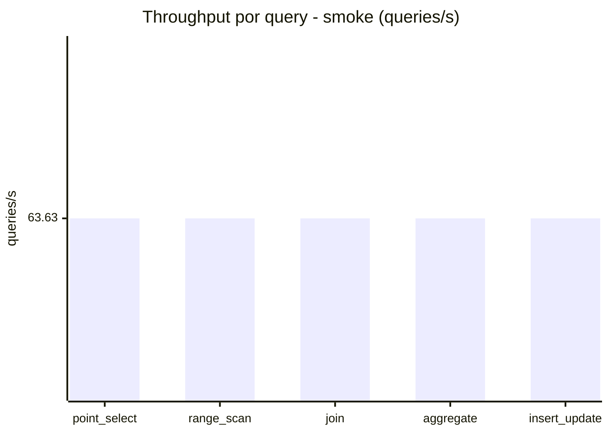
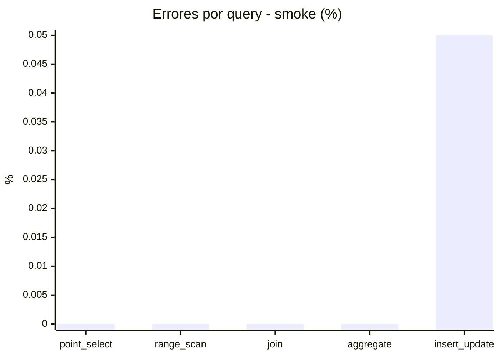

# Reporte de performance - SQL Server (k6)

**Fecha:** 2026-10-26 19:28 UTC  
**Veredicto (SLO):** `WARN`  
**Corrida:** [ver en GitHub Actions](https://github.com/lrbg/k6-sqlserver-lab/actions/runs/40386687445)  

## Analisis del agente de IA

WARN (fallback por umbrales)

- Error maximo: 0.01%
- p95 maximo: 247 ms

## Resultados

### Escenario: `load`

| Metrica | Valor |
| --- | --- |
| Queries ejecutadas | 20905 |
| Errores | 0 (0%) |
| Latencia media | 57.4 ms |
| p50 / p90 / p95 / p99 | 17 / 215 / 247 / 293 ms |
| Min / Max | 0 / 327 ms |
| Throughput | 347.62 queries/s |
| Duracion | 60.1 s |

Detalle por query

| Query | Ejecuciones | Error % | avg | p95 | p99 | q/s |
| --- | --- | --- | --- | --- | --- | --- |
| point_select | 4181 | 0% | 6 | 17 | 21 | 69.52 |
| range_scan | 4181 | 0% | 24.6 | 56 | 76 | 69.52 |
| join | 4181 | 0% | 8.5 | 18 | 22 | 69.52 |
| aggregate | 4181 | 0% | 212 | 293 | 307 | 69.52 |
| insert_update | 4181 | 0% | 36.1 | 76 | 95 | 69.52 |

### Escenario: `smoke`

| Metrica | Valor |
| --- | --- |
| Queries ejecutadas | 9555 |
| Errores | 1 (0.01%) |
| Latencia media | 9.4 ms |
| p50 / p90 / p95 / p99 | 2 / 46 / 48 / 49 ms |
| Min / Max | 0 / 85 ms |
| Throughput | 318.15 queries/s |
| Duracion | 30 s |

Detalle por query

| Query | Ejecuciones | Error % | avg | p95 | p99 | q/s |
| --- | --- | --- | --- | --- | --- | --- |
| point_select | 1911 | 0% | 0.5 | 1 | 2 | 63.63 |
| range_scan | 1911 | 0% | 2.7 | 3 | 7.7 | 63.63 |
| join | 1911 | 0% | 0.9 | 1 | 2.9 | 63.63 |
| aggregate | 1911 | 0% | 40.3 | 49 | 51 | 63.63 |
| insert_update | 1911 | 0.05% | 2.8 | 5 | 12 | 63.63 |

