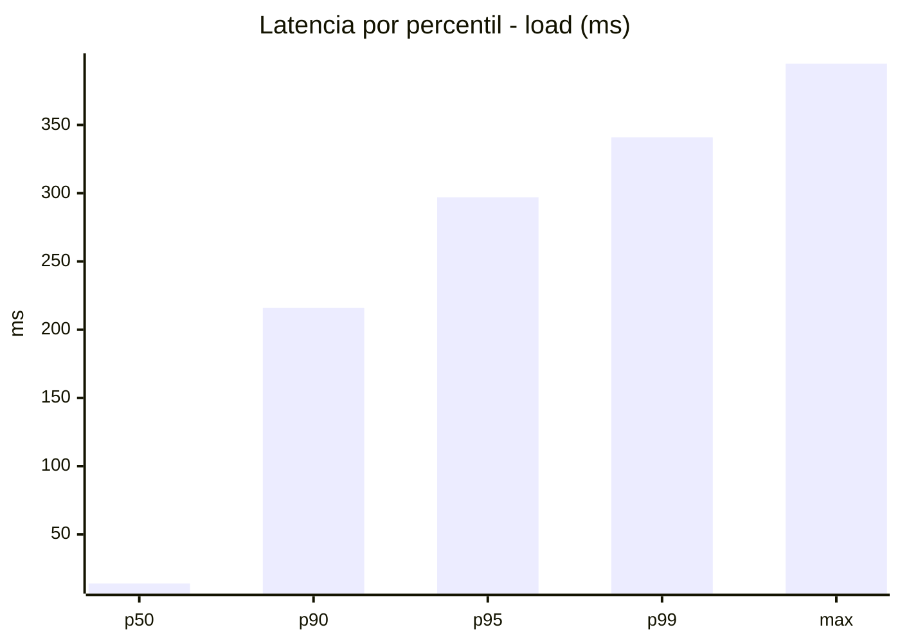
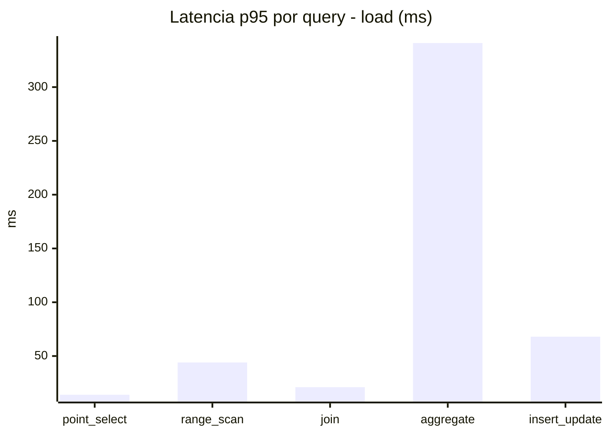
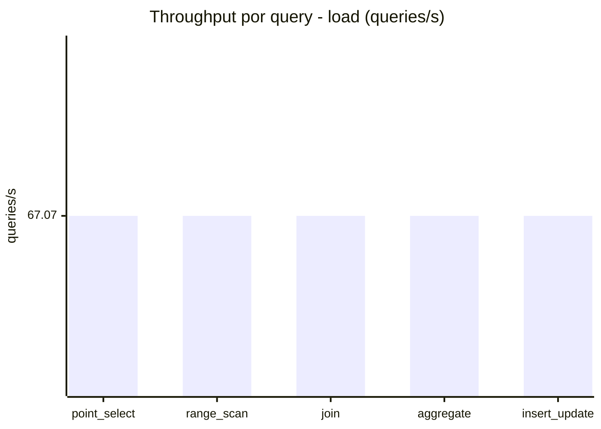
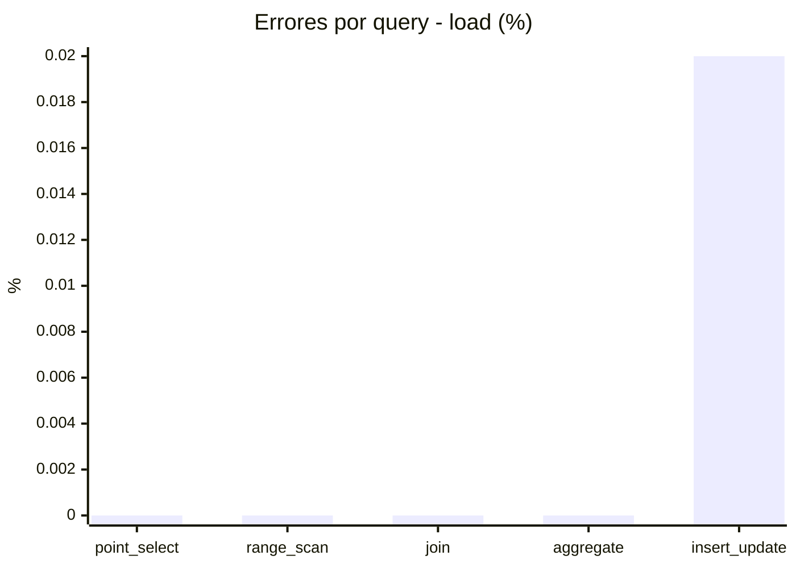
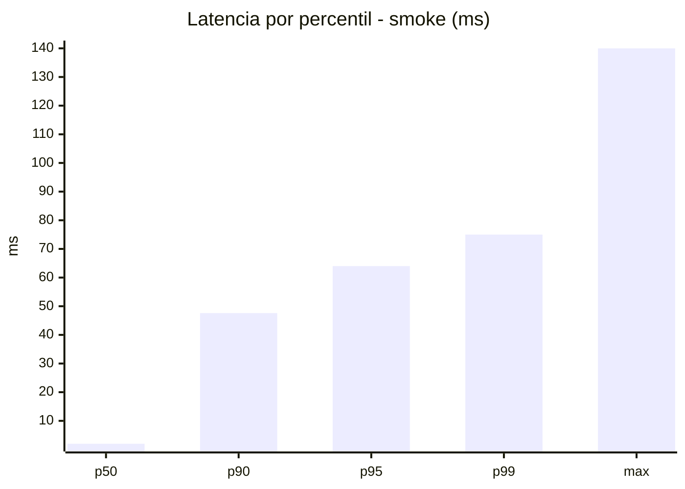
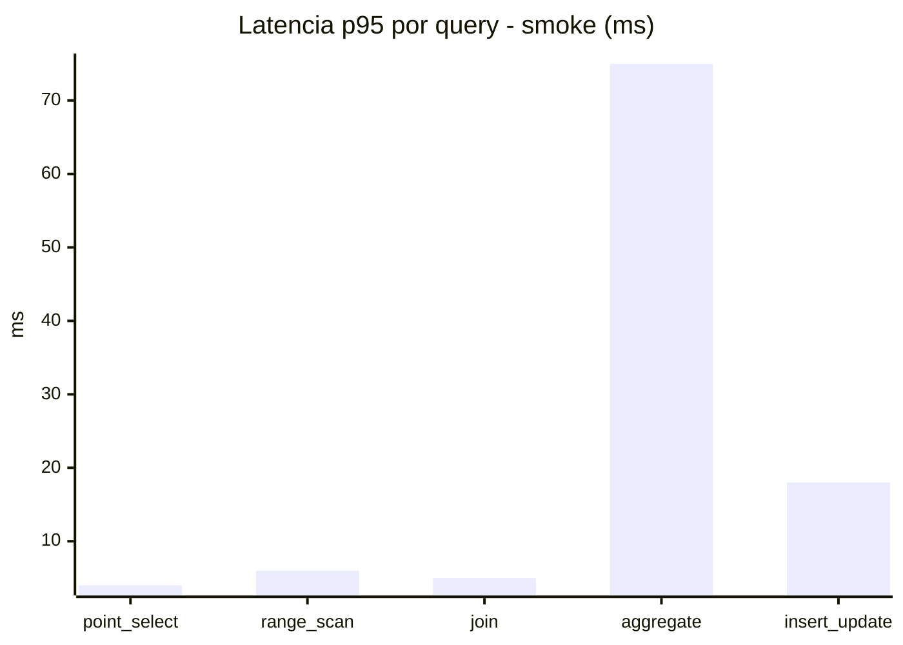
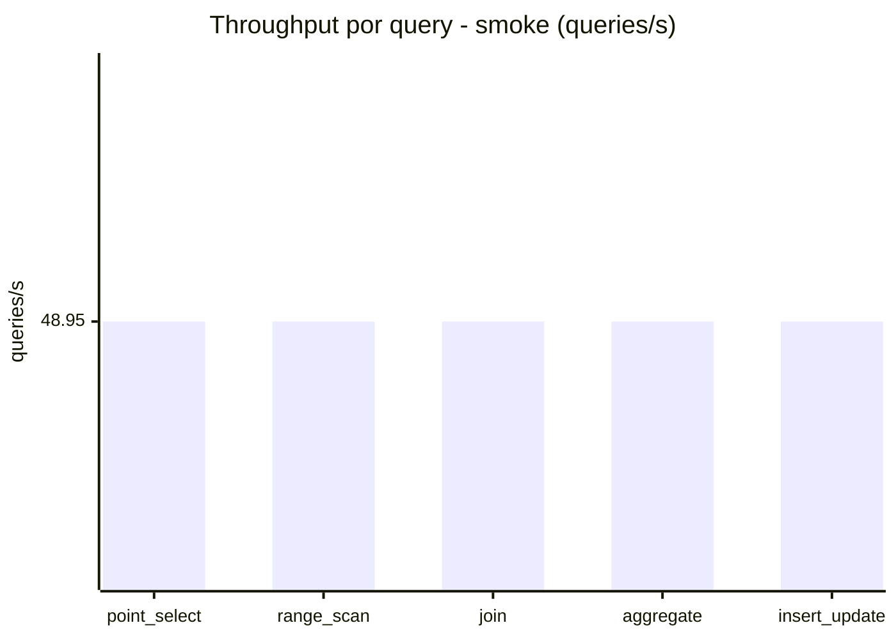
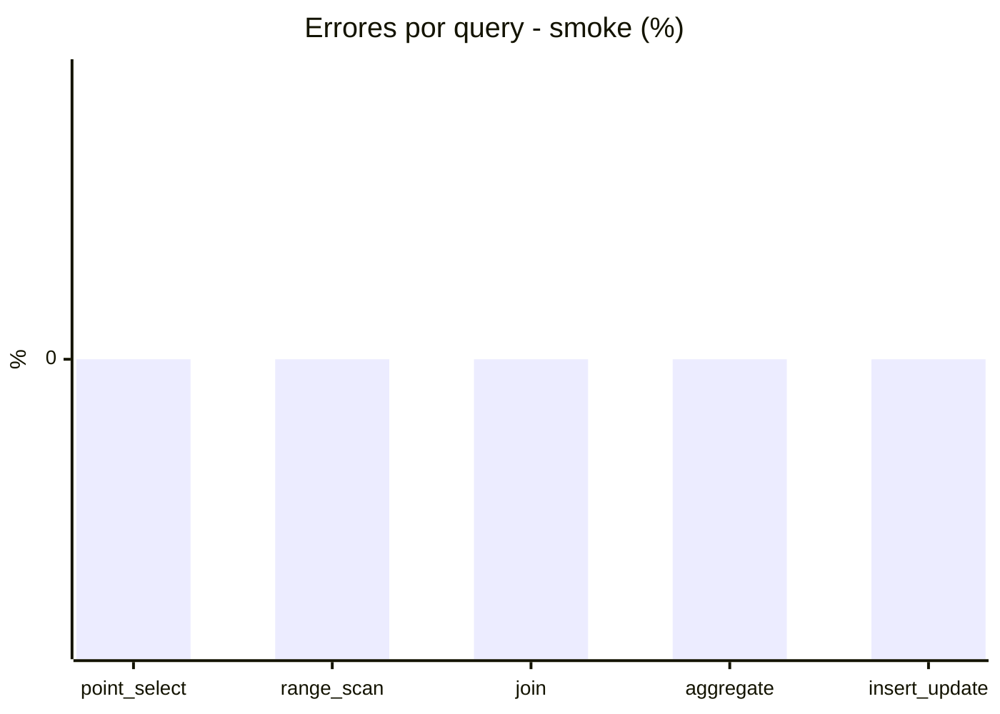

# Reporte de performance - SQL Server (k6)

**Fecha:** 2026-10-27 18:48 UTC  
**Veredicto (SLO):** `WARN`  
**Corrida:** [ver en GitHub Actions](https://github.com/lrbg/k6-sqlserver-lab/actions/runs/40563081465)  

## Analisis del agente de IA

WARN (fallback por umbrales)

- Error maximo: 0%
- p95 maximo: 297 ms

## Resultados

### Escenario: `load`

| Metrica | Valor |
| --- | --- |
| Queries ejecutadas | 20205 |
| Errores | 1 (0%) |
| Latencia media | 59.5 ms |
| p50 / p90 / p95 / p99 | 14 / 216 / 297 / 341 ms |
| Min / Max | 0 / 395 ms |
| Throughput | 335.37 queries/s |
| Duracion | 60.2 s |

Detalle por query

| Query | Ejecuciones | Error % | avg | p95 | p99 | q/s |
| --- | --- | --- | --- | --- | --- | --- |
| point_select | 4041 | 0% | 4.9 | 14 | 21 | 67.07 |
| range_scan | 4041 | 0% | 18.9 | 44 | 60.6 | 67.07 |
| join | 4041 | 0% | 8.5 | 21 | 23 | 67.07 |
| aggregate | 4041 | 0% | 235.7 | 341 | 364 | 67.07 |
| insert_update | 4041 | 0.02% | 29.4 | 68 | 92 | 67.07 |

### Escenario: `smoke`

| Metrica | Valor |
| --- | --- |
| Queries ejecutadas | 7355 |
| Errores | 0 (0%) |
| Latencia media | 12.2 ms |
| p50 / p90 / p95 / p99 | 2 / 47.6 / 64 / 75 ms |
| Min / Max | 0 / 140 ms |
| Throughput | 244.76 queries/s |
| Duracion | 30 s |

Detalle por query

| Query | Ejecuciones | Error % | avg | p95 | p99 | q/s |
| --- | --- | --- | --- | --- | --- | --- |
| point_select | 1471 | 0% | 0.9 | 4 | 5 | 48.95 |
| range_scan | 1471 | 0% | 3.1 | 6 | 10.3 | 48.95 |
| join | 1471 | 0% | 1.7 | 5 | 5 | 48.95 |
| aggregate | 1471 | 0% | 50.5 | 75 | 81 | 48.95 |
| insert_update | 1471 | 0% | 5 | 18 | 25 | 48.95 |

