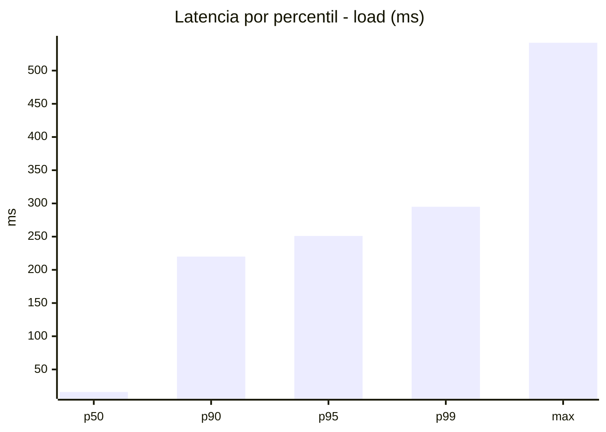
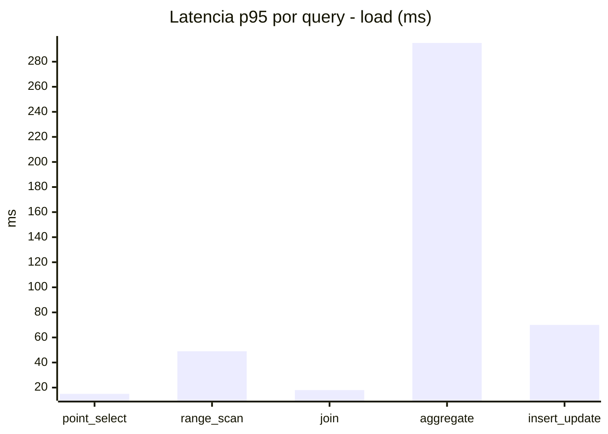
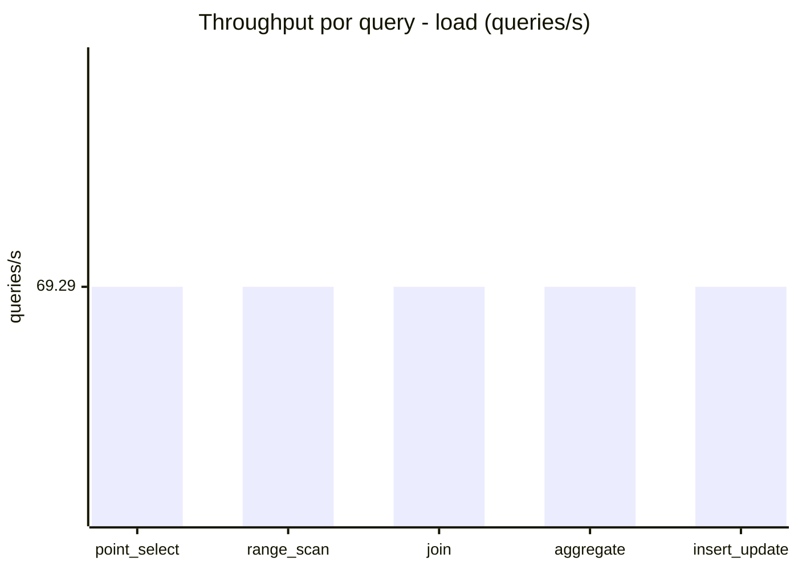
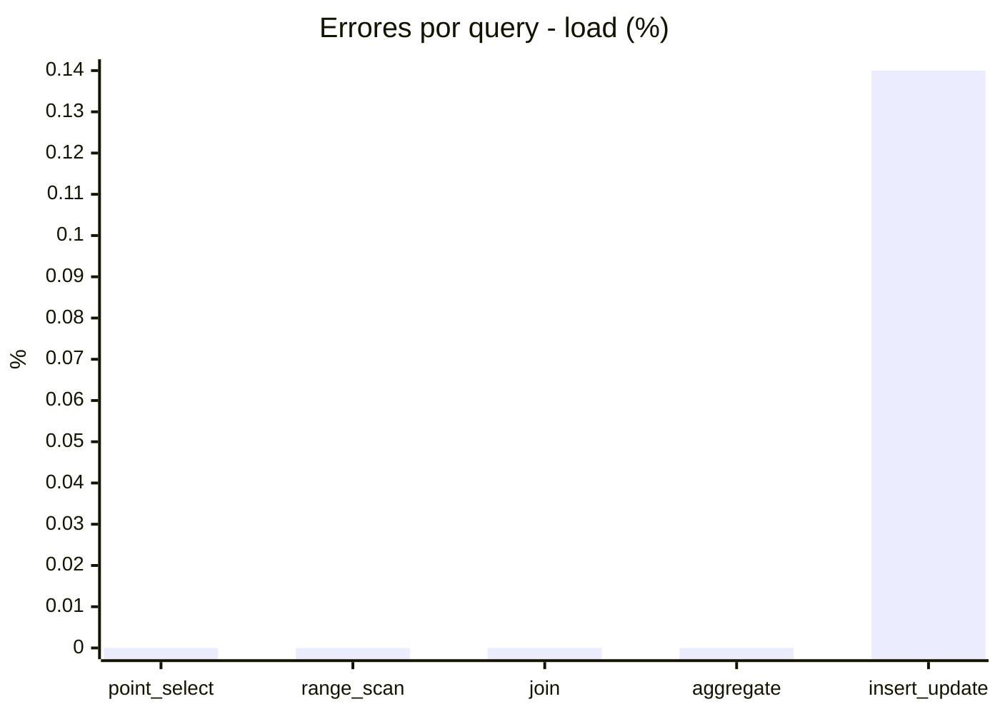
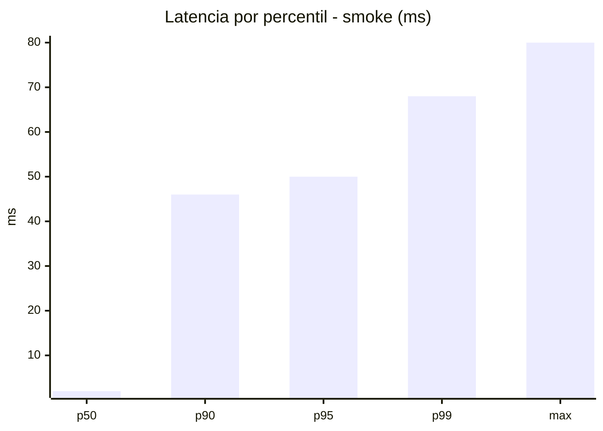
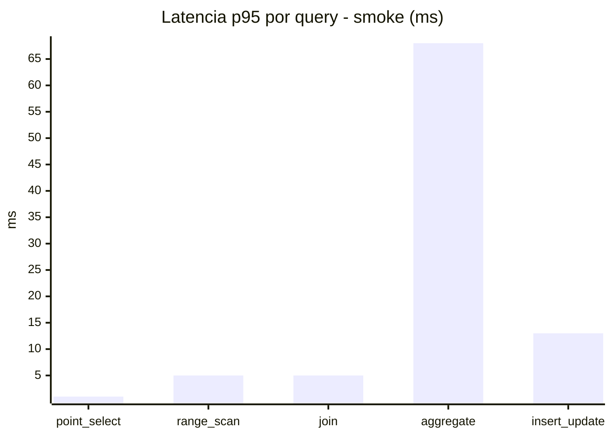
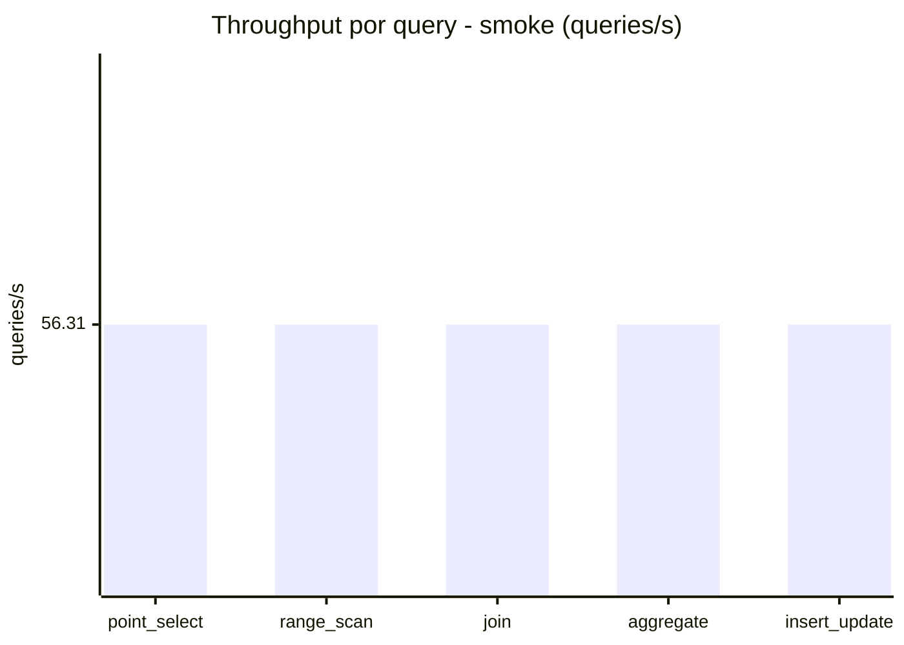
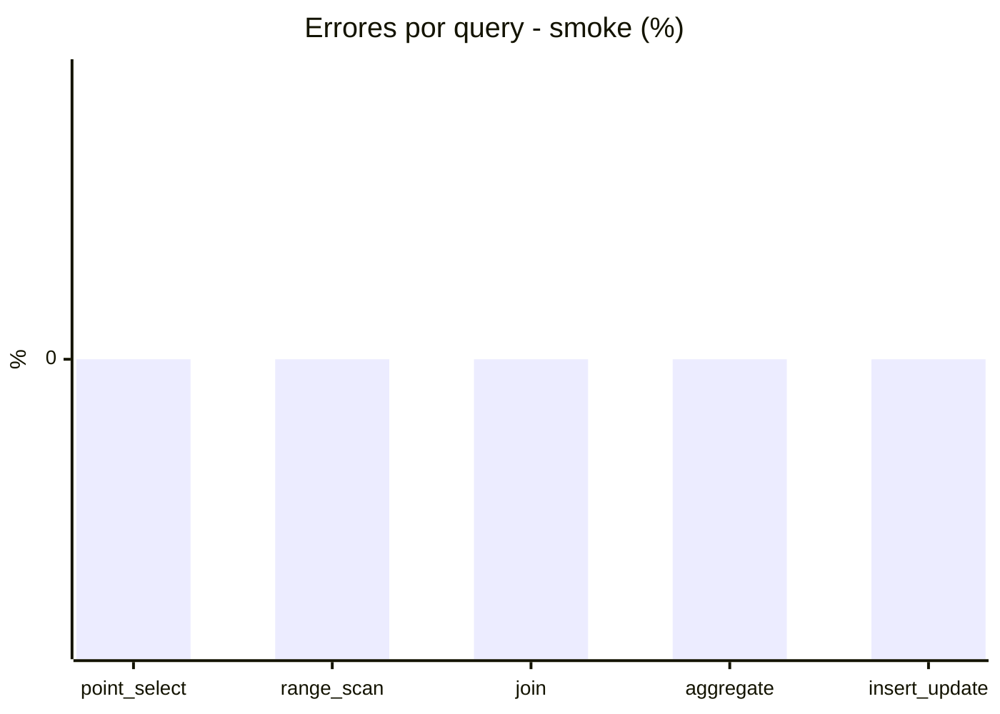

# Reporte de performance - SQL Server (k6)

**Fecha:** 2026-10-28 18:59 UTC  
**Veredicto (SLO):** `WARN`  
**Corrida:** [ver en GitHub Actions](https://github.com/lrbg/k6-sqlserver-lab/actions/runs/40749812306)  

## Analisis del agente de IA

WARN (fallback por umbrales)

- Error maximo: 0.03%
- p95 maximo: 251 ms

## Resultados

### Escenario: `load`

| Metrica | Valor |
| --- | --- |
| Queries ejecutadas | 20840 |
| Errores | 6 (0.03%) |
| Latencia media | 57.6 ms |
| p50 / p90 / p95 / p99 | 16 / 220 / 251 / 295 ms |
| Min / Max | 0 / 542 ms |
| Throughput | 346.47 queries/s |
| Duracion | 60.1 s |

Detalle por query

| Query | Ejecuciones | Error % | avg | p95 | p99 | q/s |
| --- | --- | --- | --- | --- | --- | --- |
| point_select | 4168 | 0% | 5.4 | 15 | 20 | 69.29 |
| range_scan | 4168 | 0% | 21.6 | 49 | 68 | 69.29 |
| join | 4168 | 0% | 8.5 | 18 | 22 | 69.29 |
| aggregate | 4168 | 0% | 220 | 295 | 309 | 69.29 |
| insert_update | 4168 | 0.14% | 32.6 | 70 | 89 | 69.29 |

### Escenario: `smoke`

| Metrica | Valor |
| --- | --- |
| Queries ejecutadas | 8460 |
| Errores | 0 (0%) |
| Latencia media | 10.6 ms |
| p50 / p90 / p95 / p99 | 2 / 46 / 50 / 68 ms |
| Min / Max | 0 / 80 ms |
| Throughput | 281.57 queries/s |
| Duracion | 30 s |

Detalle por query

| Query | Ejecuciones | Error % | avg | p95 | p99 | q/s |
| --- | --- | --- | --- | --- | --- | --- |
| point_select | 1692 | 0% | 0.7 | 1 | 4 | 56.31 |
| range_scan | 1692 | 0% | 2.9 | 5 | 11 | 56.31 |
| join | 1692 | 0% | 1.3 | 5 | 5 | 56.31 |
| aggregate | 1692 | 0% | 44.1 | 68 | 74 | 56.31 |
| insert_update | 1692 | 0% | 4.2 | 13 | 21 | 56.31 |

