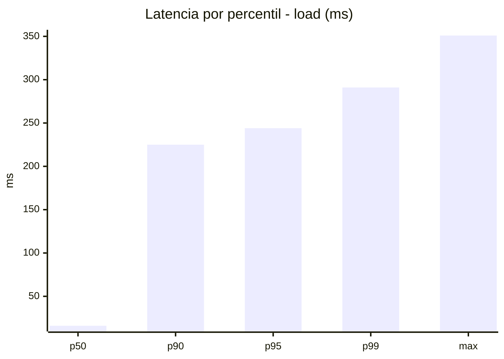
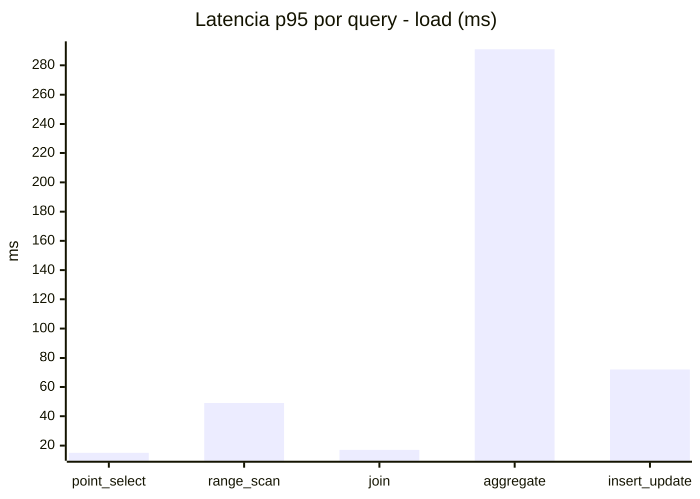
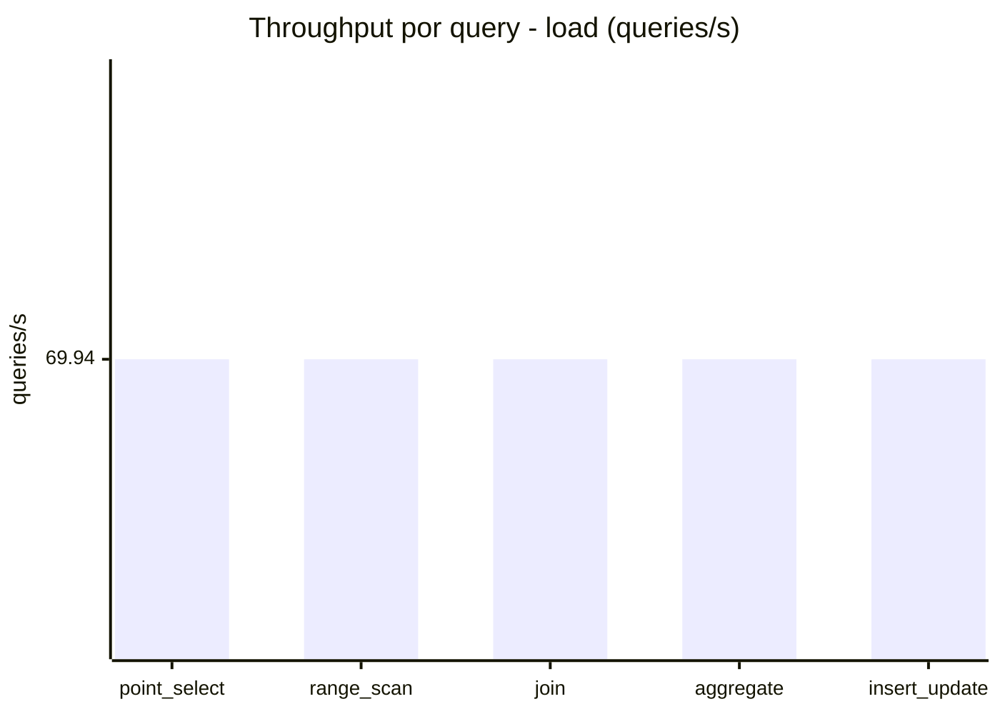
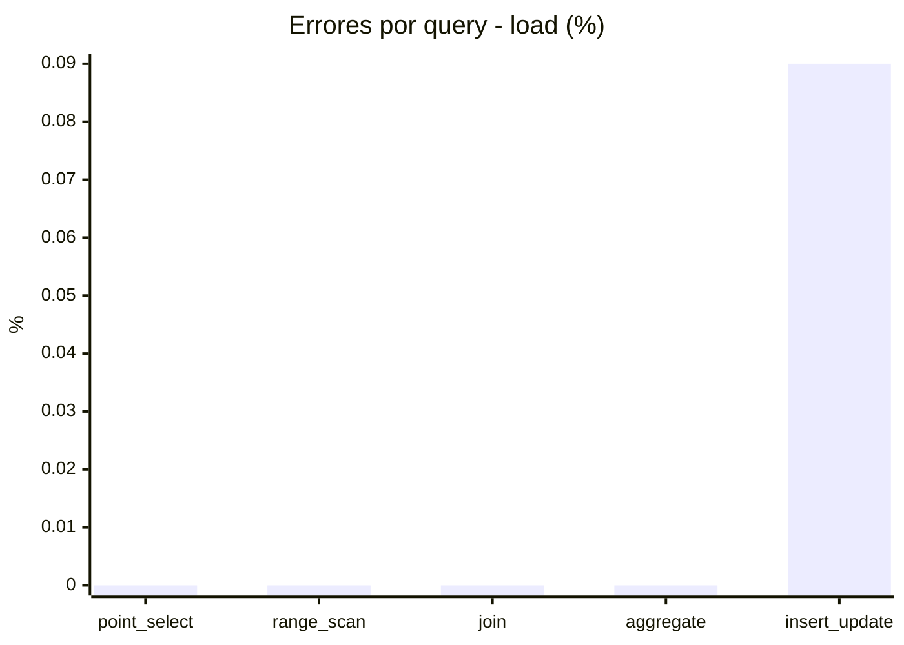
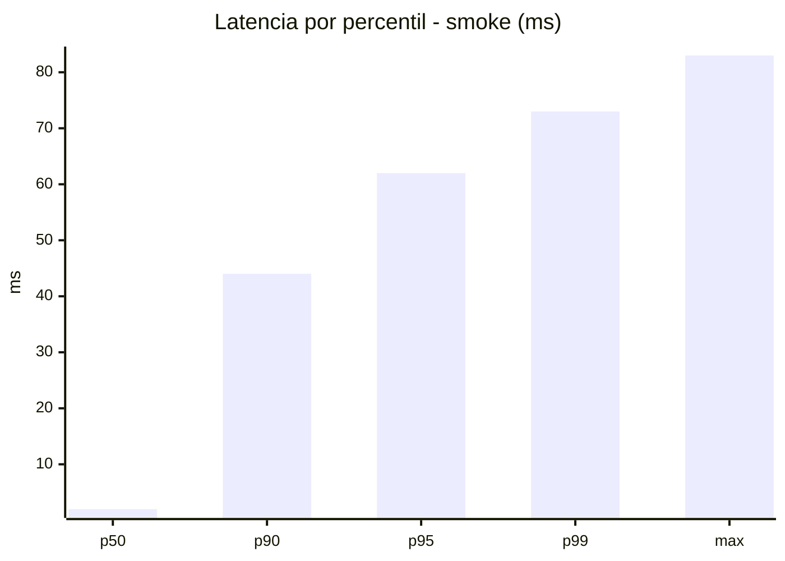
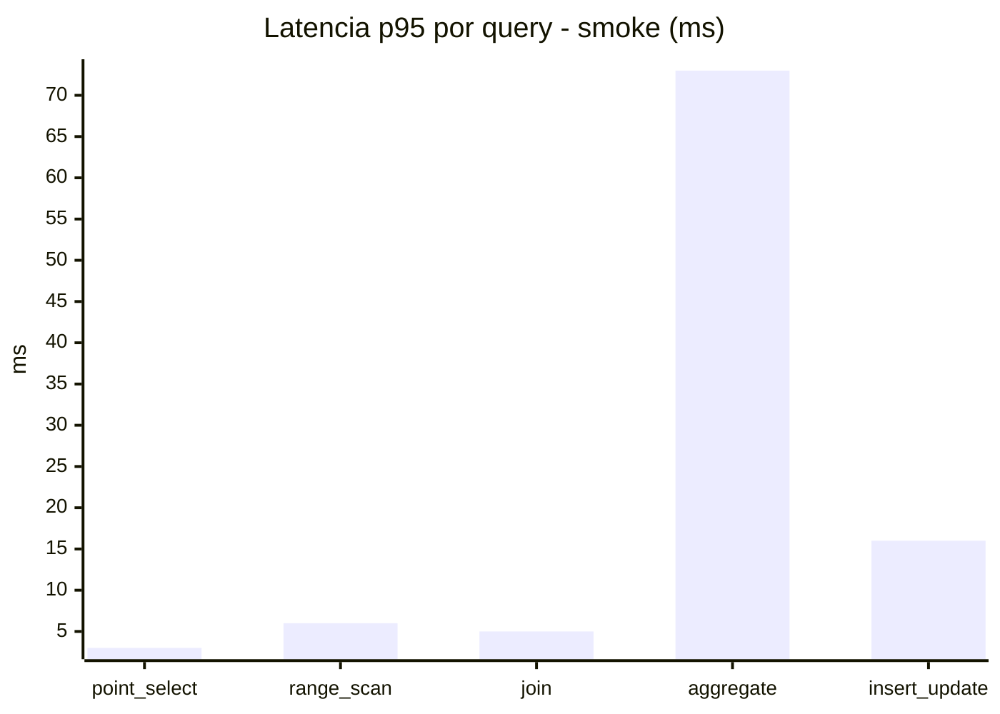
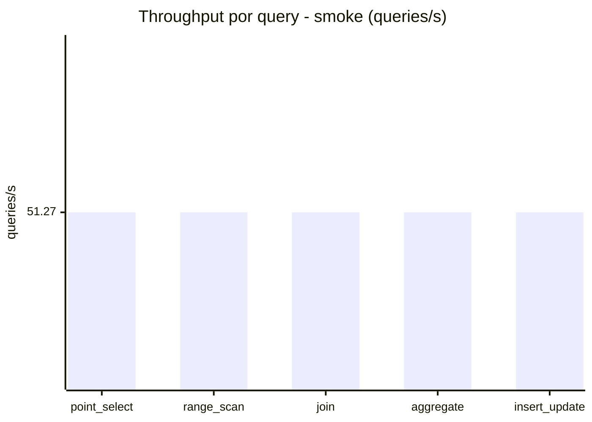
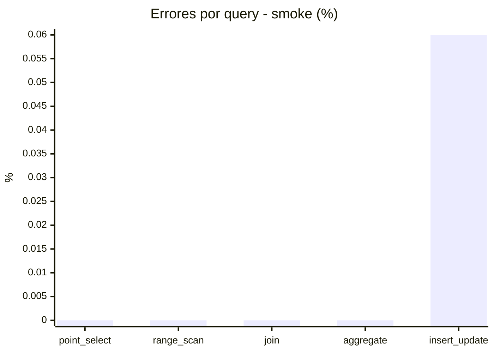

# Reporte de performance - SQL Server (k6)

**Fecha:** 2026-10-29 19:04 UTC  
**Veredicto (SLO):** `WARN`  
**Corrida:** [ver en GitHub Actions](https://github.com/lrbg/k6-sqlserver-lab/actions/runs/40936440917)  

## Analisis del agente de IA

WARN (fallback por umbrales)

- Error maximo: 0.02%
- p95 maximo: 244 ms

## Resultados

### Escenario: `load`

| Metrica | Valor |
| --- | --- |
| Queries ejecutadas | 21055 |
| Errores | 4 (0.02%) |
| Latencia media | 57.1 ms |
| p50 / p90 / p95 / p99 | 16 / 225 / 244 / 291 ms |
| Min / Max | 0 / 351 ms |
| Throughput | 349.69 queries/s |
| Duracion | 60.2 s |

Detalle por query

| Query | Ejecuciones | Error % | avg | p95 | p99 | q/s |
| --- | --- | --- | --- | --- | --- | --- |
| point_select | 4211 | 0% | 5.4 | 15 | 18 | 69.94 |
| range_scan | 4211 | 0% | 21.4 | 49 | 66.8 | 69.94 |
| join | 4211 | 0% | 8.1 | 17 | 21 | 69.94 |
| aggregate | 4211 | 0% | 218.9 | 291 | 306 | 69.94 |
| insert_update | 4211 | 0.09% | 31.6 | 72 | 88 | 69.94 |

### Escenario: `smoke`

| Metrica | Valor |
| --- | --- |
| Queries ejecutadas | 7700 |
| Errores | 1 (0.01%) |
| Latencia media | 11.7 ms |
| p50 / p90 / p95 / p99 | 2 / 44 / 62 / 73 ms |
| Min / Max | 0 / 83 ms |
| Throughput | 256.36 queries/s |
| Duracion | 30 s |

Detalle por query

| Query | Ejecuciones | Error % | avg | p95 | p99 | q/s |
| --- | --- | --- | --- | --- | --- | --- |
| point_select | 1540 | 0% | 0.8 | 3 | 5 | 51.27 |
| range_scan | 1540 | 0% | 2.9 | 6 | 10 | 51.27 |
| join | 1540 | 0% | 1.6 | 5 | 5 | 51.27 |
| aggregate | 1540 | 0% | 48.5 | 73 | 78 | 51.27 |
| insert_update | 1540 | 0.06% | 4.7 | 16 | 21 | 51.27 |

