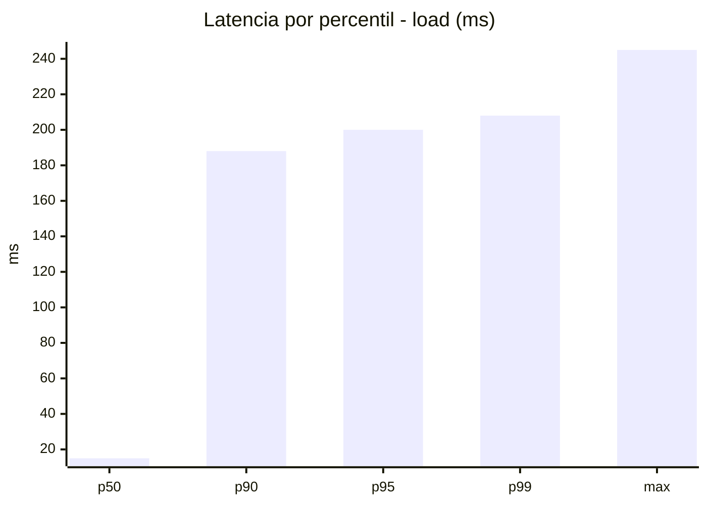
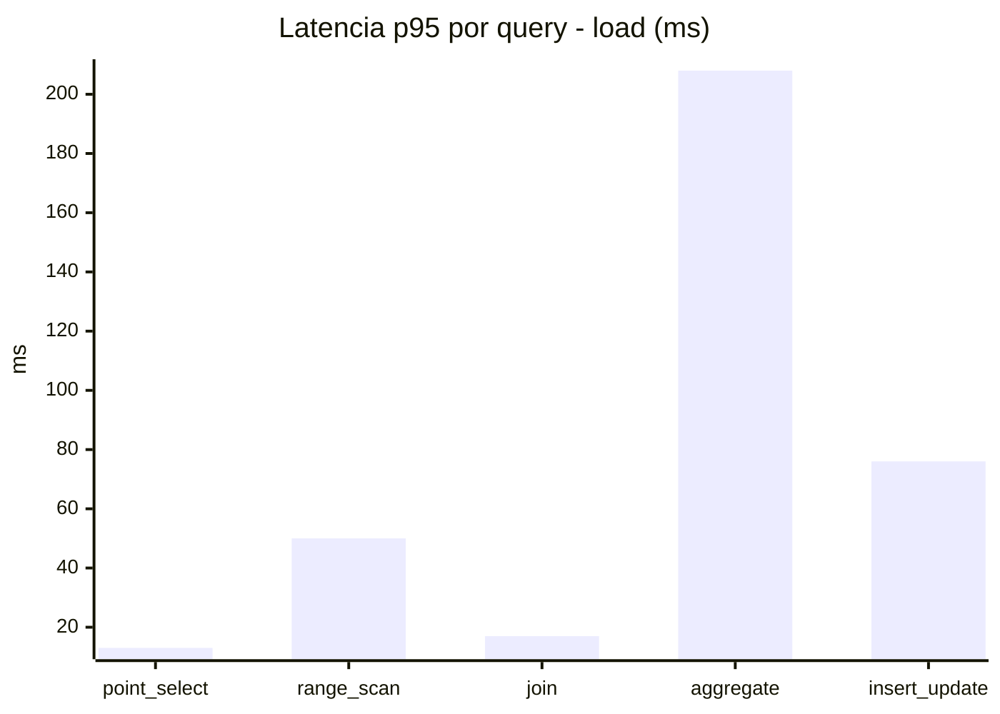
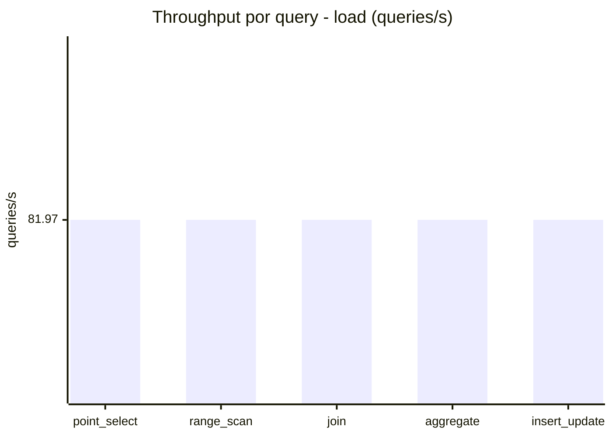
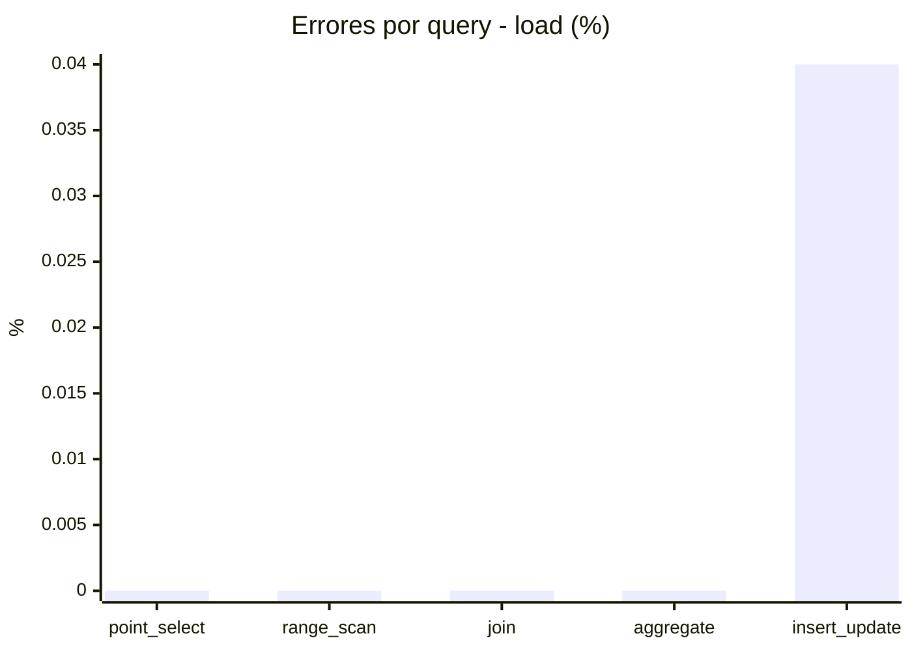
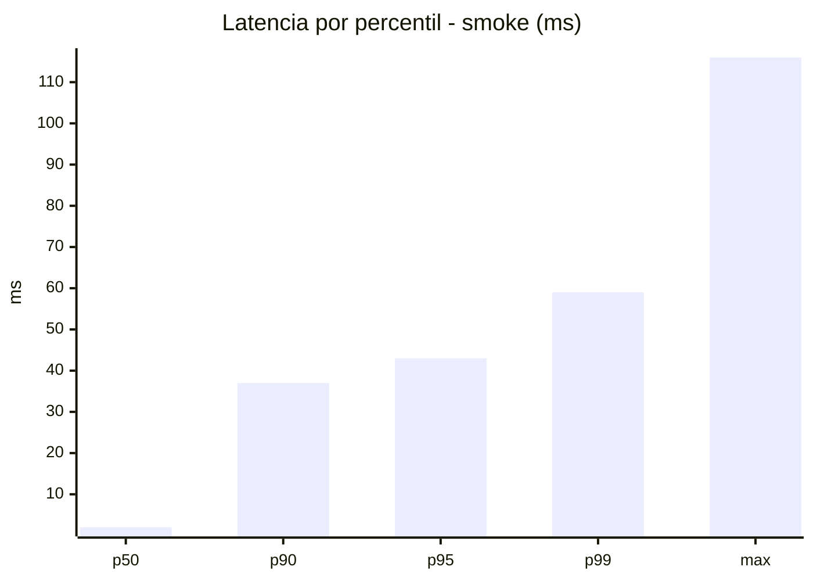
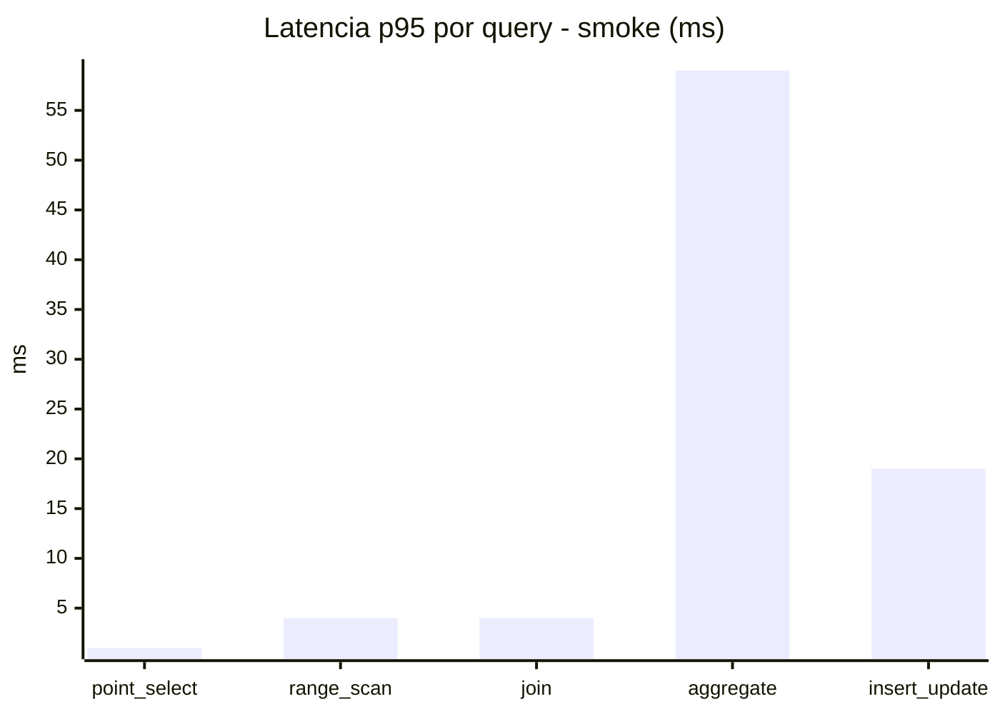
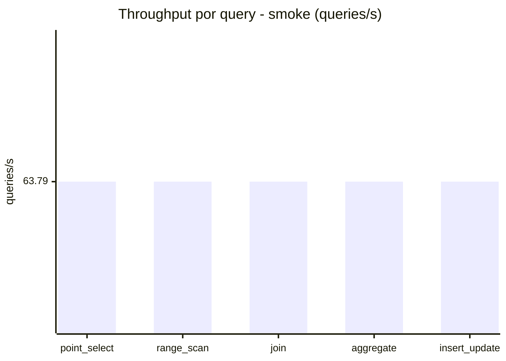
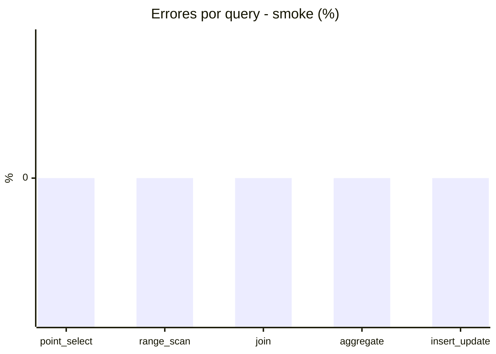

# Reporte de performance - SQL Server (k6)

**Fecha:** 2026-10-30 18:43 UTC  
**Veredicto (SLO):** `PASS`  
**Corrida:** [ver en GitHub Actions](https://github.com/lrbg/k6-sqlserver-lab/actions/runs/41108974963)  

## Analisis del agente de IA

PASS (fallback por umbrales)

- Error maximo: 0.01%
- p95 maximo: 200 ms

## Resultados

### Escenario: `load`

| Metrica | Valor |
| --- | --- |
| Queries ejecutadas | 24675 |
| Errores | 2 (0.01%) |
| Latencia media | 48.7 ms |
| p50 / p90 / p95 / p99 | 15 / 188 / 200 / 208 ms |
| Min / Max | 0 / 245 ms |
| Throughput | 409.83 queries/s |
| Duracion | 60.2 s |

Detalle por query

| Query | Ejecuciones | Error % | avg | p95 | p99 | q/s |
| --- | --- | --- | --- | --- | --- | --- |
| point_select | 4935 | 0% | 3.9 | 13 | 17 | 81.97 |
| range_scan | 4935 | 0% | 21.4 | 50 | 73.7 | 81.97 |
| join | 4935 | 0% | 7.1 | 17 | 18 | 81.97 |
| aggregate | 4935 | 0% | 179.2 | 208 | 220 | 81.97 |
| insert_update | 4935 | 0.04% | 32 | 76 | 136.7 | 81.97 |

### Escenario: `smoke`

| Metrica | Valor |
| --- | --- |
| Queries ejecutadas | 9580 |
| Errores | 0 (0%) |
| Latencia media | 9.4 ms |
| p50 / p90 / p95 / p99 | 2 / 37 / 43 / 59 ms |
| Min / Max | 0 / 116 ms |
| Throughput | 318.95 queries/s |
| Duracion | 30 s |

Detalle por query

| Query | Ejecuciones | Error % | avg | p95 | p99 | q/s |
| --- | --- | --- | --- | --- | --- | --- |
| point_select | 1916 | 0% | 0.6 | 1 | 4 | 63.79 |
| range_scan | 1916 | 0% | 2.6 | 4 | 11 | 63.79 |
| join | 1916 | 0% | 1.1 | 4 | 5 | 63.79 |
| aggregate | 1916 | 0% | 36.9 | 59 | 64 | 63.79 |
| insert_update | 1916 | 0% | 5.7 | 19 | 35 | 63.79 |

