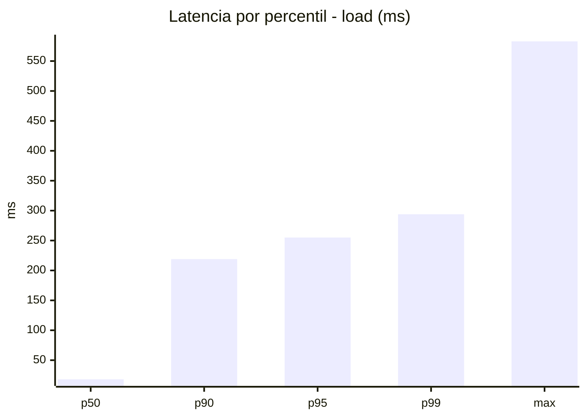
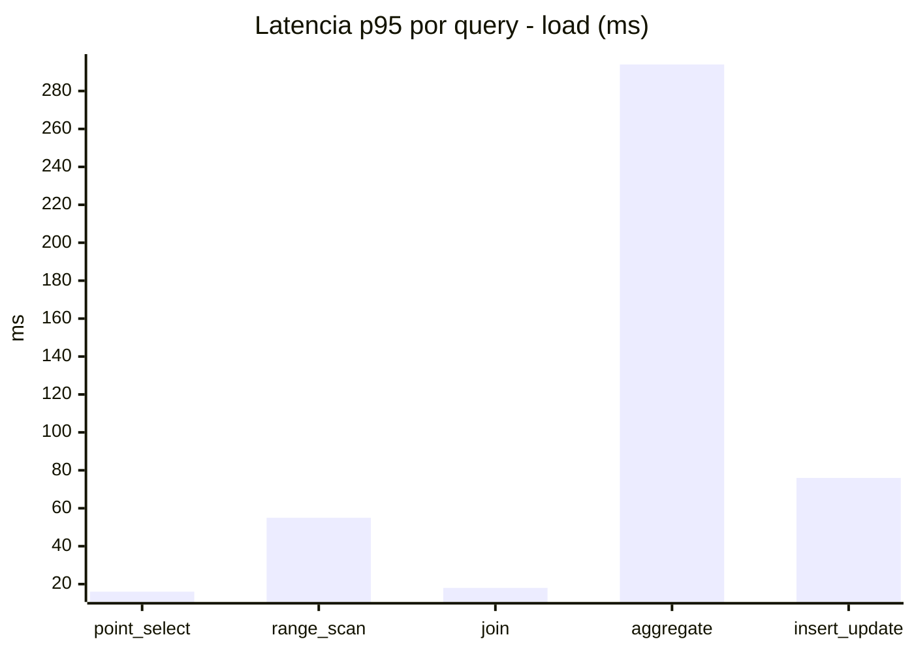
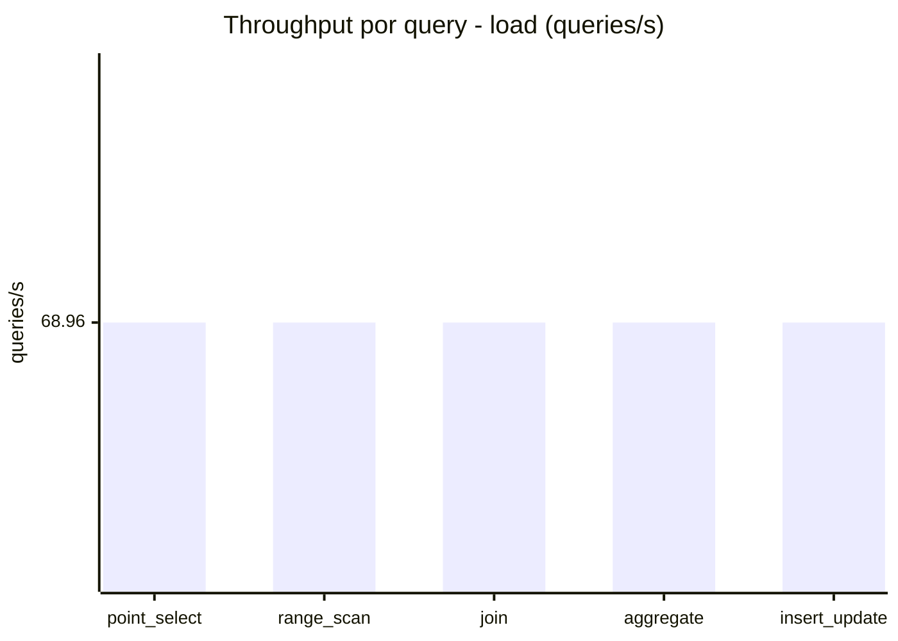
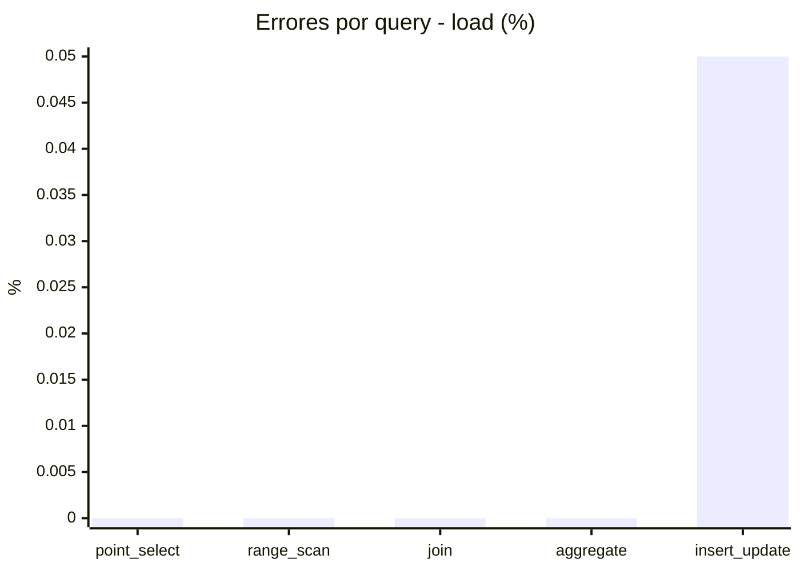
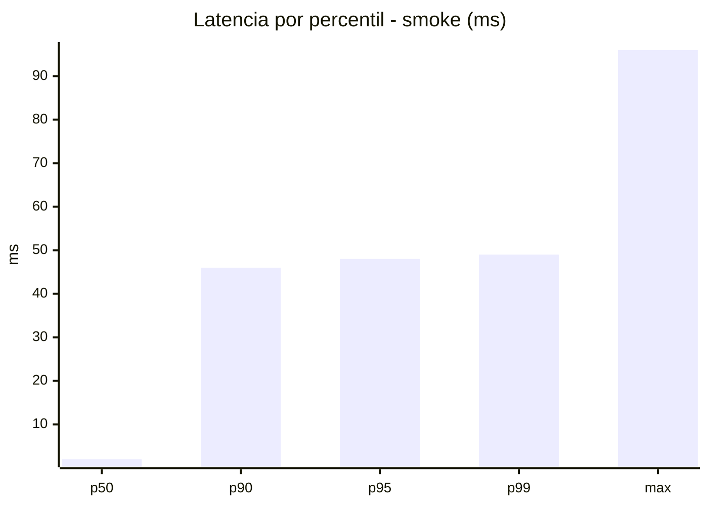
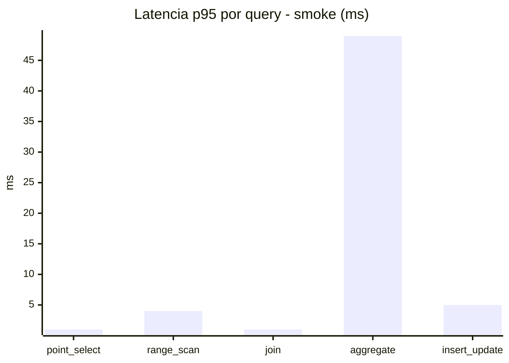
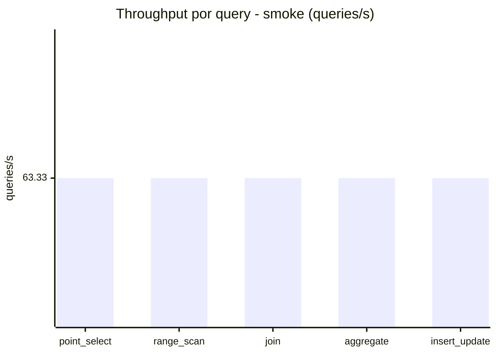
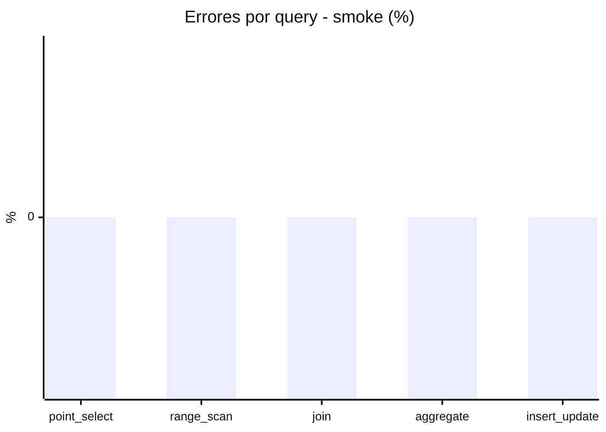

# Reporte de performance - SQL Server (k6)

**Fecha:** 2026-10-31 17:51 UTC  
**Veredicto (SLO):** `WARN`  
**Corrida:** [ver en GitHub Actions](https://github.com/lrbg/k6-sqlserver-lab/actions/runs/41226396458)  

## Analisis del agente de IA

WARN (fallback por umbrales)

- Error maximo: 0.01%
- p95 maximo: 255 ms

## Resultados

### Escenario: `load`

| Metrica | Valor |
| --- | --- |
| Queries ejecutadas | 20765 |
| Errores | 2 (0.01%) |
| Latencia media | 57.9 ms |
| p50 / p90 / p95 / p99 | 18 / 219 / 255 / 294 ms |
| Min / Max | 0 / 583 ms |
| Throughput | 344.8 queries/s |
| Duracion | 60.2 s |

Detalle por query

| Query | Ejecuciones | Error % | avg | p95 | p99 | q/s |
| --- | --- | --- | --- | --- | --- | --- |
| point_select | 4153 | 0% | 5.7 | 16 | 21 | 68.96 |
| range_scan | 4153 | 0% | 24.8 | 55 | 78.5 | 68.96 |
| join | 4153 | 0% | 8.4 | 18 | 22 | 68.96 |
| aggregate | 4153 | 0% | 213.8 | 294 | 314.5 | 68.96 |
| insert_update | 4153 | 0.05% | 36.8 | 76 | 95 | 68.96 |

### Escenario: `smoke`

| Metrica | Valor |
| --- | --- |
| Queries ejecutadas | 9505 |
| Errores | 0 (0%) |
| Latencia media | 9.4 ms |
| p50 / p90 / p95 / p99 | 2 / 46 / 48 / 49 ms |
| Min / Max | 0 / 96 ms |
| Throughput | 316.63 queries/s |
| Duracion | 30 s |

Detalle por query

| Query | Ejecuciones | Error % | avg | p95 | p99 | q/s |
| --- | --- | --- | --- | --- | --- | --- |
| point_select | 1901 | 0% | 0.6 | 1 | 2 | 63.33 |
| range_scan | 1901 | 0% | 2.7 | 4 | 6 | 63.33 |
| join | 1901 | 0% | 0.9 | 1 | 3 | 63.33 |
| aggregate | 1901 | 0% | 40.1 | 49 | 50 | 63.33 |
| insert_update | 1901 | 0% | 2.9 | 5 | 8 | 63.33 |

