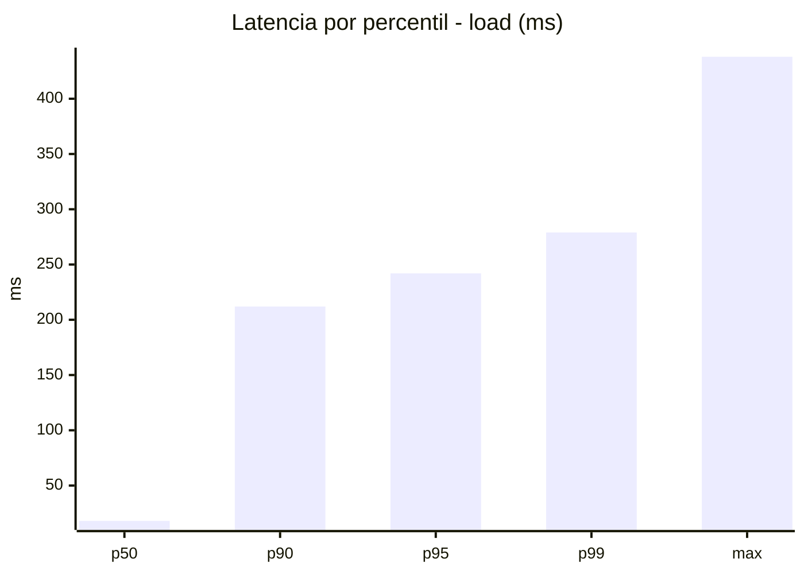
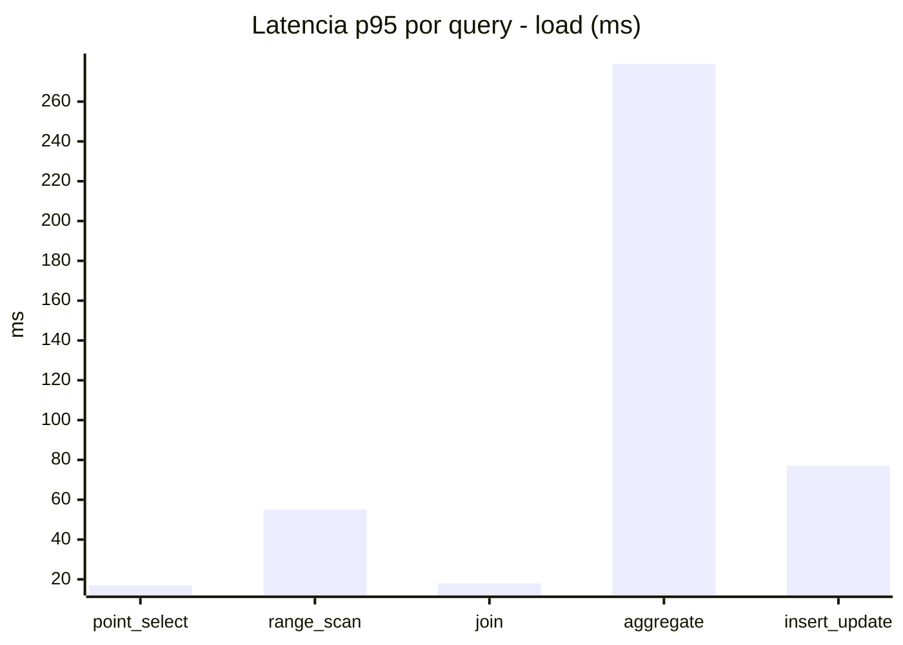
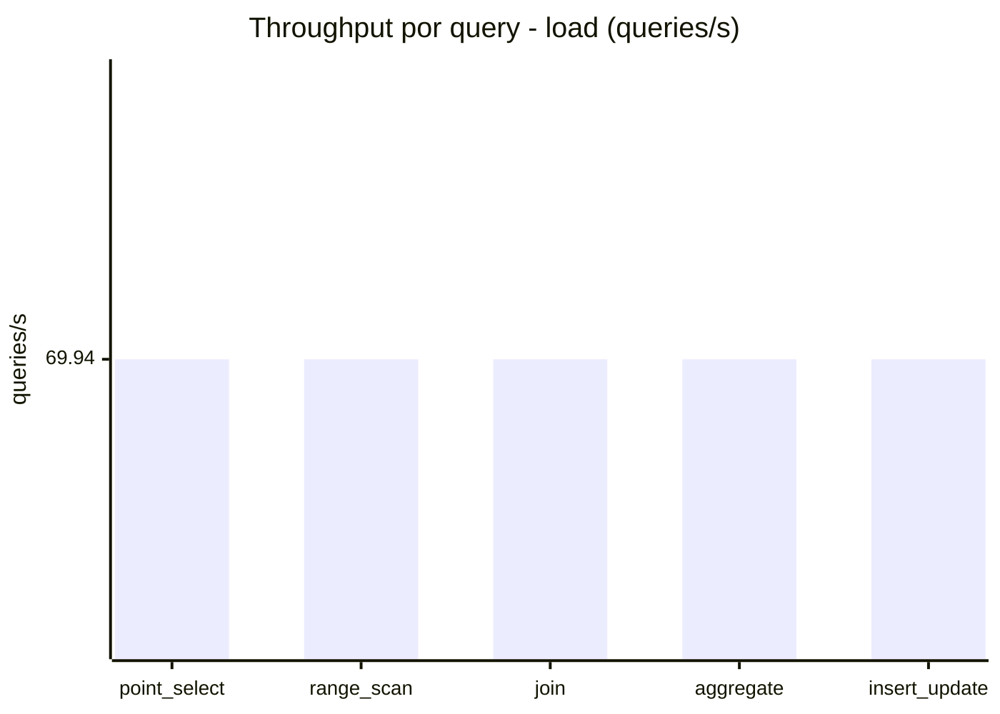
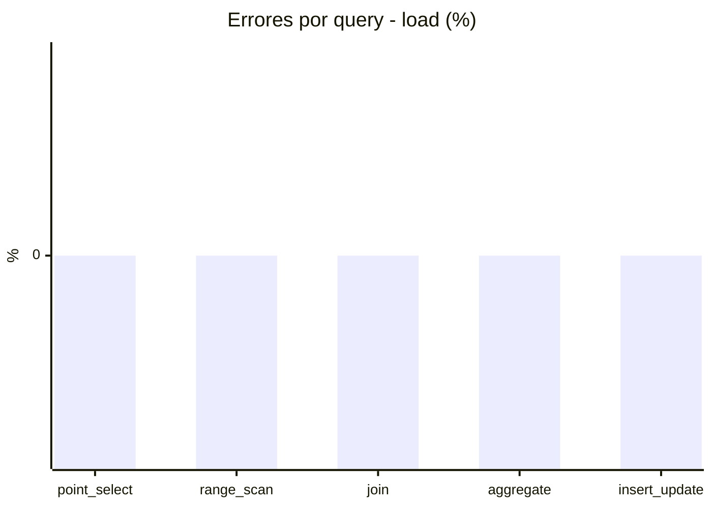
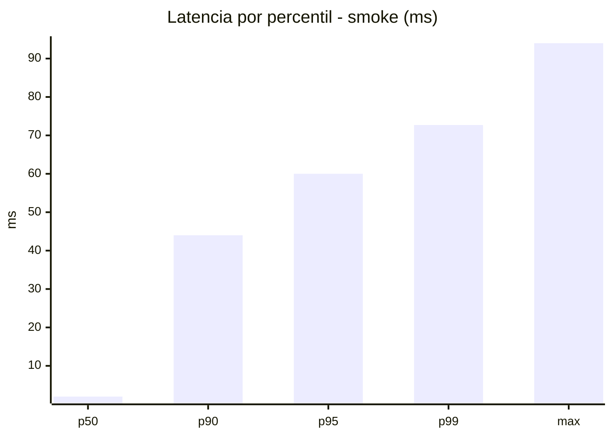
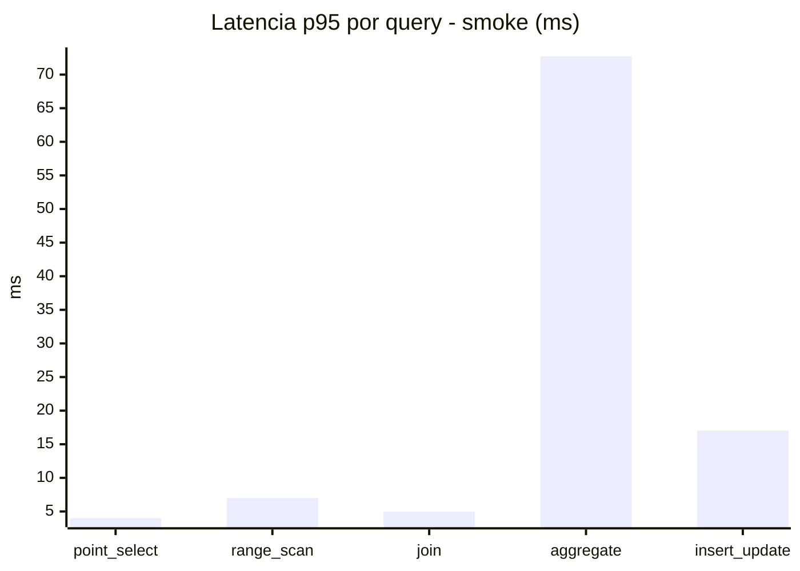
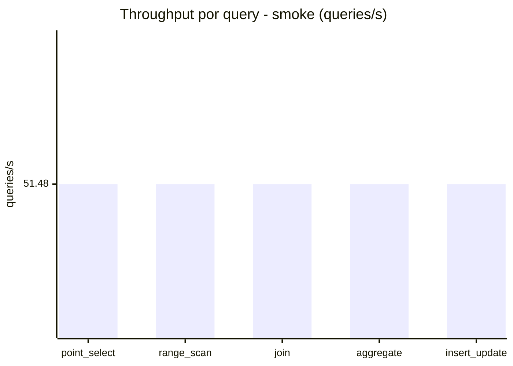
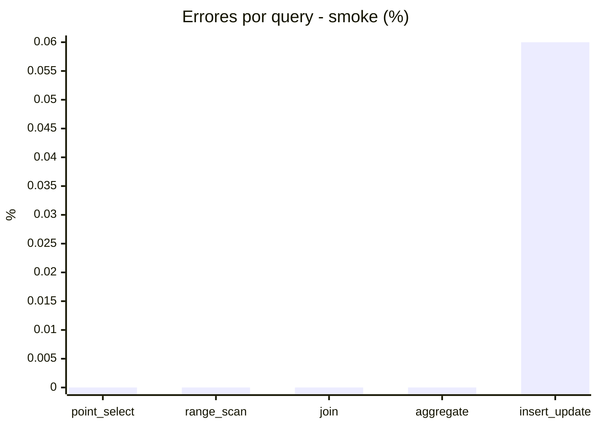

# Reporte de performance - SQL Server (k6)

**Fecha:** 2026-11-01 18:29 UTC  
**Veredicto (SLO):** `WARN`  
**Corrida:** [ver en GitHub Actions](https://github.com/lrbg/k6-sqlserver-lab/actions/runs/41336741107)  

## Analisis del agente de IA

WARN (fallback por umbrales)

- Error maximo: 0.01%
- p95 maximo: 242 ms

## Resultados

### Escenario: `load`

| Metrica | Valor |
| --- | --- |
| Queries ejecutadas | 21055 |
| Errores | 0 (0%) |
| Latencia media | 57.1 ms |
| p50 / p90 / p95 / p99 | 18 / 212 / 242 / 279 ms |
| Min / Max | 0 / 438 ms |
| Throughput | 349.71 queries/s |
| Duracion | 60.2 s |

Detalle por query

| Query | Ejecuciones | Error % | avg | p95 | p99 | q/s |
| --- | --- | --- | --- | --- | --- | --- |
| point_select | 4211 | 0% | 6 | 17 | 21 | 69.94 |
| range_scan | 4211 | 0% | 25 | 55 | 79.9 | 69.94 |
| join | 4211 | 0% | 8.5 | 18 | 22 | 69.94 |
| aggregate | 4211 | 0% | 208.9 | 279 | 298 | 69.94 |
| insert_update | 4211 | 0% | 37.1 | 77 | 95 | 69.94 |

### Escenario: `smoke`

| Metrica | Valor |
| --- | --- |
| Queries ejecutadas | 7735 |
| Errores | 1 (0.01%) |
| Latencia media | 11.6 ms |
| p50 / p90 / p95 / p99 | 2 / 44 / 60 / 72.7 ms |
| Min / Max | 0 / 94 ms |
| Throughput | 257.39 queries/s |
| Duracion | 30.1 s |

Detalle por query

| Query | Ejecuciones | Error % | avg | p95 | p99 | q/s |
| --- | --- | --- | --- | --- | --- | --- |
| point_select | 1547 | 0% | 0.9 | 4 | 5 | 51.48 |
| range_scan | 1547 | 0% | 3.1 | 7 | 11 | 51.48 |
| join | 1547 | 0% | 1.7 | 5 | 5 | 51.48 |
| aggregate | 1547 | 0% | 47.3 | 72.7 | 79 | 51.48 |
| insert_update | 1547 | 0.06% | 5.1 | 17 | 24 | 51.48 |

