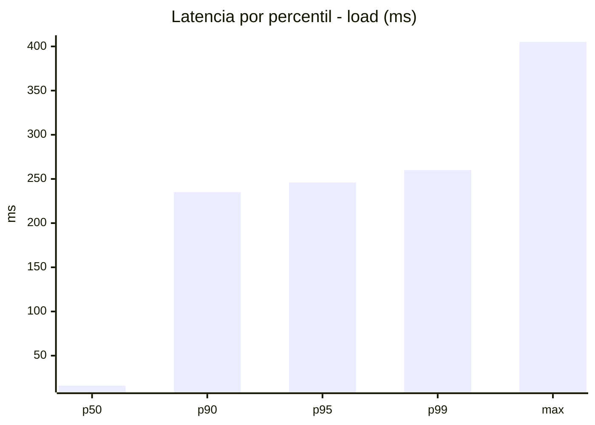
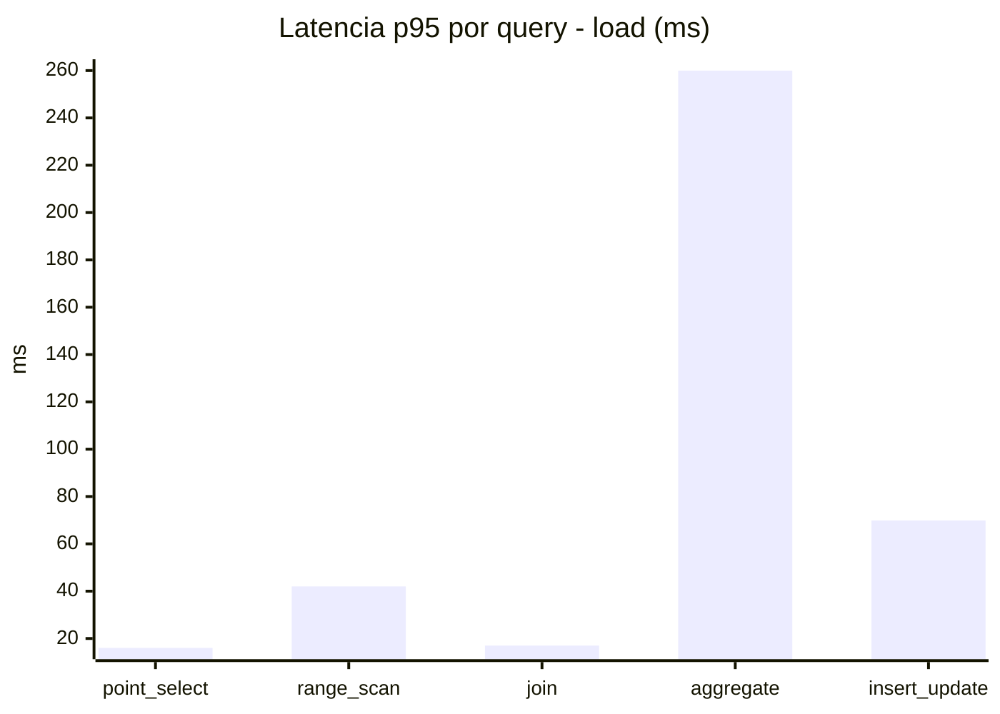
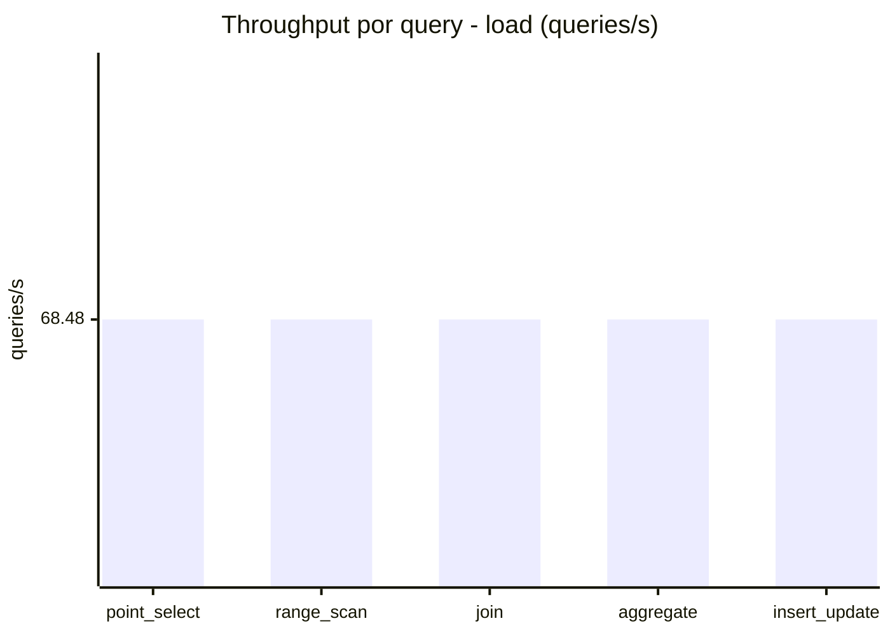
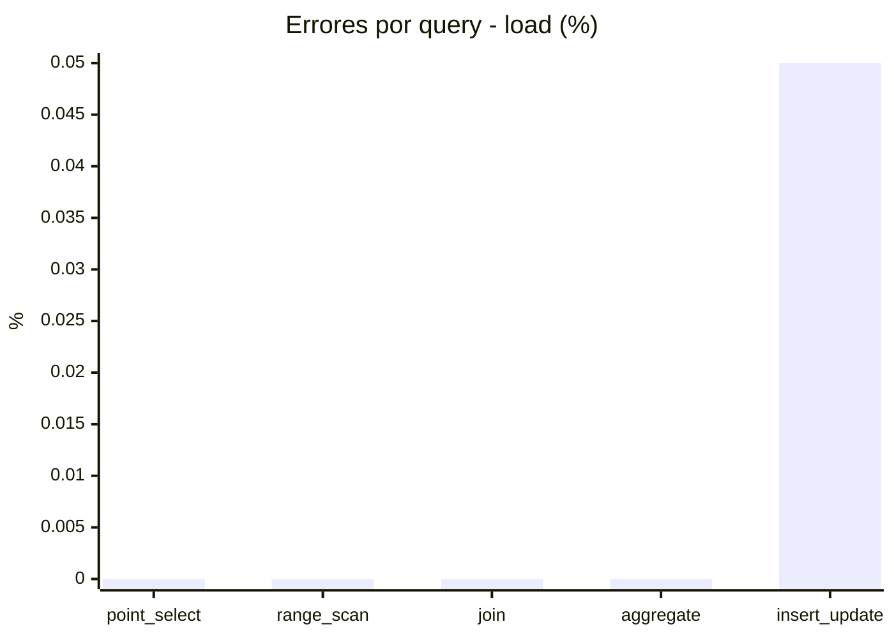
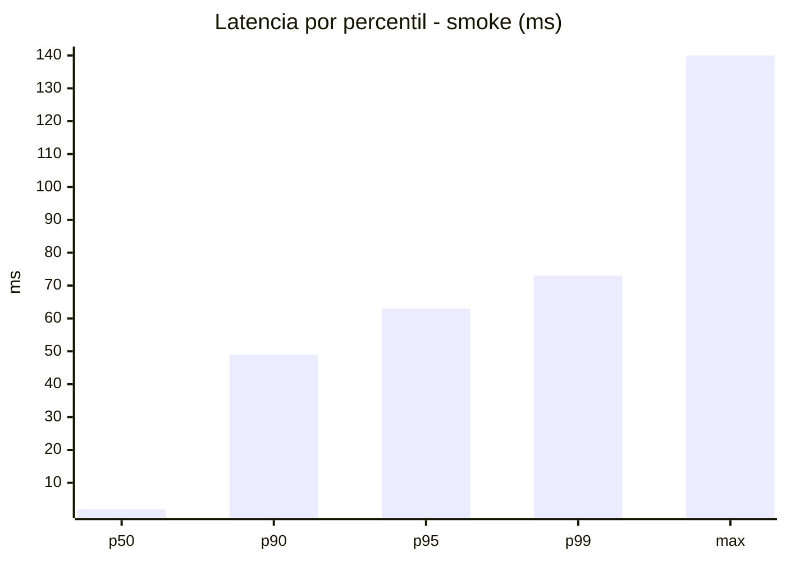
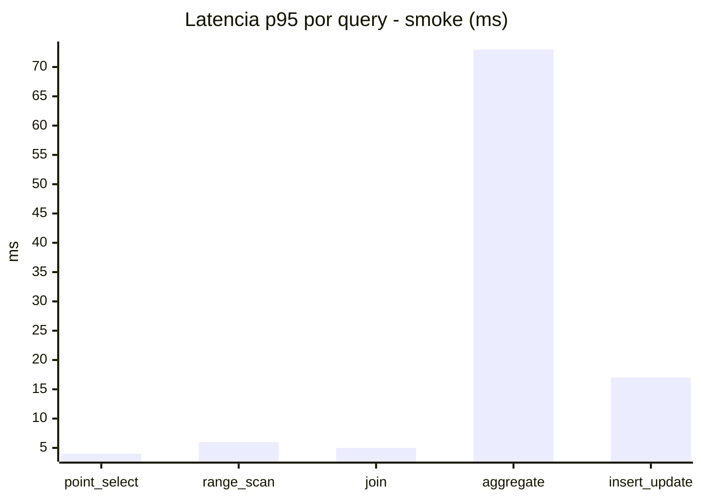
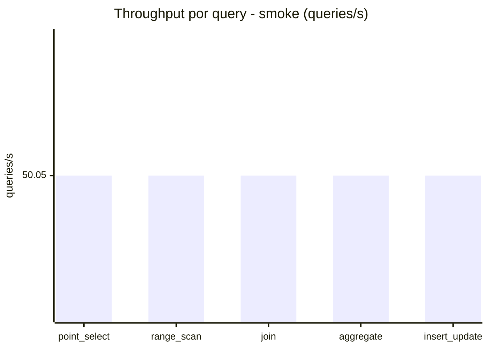
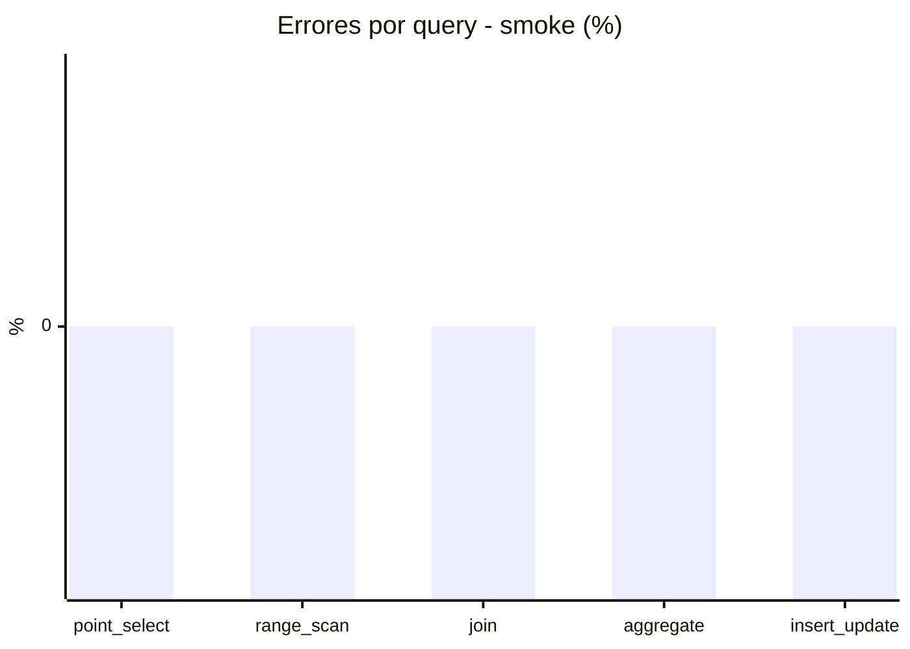

# Reporte de performance - SQL Server (k6)

**Fecha:** 2026-11-02 22:24 UTC  
**Veredicto (SLO):** `WARN`  
**Corrida:** [ver en GitHub Actions](https://github.com/lrbg/k6-sqlserver-lab/actions/runs/41536757320)  

## Analisis del agente de IA

WARN (fallback por umbrales)

- Error maximo: 0.01%
- p95 maximo: 246 ms

## Resultados

### Escenario: `load`

| Metrica | Valor |
| --- | --- |
| Queries ejecutadas | 20610 |
| Errores | 2 (0.01%) |
| Latencia media | 58.3 ms |
| p50 / p90 / p95 / p99 | 16 / 235 / 246 / 260 ms |
| Min / Max | 0 / 405 ms |
| Throughput | 342.41 queries/s |
| Duracion | 60.2 s |

Detalle por query

| Query | Ejecuciones | Error % | avg | p95 | p99 | q/s |
| --- | --- | --- | --- | --- | --- | --- |
| point_select | 4122 | 0% | 5.4 | 16 | 17 | 68.48 |
| range_scan | 4122 | 0% | 19.6 | 42 | 59 | 68.48 |
| join | 4122 | 0% | 8.6 | 17 | 19 | 68.48 |
| aggregate | 4122 | 0% | 228.2 | 260 | 282 | 68.48 |
| insert_update | 4122 | 0.05% | 30 | 69.9 | 79 | 68.48 |

### Escenario: `smoke`

| Metrica | Valor |
| --- | --- |
| Queries ejecutadas | 7510 |
| Errores | 0 (0%) |
| Latencia media | 12 ms |
| p50 / p90 / p95 / p99 | 2 / 49 / 63 / 73 ms |
| Min / Max | 0 / 140 ms |
| Throughput | 250.26 queries/s |
| Duracion | 30 s |

Detalle por query

| Query | Ejecuciones | Error % | avg | p95 | p99 | q/s |
| --- | --- | --- | --- | --- | --- | --- |
| point_select | 1502 | 0% | 0.9 | 4 | 5 | 50.05 |
| range_scan | 1502 | 0% | 2.9 | 6 | 8 | 50.05 |
| join | 1502 | 0% | 1.7 | 5 | 5 | 50.05 |
| aggregate | 1502 | 0% | 49.2 | 73 | 79 | 50.05 |
| insert_update | 1502 | 0% | 5 | 17 | 24 | 50.05 |

