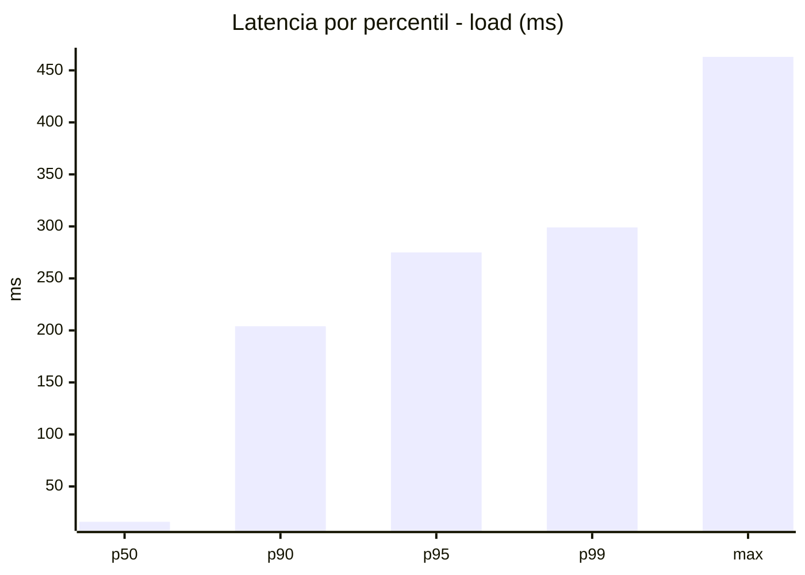
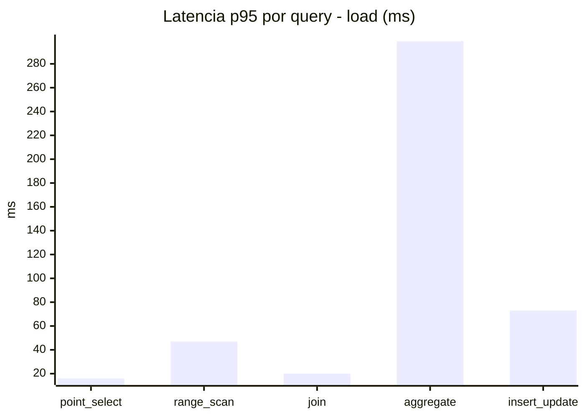
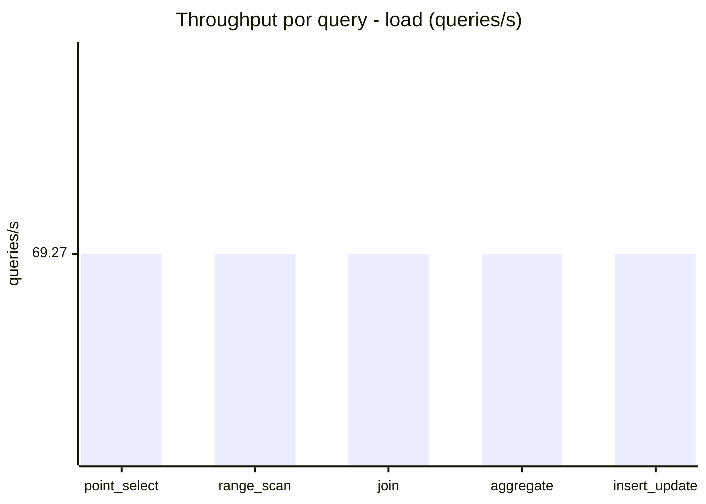
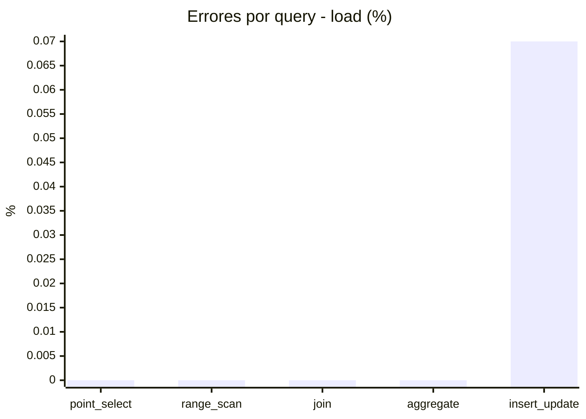
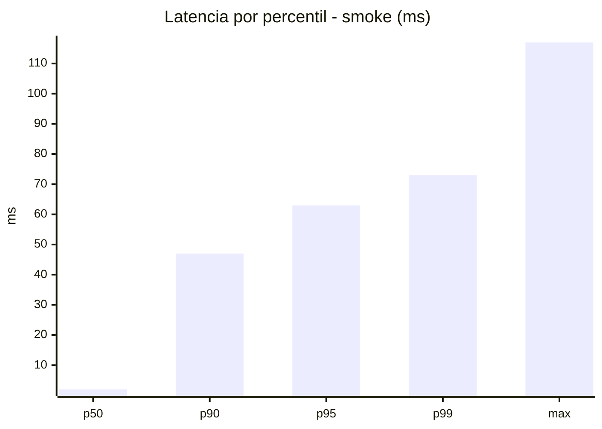
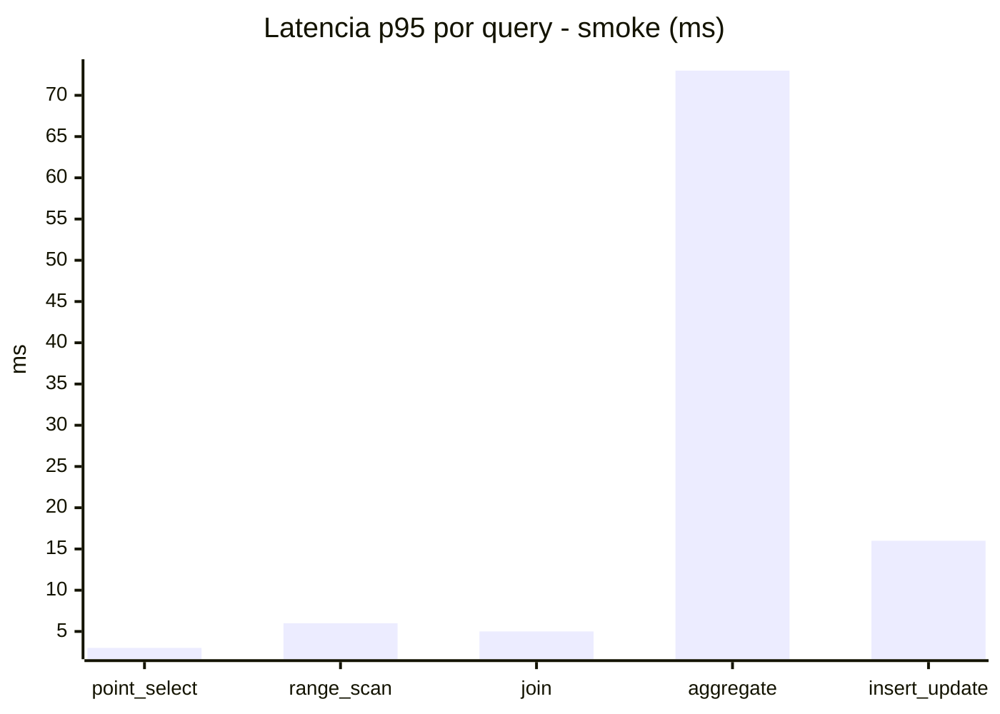
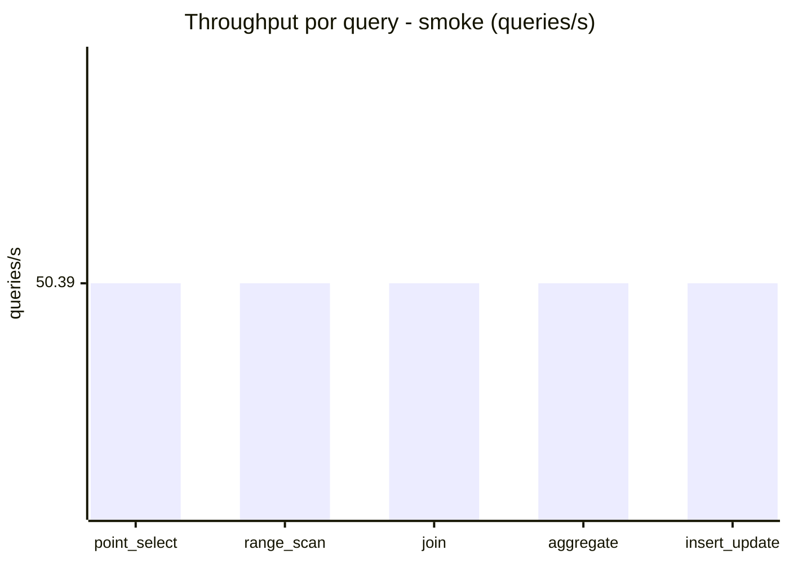
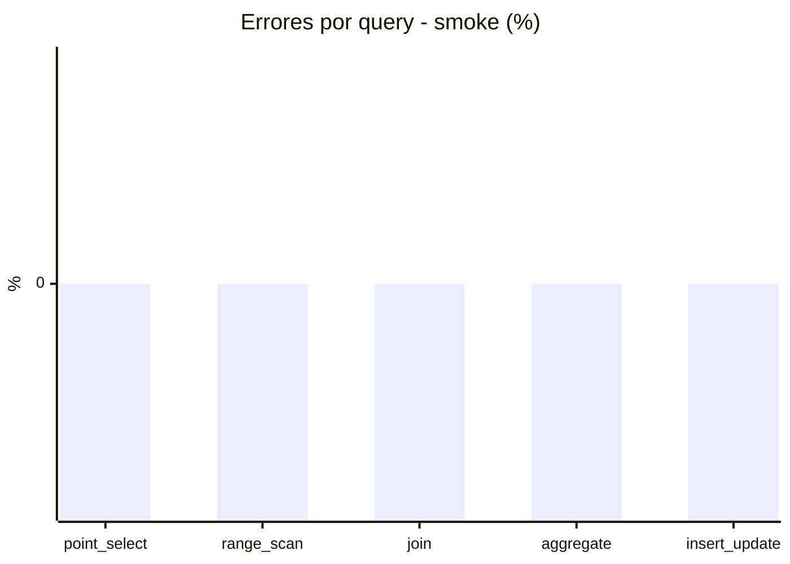

# Reporte de performance - SQL Server (k6)

**Fecha:** 2026-11-03 20:12 UTC  
**Veredicto (SLO):** `WARN`  
**Corrida:** [ver en GitHub Actions](https://github.com/lrbg/k6-sqlserver-lab/actions/runs/41710043579)  

## Analisis del agente de IA

WARN (fallback por umbrales)

- Error maximo: 0.01%
- p95 maximo: 275 ms

## Resultados

### Escenario: `load`

| Metrica | Valor |
| --- | --- |
| Queries ejecutadas | 20860 |
| Errores | 3 (0.01%) |
| Latencia media | 57.7 ms |
| p50 / p90 / p95 / p99 | 16 / 204 / 275 / 299 ms |
| Min / Max | 0 / 463 ms |
| Throughput | 346.34 queries/s |
| Duracion | 60.2 s |

Detalle por query

| Query | Ejecuciones | Error % | avg | p95 | p99 | q/s |
| --- | --- | --- | --- | --- | --- | --- |
| point_select | 4172 | 0% | 5.6 | 16 | 21 | 69.27 |
| range_scan | 4172 | 0% | 21.2 | 47 | 69 | 69.27 |
| join | 4172 | 0% | 8.5 | 20 | 22 | 69.27 |
| aggregate | 4172 | 0% | 220.3 | 299 | 313.3 | 69.27 |
| insert_update | 4172 | 0.07% | 32.7 | 73 | 94.3 | 69.27 |

### Escenario: `smoke`

| Metrica | Valor |
| --- | --- |
| Queries ejecutadas | 7565 |
| Errores | 0 (0%) |
| Latencia media | 11.9 ms |
| p50 / p90 / p95 / p99 | 2 / 47 / 63 / 73 ms |
| Min / Max | 0 / 117 ms |
| Throughput | 251.95 queries/s |
| Duracion | 30 s |

Detalle por query

| Query | Ejecuciones | Error % | avg | p95 | p99 | q/s |
| --- | --- | --- | --- | --- | --- | --- |
| point_select | 1513 | 0% | 0.8 | 3 | 5 | 50.39 |
| range_scan | 1513 | 0% | 3 | 6 | 11 | 50.39 |
| join | 1513 | 0% | 1.7 | 5 | 5 | 50.39 |
| aggregate | 1513 | 0% | 49 | 73 | 80.9 | 50.39 |
| insert_update | 1513 | 0% | 5 | 16 | 23.9 | 50.39 |

