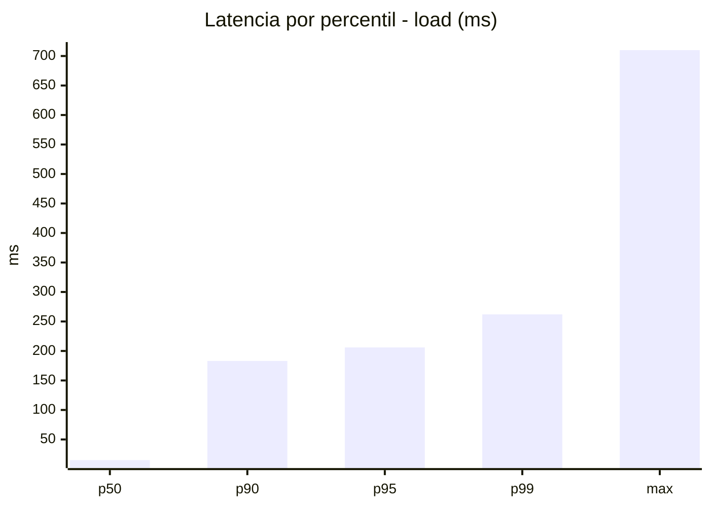
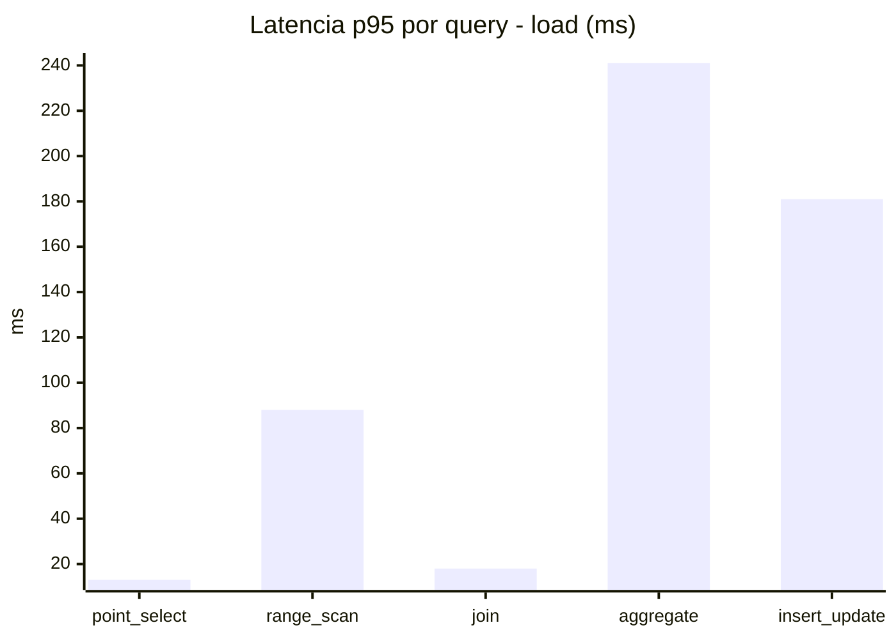
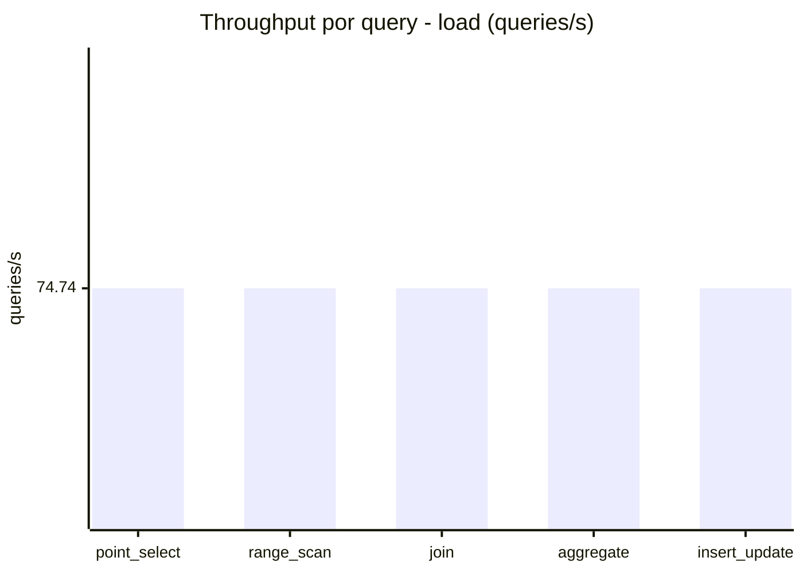
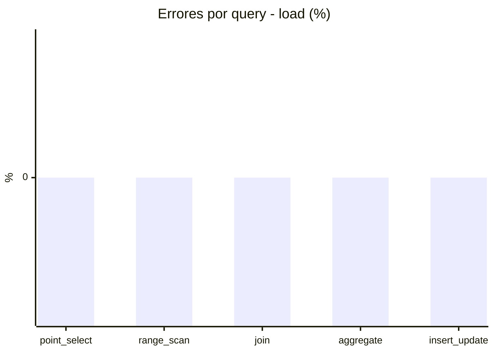
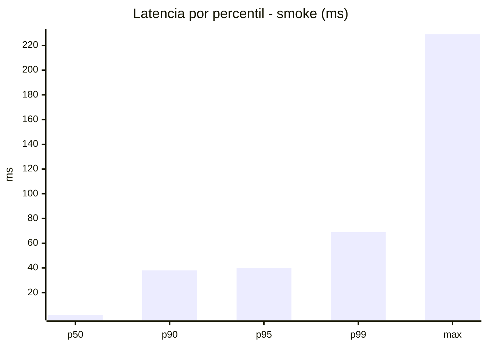
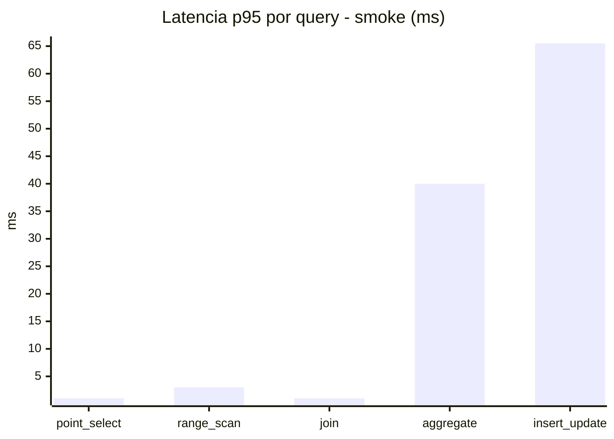
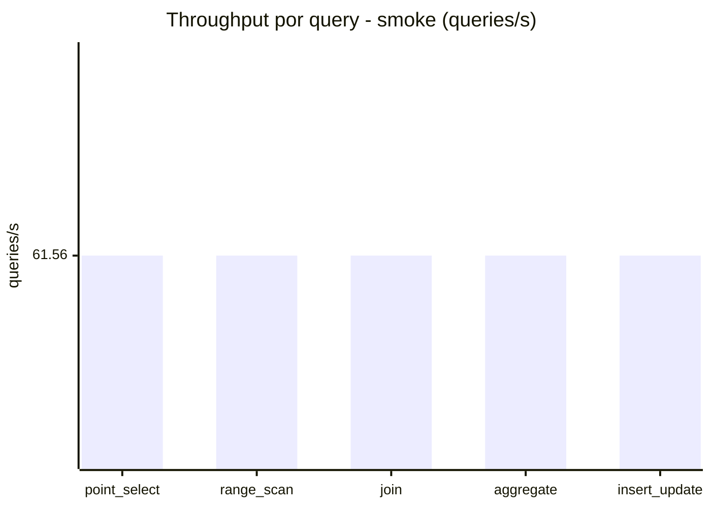
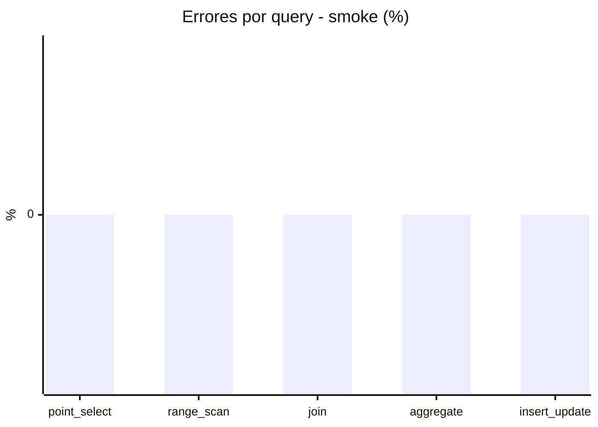

# Reporte de performance - SQL Server (k6)

**Fecha:** 2026-11-04 20:30 UTC  
**Veredicto (SLO):** `WARN`  
**Corrida:** [ver en GitHub Actions](https://github.com/lrbg/k6-sqlserver-lab/actions/runs/41906848079)  

## Analisis del agente de IA

WARN (fallback por umbrales)

- Error maximo: 0%
- p95 maximo: 206 ms

## Resultados

### Escenario: `load`

| Metrica | Valor |
| --- | --- |
| Queries ejecutadas | 22500 |
| Errores | 0 (0%) |
| Latencia media | 53.5 ms |
| p50 / p90 / p95 / p99 | 15 / 183.1 / 206 / 262 ms |
| Min / Max | 0 / 710 ms |
| Throughput | 373.68 queries/s |
| Duracion | 60.2 s |

Detalle por query

| Query | Ejecuciones | Error % | avg | p95 | p99 | q/s |
| --- | --- | --- | --- | --- | --- | --- |
| point_select | 4500 | 0% | 4 | 13 | 18 | 74.74 |
| range_scan | 4500 | 0% | 28.6 | 88 | 248 | 74.74 |
| join | 4500 | 0% | 7.4 | 18 | 22 | 74.74 |
| aggregate | 4500 | 0% | 171.8 | 241 | 268 | 74.74 |
| insert_update | 4500 | 0% | 55.7 | 181 | 410.1 | 74.74 |

### Escenario: `smoke`

| Metrica | Valor |
| --- | --- |
| Queries ejecutadas | 9250 |
| Errores | 0 (0%) |
| Latencia media | 9.7 ms |
| p50 / p90 / p95 / p99 | 2 / 38 / 40 / 69 ms |
| Min / Max | 0 / 229 ms |
| Throughput | 307.8 queries/s |
| Duracion | 30.1 s |

Detalle por query

| Query | Ejecuciones | Error % | avg | p95 | p99 | q/s |
| --- | --- | --- | --- | --- | --- | --- |
| point_select | 1850 | 0% | 0.4 | 1 | 1 | 61.56 |
| range_scan | 1850 | 0% | 2.8 | 3 | 15.1 | 61.56 |
| join | 1850 | 0% | 0.8 | 1 | 3 | 61.56 |
| aggregate | 1850 | 0% | 32.5 | 40 | 41 | 61.56 |
| insert_update | 1850 | 0% | 12.1 | 65.5 | 153.5 | 61.56 |

