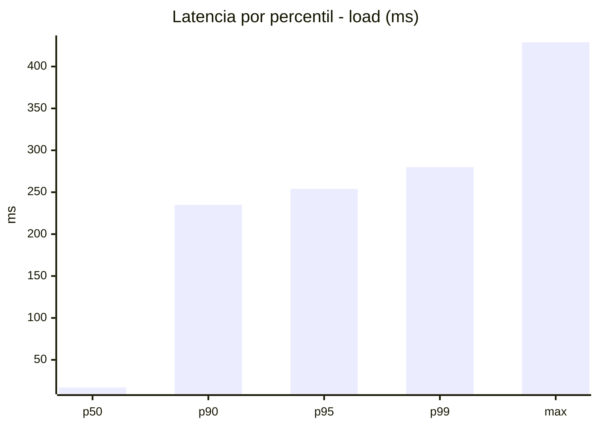
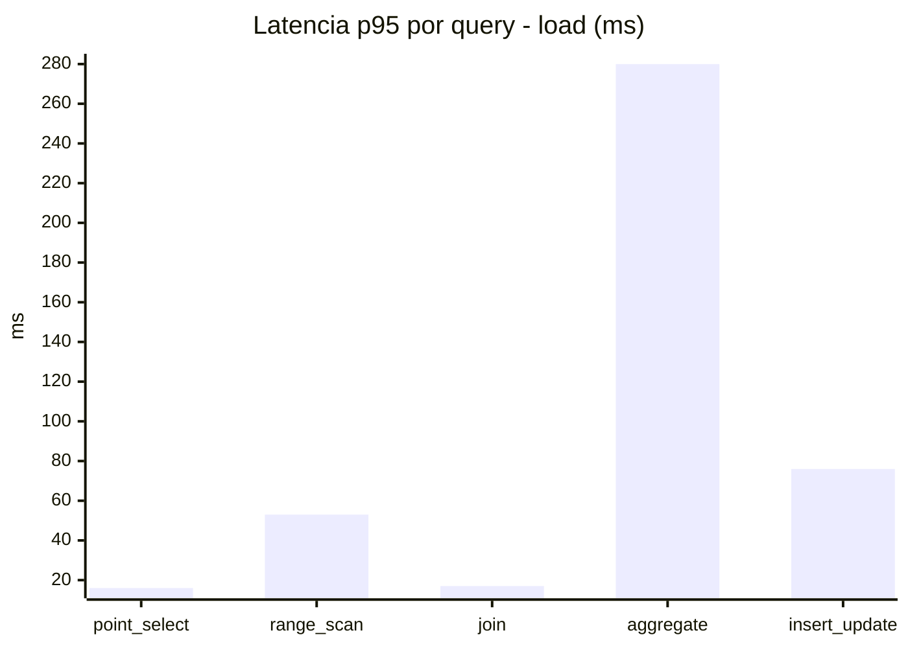
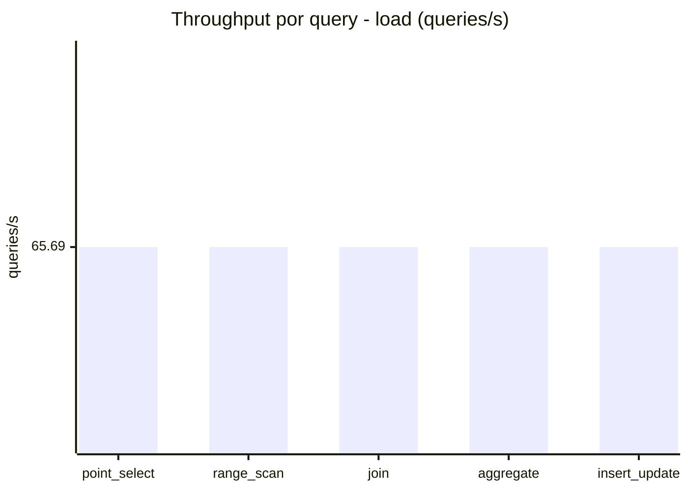
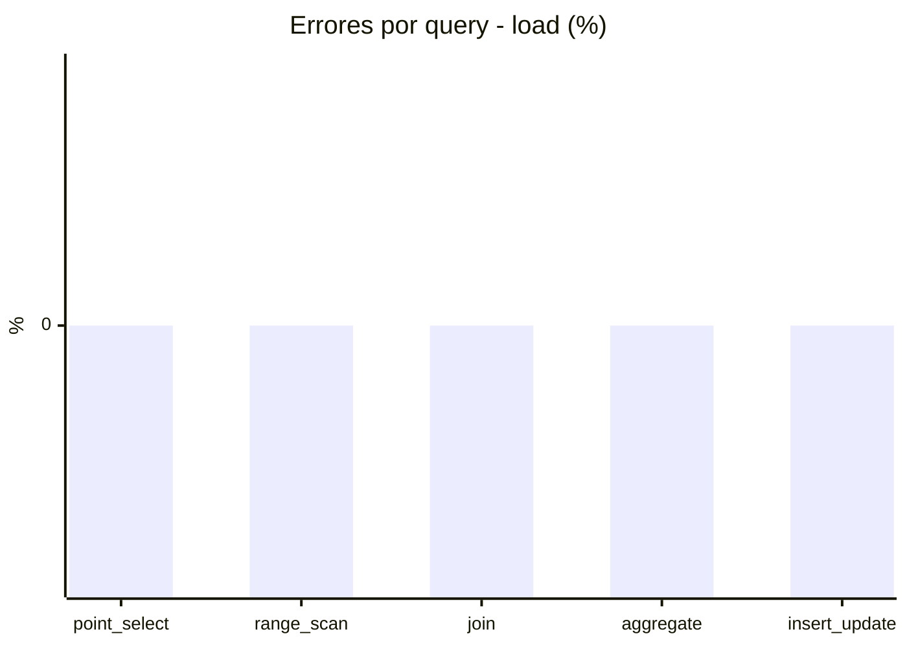
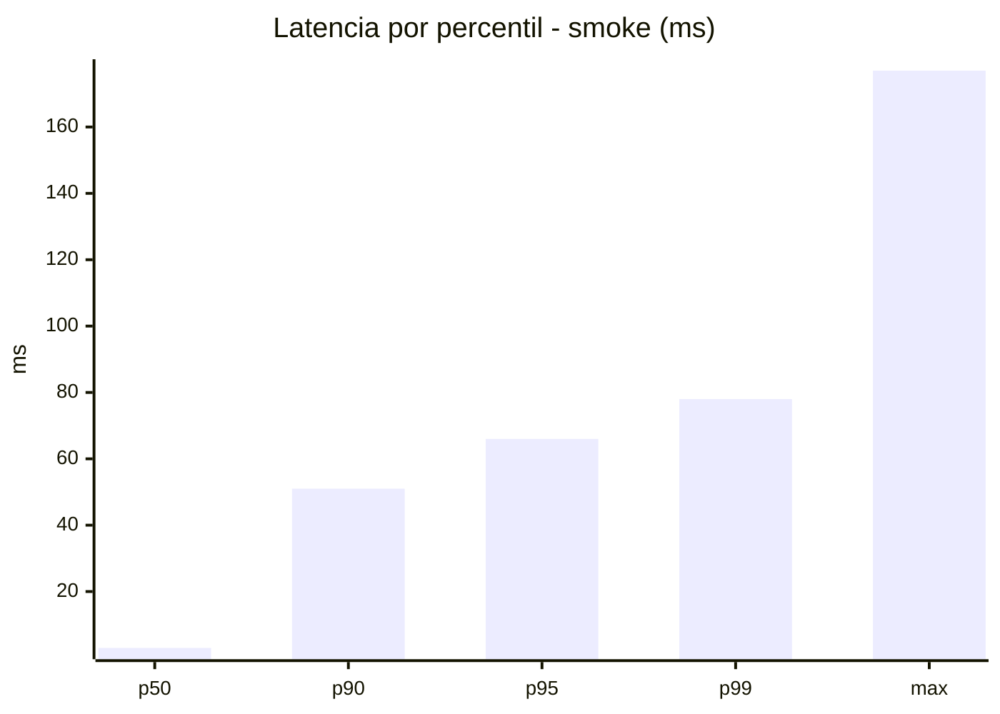
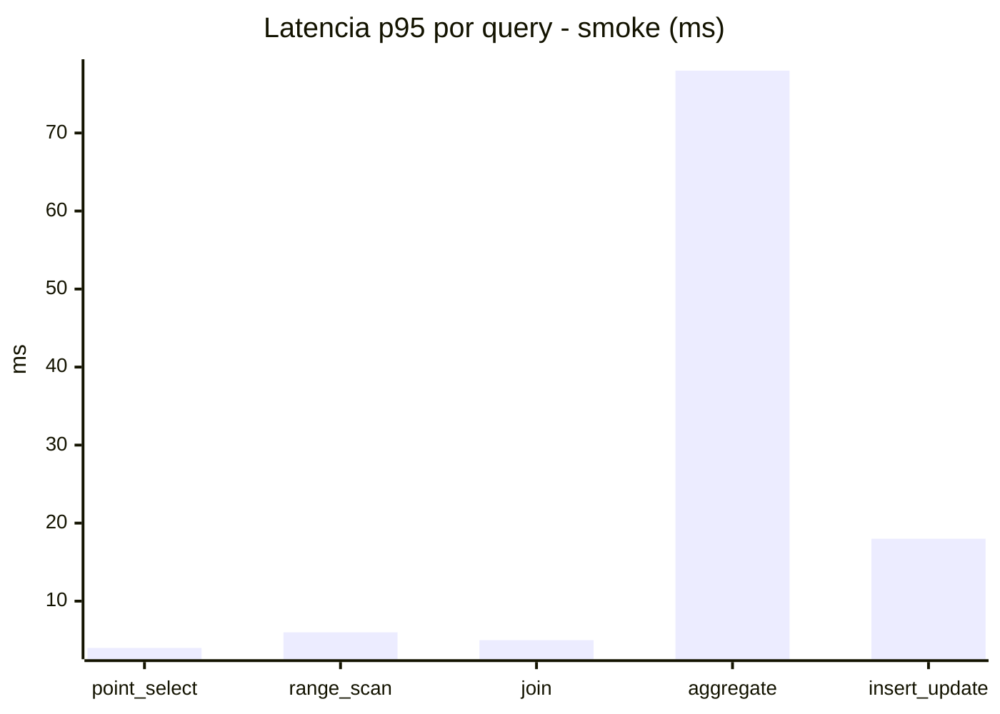
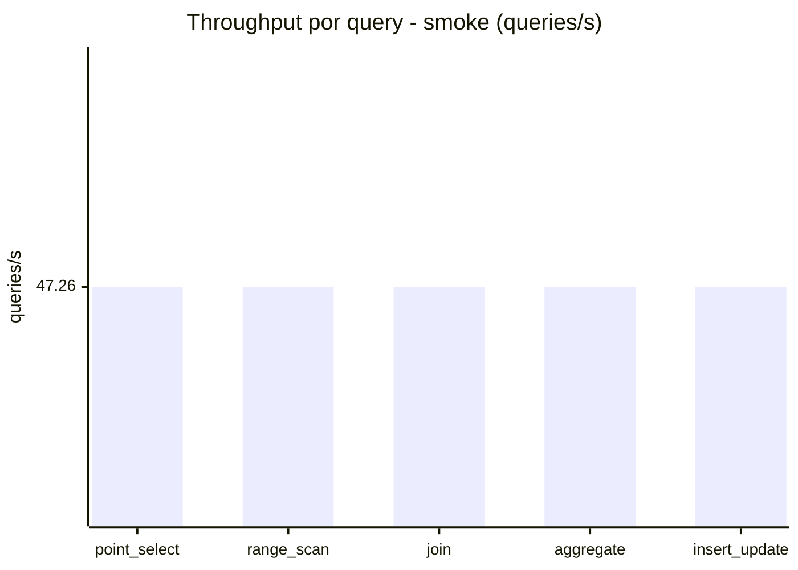
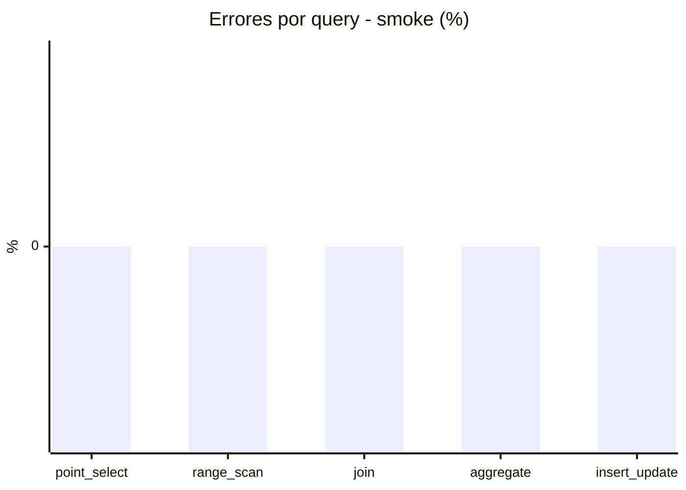

# Reporte de performance - SQL Server (k6)

**Fecha:** 2026-11-05 20:45 UTC  
**Veredicto (SLO):** `WARN`  
**Corrida:** [ver en GitHub Actions](https://github.com/lrbg/k6-sqlserver-lab/actions/runs/42106042004)  

## Analisis del agente de IA

WARN (fallback por umbrales)

- Error maximo: 0%
- p95 maximo: 254 ms

## Resultados

### Escenario: `load`

| Metrica | Valor |
| --- | --- |
| Queries ejecutadas | 19780 |
| Errores | 0 (0%) |
| Latencia media | 60.8 ms |
| p50 / p90 / p95 / p99 | 17 / 235 / 254 / 280 ms |
| Min / Max | 0 / 429 ms |
| Throughput | 328.45 queries/s |
| Duracion | 60.2 s |

Detalle por query

| Query | Ejecuciones | Error % | avg | p95 | p99 | q/s |
| --- | --- | --- | --- | --- | --- | --- |
| point_select | 3956 | 0% | 6.4 | 16 | 18.4 | 65.69 |
| range_scan | 3956 | 0% | 23.7 | 53 | 69 | 65.69 |
| join | 3956 | 0% | 9 | 17 | 21 | 65.69 |
| aggregate | 3956 | 0% | 227.5 | 280 | 312 | 65.69 |
| insert_update | 3956 | 0% | 37.2 | 76 | 95 | 65.69 |

### Escenario: `smoke`

| Metrica | Valor |
| --- | --- |
| Queries ejecutadas | 7095 |
| Errores | 0 (0%) |
| Latencia media | 12.7 ms |
| p50 / p90 / p95 / p99 | 3 / 51 / 66 / 78 ms |
| Min / Max | 0 / 177 ms |
| Throughput | 236.31 queries/s |
| Duracion | 30 s |

Detalle por query

| Query | Ejecuciones | Error % | avg | p95 | p99 | q/s |
| --- | --- | --- | --- | --- | --- | --- |
| point_select | 1419 | 0% | 0.9 | 4 | 5 | 47.26 |
| range_scan | 1419 | 0% | 3.2 | 6 | 11 | 47.26 |
| join | 1419 | 0% | 1.8 | 5 | 5 | 47.26 |
| aggregate | 1419 | 0% | 51.7 | 78 | 82 | 47.26 |
| insert_update | 1419 | 0% | 5.6 | 18 | 25 | 47.26 |

