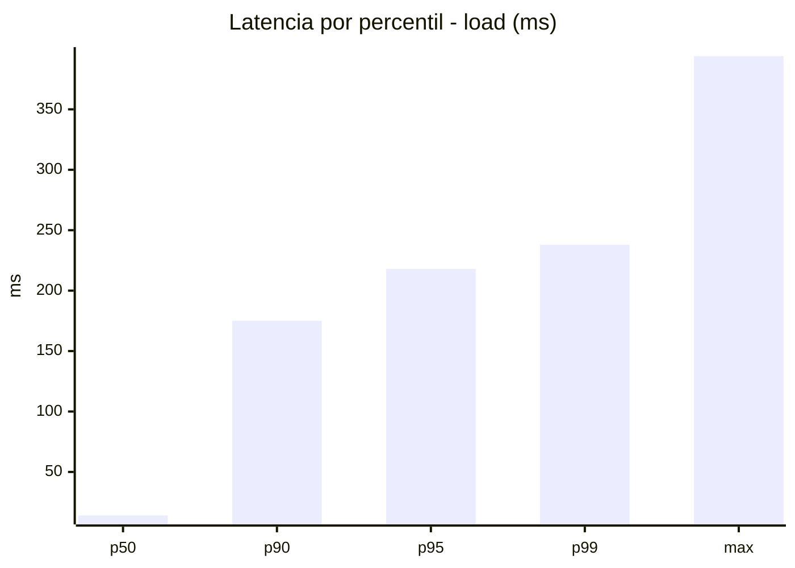
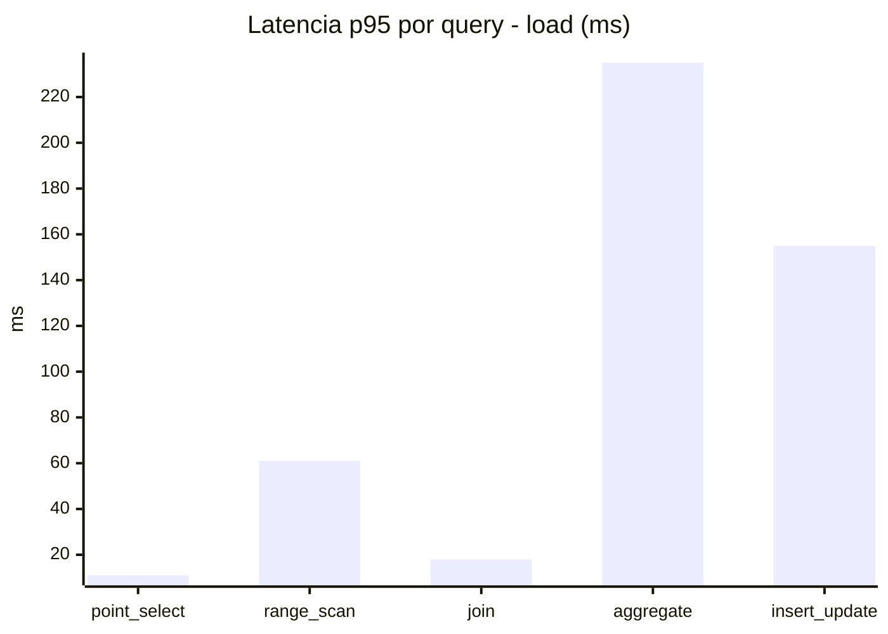
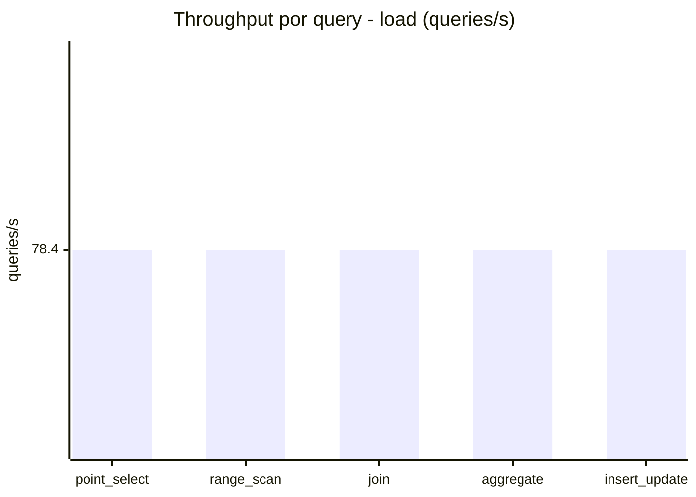
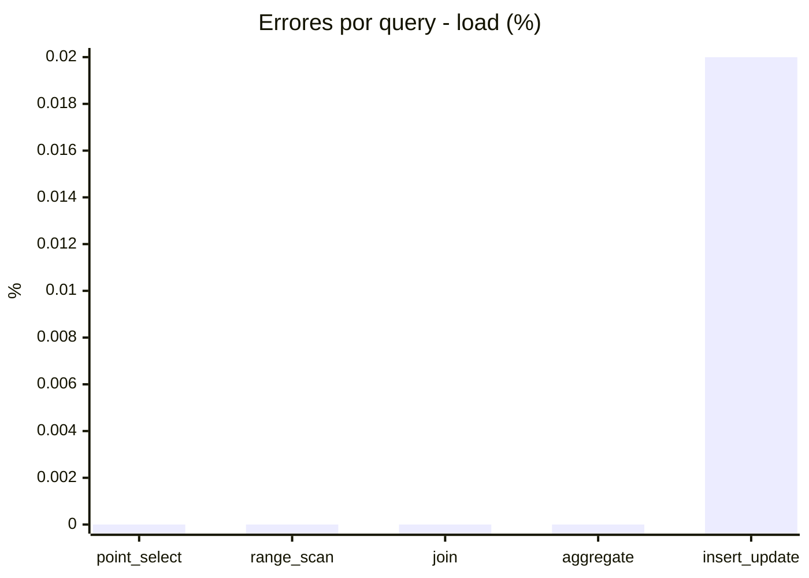
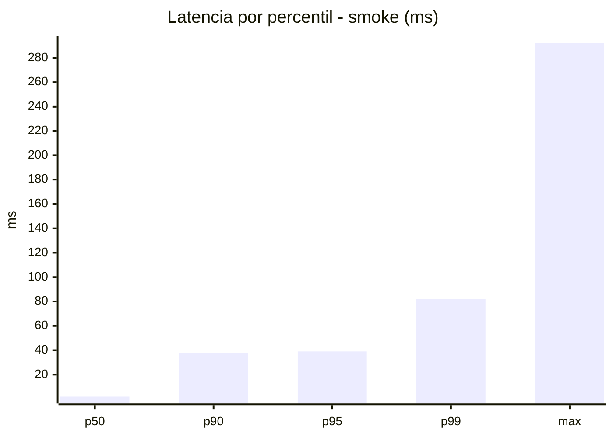
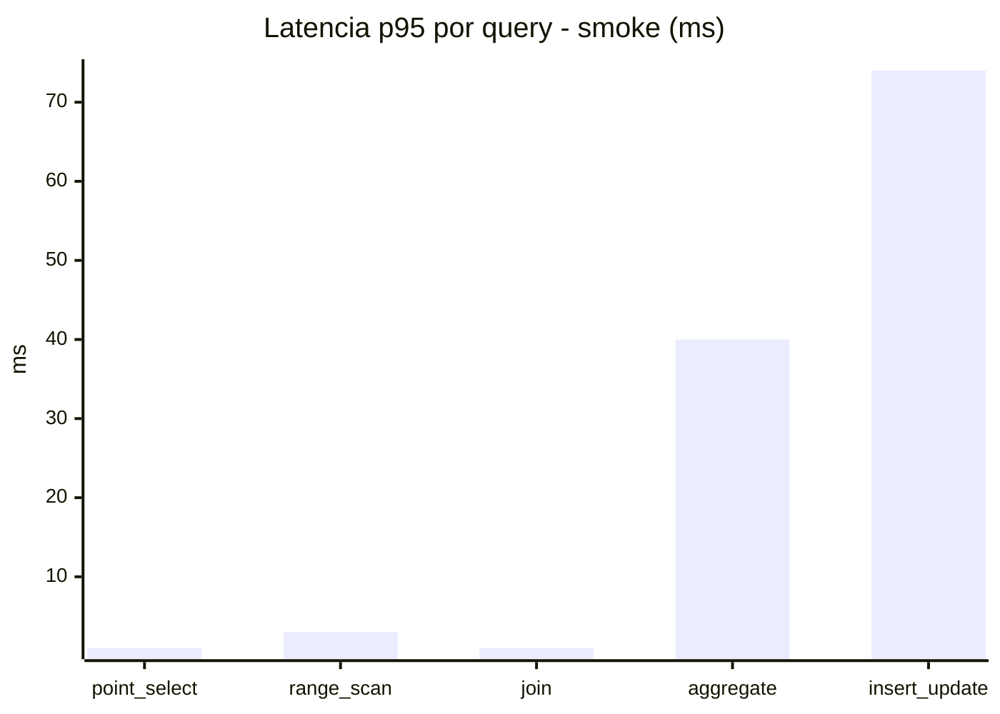
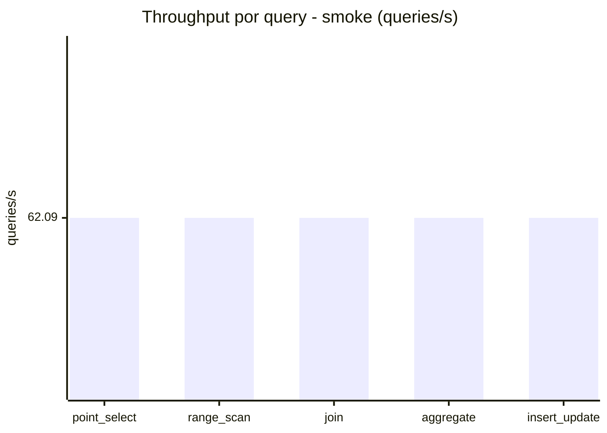
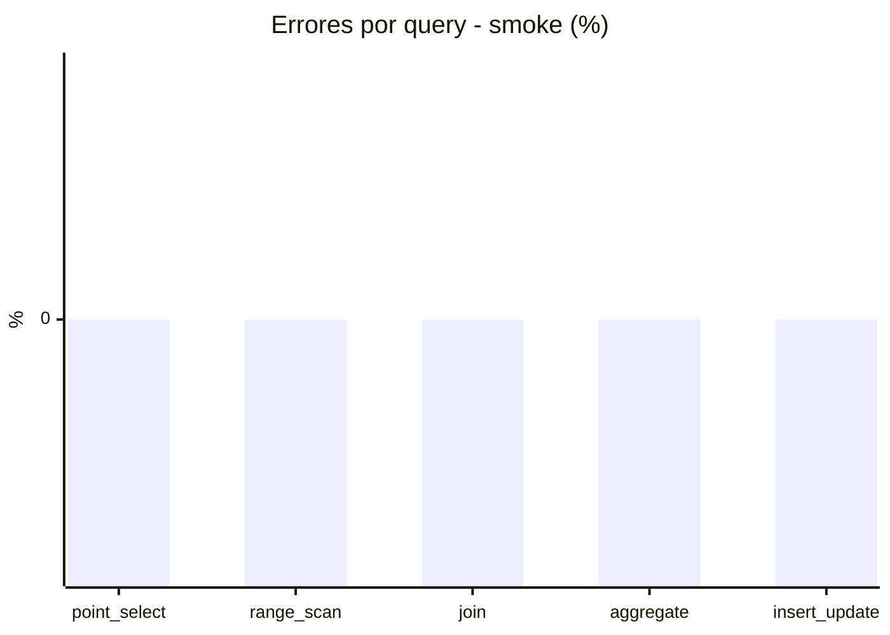

# Reporte de performance - SQL Server (k6)

**Fecha:** 2026-11-06 20:01 UTC  
**Veredicto (SLO):** `WARN`  
**Corrida:** [ver en GitHub Actions](https://github.com/lrbg/k6-sqlserver-lab/actions/runs/42284443153)  

## Analisis del agente de IA

WARN (fallback por umbrales)

- Error maximo: 0%
- p95 maximo: 218 ms

## Resultados

### Escenario: `load`

| Metrica | Valor |
| --- | --- |
| Queries ejecutadas | 23545 |
| Errores | 1 (0%) |
| Latencia media | 51 ms |
| p50 / p90 / p95 / p99 | 14 / 175 / 218 / 238 ms |
| Min / Max | 0 / 394 ms |
| Throughput | 392 queries/s |
| Duracion | 60.1 s |

Detalle por query

| Query | Ejecuciones | Error % | avg | p95 | p99 | q/s |
| --- | --- | --- | --- | --- | --- | --- |
| point_select | 4709 | 0% | 3.2 | 11 | 18 | 78.4 |
| range_scan | 4709 | 0% | 21.6 | 61 | 155.8 | 78.4 |
| join | 4709 | 0% | 6.9 | 18 | 22 | 78.4 |
| aggregate | 4709 | 0% | 174.6 | 235 | 245 | 78.4 |
| insert_update | 4709 | 0.02% | 48.6 | 155 | 277.9 | 78.4 |

### Escenario: `smoke`

| Metrica | Valor |
| --- | --- |
| Queries ejecutadas | 9320 |
| Errores | 0 (0%) |
| Latencia media | 9.6 ms |
| p50 / p90 / p95 / p99 | 2 / 38 / 39 / 81.8 ms |
| Min / Max | 0 / 292 ms |
| Throughput | 310.47 queries/s |
| Duracion | 30 s |

Detalle por query

| Query | Ejecuciones | Error % | avg | p95 | p99 | q/s |
| --- | --- | --- | --- | --- | --- | --- |
| point_select | 1864 | 0% | 0.4 | 1 | 1 | 62.09 |
| range_scan | 1864 | 0% | 2.8 | 3 | 20.1 | 62.09 |
| join | 1864 | 0% | 0.7 | 1 | 2 | 62.09 |
| aggregate | 1864 | 0% | 32.2 | 40 | 40 | 62.09 |
| insert_update | 1864 | 0% | 12.2 | 74 | 158.4 | 62.09 |

