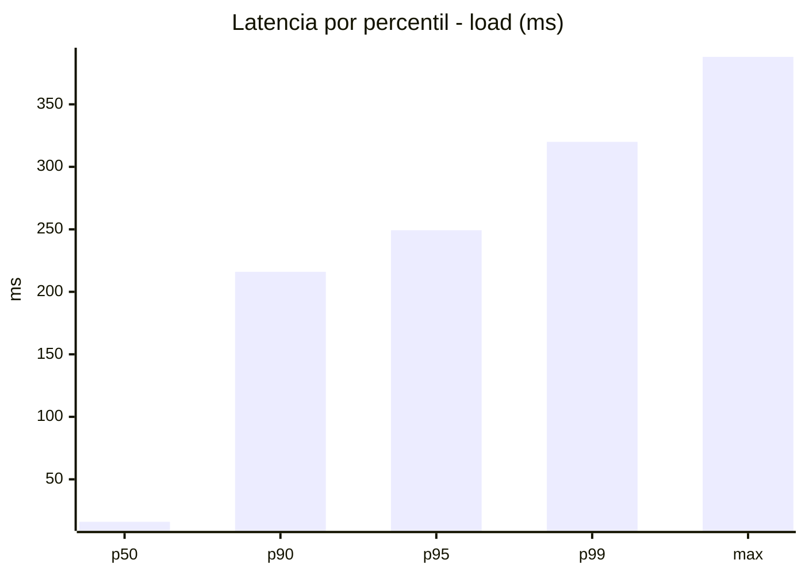
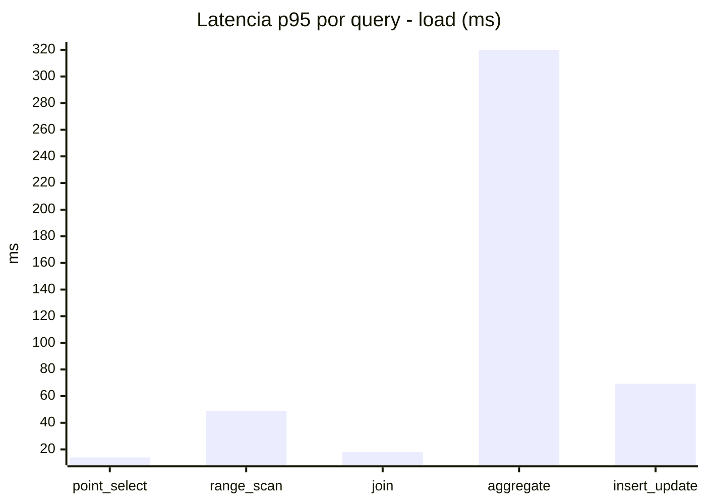
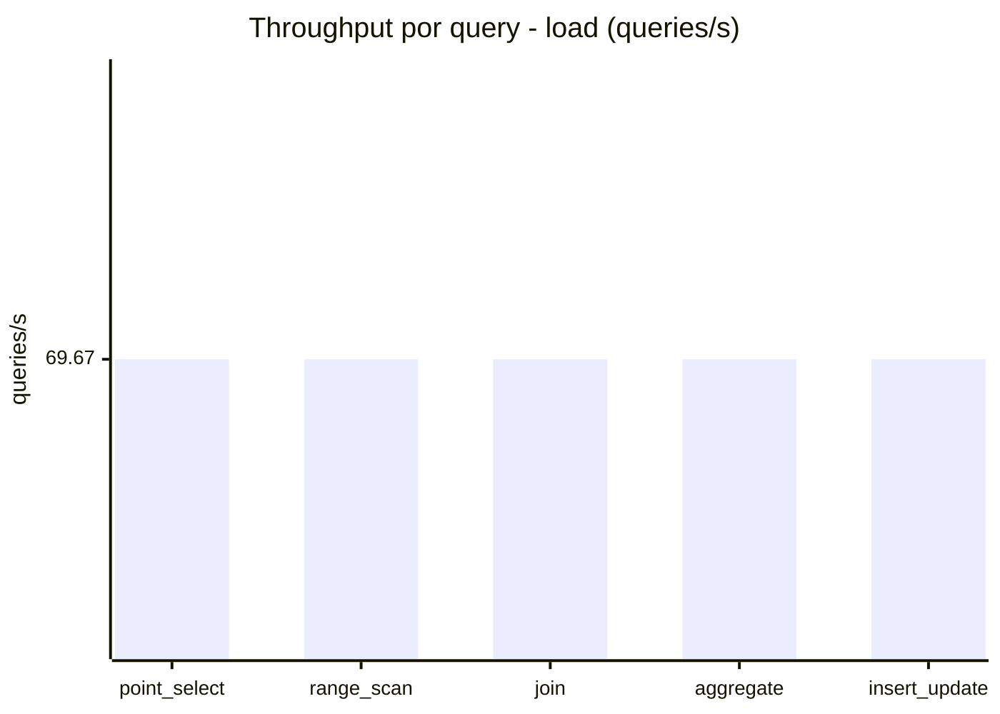
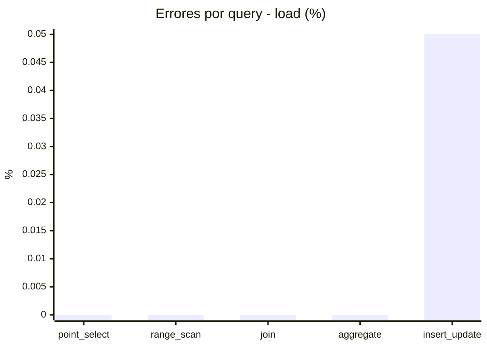
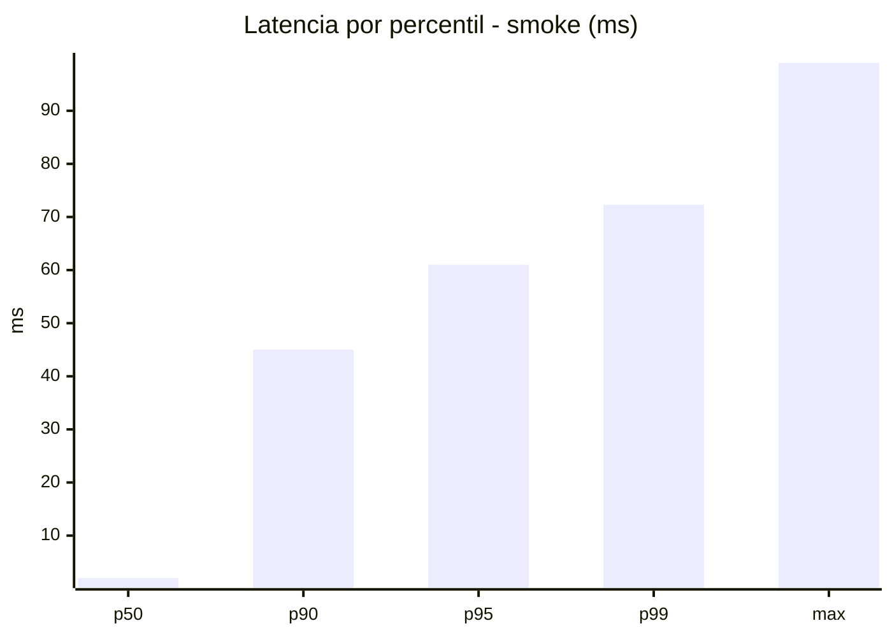
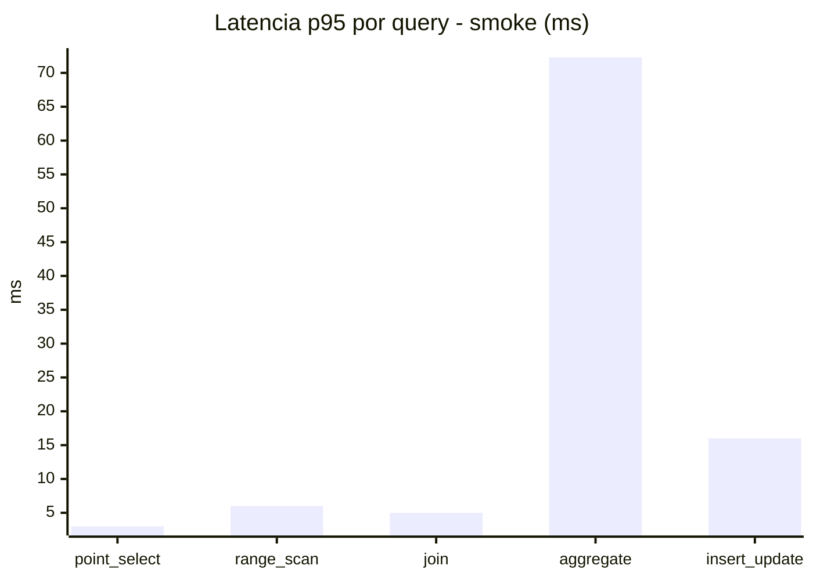
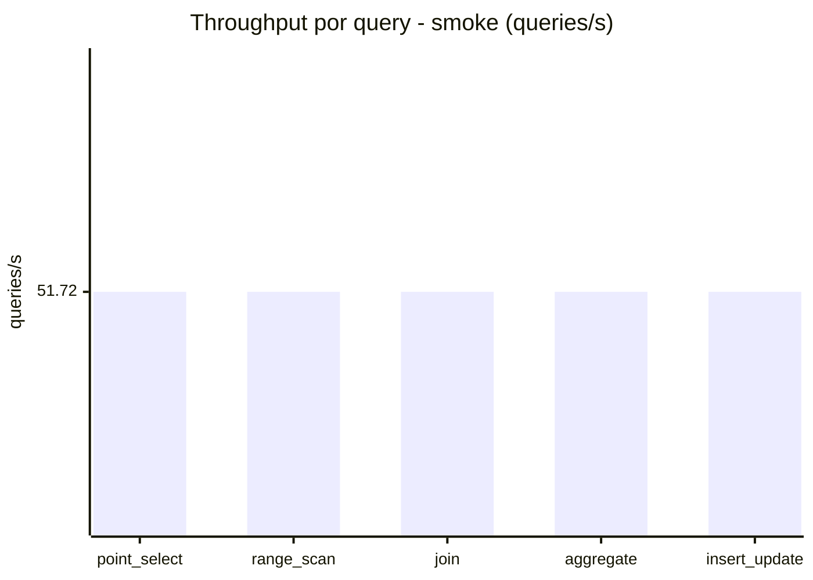
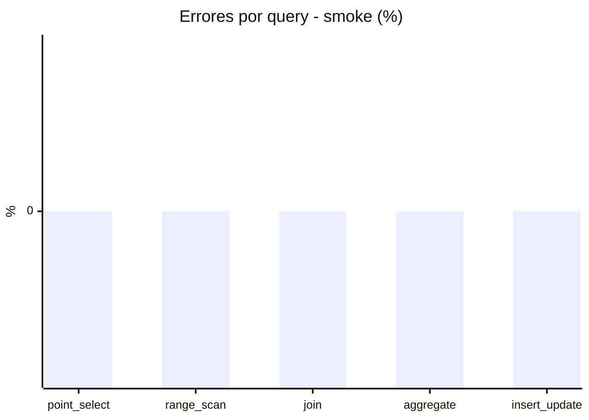

# Reporte de performance - SQL Server (k6)

**Fecha:** 2026-11-07 18:09 UTC  
**Veredicto (SLO):** `WARN`  
**Corrida:** [ver en GitHub Actions](https://github.com/lrbg/k6-sqlserver-lab/actions/runs/42399641559)  

## Analisis del agente de IA

WARN (fallback por umbrales)

- Error maximo: 0.01%
- p95 maximo: 249.3 ms

## Resultados

### Escenario: `load`

| Metrica | Valor |
| --- | --- |
| Queries ejecutadas | 20975 |
| Errores | 2 (0.01%) |
| Latencia media | 57.3 ms |
| p50 / p90 / p95 / p99 | 16 / 216 / 249.3 / 320 ms |
| Min / Max | 0 / 388 ms |
| Throughput | 348.36 queries/s |
| Duracion | 60.2 s |

Detalle por query

| Query | Ejecuciones | Error % | avg | p95 | p99 | q/s |
| --- | --- | --- | --- | --- | --- | --- |
| point_select | 4195 | 0% | 5.3 | 14 | 20 | 69.67 |
| range_scan | 4195 | 0% | 21.9 | 49 | 69 | 69.67 |
| join | 4195 | 0% | 8.2 | 18 | 24 | 69.67 |
| aggregate | 4195 | 0% | 217.7 | 320 | 343 | 69.67 |
| insert_update | 4195 | 0.05% | 33.5 | 69.3 | 94.1 | 69.67 |

### Escenario: `smoke`

| Metrica | Valor |
| --- | --- |
| Queries ejecutadas | 7770 |
| Errores | 0 (0%) |
| Latencia media | 11.6 ms |
| p50 / p90 / p95 / p99 | 2 / 45 / 61 / 72.3 ms |
| Min / Max | 0 / 99 ms |
| Throughput | 258.61 queries/s |
| Duracion | 30 s |

Detalle por query

| Query | Ejecuciones | Error % | avg | p95 | p99 | q/s |
| --- | --- | --- | --- | --- | --- | --- |
| point_select | 1554 | 0% | 0.8 | 3 | 4 | 51.72 |
| range_scan | 1554 | 0% | 2.8 | 6 | 10 | 51.72 |
| join | 1554 | 0% | 1.6 | 5 | 5 | 51.72 |
| aggregate | 1554 | 0% | 47.9 | 72.3 | 83 | 51.72 |
| insert_update | 1554 | 0% | 4.7 | 16 | 24 | 51.72 |

