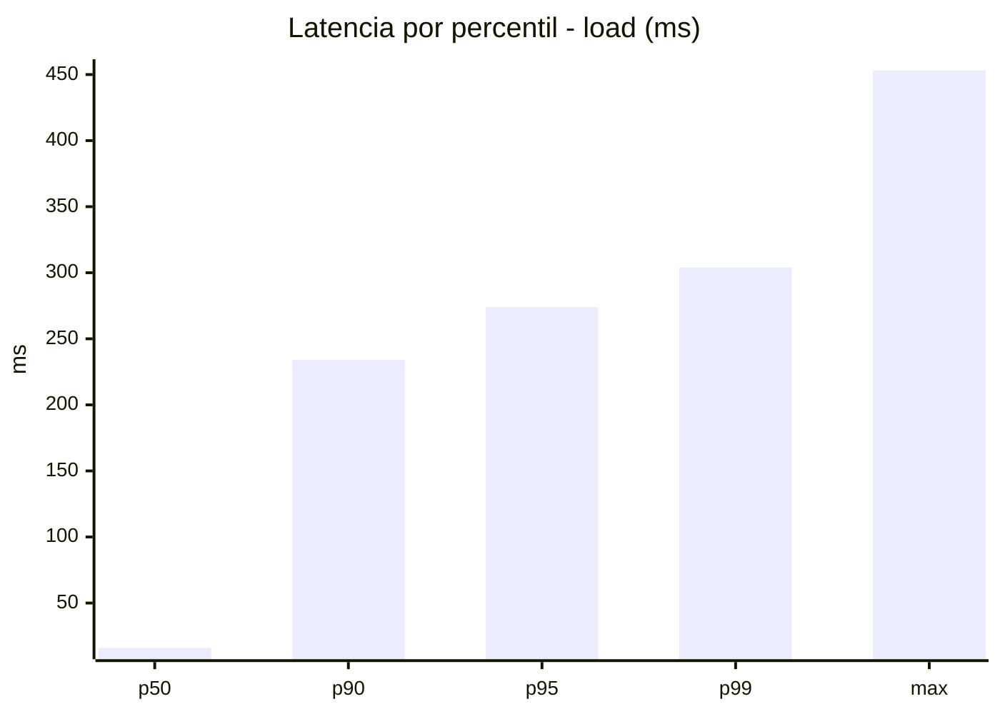
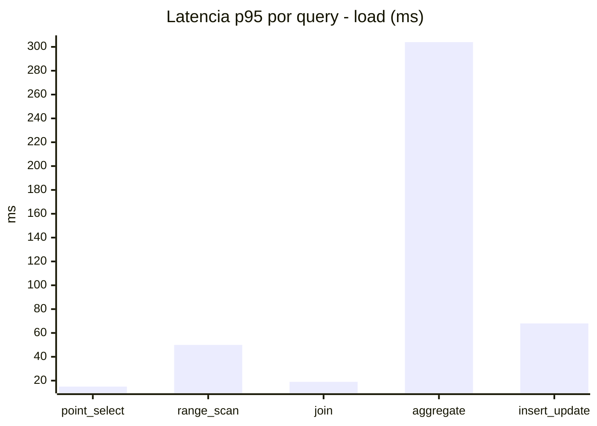
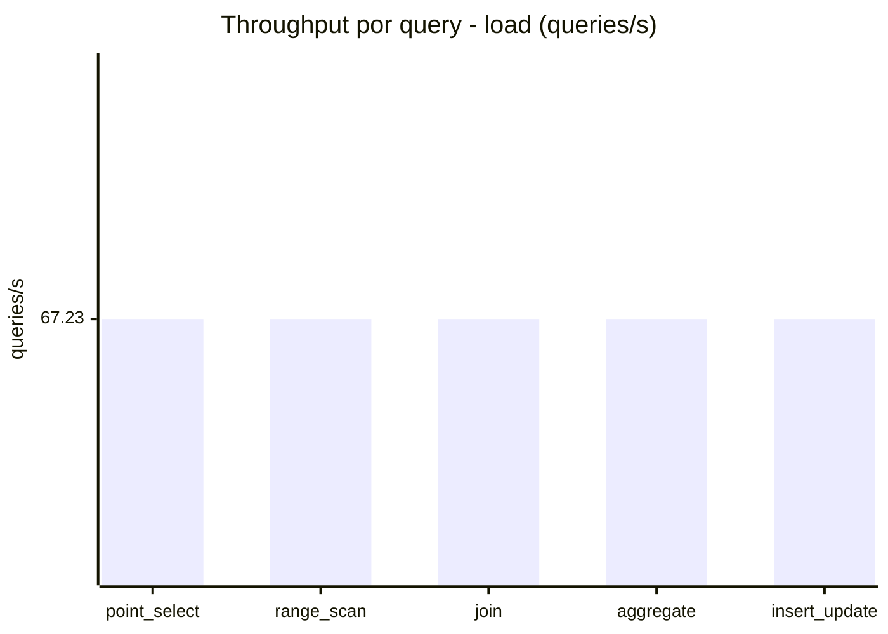
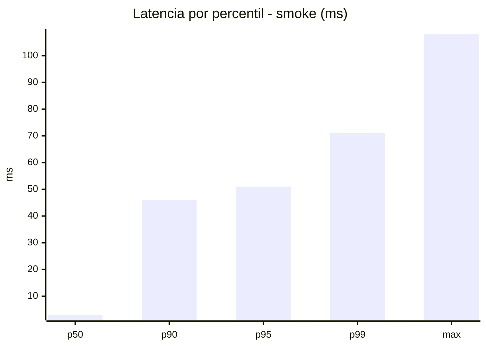
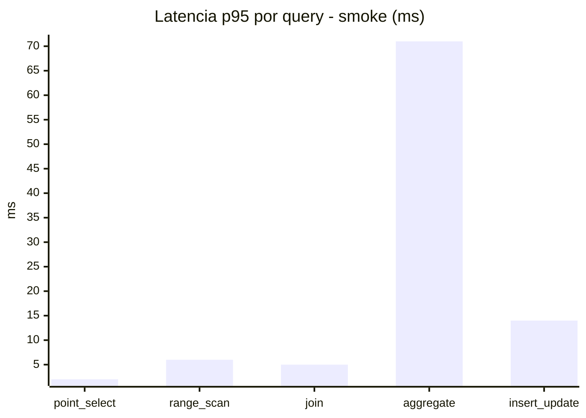
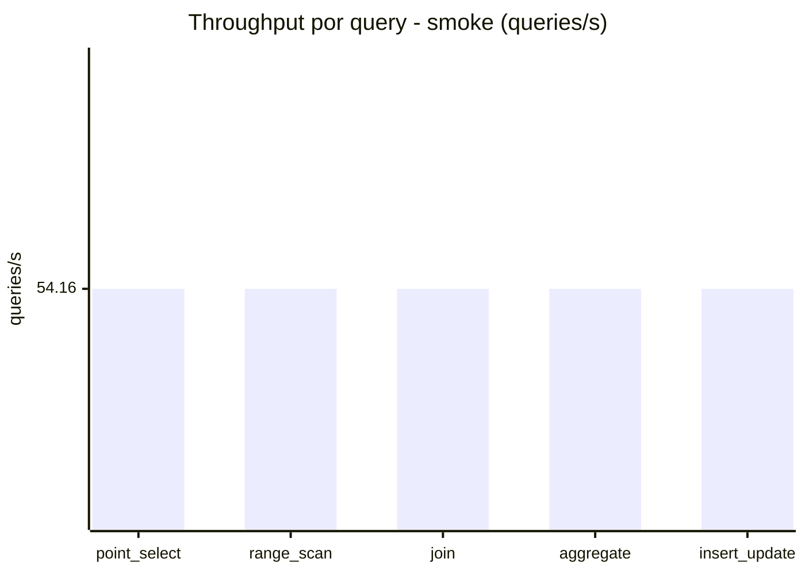
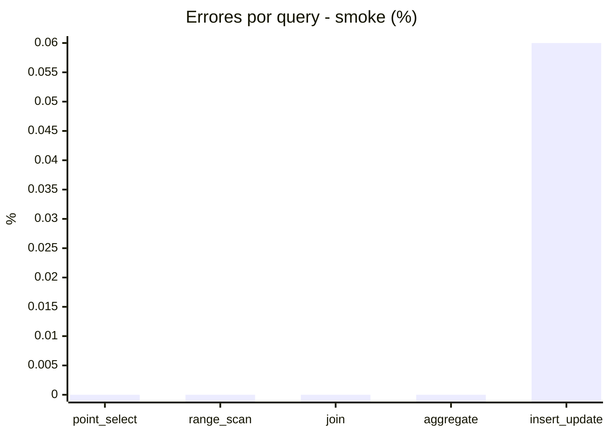

# Reporte de performance - SQL Server (k6)

**Fecha:** 2026-11-08 18:26 UTC  
**Veredicto (SLO):** `WARN`  
**Corrida:** [ver en GitHub Actions](https://github.com/lrbg/k6-sqlserver-lab/actions/runs/42509827346)  

## Analisis del agente de IA

WARN (fallback por umbrales)

- Error maximo: 0.01%
- p95 maximo: 273.8 ms

## Resultados

### Escenario: `load`

| Metrica | Valor |
| --- | --- |
| Queries ejecutadas | 20205 |
| Errores | 1 (0%) |
| Latencia media | 59.4 ms |
| p50 / p90 / p95 / p99 | 16 / 234 / 273.8 / 304 ms |
| Min / Max | 0 / 453 ms |
| Throughput | 336.16 queries/s |
| Duracion | 60.1 s |

Detalle por query

| Query | Ejecuciones | Error % | avg | p95 | p99 | q/s |
| --- | --- | --- | --- | --- | --- | --- |
| point_select | 4041 | 0% | 5.6 | 15 | 21 | 67.23 |
| range_scan | 4041 | 0% | 21.5 | 50 | 72 | 67.23 |
| join | 4041 | 0% | 8.9 | 19 | 22 | 67.23 |
| aggregate | 4041 | 0% | 228.7 | 304 | 324 | 67.23 |
| insert_update | 4041 | 0.02% | 32.3 | 68 | 89 | 67.23 |

### Escenario: `smoke`

| Metrica | Valor |
| --- | --- |
| Queries ejecutadas | 8140 |
| Errores | 1 (0.01%) |
| Latencia media | 11 ms |
| p50 / p90 / p95 / p99 | 3 / 46 / 51 / 71 ms |
| Min / Max | 0 / 108 ms |
| Throughput | 270.79 queries/s |
| Duracion | 30.1 s |

Detalle por query

| Query | Ejecuciones | Error % | avg | p95 | p99 | q/s |
| --- | --- | --- | --- | --- | --- | --- |
| point_select | 1628 | 0% | 0.8 | 2 | 5 | 54.16 |
| range_scan | 1628 | 0% | 3.1 | 6 | 11 | 54.16 |
| join | 1628 | 0% | 1.4 | 5 | 5 | 54.16 |
| aggregate | 1628 | 0% | 45.2 | 71 | 78 | 54.16 |
| insert_update | 1628 | 0.06% | 4.7 | 14 | 21.7 | 54.16 |

