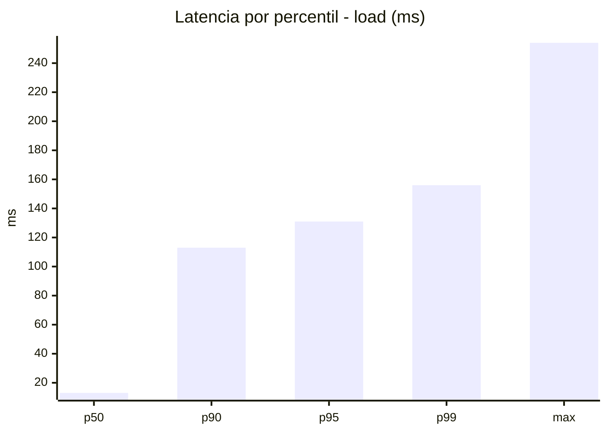
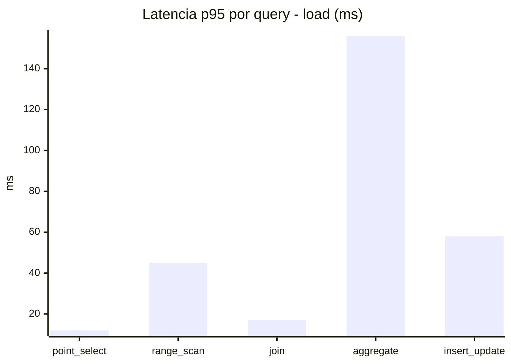
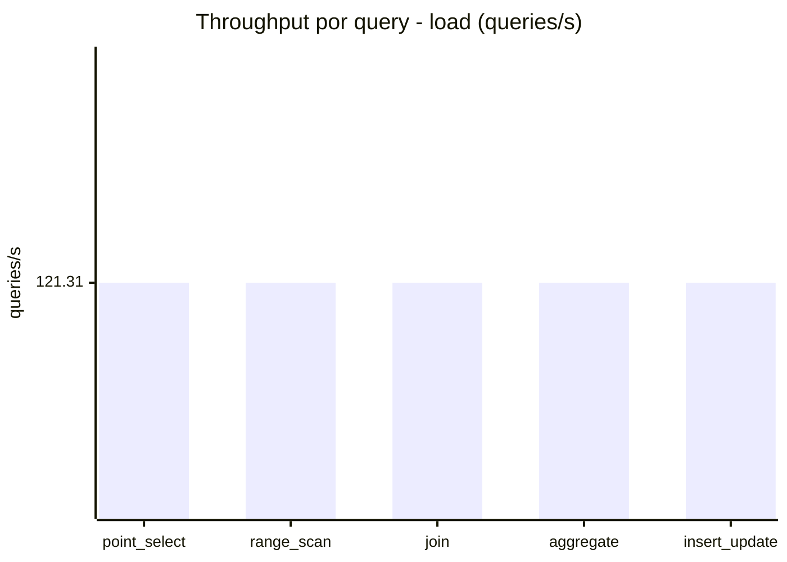
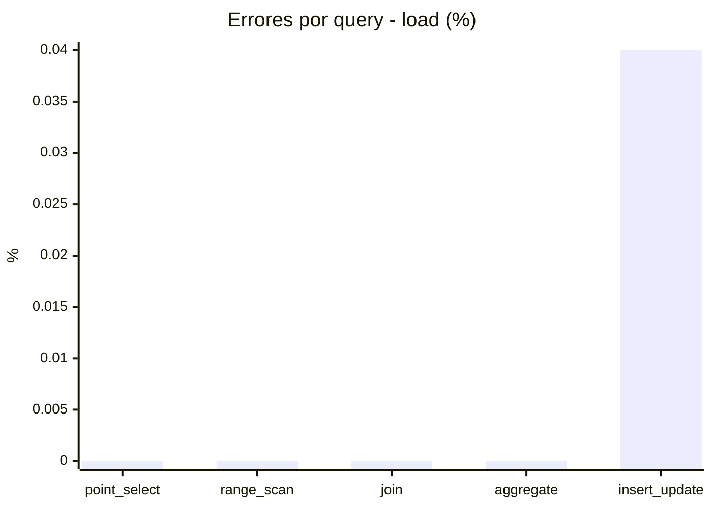
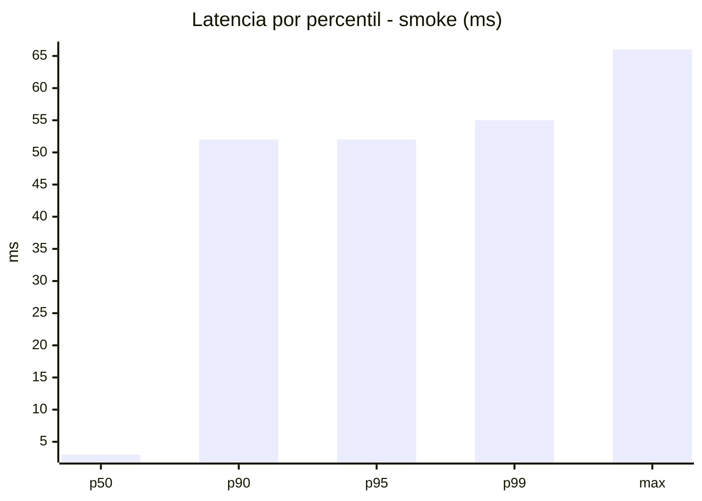
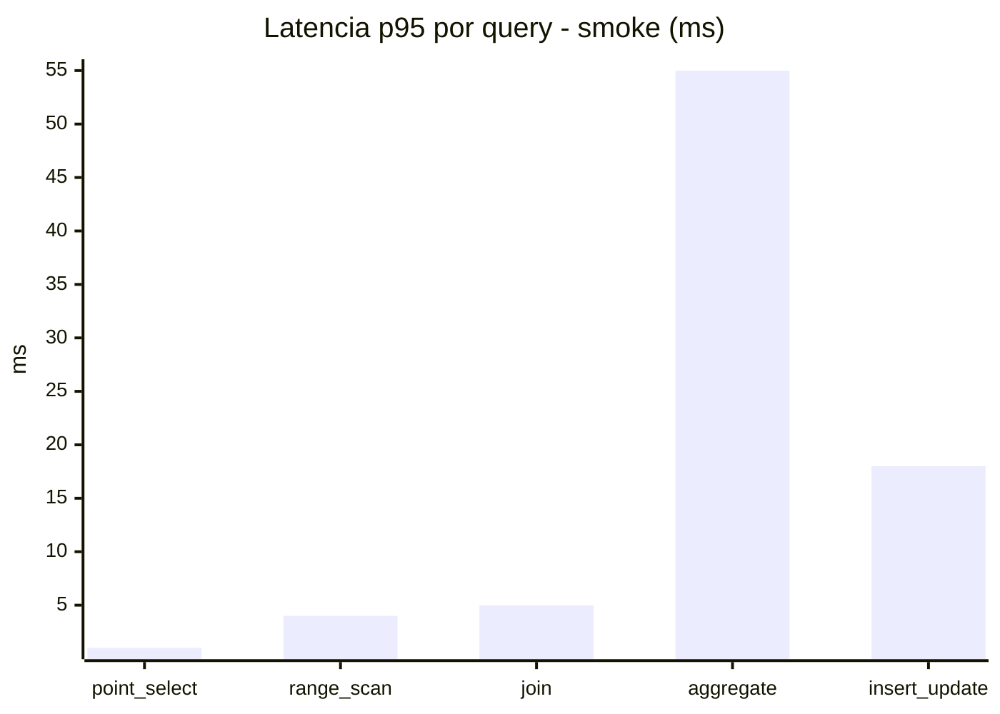
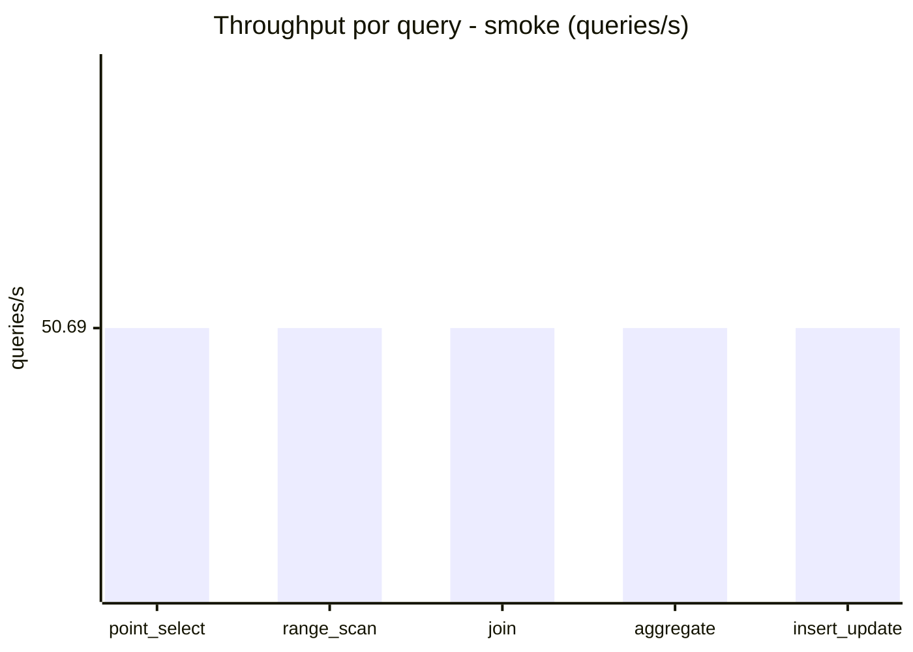
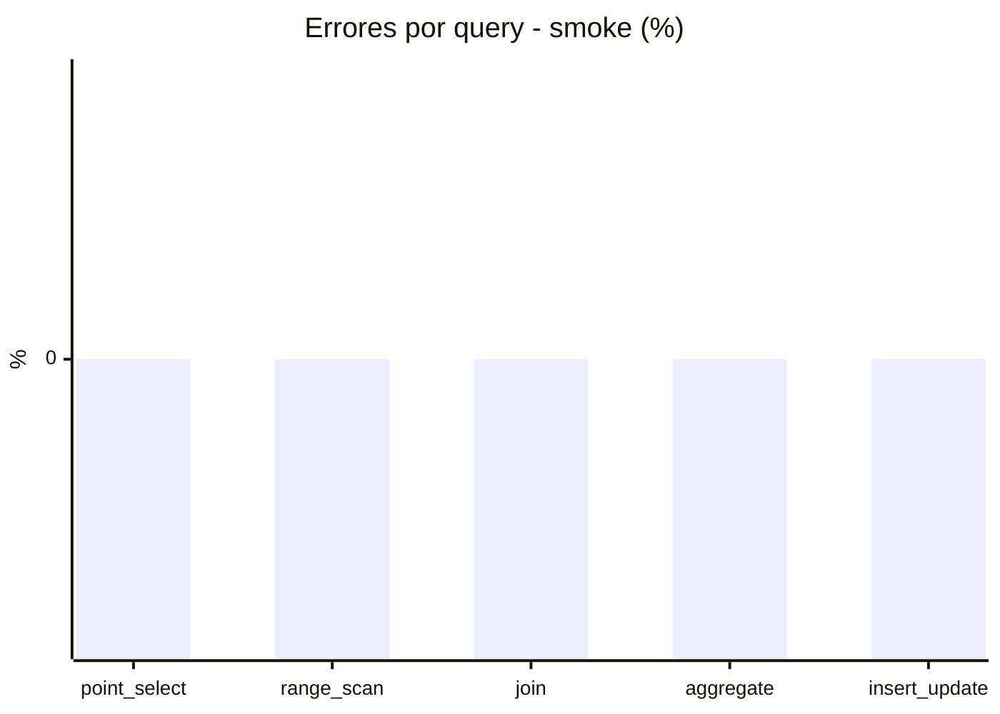

# Reporte de performance - SQL Server (k6)

**Fecha:** 2026-11-09 23:04 UTC  
**Veredicto (SLO):** `PASS`  
**Corrida:** [ver en GitHub Actions](https://github.com/lrbg/k6-sqlserver-lab/actions/runs/42717148096)  

## Analisis del agente de IA

PASS (fallback por umbrales)

- Error maximo: 0.01%
- p95 maximo: 131 ms

## Resultados

### Escenario: `load`

| Metrica | Valor |
| --- | --- |
| Queries ejecutadas | 36465 |
| Errores | 3 (0.01%) |
| Latencia media | 33 ms |
| p50 / p90 / p95 / p99 | 13 / 113 / 131 / 156 ms |
| Min / Max | 0 / 254 ms |
| Throughput | 606.53 queries/s |
| Duracion | 60.1 s |

Detalle por query

| Query | Ejecuciones | Error % | avg | p95 | p99 | q/s |
| --- | --- | --- | --- | --- | --- | --- |
| point_select | 7293 | 0% | 3.6 | 12 | 18 | 121.31 |
| range_scan | 7293 | 0% | 18.1 | 45 | 64 | 121.31 |
| join | 7293 | 0% | 6.5 | 17 | 21 | 121.31 |
| aggregate | 7293 | 0% | 111.4 | 156 | 176 | 121.31 |
| insert_update | 7293 | 0.04% | 25.1 | 58 | 77.1 | 121.31 |

### Escenario: `smoke`

| Metrica | Valor |
| --- | --- |
| Queries ejecutadas | 7615 |
| Errores | 0 (0%) |
| Latencia media | 11.8 ms |
| p50 / p90 / p95 / p99 | 3 / 52 / 52 / 55 ms |
| Min / Max | 0 / 66 ms |
| Throughput | 253.45 queries/s |
| Duracion | 30 s |

Detalle por query

| Query | Ejecuciones | Error % | avg | p95 | p99 | q/s |
| --- | --- | --- | --- | --- | --- | --- |
| point_select | 1523 | 0% | 0.6 | 1 | 2 | 50.69 |
| range_scan | 1523 | 0% | 2.6 | 4 | 6 | 50.69 |
| join | 1523 | 0% | 2.2 | 5 | 9 | 50.69 |
| aggregate | 1523 | 0% | 47.5 | 55 | 62 | 50.69 |
| insert_update | 1523 | 0% | 6.1 | 18 | 22.8 | 50.69 |

