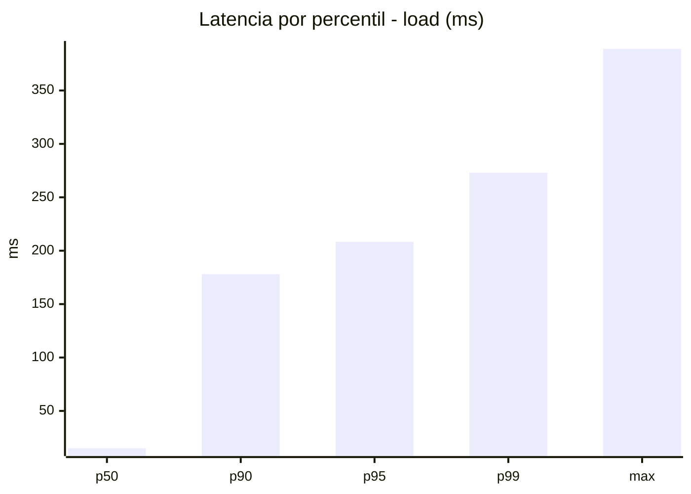
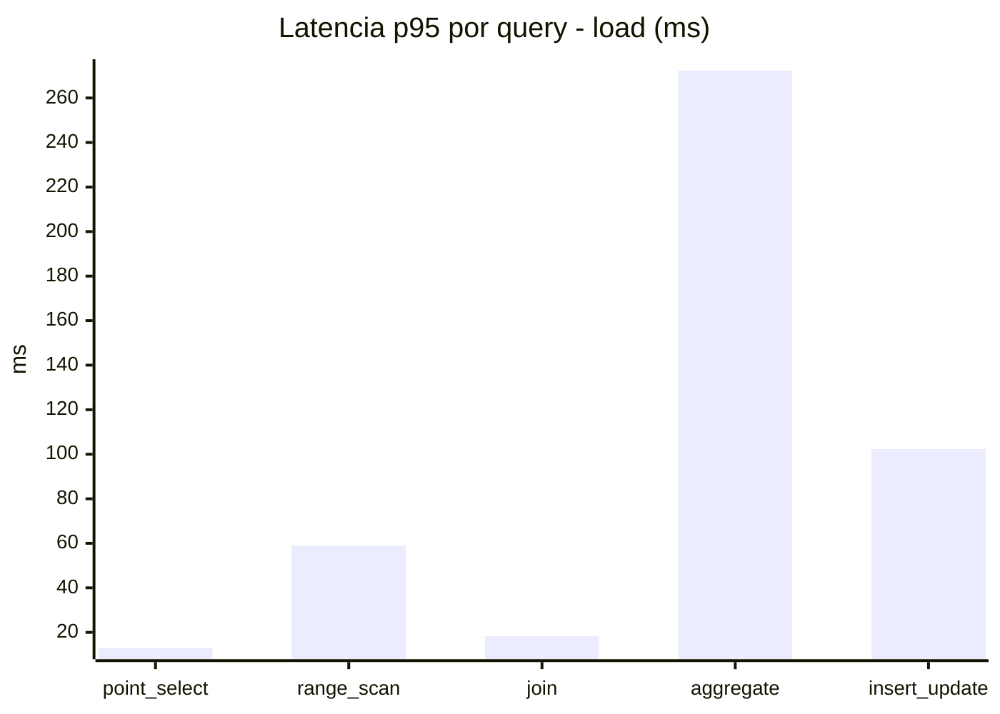
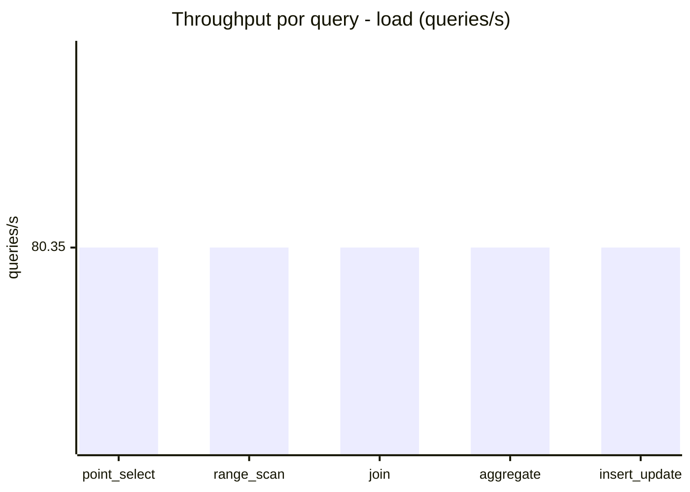
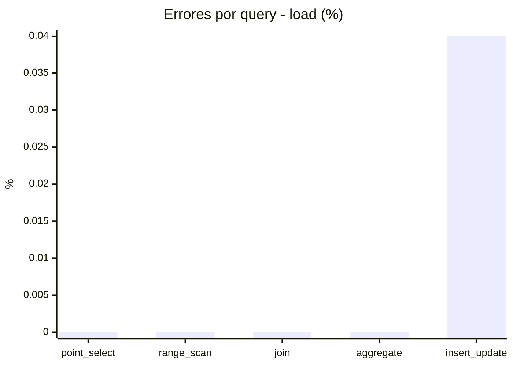
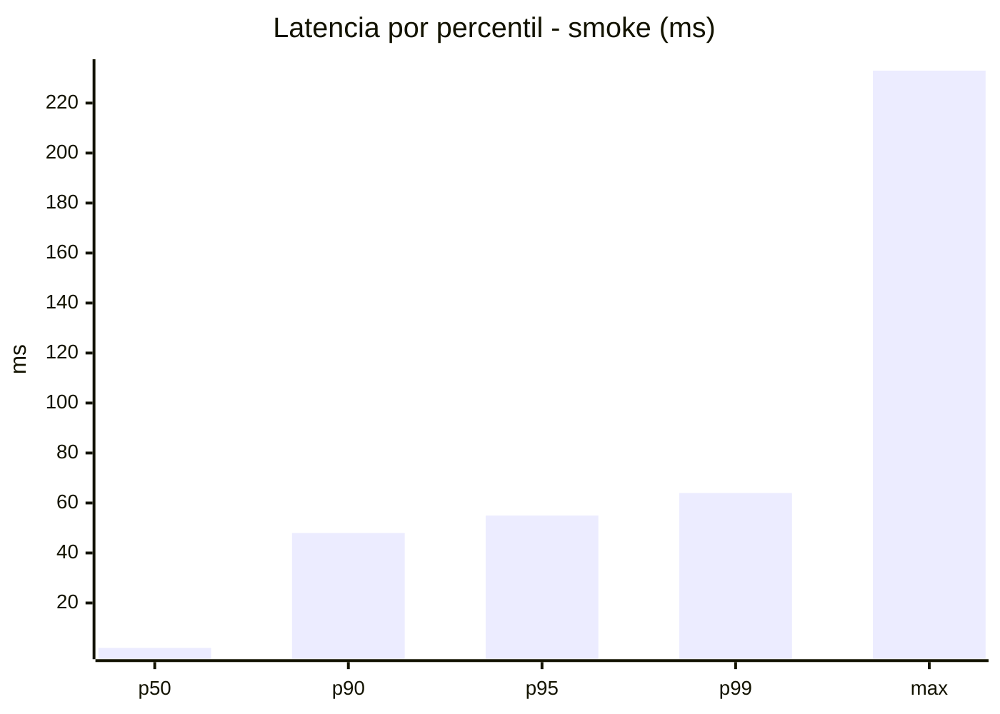
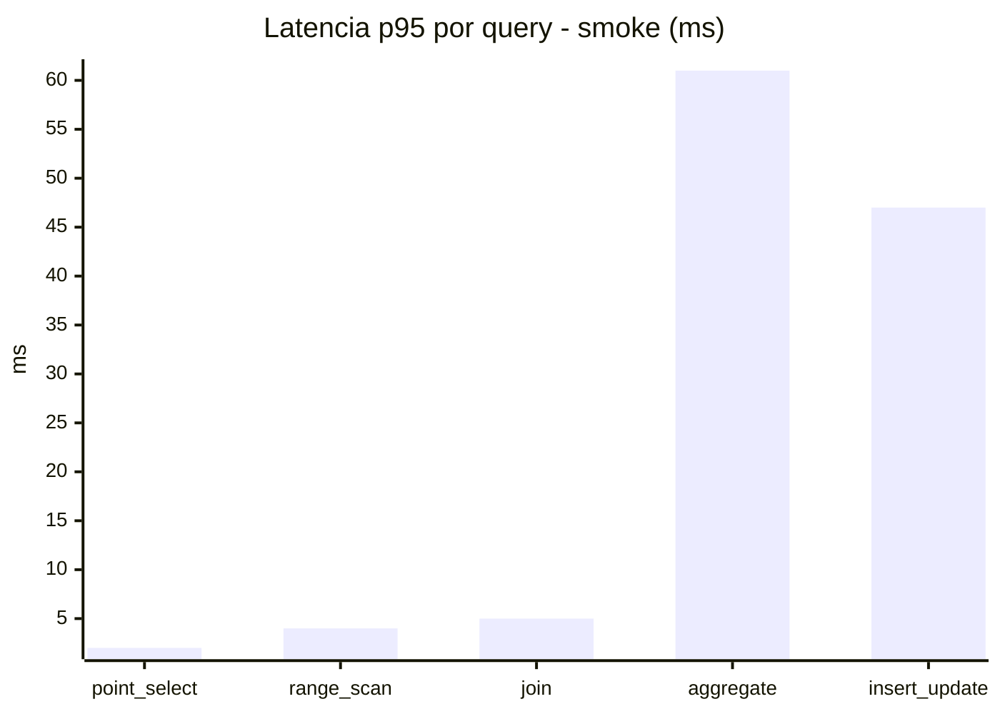
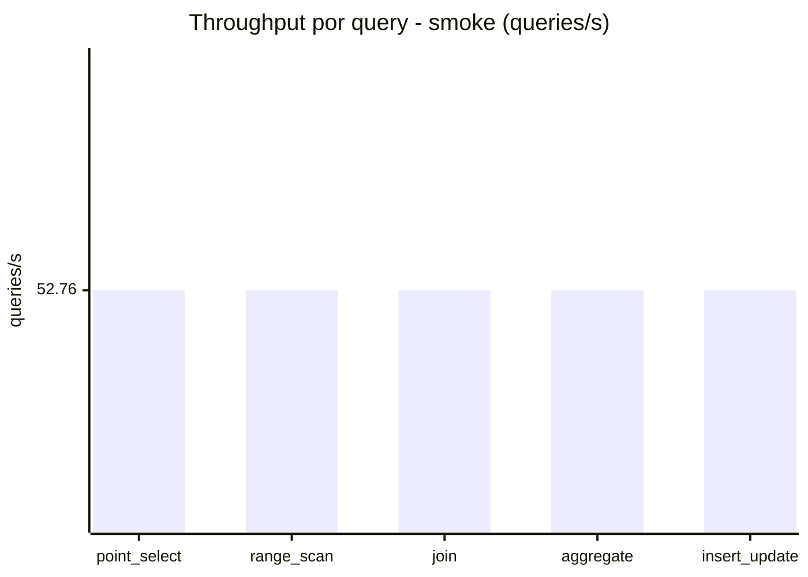
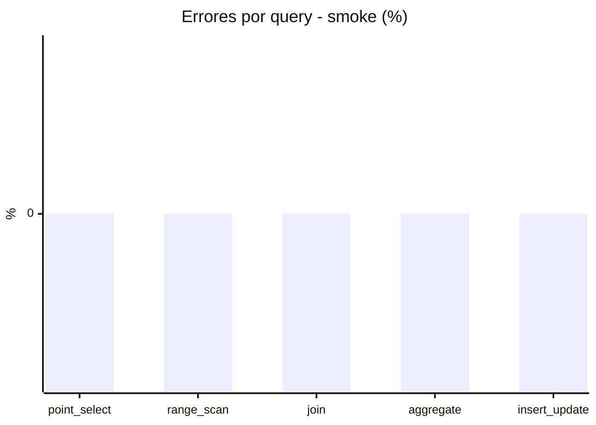

# Reporte de performance - SQL Server (k6)

**Fecha:** 2026-11-10 20:32 UTC  
**Veredicto (SLO):** `WARN`  
**Corrida:** [ver en GitHub Actions](https://github.com/lrbg/k6-sqlserver-lab/actions/runs/42895904266)  

## Analisis del agente de IA

WARN (fallback por umbrales)

- Error maximo: 0.01%
- p95 maximo: 208.3 ms

## Resultados

### Escenario: `load`

| Metrica | Valor |
| --- | --- |
| Queries ejecutadas | 24175 |
| Errores | 2 (0.01%) |
| Latencia media | 49.7 ms |
| p50 / p90 / p95 / p99 | 15 / 178 / 208.3 / 273 ms |
| Min / Max | 0 / 389 ms |
| Throughput | 401.76 queries/s |
| Duracion | 60.2 s |

Detalle por query

| Query | Ejecuciones | Error % | avg | p95 | p99 | q/s |
| --- | --- | --- | --- | --- | --- | --- |
| point_select | 4835 | 0% | 4.1 | 13 | 22 | 80.35 |
| range_scan | 4835 | 0% | 21.9 | 59 | 99 | 80.35 |
| join | 4835 | 0% | 7.3 | 18.3 | 25 | 80.35 |
| aggregate | 4835 | 0% | 175.8 | 272.3 | 291 | 80.35 |
| insert_update | 4835 | 0.04% | 39.4 | 102.3 | 165 | 80.35 |

### Escenario: `smoke`

| Metrica | Valor |
| --- | --- |
| Queries ejecutadas | 7925 |
| Errores | 0 (0%) |
| Latencia media | 11.3 ms |
| p50 / p90 / p95 / p99 | 2 / 48 / 55 / 64 ms |
| Min / Max | 0 / 233 ms |
| Throughput | 263.8 queries/s |
| Duracion | 30 s |

Detalle por query

| Query | Ejecuciones | Error % | avg | p95 | p99 | q/s |
| --- | --- | --- | --- | --- | --- | --- |
| point_select | 1585 | 0% | 0.6 | 2 | 3 | 52.76 |
| range_scan | 1585 | 0% | 3.2 | 4 | 17 | 52.76 |
| join | 1585 | 0% | 1.5 | 5 | 5 | 52.76 |
| aggregate | 1585 | 0% | 41.4 | 61 | 66 | 52.76 |
| insert_update | 1585 | 0% | 10 | 47 | 120.2 | 52.76 |

