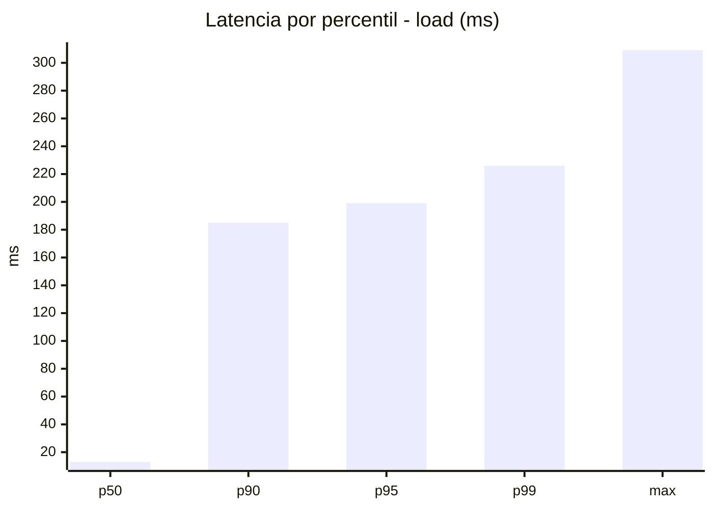
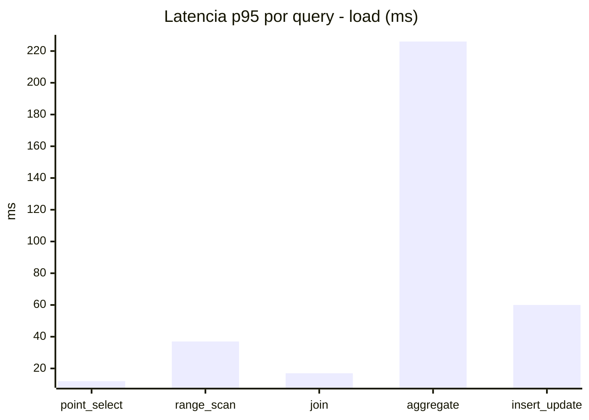
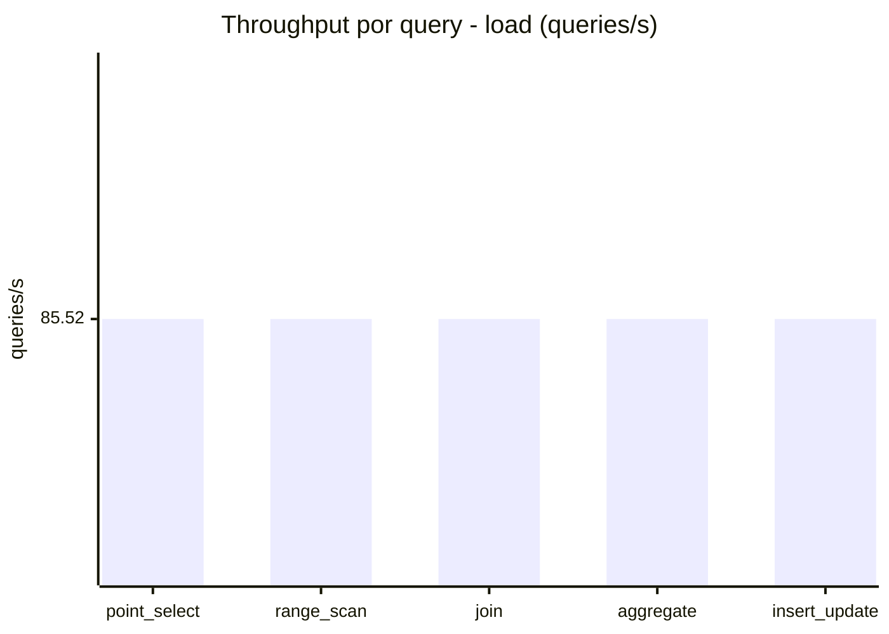
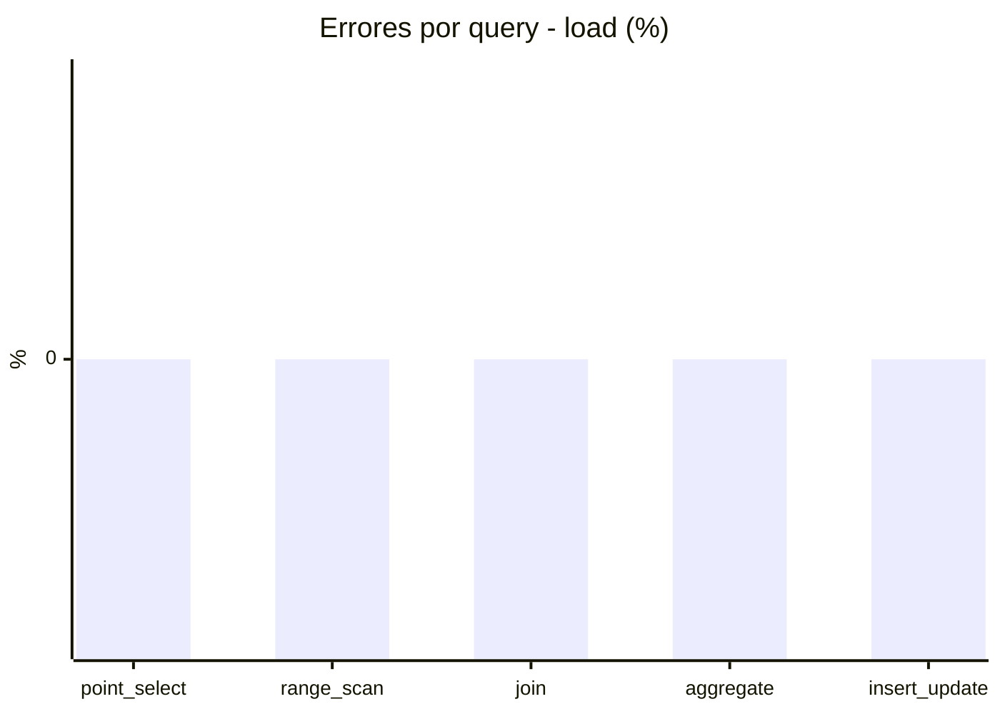
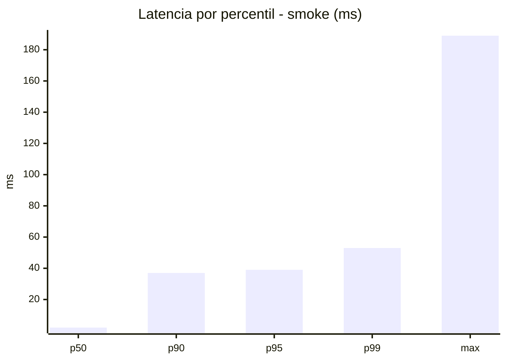
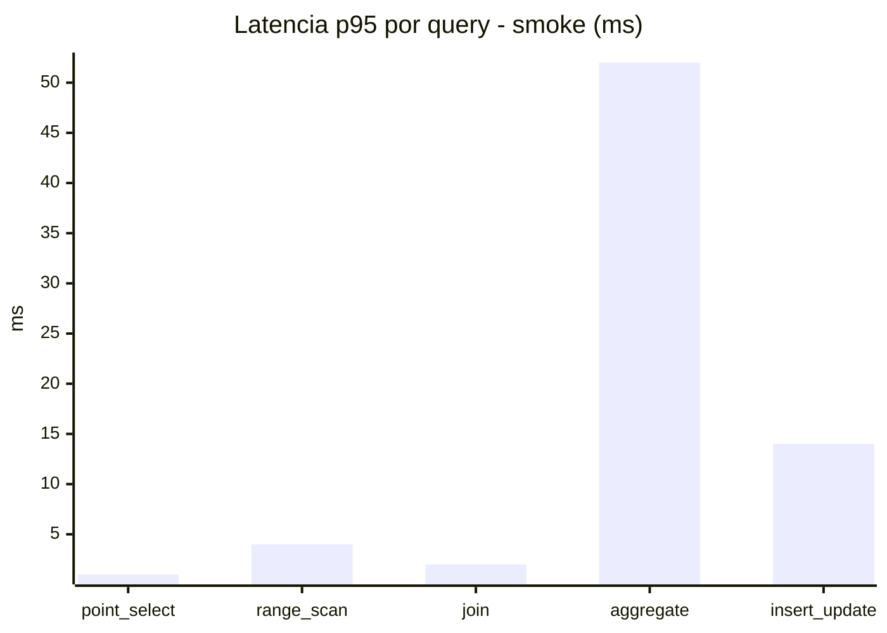
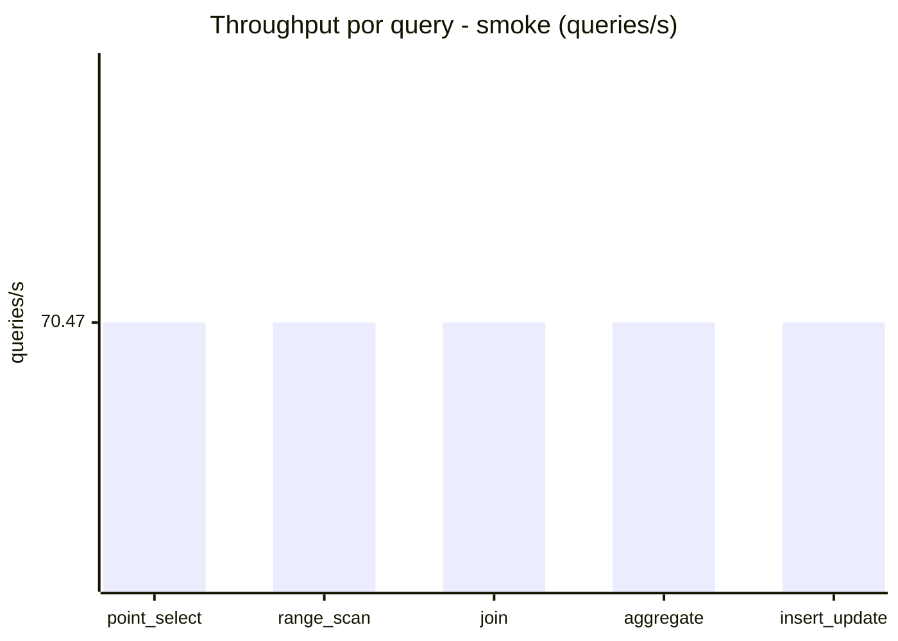
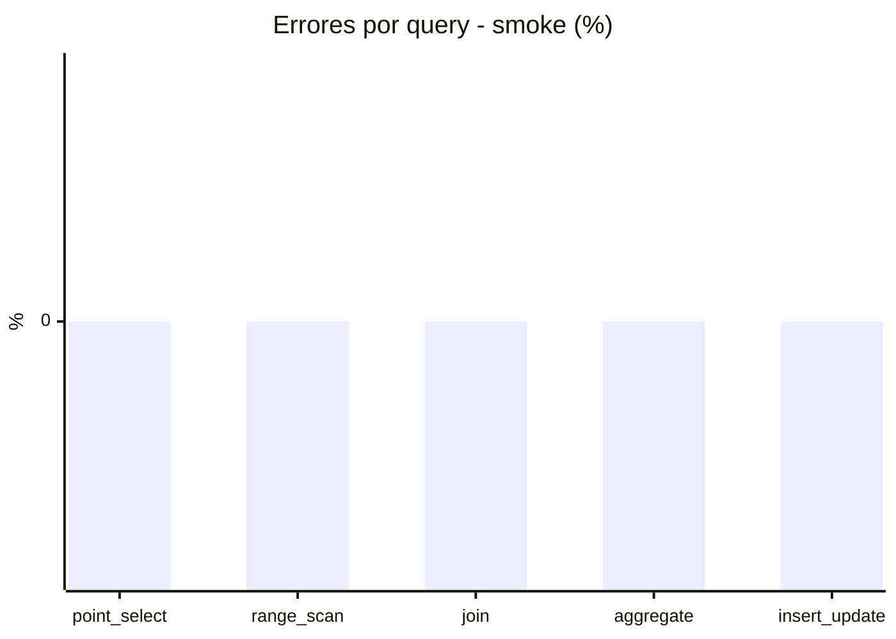

# Reporte de performance - SQL Server (k6)

**Fecha:** 2026-11-12 21:00 UTC  
**Veredicto (SLO):** `PASS`  
**Corrida:** [ver en GitHub Actions](https://github.com/lrbg/k6-sqlserver-lab/actions/runs/43305479431)  

## Analisis del agente de IA

PASS (fallback por umbrales)

- Error maximo: 0%
- p95 maximo: 199 ms

## Resultados

### Escenario: `load`

| Metrica | Valor |
| --- | --- |
| Queries ejecutadas | 25720 |
| Errores | 0 (0%) |
| Latencia media | 46.7 ms |
| p50 / p90 / p95 / p99 | 13 / 185 / 199 / 226 ms |
| Min / Max | 0 / 309 ms |
| Throughput | 427.59 queries/s |
| Duracion | 60.2 s |

Detalle por query

| Query | Ejecuciones | Error % | avg | p95 | p99 | q/s |
| --- | --- | --- | --- | --- | --- | --- |
| point_select | 5144 | 0% | 3.9 | 12 | 17 | 85.52 |
| range_scan | 5144 | 0% | 16.6 | 37 | 57 | 85.52 |
| join | 5144 | 0% | 7.4 | 17 | 20 | 85.52 |
| aggregate | 5144 | 0% | 180.9 | 226 | 244 | 85.52 |
| insert_update | 5144 | 0% | 24.8 | 60 | 78 | 85.52 |

### Escenario: `smoke`

| Metrica | Valor |
| --- | --- |
| Queries ejecutadas | 10580 |
| Errores | 0 (0%) |
| Latencia media | 8.5 ms |
| p50 / p90 / p95 / p99 | 2 / 37 / 39 / 53 ms |
| Min / Max | 0 / 189 ms |
| Throughput | 352.35 queries/s |
| Duracion | 30 s |

Detalle por query

| Query | Ejecuciones | Error % | avg | p95 | p99 | q/s |
| --- | --- | --- | --- | --- | --- | --- |
| point_select | 2116 | 0% | 0.5 | 1 | 3 | 70.47 |
| range_scan | 2116 | 0% | 2.4 | 4 | 10 | 70.47 |
| join | 2116 | 0% | 0.9 | 2 | 5 | 70.47 |
| aggregate | 2116 | 0% | 34.2 | 52 | 60 | 70.47 |
| insert_update | 2116 | 0% | 4.4 | 14 | 36 | 70.47 |

