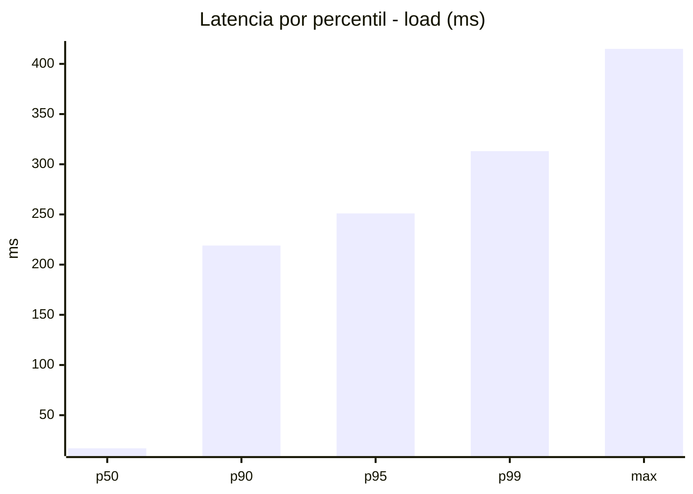
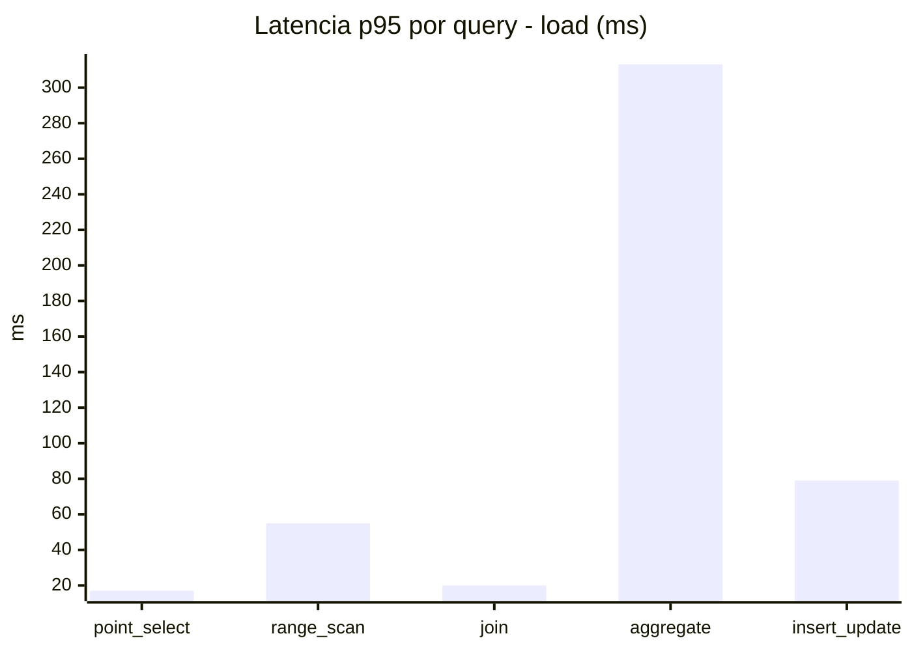
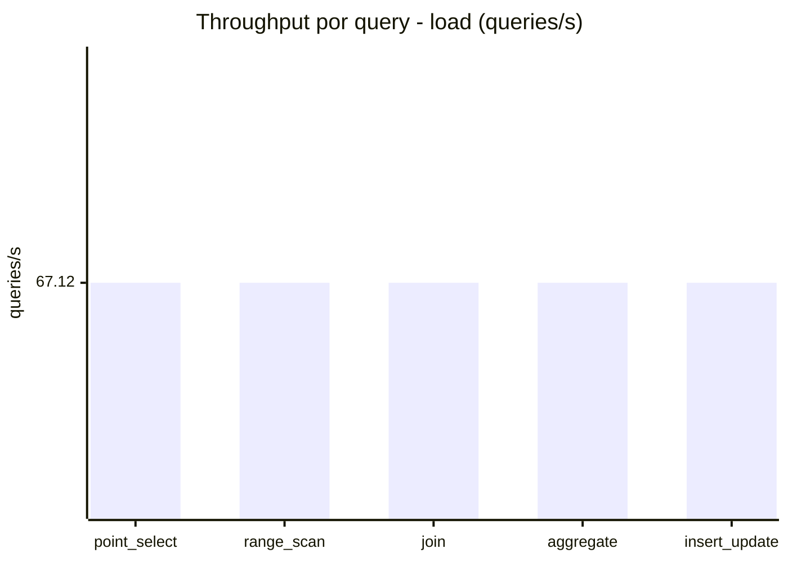
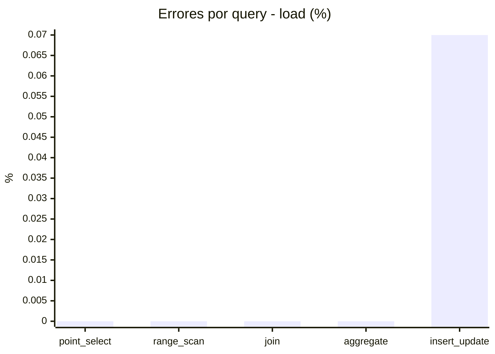
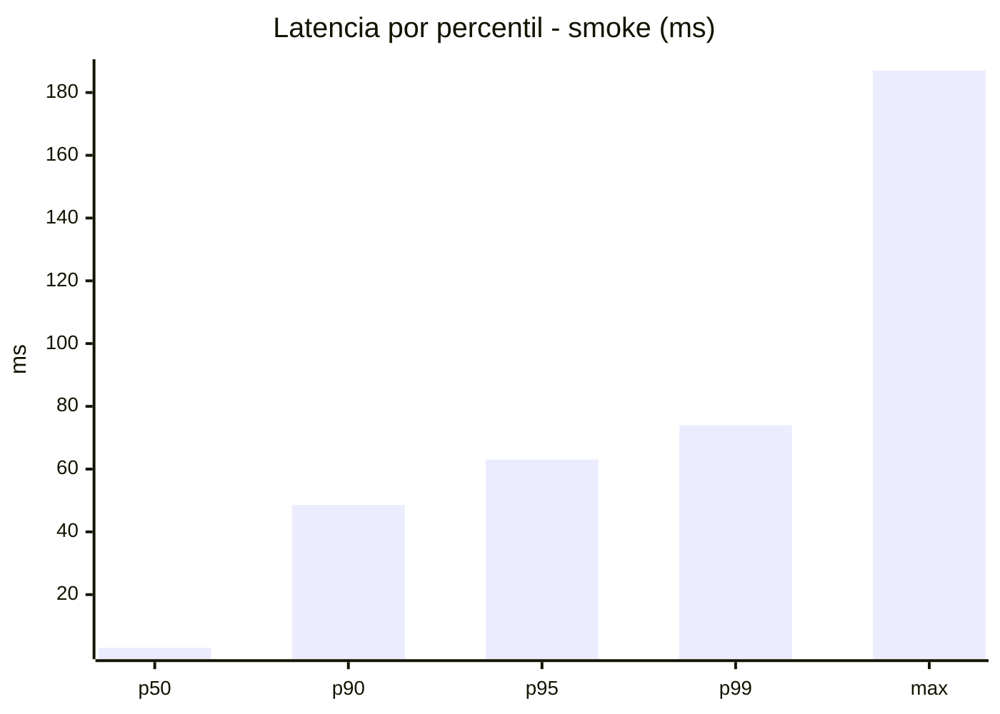
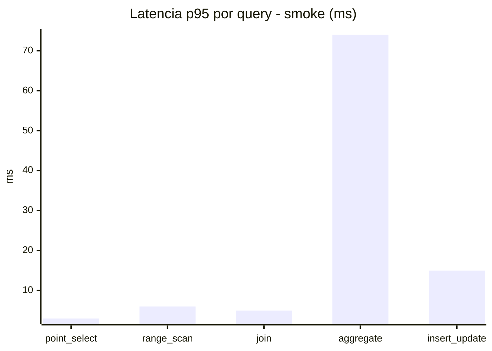
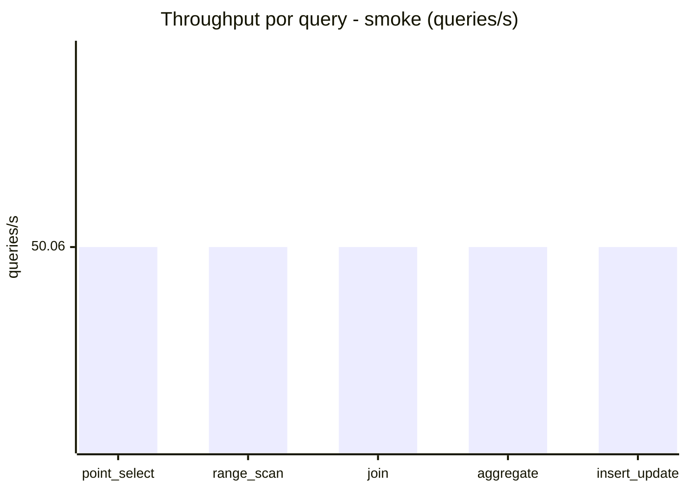
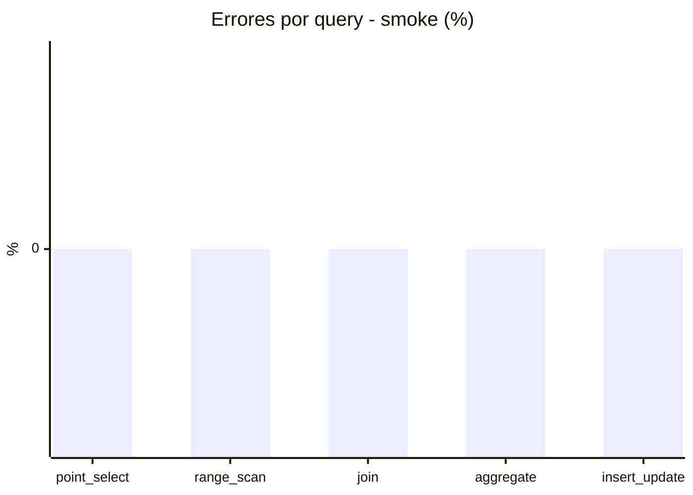

# Reporte de performance - SQL Server (k6)

**Fecha:** 2026-11-13 20:34 UTC  
**Veredicto (SLO):** `WARN`  
**Corrida:** [ver en GitHub Actions](https://github.com/lrbg/k6-sqlserver-lab/actions/runs/43502508006)  

## Analisis del agente de IA

WARN (fallback por umbrales)

- Error maximo: 0.01%
- p95 maximo: 251 ms

## Resultados

### Escenario: `load`

| Metrica | Valor |
| --- | --- |
| Queries ejecutadas | 20190 |
| Errores | 3 (0.01%) |
| Latencia media | 59.5 ms |
| p50 / p90 / p95 / p99 | 17 / 219 / 251 / 313.1 ms |
| Min / Max | 0 / 415 ms |
| Throughput | 335.59 queries/s |
| Duracion | 60.2 s |

Detalle por query

| Query | Ejecuciones | Error % | avg | p95 | p99 | q/s |
| --- | --- | --- | --- | --- | --- | --- |
| point_select | 4038 | 0% | 6.3 | 17 | 24 | 67.12 |
| range_scan | 4038 | 0% | 24.2 | 55 | 77 | 67.12 |
| join | 4038 | 0% | 9.2 | 20 | 26 | 67.12 |
| aggregate | 4038 | 0% | 222.1 | 313.1 | 353 | 67.12 |
| insert_update | 4038 | 0.07% | 35.7 | 79 | 100.6 | 67.12 |

### Escenario: `smoke`

| Metrica | Valor |
| --- | --- |
| Queries ejecutadas | 7515 |
| Errores | 0 (0%) |
| Latencia media | 12 ms |
| p50 / p90 / p95 / p99 | 3 / 48.6 / 63 / 74 ms |
| Min / Max | 0 / 187 ms |
| Throughput | 250.28 queries/s |
| Duracion | 30 s |

Detalle por query

| Query | Ejecuciones | Error % | avg | p95 | p99 | q/s |
| --- | --- | --- | --- | --- | --- | --- |
| point_select | 1503 | 0% | 0.8 | 3 | 5 | 50.06 |
| range_scan | 1503 | 0% | 3 | 6 | 8 | 50.06 |
| join | 1503 | 0% | 1.8 | 5 | 5 | 50.06 |
| aggregate | 1503 | 0% | 49.4 | 74 | 79 | 50.06 |
| insert_update | 1503 | 0% | 4.8 | 15 | 22 | 50.06 |

