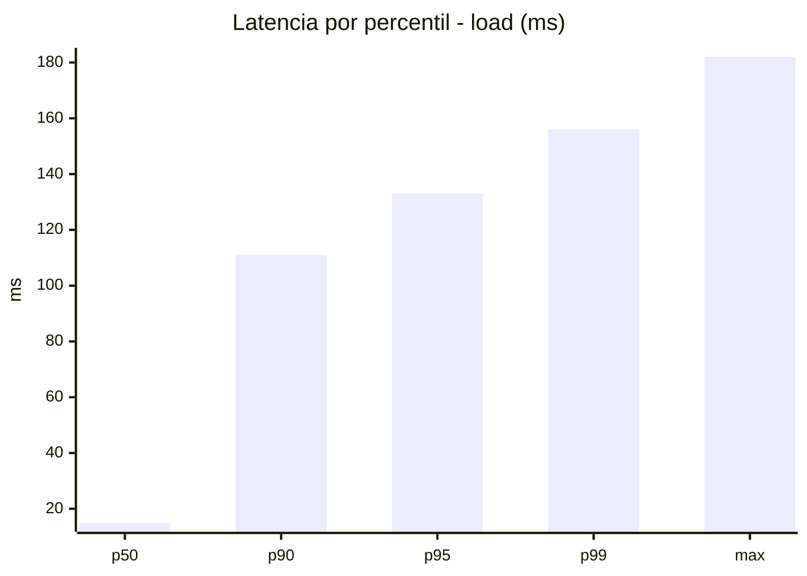
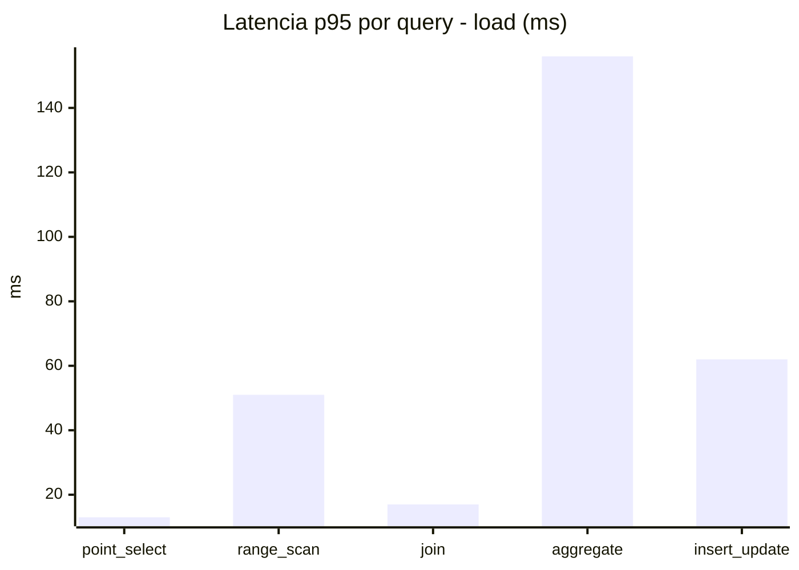
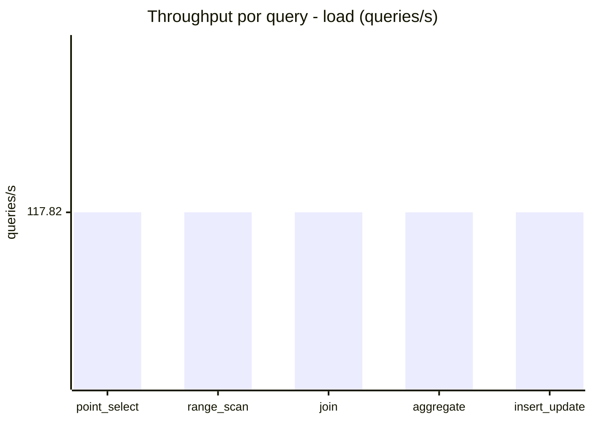
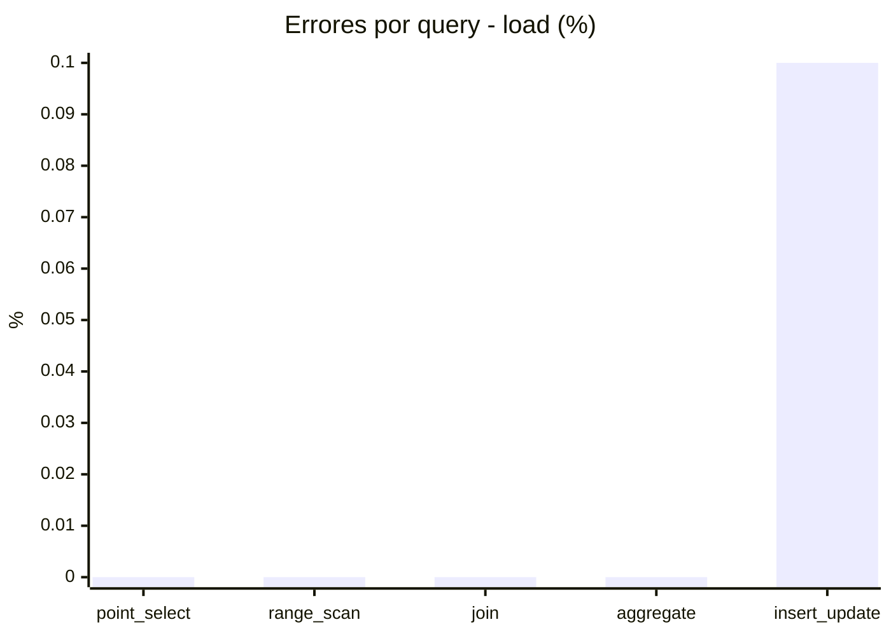
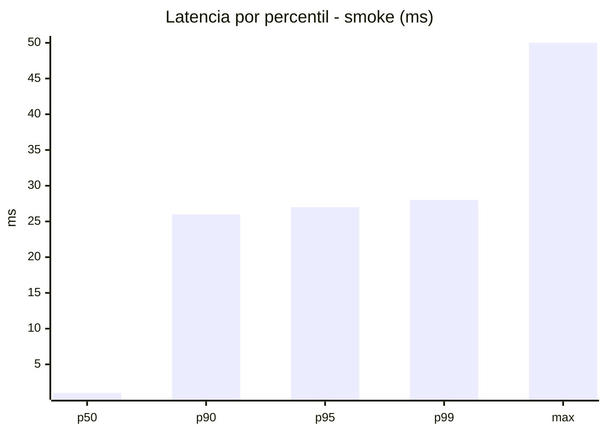
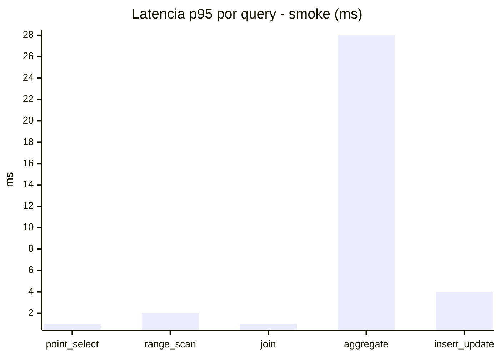
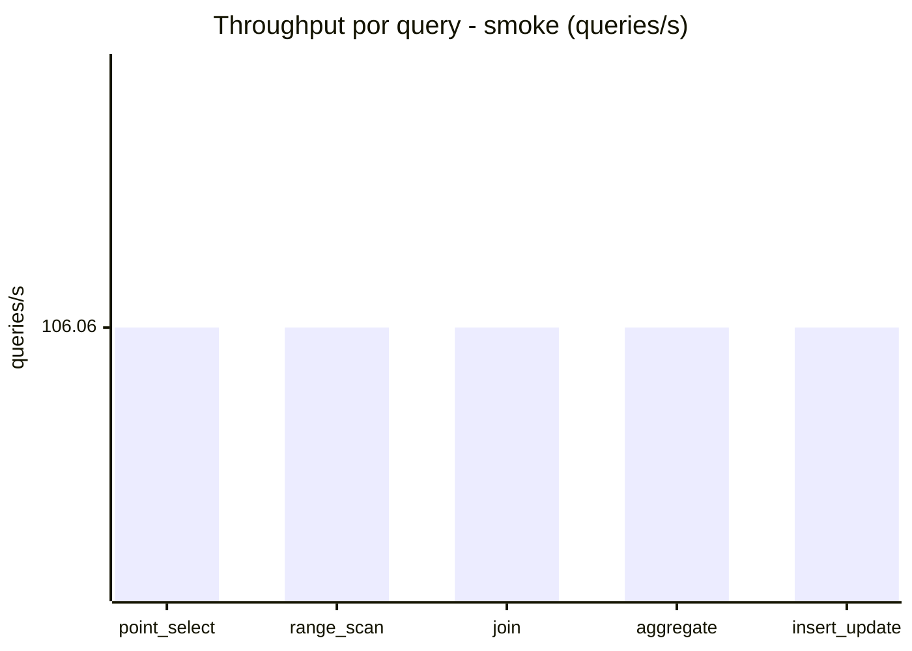
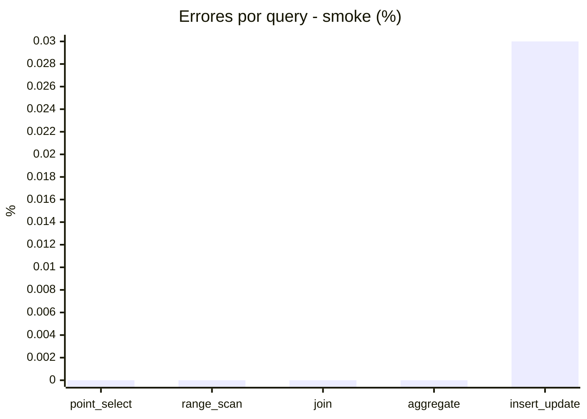

# Reporte de performance - SQL Server (k6)

**Fecha:** 2026-11-14 18:48 UTC  
**Veredicto (SLO):** `PASS`  
**Corrida:** [ver en GitHub Actions](https://github.com/lrbg/k6-sqlserver-lab/actions/runs/43628465622)  

## Analisis del agente de IA

PASS (fallback por umbrales)

- Error maximo: 0.02%
- p95 maximo: 133 ms

## Resultados

### Escenario: `load`

| Metrica | Valor |
| --- | --- |
| Queries ejecutadas | 35400 |
| Errores | 7 (0.02%) |
| Latencia media | 33.9 ms |
| p50 / p90 / p95 / p99 | 15 / 111 / 133 / 156 ms |
| Min / Max | 0 / 182 ms |
| Throughput | 589.09 queries/s |
| Duracion | 60.1 s |

Detalle por query

| Query | Ejecuciones | Error % | avg | p95 | p99 | q/s |
| --- | --- | --- | --- | --- | --- | --- |
| point_select | 7080 | 0% | 4.2 | 13 | 19 | 117.82 |
| range_scan | 7080 | 0% | 21.9 | 51 | 68 | 117.82 |
| join | 7080 | 0% | 6.5 | 17 | 21 | 117.82 |
| aggregate | 7080 | 0% | 108.4 | 156 | 169 | 117.82 |
| insert_update | 7080 | 0.1% | 28.6 | 62 | 79 | 117.82 |

### Escenario: `smoke`

| Metrica | Valor |
| --- | --- |
| Queries ejecutadas | 15920 |
| Errores | 1 (0.01%) |
| Latencia media | 5.6 ms |
| p50 / p90 / p95 / p99 | 1 / 26 / 27 / 28 ms |
| Min / Max | 0 / 50 ms |
| Throughput | 530.32 queries/s |
| Duracion | 30 s |

Detalle por query

| Query | Ejecuciones | Error % | avg | p95 | p99 | q/s |
| --- | --- | --- | --- | --- | --- | --- |
| point_select | 3184 | 0% | 0.4 | 1 | 1 | 106.06 |
| range_scan | 3184 | 0% | 1.8 | 2 | 3 | 106.06 |
| join | 3184 | 0% | 0.5 | 1 | 2 | 106.06 |
| aggregate | 3184 | 0% | 23.8 | 28 | 29 | 106.06 |
| insert_update | 3184 | 0.03% | 1.7 | 4 | 7 | 106.06 |

