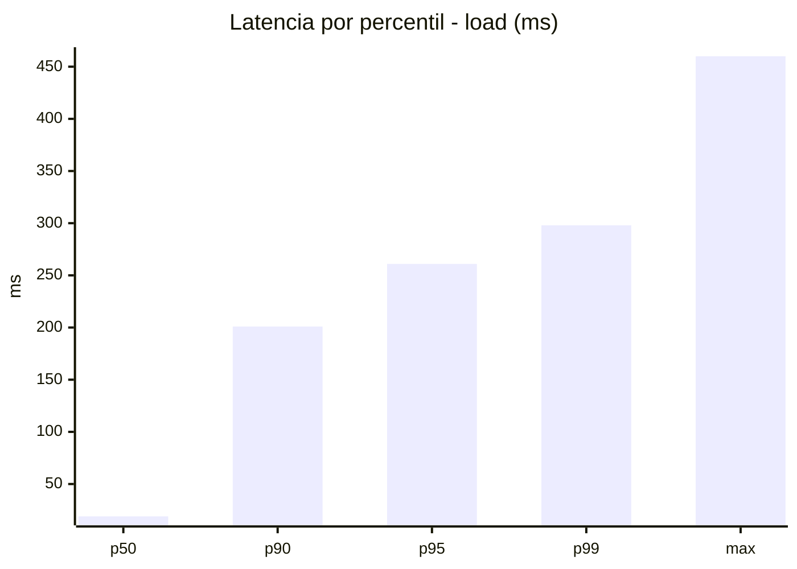
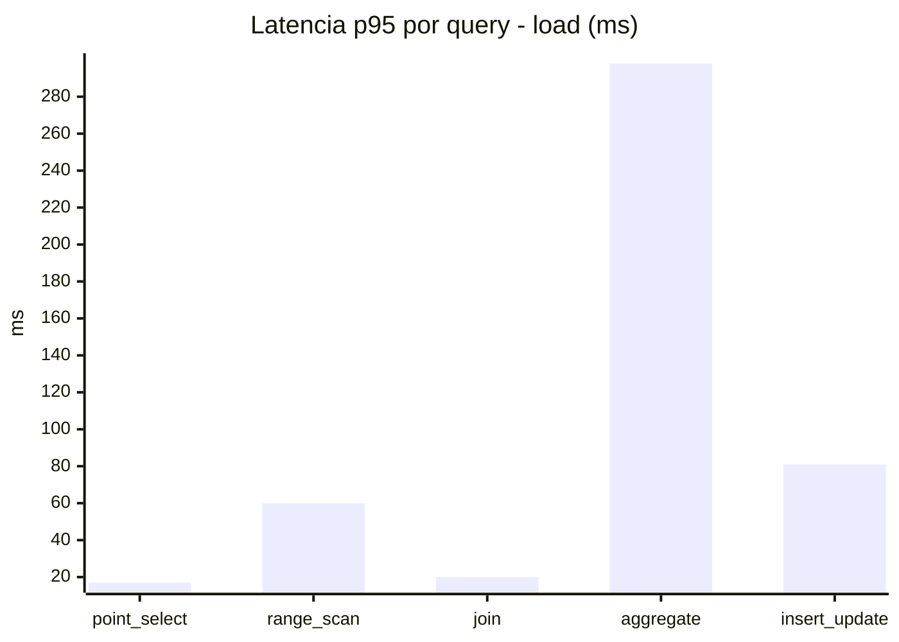
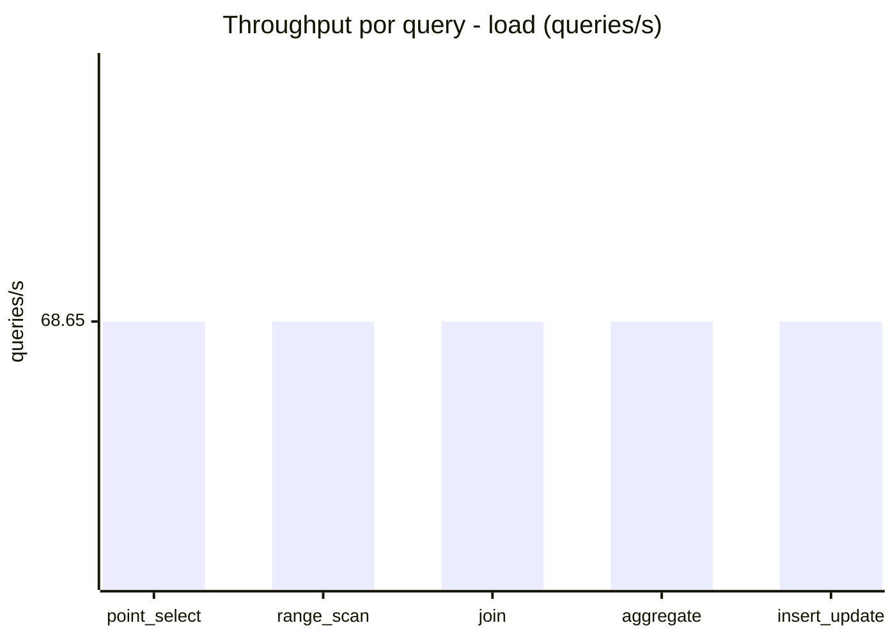
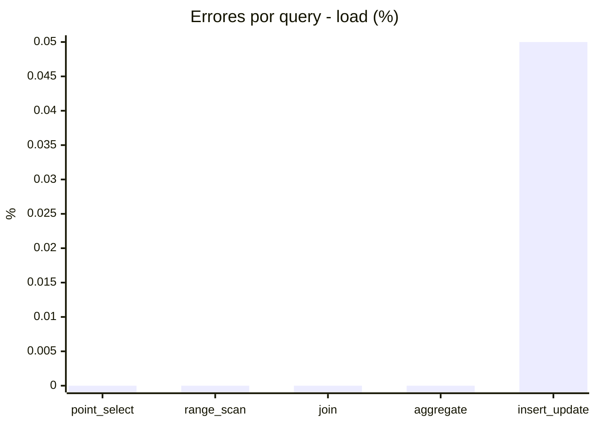
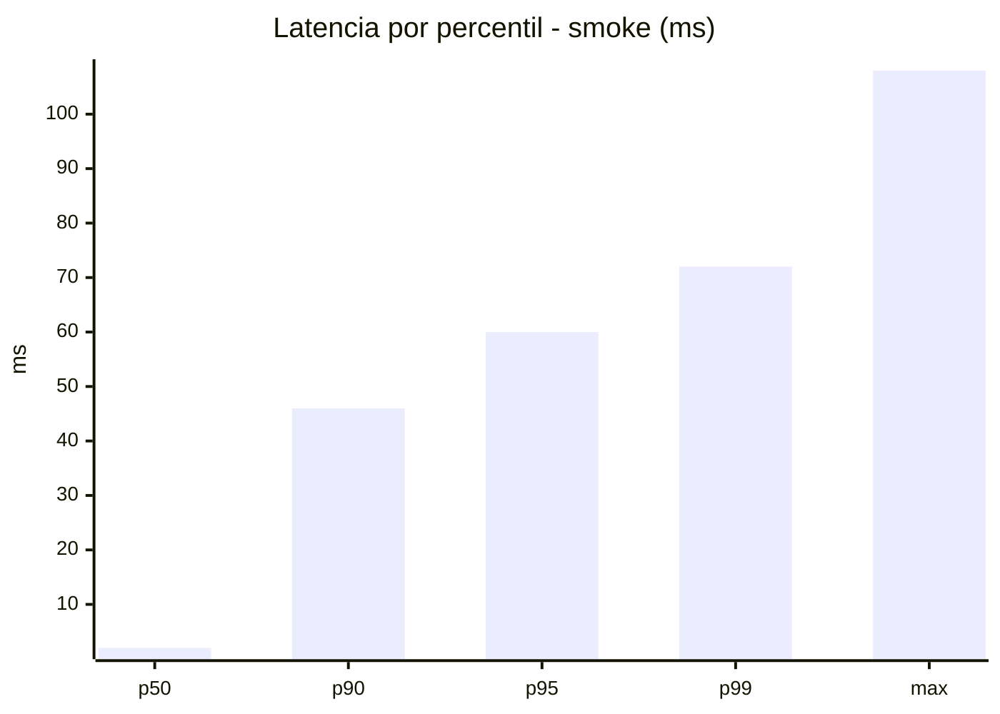
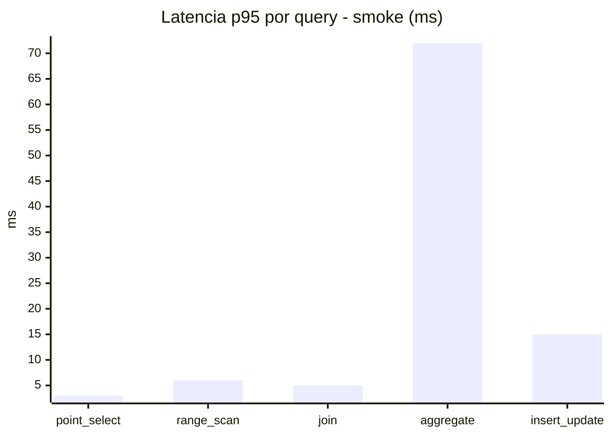
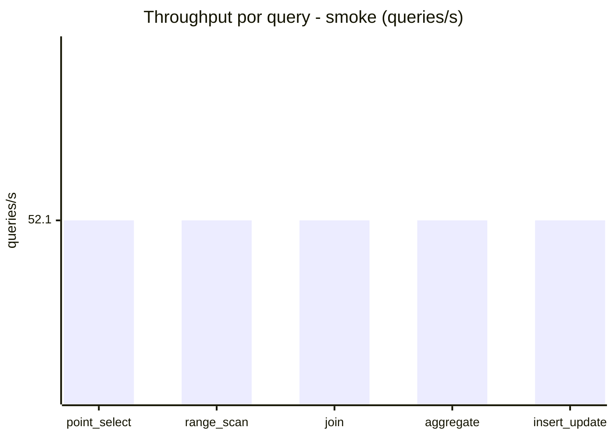
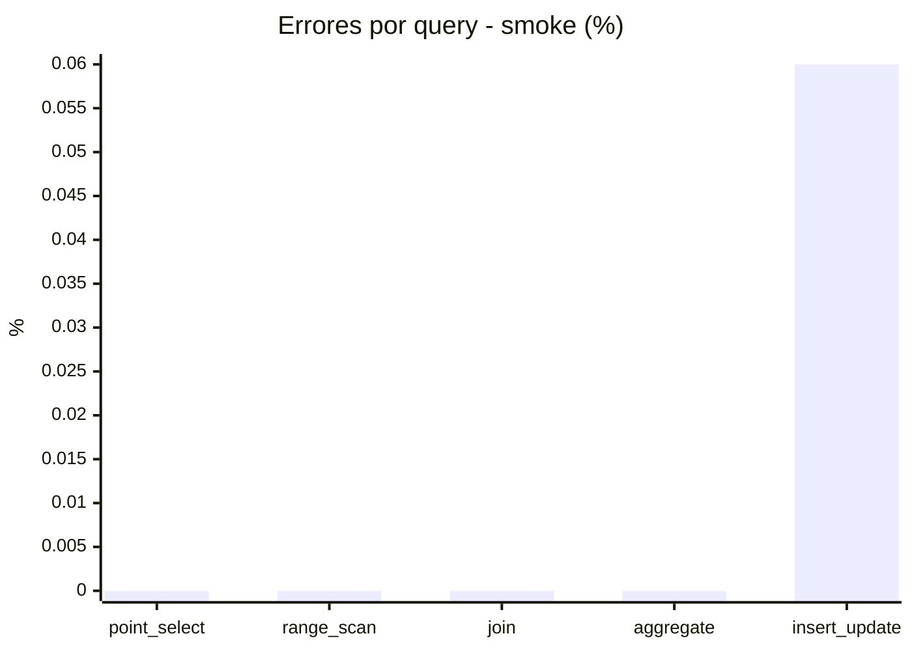

# Reporte de performance - SQL Server (k6)

**Fecha:** 2026-11-15 19:26 UTC  
**Veredicto (SLO):** `WARN`  
**Corrida:** [ver en GitHub Actions](https://github.com/lrbg/k6-sqlserver-lab/actions/runs/43752243326)  

## Analisis del agente de IA

WARN (fallback por umbrales)

- Error maximo: 0.01%
- p95 maximo: 261 ms

## Resultados

### Escenario: `load`

| Metrica | Valor |
| --- | --- |
| Queries ejecutadas | 20670 |
| Errores | 2 (0.01%) |
| Latencia media | 58.2 ms |
| p50 / p90 / p95 / p99 | 19 / 201 / 261 / 298 ms |
| Min / Max | 0 / 460 ms |
| Throughput | 343.25 queries/s |
| Duracion | 60.2 s |

Detalle por query

| Query | Ejecuciones | Error % | avg | p95 | p99 | q/s |
| --- | --- | --- | --- | --- | --- | --- |
| point_select | 4134 | 0% | 6.3 | 17 | 22 | 68.65 |
| range_scan | 4134 | 0% | 26.9 | 60 | 81 | 68.65 |
| join | 4134 | 0% | 8.7 | 20 | 22 | 68.65 |
| aggregate | 4134 | 0% | 209.6 | 298 | 314.7 | 68.65 |
| insert_update | 4134 | 0.05% | 39.5 | 81 | 103 | 68.65 |

### Escenario: `smoke`

| Metrica | Valor |
| --- | --- |
| Queries ejecutadas | 7830 |
| Errores | 1 (0.01%) |
| Latencia media | 11.5 ms |
| p50 / p90 / p95 / p99 | 2 / 46 / 60 / 72 ms |
| Min / Max | 0 / 108 ms |
| Throughput | 260.5 queries/s |
| Duracion | 30.1 s |

Detalle por query

| Query | Ejecuciones | Error % | avg | p95 | p99 | q/s |
| --- | --- | --- | --- | --- | --- | --- |
| point_select | 1566 | 0% | 0.8 | 3 | 5 | 52.1 |
| range_scan | 1566 | 0% | 3 | 6 | 11 | 52.1 |
| join | 1566 | 0% | 1.6 | 5 | 5 | 52.1 |
| aggregate | 1566 | 0% | 47.4 | 72 | 77 | 52.1 |
| insert_update | 1566 | 0.06% | 4.6 | 15 | 21 | 52.1 |

