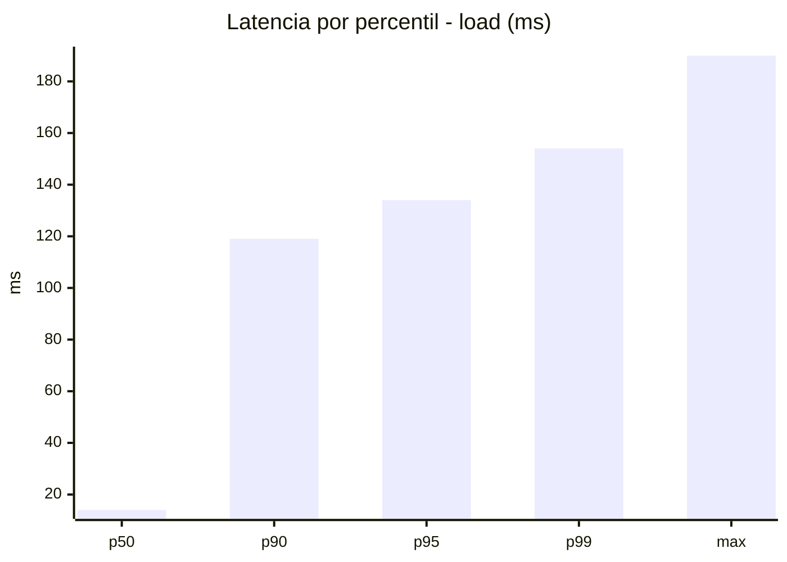
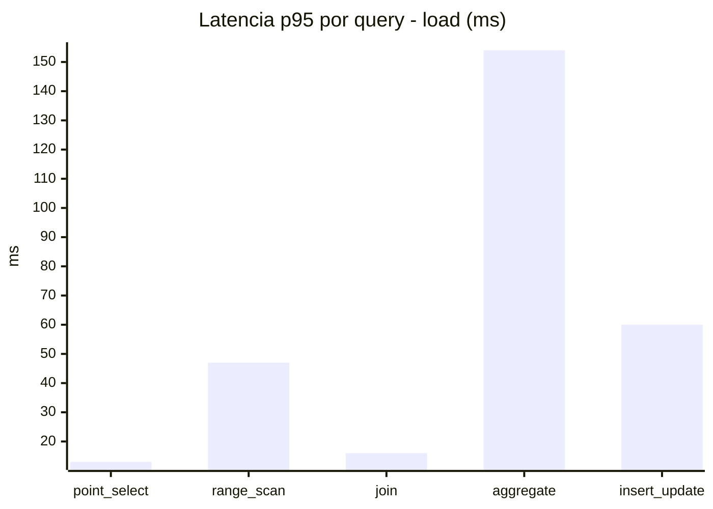
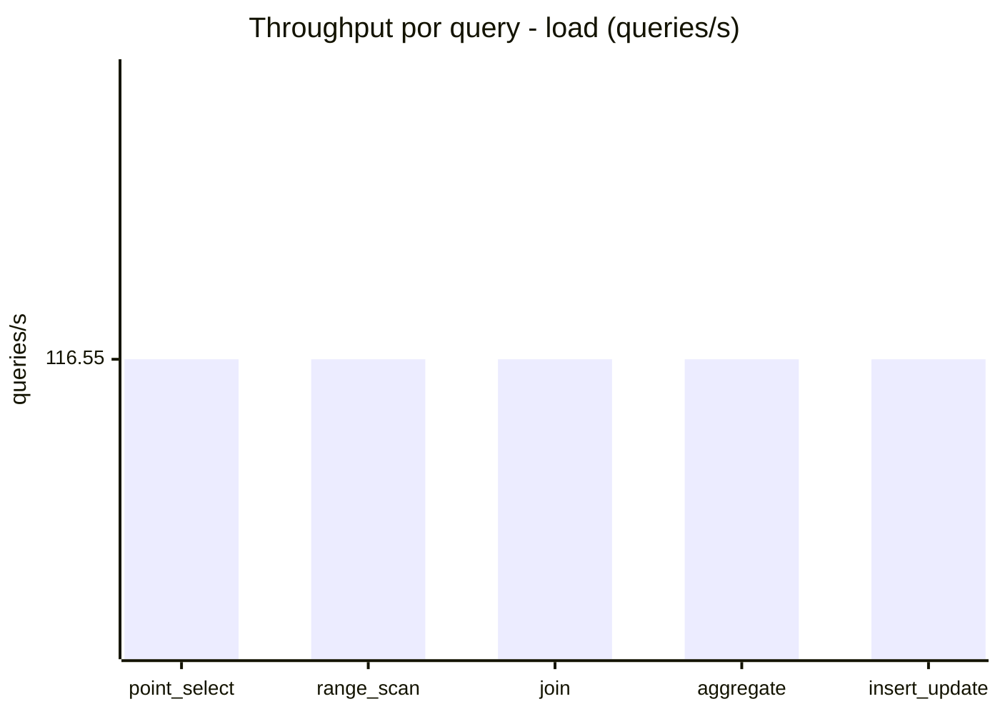
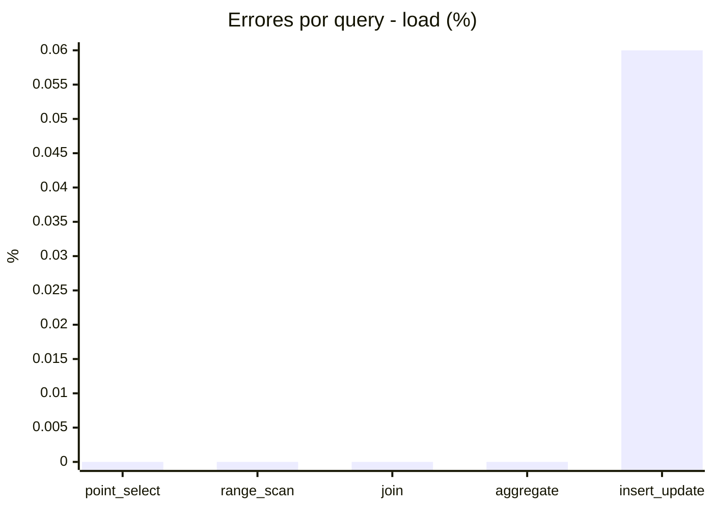
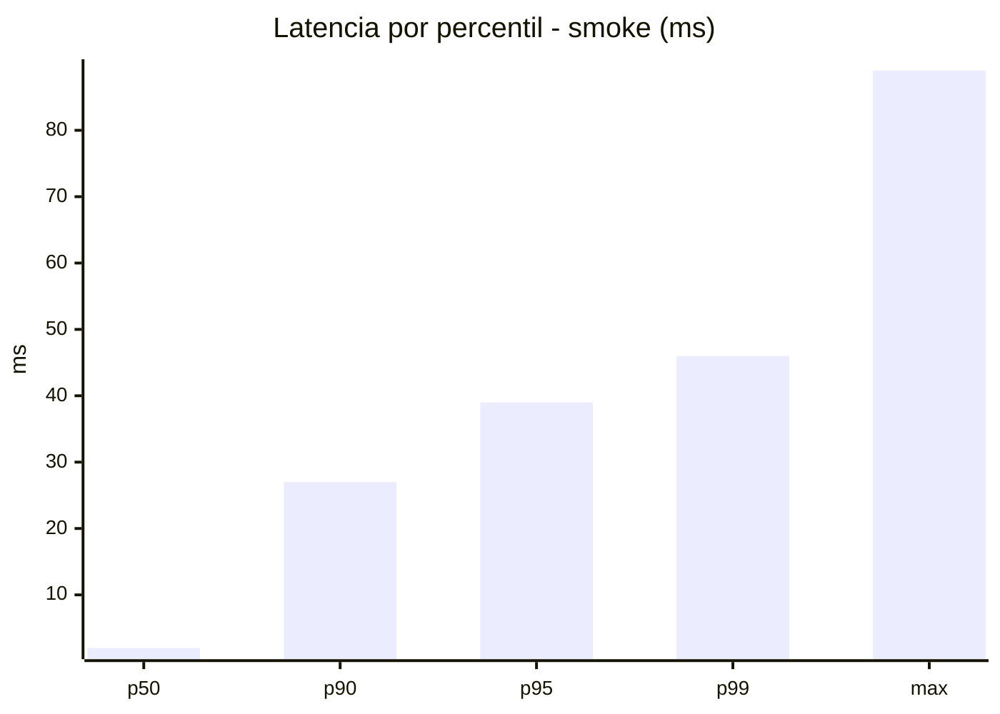
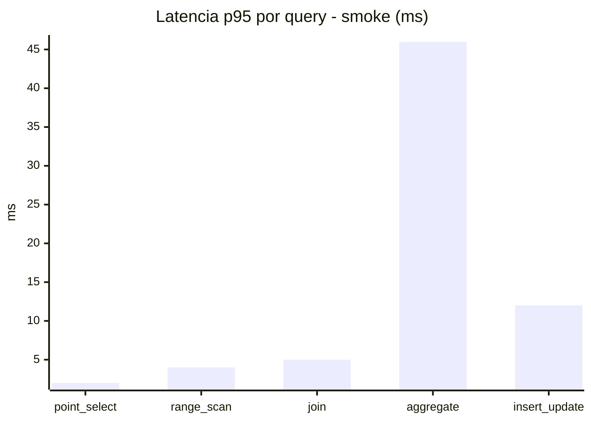
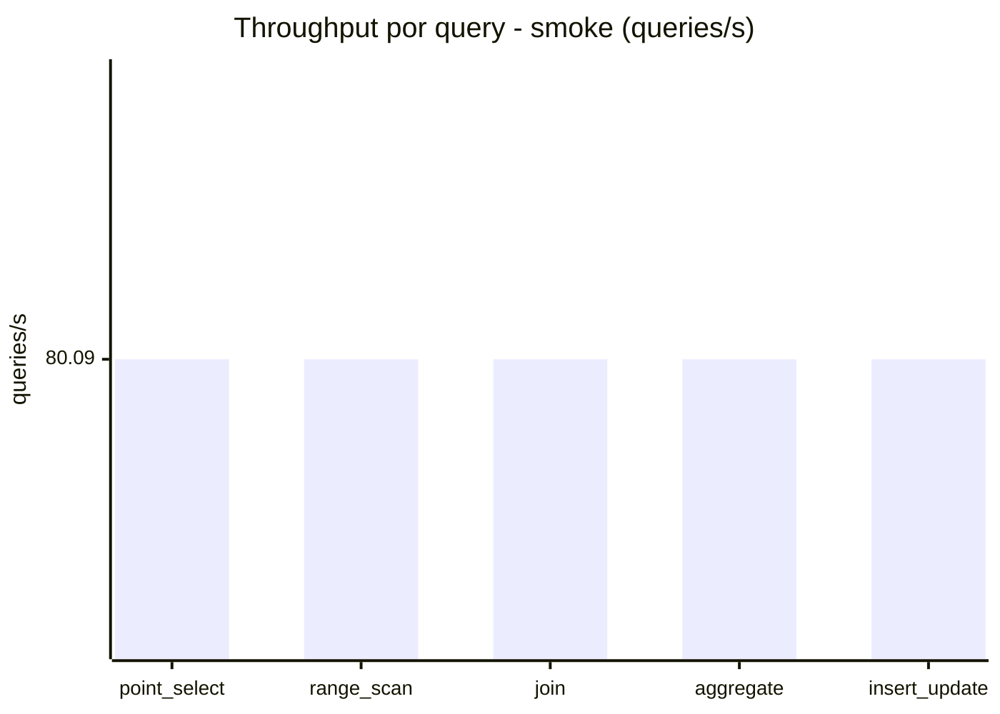
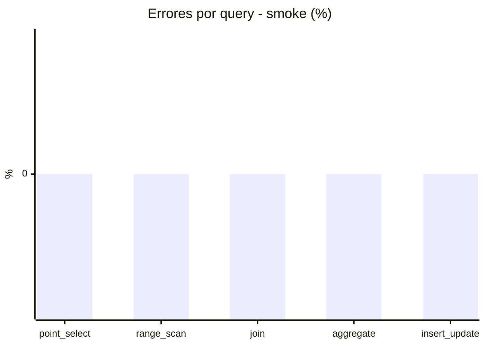

# Reporte de performance - SQL Server (k6)

**Fecha:** 2026-11-16 22:58 UTC  
**Veredicto (SLO):** `PASS`  
**Corrida:** [ver en GitHub Actions](https://github.com/lrbg/k6-sqlserver-lab/actions/runs/43974787499)  

## Analisis del agente de IA

PASS (fallback por umbrales)

- Error maximo: 0.01%
- p95 maximo: 134 ms

## Resultados

### Escenario: `load`

| Metrica | Valor |
| --- | --- |
| Queries ejecutadas | 35045 |
| Errores | 4 (0.01%) |
| Latencia media | 34.3 ms |
| p50 / p90 / p95 / p99 | 14 / 119 / 134 / 154 ms |
| Min / Max | 0 / 190 ms |
| Throughput | 582.73 queries/s |
| Duracion | 60.1 s |

Detalle por query

| Query | Ejecuciones | Error % | avg | p95 | p99 | q/s |
| --- | --- | --- | --- | --- | --- | --- |
| point_select | 7009 | 0% | 3.7 | 13 | 17 | 116.55 |
| range_scan | 7009 | 0% | 20.8 | 47 | 64 | 116.55 |
| join | 7009 | 0% | 6.3 | 16 | 19 | 116.55 |
| aggregate | 7009 | 0% | 113.3 | 154 | 170 | 116.55 |
| insert_update | 7009 | 0.06% | 27.5 | 60 | 78 | 116.55 |

### Escenario: `smoke`

| Metrica | Valor |
| --- | --- |
| Queries ejecutadas | 12030 |
| Errores | 0 (0%) |
| Latencia media | 7.5 ms |
| p50 / p90 / p95 / p99 | 2 / 27 / 39 / 46 ms |
| Min / Max | 0 / 89 ms |
| Throughput | 400.44 queries/s |
| Duracion | 30 s |

Detalle por query

| Query | Ejecuciones | Error % | avg | p95 | p99 | q/s |
| --- | --- | --- | --- | --- | --- | --- |
| point_select | 2406 | 0% | 0.5 | 2 | 4 | 80.09 |
| range_scan | 2406 | 0% | 2 | 4 | 8 | 80.09 |
| join | 2406 | 0% | 1.3 | 5 | 5 | 80.09 |
| aggregate | 2406 | 0% | 30.3 | 46 | 48 | 80.09 |
| insert_update | 2406 | 0% | 3.3 | 12 | 17 | 80.09 |

