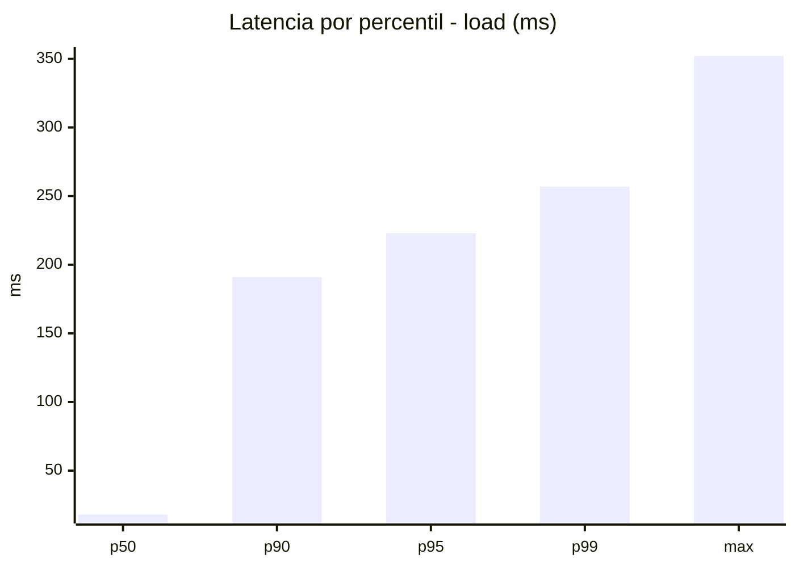
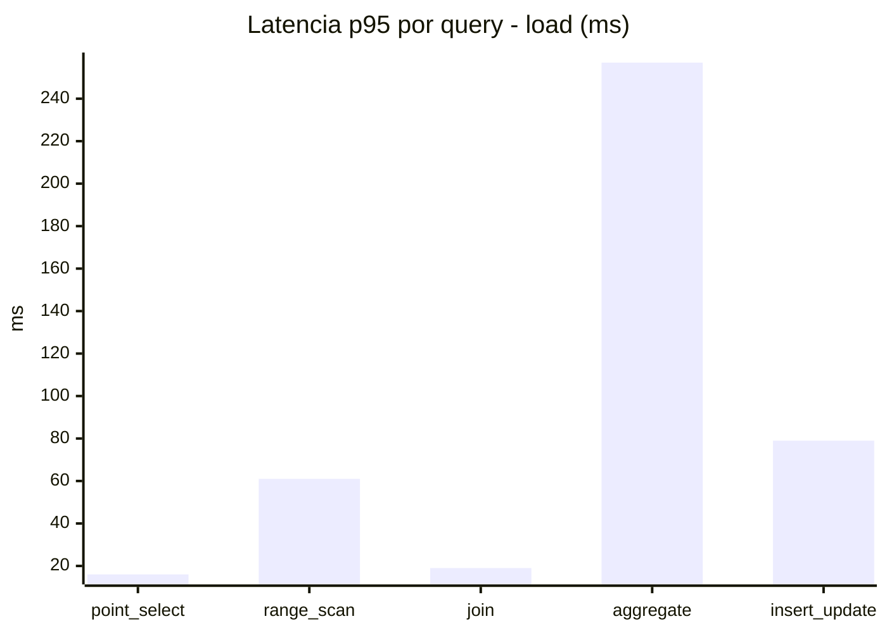
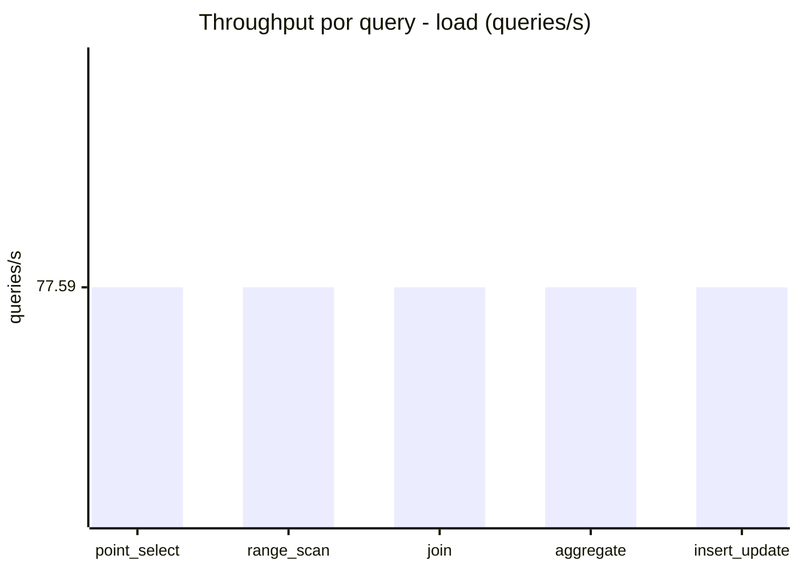
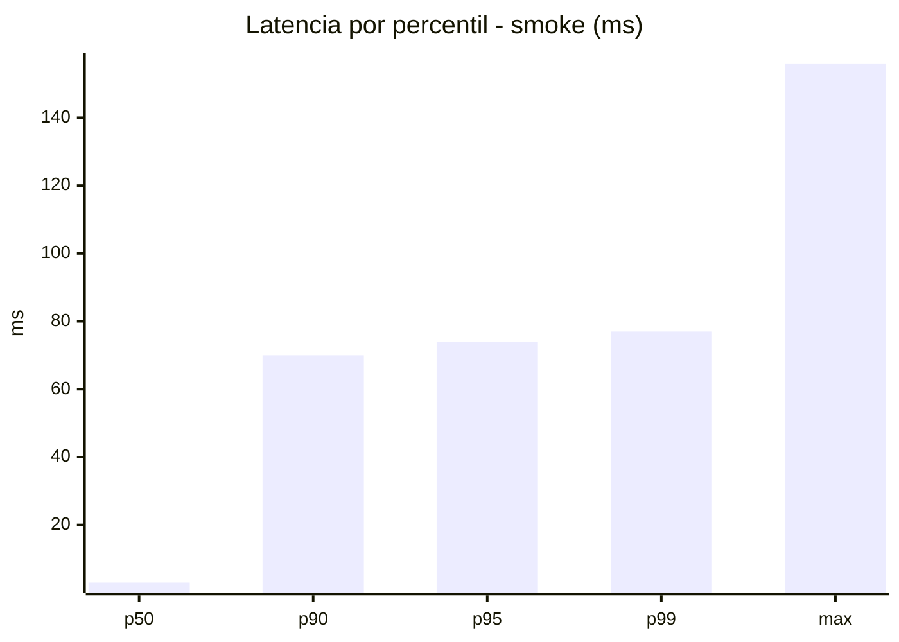
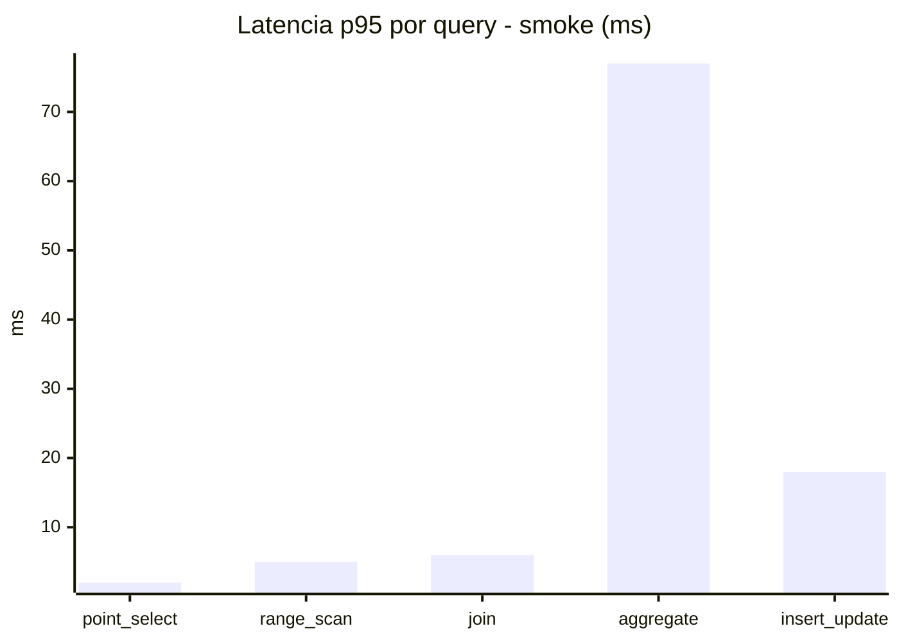
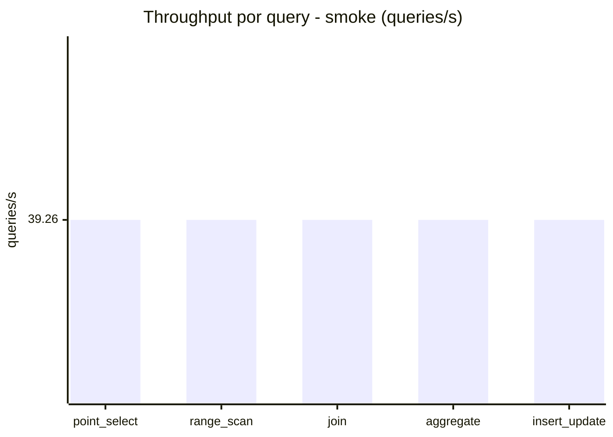
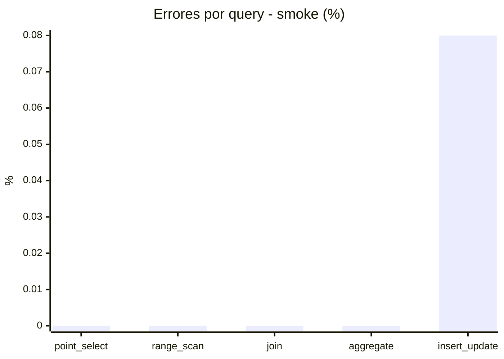

# Reporte de performance - SQL Server (k6)

**Fecha:** 2026-11-17 21:51 UTC  
**Veredicto (SLO):** `WARN`  
**Corrida:** [ver en GitHub Actions](https://github.com/lrbg/k6-sqlserver-lab/actions/runs/44183829684)  

## Analisis del agente de IA

WARN (fallback por umbrales)

- Error maximo: 0.02%
- p95 maximo: 223 ms

## Resultados

### Escenario: `load`

| Metrica | Valor |
| --- | --- |
| Queries ejecutadas | 23340 |
| Errores | 2 (0.01%) |
| Latencia media | 51.5 ms |
| p50 / p90 / p95 / p99 | 18 / 191 / 223 / 257 ms |
| Min / Max | 0 / 352 ms |
| Throughput | 387.95 queries/s |
| Duracion | 60.2 s |

Detalle por query

| Query | Ejecuciones | Error % | avg | p95 | p99 | q/s |
| --- | --- | --- | --- | --- | --- | --- |
| point_select | 4668 | 0% | 5.2 | 16 | 21 | 77.59 |
| range_scan | 4668 | 0% | 25.7 | 61 | 81.3 | 77.59 |
| join | 4668 | 0% | 8.1 | 19 | 22 | 77.59 |
| aggregate | 4668 | 0% | 181.2 | 257 | 269 | 77.59 |
| insert_update | 4668 | 0.04% | 37.2 | 79 | 99 | 77.59 |

### Escenario: `smoke`

| Metrica | Valor |
| --- | --- |
| Queries ejecutadas | 5895 |
| Errores | 1 (0.02%) |
| Latencia media | 15.2 ms |
| p50 / p90 / p95 / p99 | 3 / 70 / 74 / 77 ms |
| Min / Max | 0 / 156 ms |
| Throughput | 196.32 queries/s |
| Duracion | 30 s |

Detalle por query

| Query | Ejecuciones | Error % | avg | p95 | p99 | q/s |
| --- | --- | --- | --- | --- | --- | --- |
| point_select | 1179 | 0% | 0.9 | 2 | 5 | 39.26 |
| range_scan | 1179 | 0% | 3.4 | 5 | 9 | 39.26 |
| join | 1179 | 0% | 2.7 | 6 | 9 | 39.26 |
| aggregate | 1179 | 0% | 62.5 | 77 | 82 | 39.26 |
| insert_update | 1179 | 0.08% | 6.8 | 18 | 25 | 39.26 |

