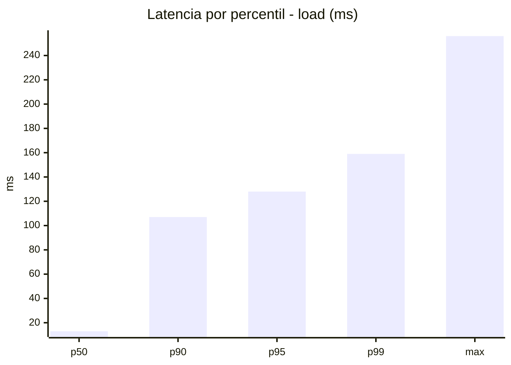
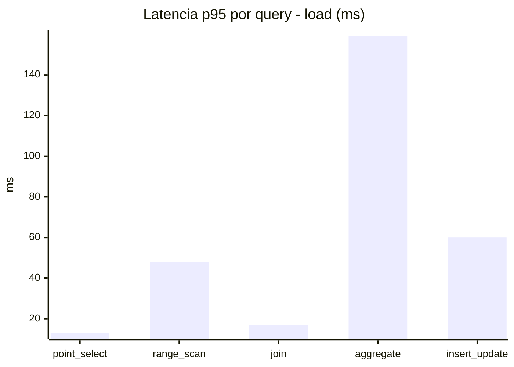
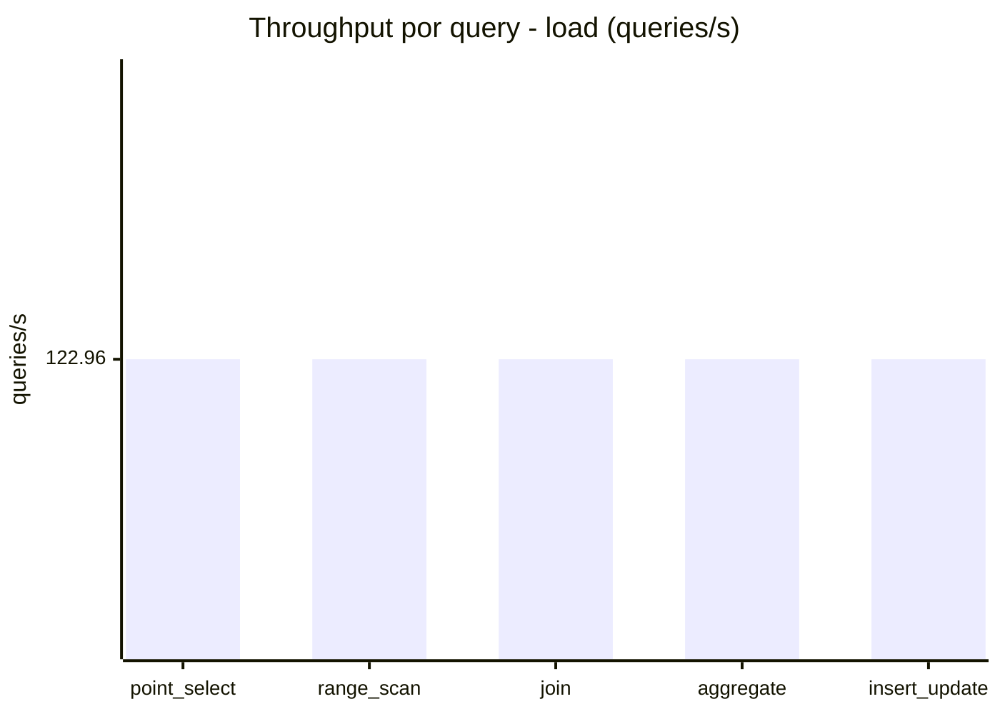
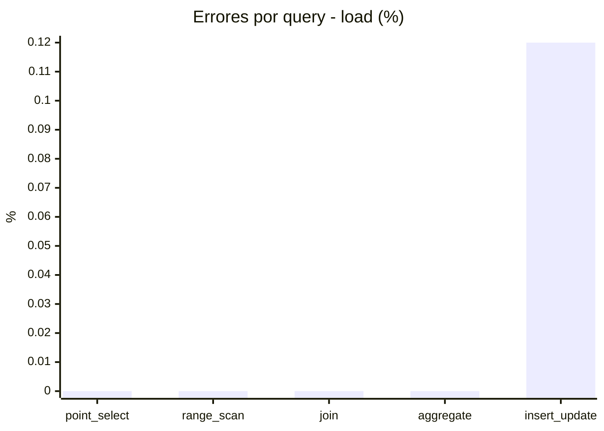
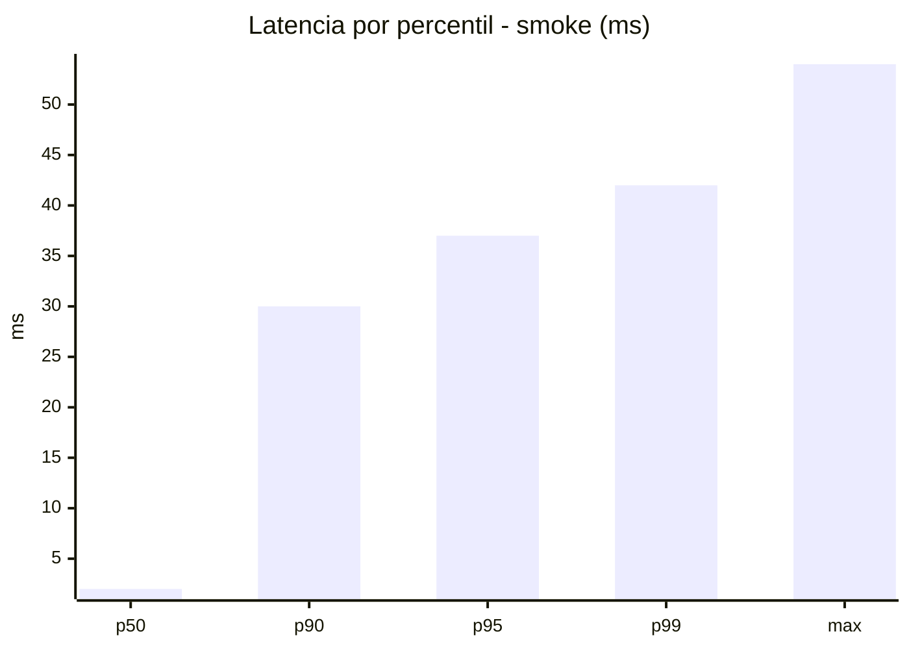
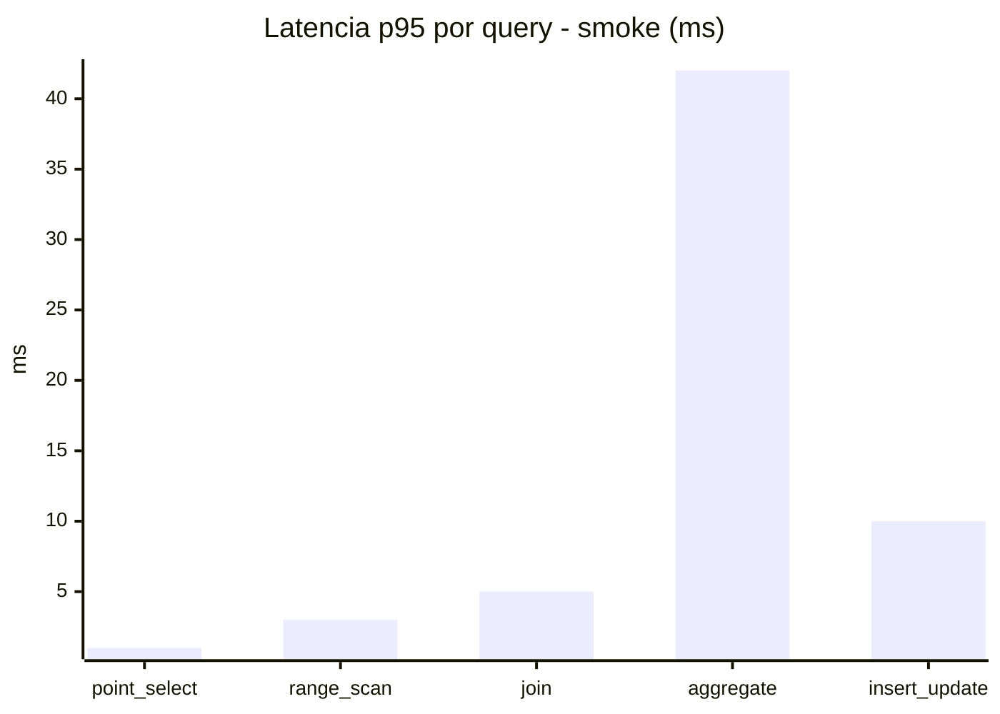
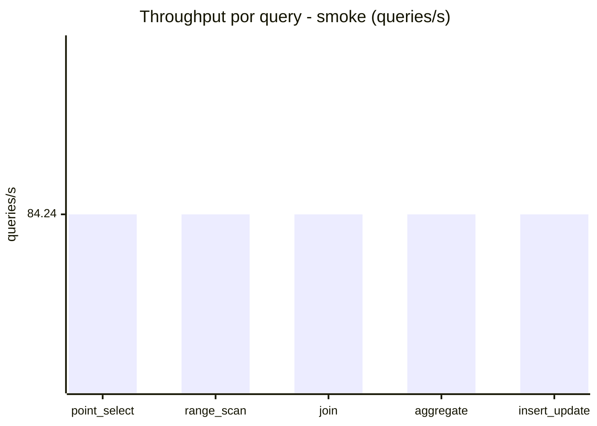
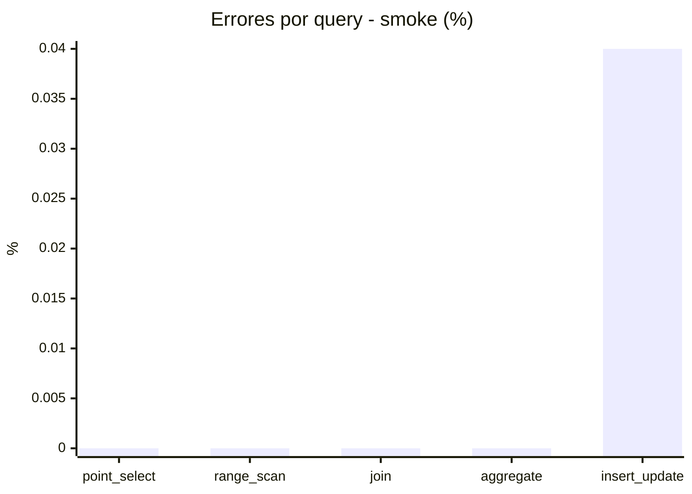

# Reporte de performance - SQL Server (k6)

**Fecha:** 2026-11-18 21:30 UTC  
**Veredicto (SLO):** `PASS`  
**Corrida:** [ver en GitHub Actions](https://github.com/lrbg/k6-sqlserver-lab/actions/runs/44401893297)  

## Analisis del agente de IA

PASS (fallback por umbrales)

- Error maximo: 0.02%
- p95 maximo: 128 ms

## Resultados

### Escenario: `load`

| Metrica | Valor |
| --- | --- |
| Queries ejecutadas | 36965 |
| Errores | 9 (0.02%) |
| Latencia media | 32.5 ms |
| p50 / p90 / p95 / p99 | 13 / 107 / 128 / 159 ms |
| Min / Max | 0 / 256 ms |
| Throughput | 614.79 queries/s |
| Duracion | 60.1 s |

Detalle por query

| Query | Ejecuciones | Error % | avg | p95 | p99 | q/s |
| --- | --- | --- | --- | --- | --- | --- |
| point_select | 7393 | 0% | 3.8 | 13 | 18 | 122.96 |
| range_scan | 7393 | 0% | 19.5 | 48 | 66 | 122.96 |
| join | 7393 | 0% | 6.3 | 17 | 21 | 122.96 |
| aggregate | 7393 | 0% | 106.9 | 159 | 178 | 122.96 |
| insert_update | 7393 | 0.12% | 25.9 | 60 | 79.1 | 122.96 |

### Escenario: `smoke`

| Metrica | Valor |
| --- | --- |
| Queries ejecutadas | 12645 |
| Errores | 1 (0.01%) |
| Latencia media | 7.1 ms |
| p50 / p90 / p95 / p99 | 2 / 30 / 37 / 42 ms |
| Min / Max | 0 / 54 ms |
| Throughput | 421.19 queries/s |
| Duracion | 30 s |

Detalle por query

| Query | Ejecuciones | Error % | avg | p95 | p99 | q/s |
| --- | --- | --- | --- | --- | --- | --- |
| point_select | 2529 | 0% | 0.4 | 1 | 2 | 84.24 |
| range_scan | 2529 | 0% | 1.9 | 3 | 6 | 84.24 |
| join | 2529 | 0% | 1.3 | 5 | 5 | 84.24 |
| aggregate | 2529 | 0% | 28.5 | 42 | 46 | 84.24 |
| insert_update | 2529 | 0.04% | 3.4 | 10 | 14 | 84.24 |

