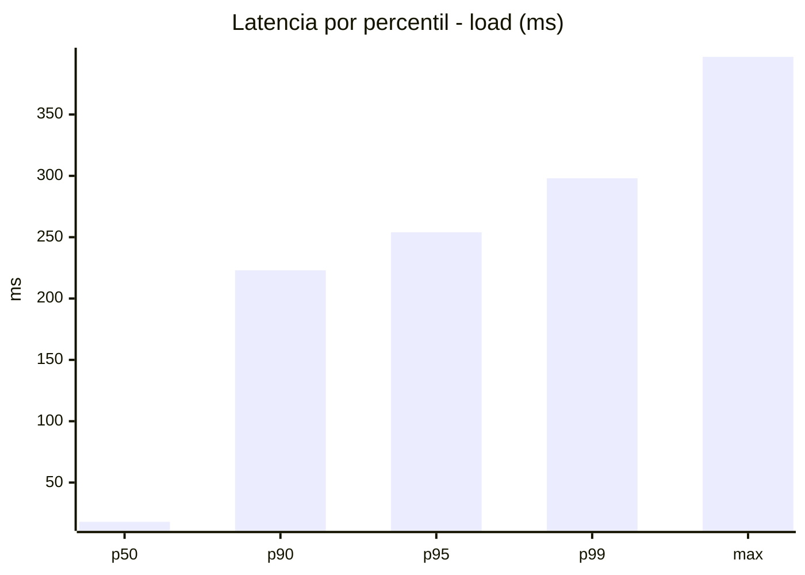
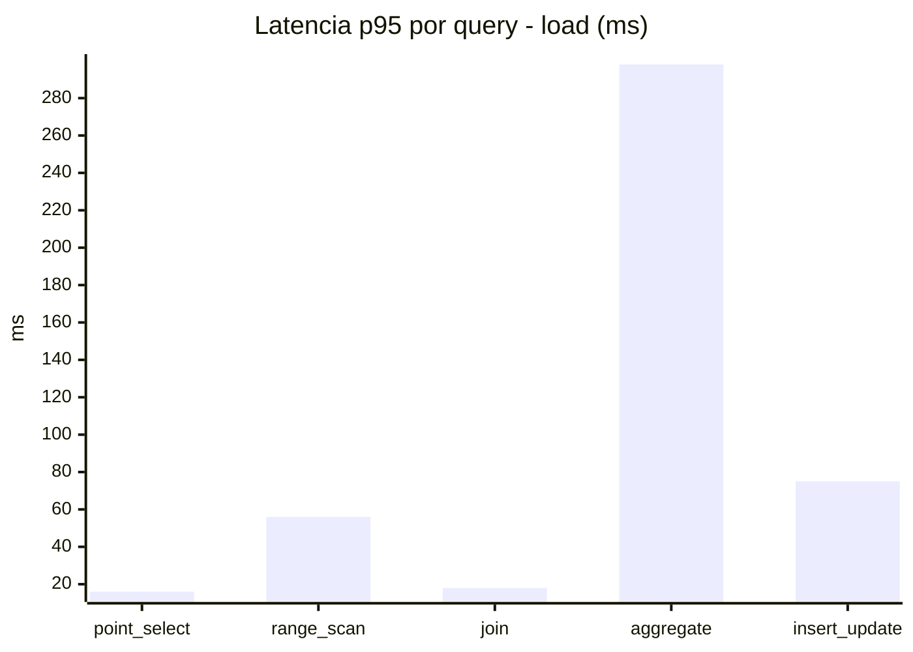
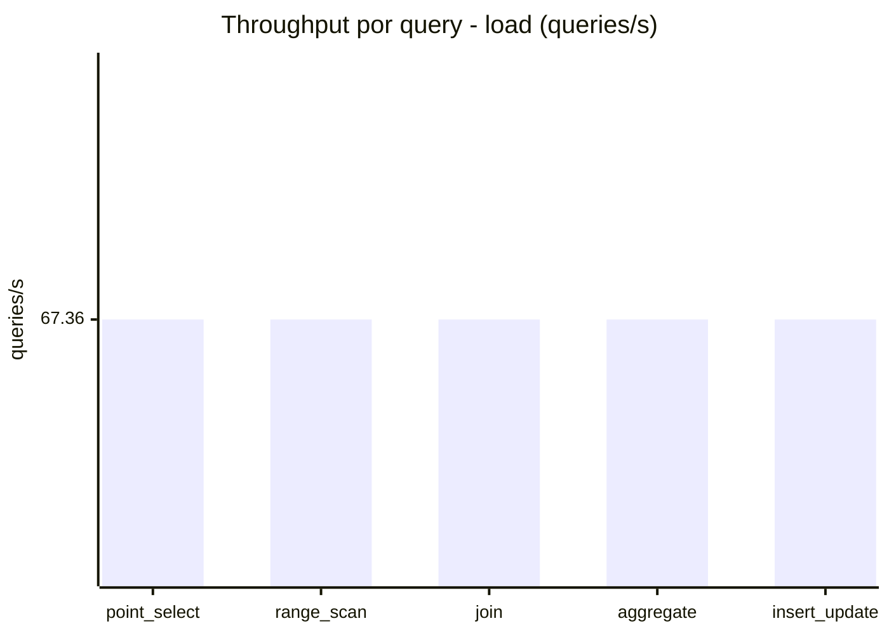
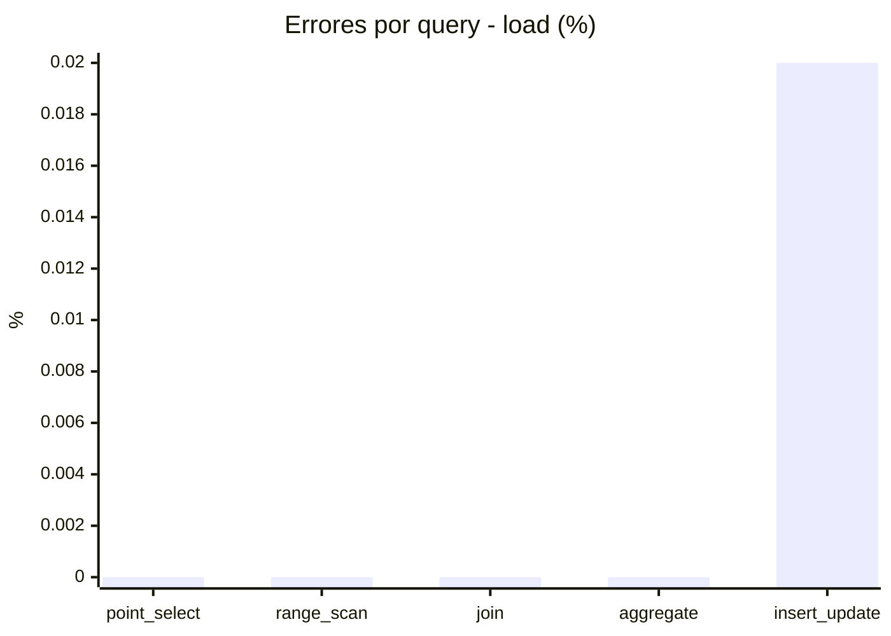
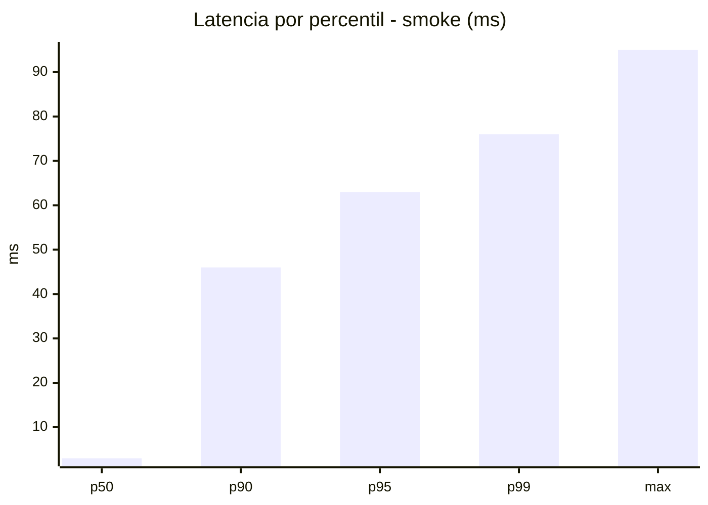
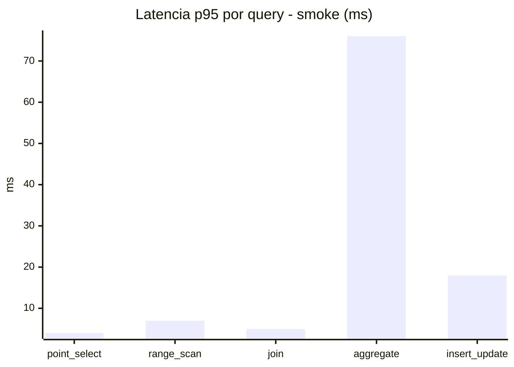
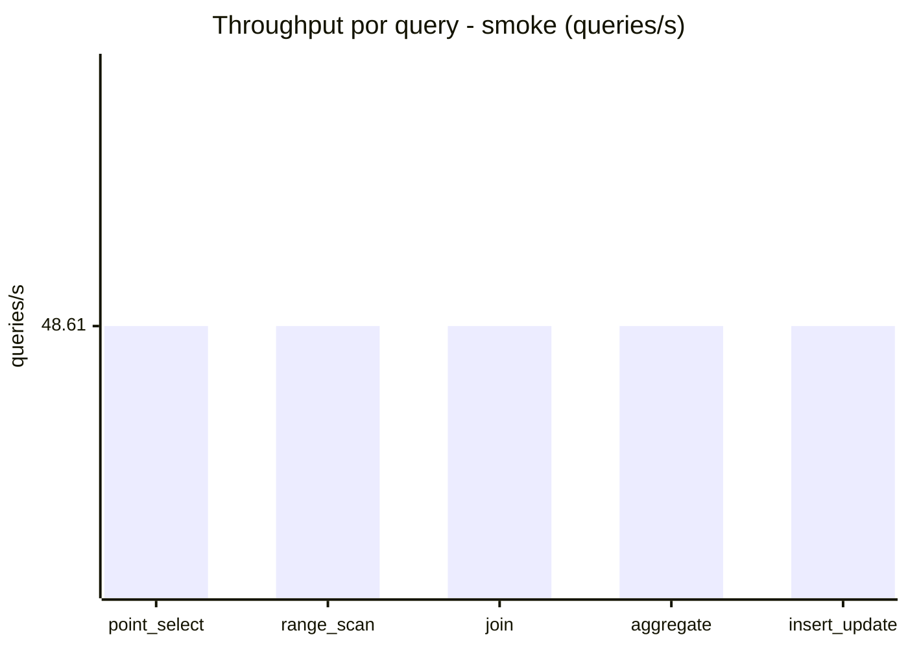
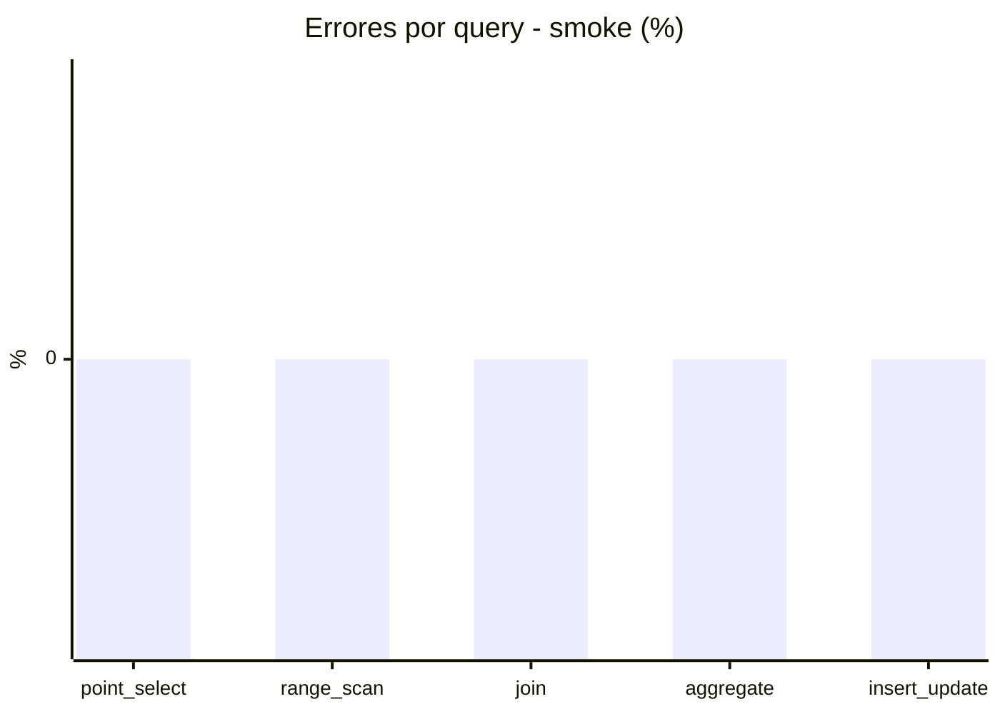

# Reporte de performance - SQL Server (k6)

**Fecha:** 2026-11-19 21:42 UTC  
**Veredicto (SLO):** `WARN`  
**Corrida:** [ver en GitHub Actions](https://github.com/lrbg/k6-sqlserver-lab/actions/runs/44621203885)  

## Analisis del agente de IA

WARN (fallback por umbrales)

- Error maximo: 0%
- p95 maximo: 254 ms

## Resultados

### Escenario: `load`

| Metrica | Valor |
| --- | --- |
| Queries ejecutadas | 20255 |
| Errores | 1 (0%) |
| Latencia media | 59.2 ms |
| p50 / p90 / p95 / p99 | 18 / 223 / 254 / 298 ms |
| Min / Max | 0 / 397 ms |
| Throughput | 336.81 queries/s |
| Duracion | 60.1 s |

Detalle por query

| Query | Ejecuciones | Error % | avg | p95 | p99 | q/s |
| --- | --- | --- | --- | --- | --- | --- |
| point_select | 4051 | 0% | 5.8 | 16 | 21 | 67.36 |
| range_scan | 4051 | 0% | 24.4 | 56 | 78 | 67.36 |
| join | 4051 | 0% | 8.9 | 18 | 22 | 67.36 |
| aggregate | 4051 | 0% | 220.4 | 298 | 325 | 67.36 |
| insert_update | 4051 | 0.02% | 36.6 | 75 | 97 | 67.36 |

### Escenario: `smoke`

| Metrica | Valor |
| --- | --- |
| Queries ejecutadas | 7300 |
| Errores | 0 (0%) |
| Latencia media | 12.3 ms |
| p50 / p90 / p95 / p99 | 3 / 46 / 63 / 76 ms |
| Min / Max | 0 / 95 ms |
| Throughput | 243.03 queries/s |
| Duracion | 30 s |

Detalle por query

| Query | Ejecuciones | Error % | avg | p95 | p99 | q/s |
| --- | --- | --- | --- | --- | --- | --- |
| point_select | 1460 | 0% | 0.9 | 4 | 5 | 48.61 |
| range_scan | 1460 | 0% | 3.3 | 7 | 11 | 48.61 |
| join | 1460 | 0% | 1.8 | 5 | 5 | 48.61 |
| aggregate | 1460 | 0% | 49.9 | 76 | 85.4 | 48.61 |
| insert_update | 1460 | 0% | 5.7 | 18 | 25 | 48.61 |

