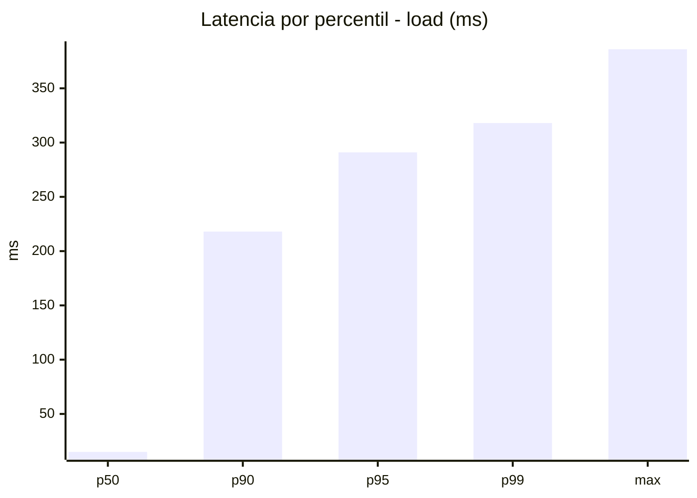
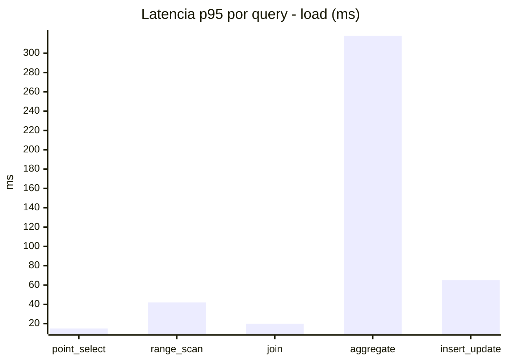
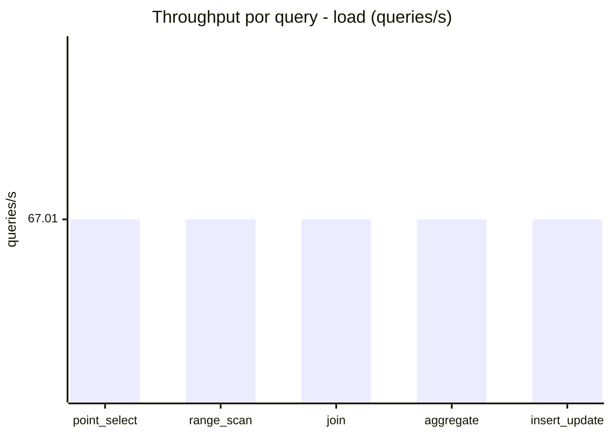
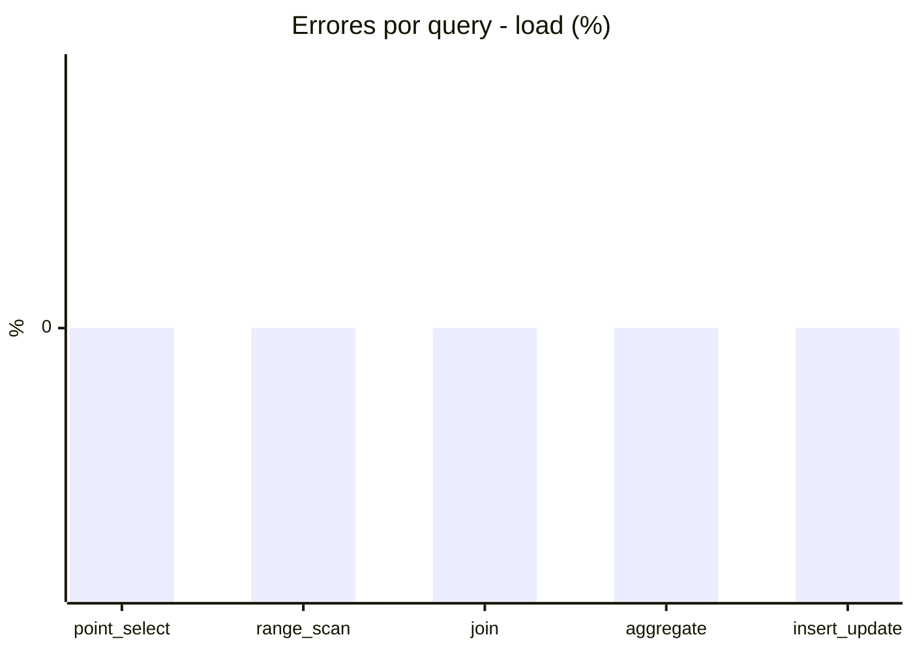
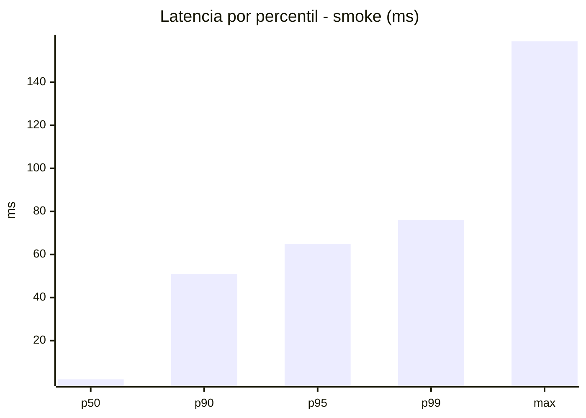
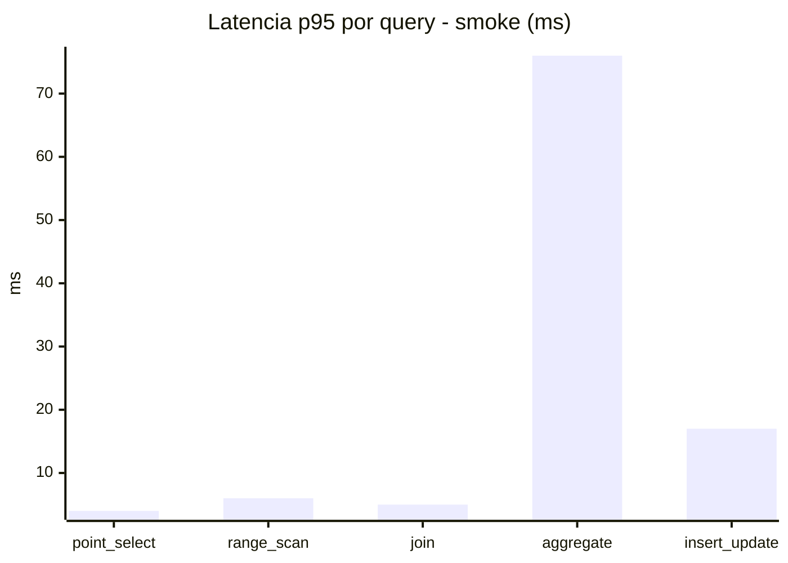
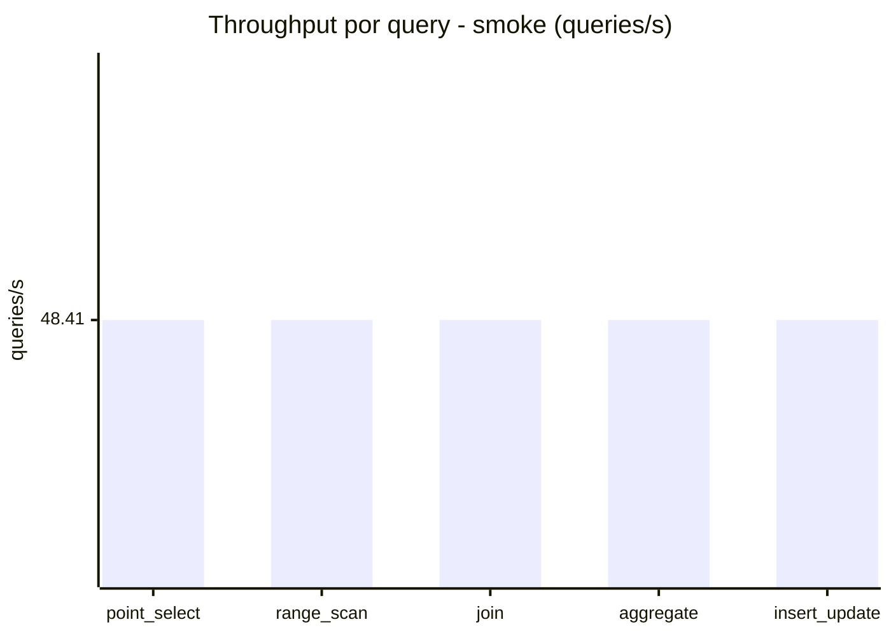
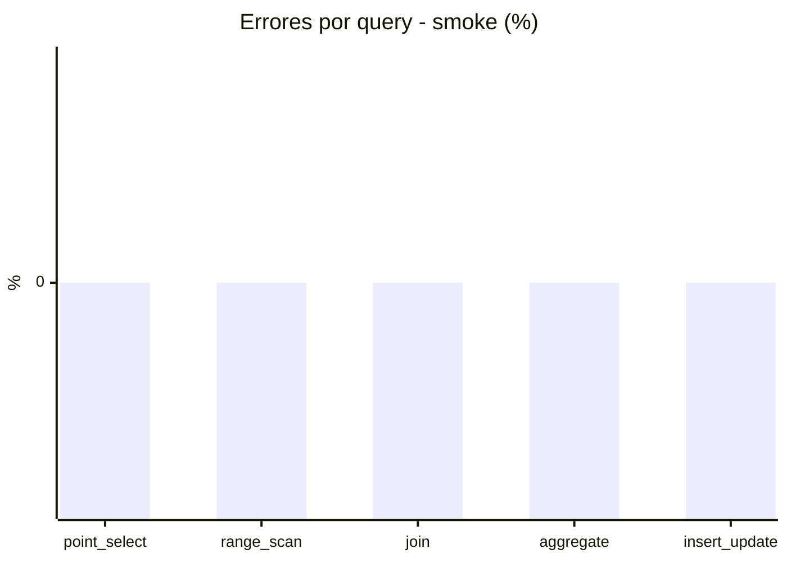

# Reporte de performance - SQL Server (k6)

**Fecha:** 2026-11-20 21:22 UTC  
**Veredicto (SLO):** `WARN`  
**Corrida:** [ver en GitHub Actions](https://github.com/lrbg/k6-sqlserver-lab/actions/runs/44819507485)  

## Analisis del agente de IA

WARN (fallback por umbrales)

- Error maximo: 0%
- p95 maximo: 291 ms

## Resultados

### Escenario: `load`

| Metrica | Valor |
| --- | --- |
| Queries ejecutadas | 20155 |
| Errores | 0 (0%) |
| Latencia media | 59.6 ms |
| p50 / p90 / p95 / p99 | 15 / 218 / 291 / 318 ms |
| Min / Max | 0 / 386 ms |
| Throughput | 335.03 queries/s |
| Duracion | 60.2 s |

Detalle por query

| Query | Ejecuciones | Error % | avg | p95 | p99 | q/s |
| --- | --- | --- | --- | --- | --- | --- |
| point_select | 4031 | 0% | 5.4 | 15 | 20 | 67.01 |
| range_scan | 4031 | 0% | 19.4 | 42 | 59 | 67.01 |
| join | 4031 | 0% | 8.6 | 20 | 22 | 67.01 |
| aggregate | 4031 | 0% | 235.8 | 318 | 340.4 | 67.01 |
| insert_update | 4031 | 0% | 29.1 | 65 | 89 | 67.01 |

### Escenario: `smoke`

| Metrica | Valor |
| --- | --- |
| Queries ejecutadas | 7275 |
| Errores | 0 (0%) |
| Latencia media | 12.4 ms |
| p50 / p90 / p95 / p99 | 2 / 51 / 65 / 76 ms |
| Min / Max | 0 / 159 ms |
| Throughput | 242.04 queries/s |
| Duracion | 30.1 s |

Detalle por query

| Query | Ejecuciones | Error % | avg | p95 | p99 | q/s |
| --- | --- | --- | --- | --- | --- | --- |
| point_select | 1455 | 0% | 0.9 | 4 | 5 | 48.41 |
| range_scan | 1455 | 0% | 3.1 | 6 | 10 | 48.41 |
| join | 1455 | 0% | 1.7 | 5 | 5 | 48.41 |
| aggregate | 1455 | 0% | 51.2 | 76 | 82 | 48.41 |
| insert_update | 1455 | 0% | 4.9 | 17 | 24 | 48.41 |

