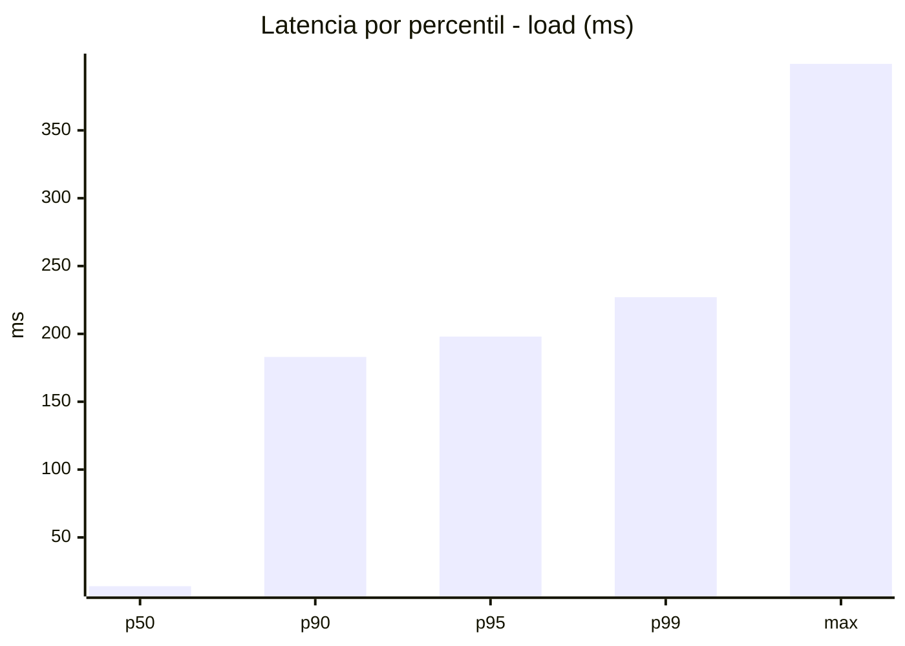
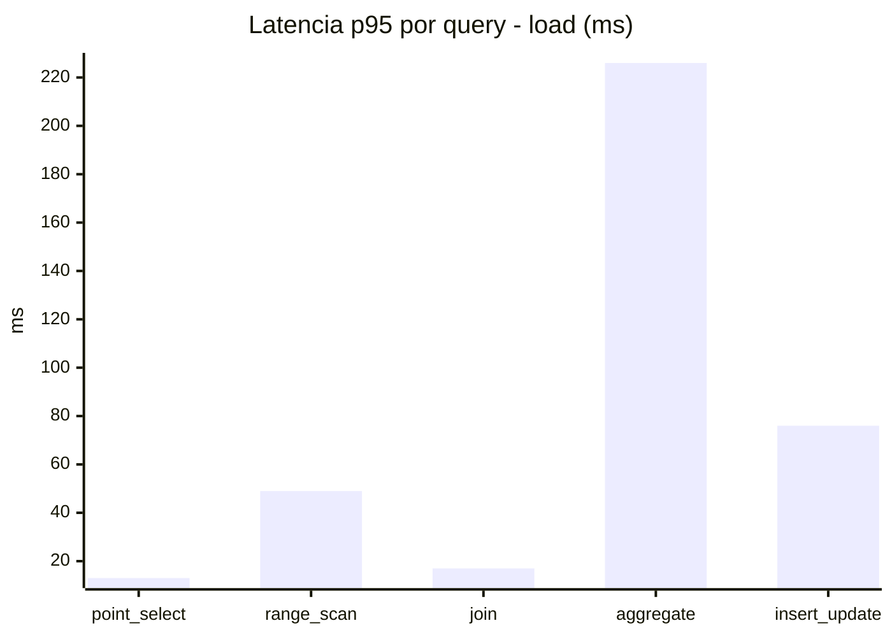
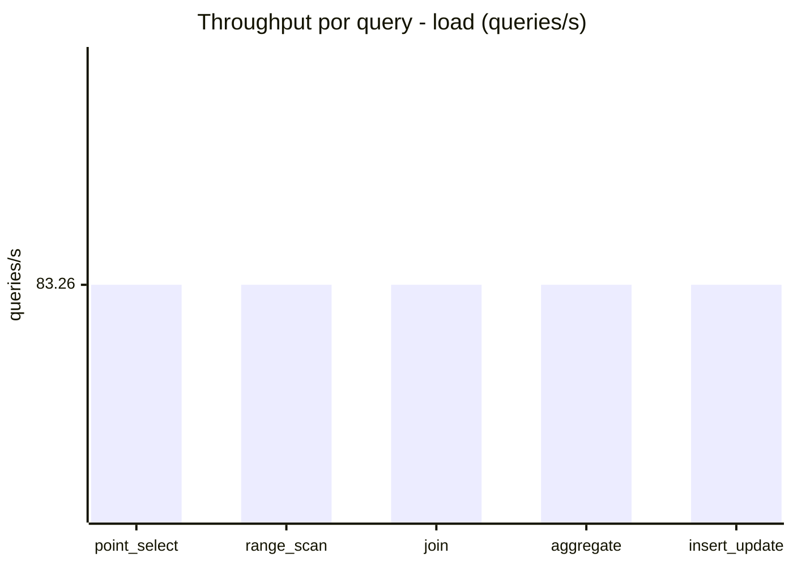
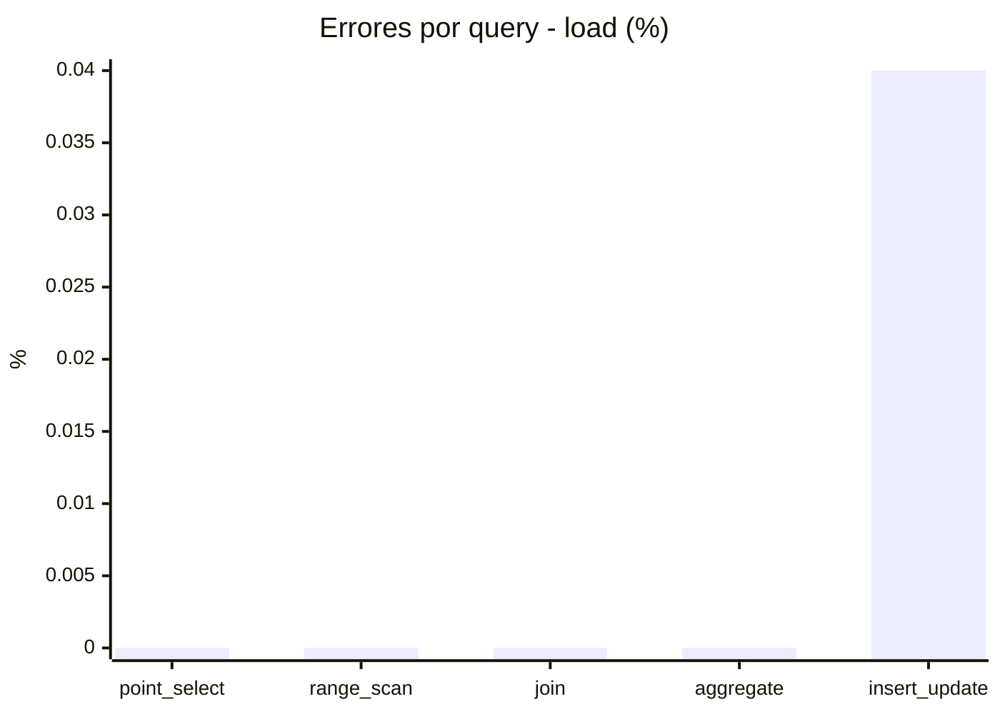
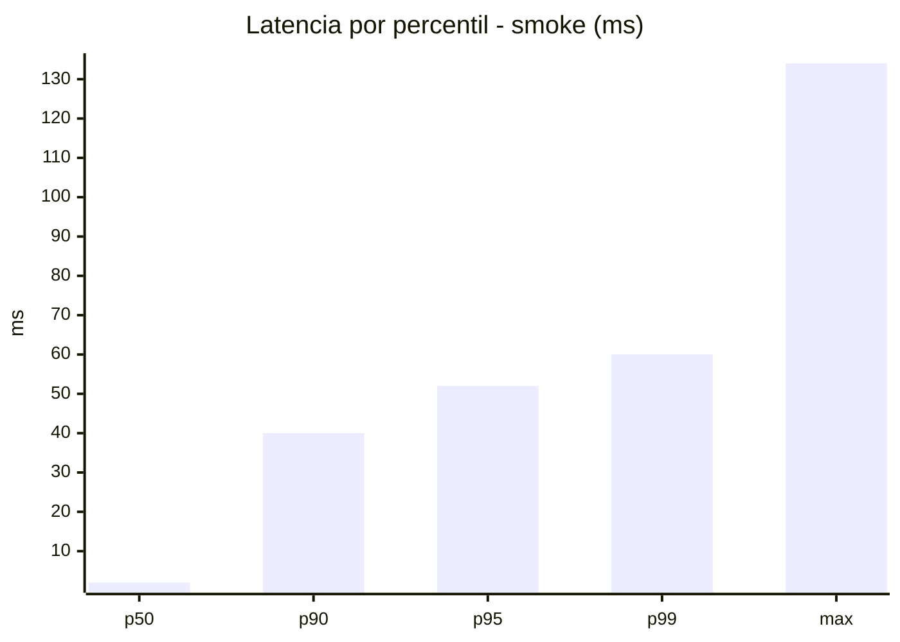
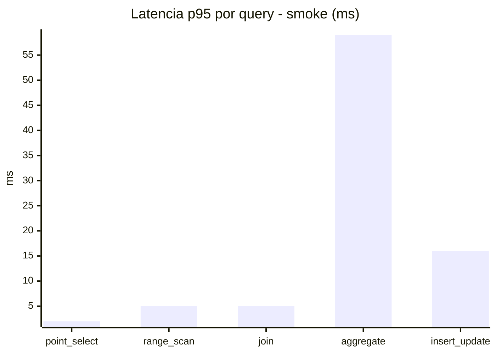
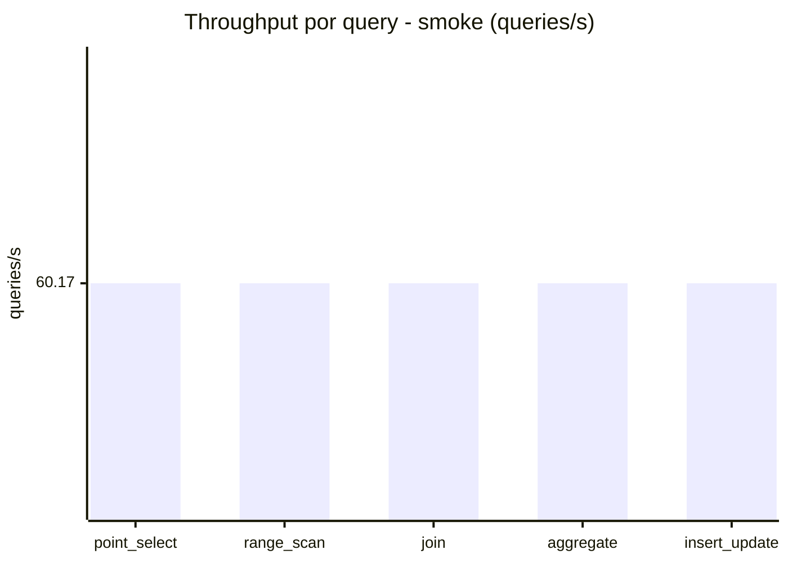
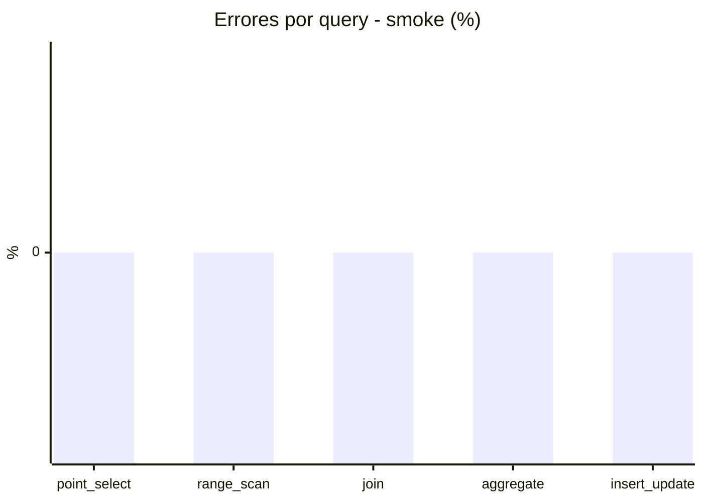

# Reporte de performance - SQL Server (k6)

**Fecha:** 2026-11-21 20:11 UTC  
**Veredicto (SLO):** `PASS`  
**Corrida:** [ver en GitHub Actions](https://github.com/lrbg/k6-sqlserver-lab/actions/runs/44944776069)  

## Analisis del agente de IA

PASS (fallback por umbrales)

- Error maximo: 0.01%
- p95 maximo: 198 ms

## Resultados

### Escenario: `load`

| Metrica | Valor |
| --- | --- |
| Queries ejecutadas | 25010 |
| Errores | 2 (0.01%) |
| Latencia media | 48 ms |
| p50 / p90 / p95 / p99 | 14 / 183 / 198 / 227 ms |
| Min / Max | 0 / 399 ms |
| Throughput | 416.32 queries/s |
| Duracion | 60.1 s |

Detalle por query

| Query | Ejecuciones | Error % | avg | p95 | p99 | q/s |
| --- | --- | --- | --- | --- | --- | --- |
| point_select | 5002 | 0% | 4.1 | 13 | 17 | 83.26 |
| range_scan | 5002 | 0% | 20.5 | 49 | 90 | 83.26 |
| join | 5002 | 0% | 7.3 | 17 | 20 | 83.26 |
| aggregate | 5002 | 0% | 175.6 | 226 | 243 | 83.26 |
| insert_update | 5002 | 0.04% | 32.5 | 76 | 159 | 83.26 |

### Escenario: `smoke`

| Metrica | Valor |
| --- | --- |
| Queries ejecutadas | 9030 |
| Errores | 0 (0%) |
| Latencia media | 9.9 ms |
| p50 / p90 / p95 / p99 | 2 / 40 / 52 / 60 ms |
| Min / Max | 0 / 134 ms |
| Throughput | 300.84 queries/s |
| Duracion | 30 s |

Detalle por query

| Query | Ejecuciones | Error % | avg | p95 | p99 | q/s |
| --- | --- | --- | --- | --- | --- | --- |
| point_select | 1806 | 0% | 0.6 | 2 | 4 | 60.17 |
| range_scan | 1806 | 0% | 2.5 | 5 | 10 | 60.17 |
| join | 1806 | 0% | 1.4 | 5 | 5 | 60.17 |
| aggregate | 1806 | 0% | 40.1 | 59 | 64 | 60.17 |
| insert_update | 1806 | 0% | 5.1 | 16 | 33 | 60.17 |

