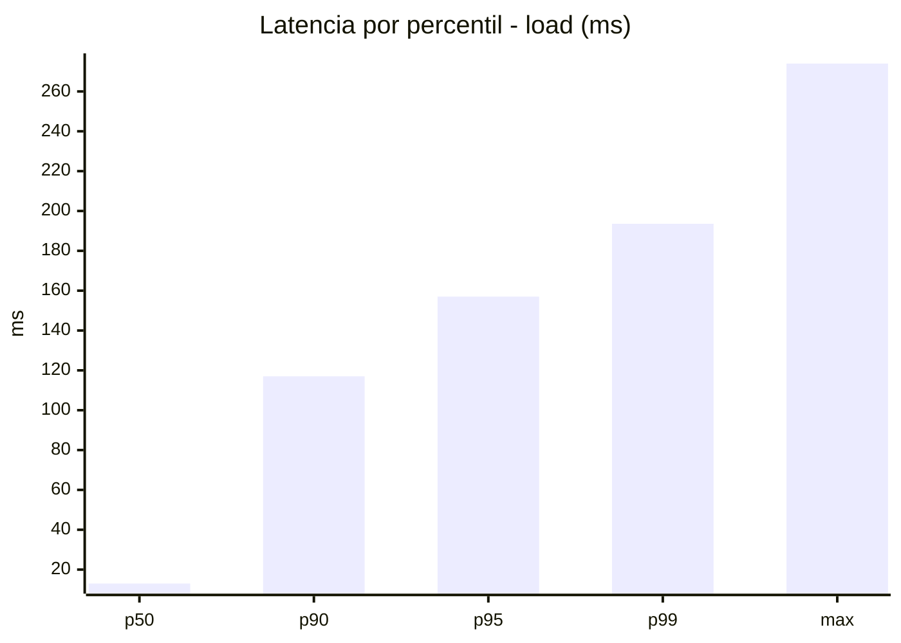
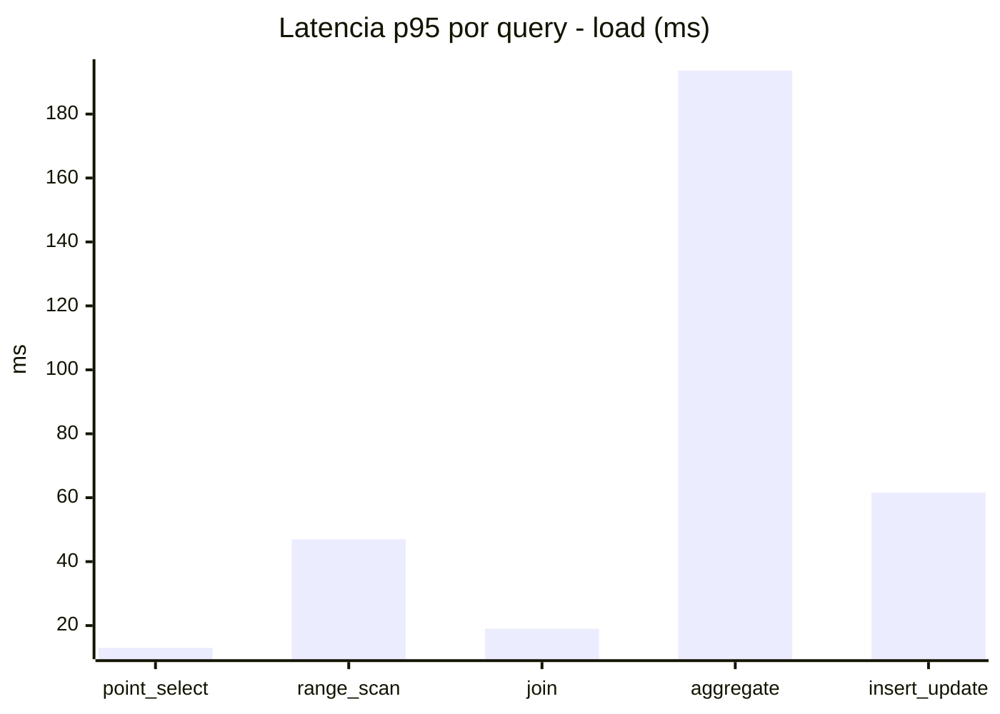
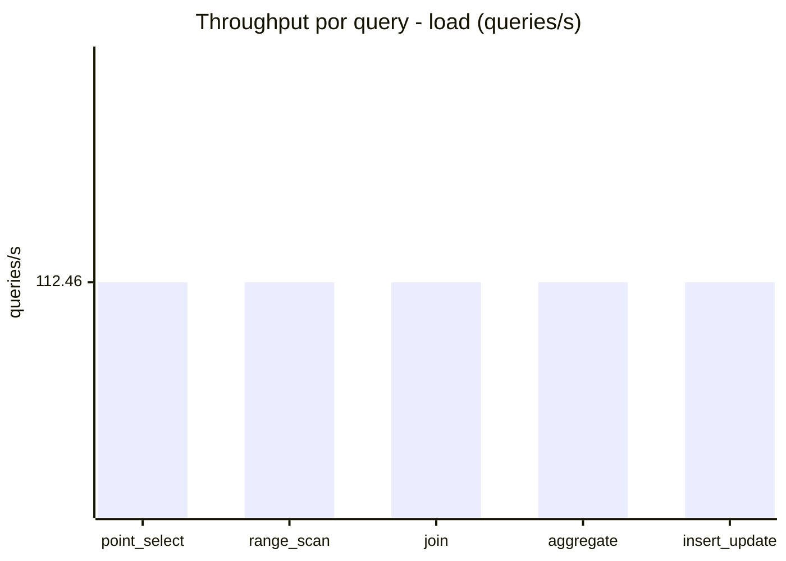
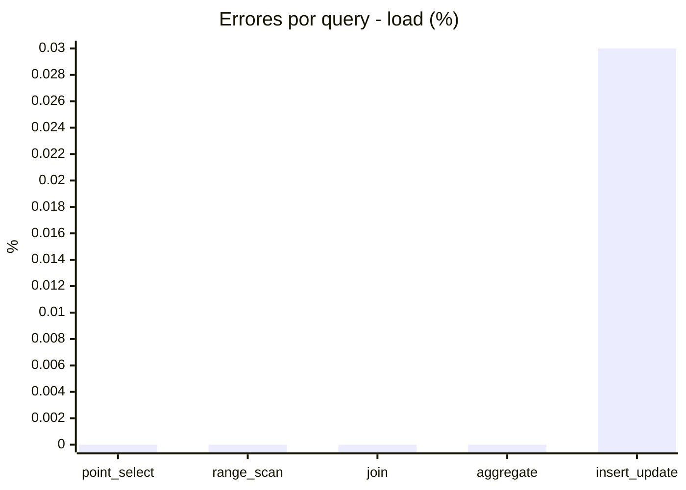
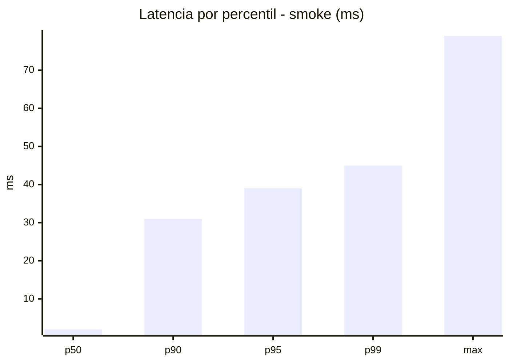
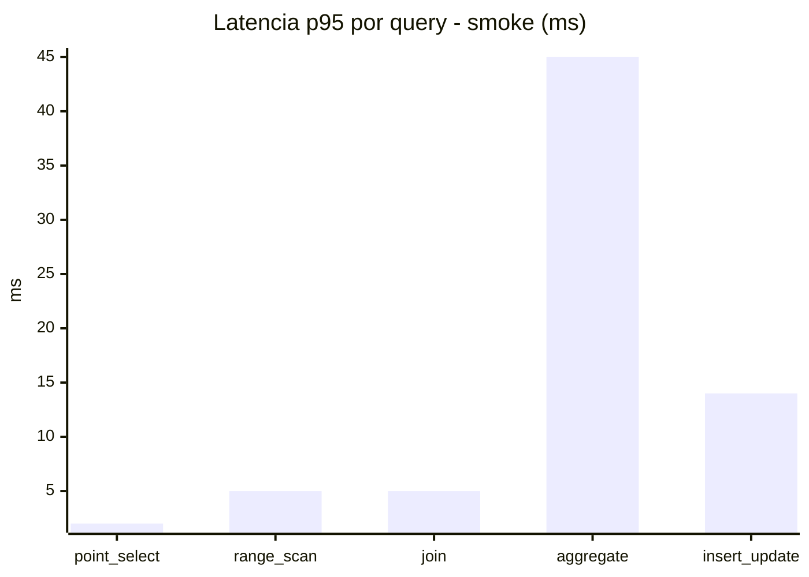
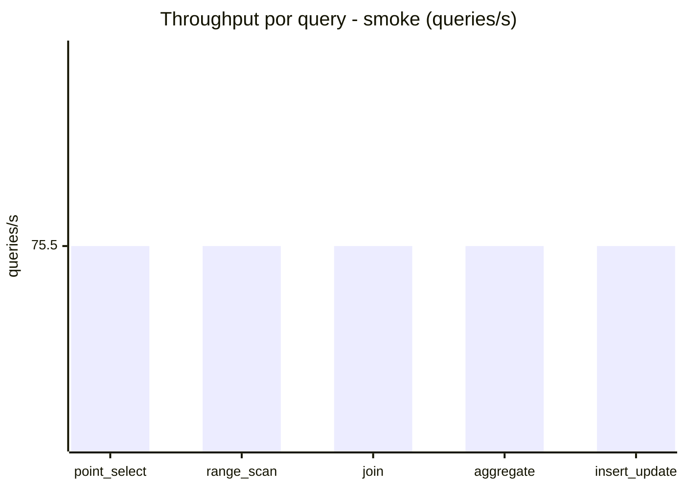
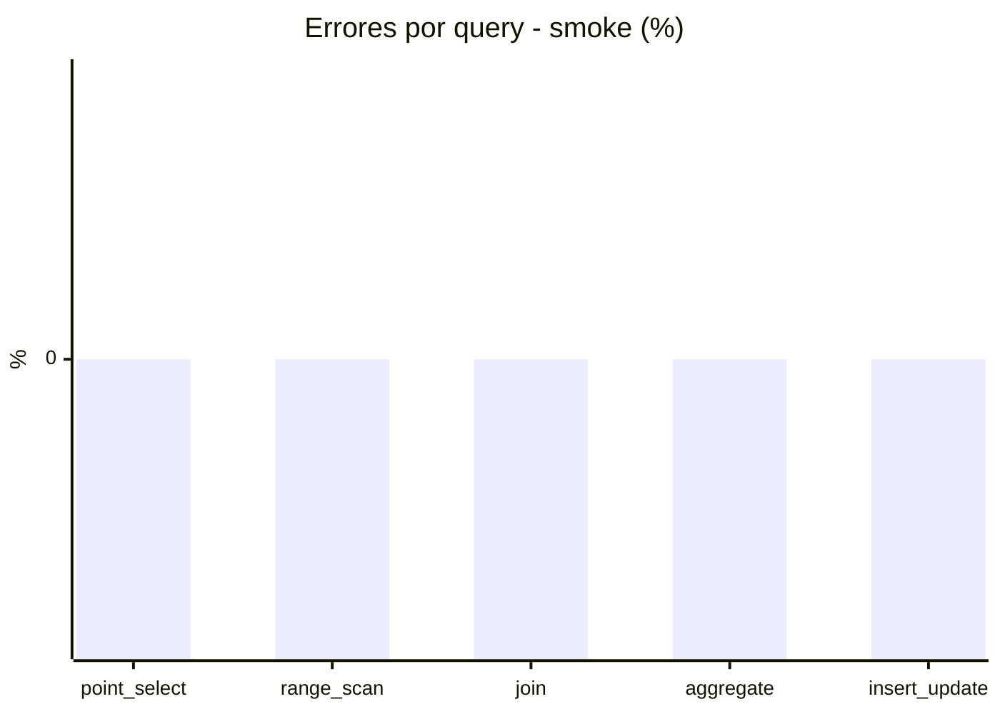

# Reporte de performance - SQL Server (k6)

**Fecha:** 2026-11-22 20:26 UTC  
**Veredicto (SLO):** `PASS`  
**Corrida:** [ver en GitHub Actions](https://github.com/lrbg/k6-sqlserver-lab/actions/runs/45066253663)  

## Analisis del agente de IA

PASS (fallback por umbrales)

- Error maximo: 0.01%
- p95 maximo: 157 ms

## Resultados

### Escenario: `load`

| Metrica | Valor |
| --- | --- |
| Queries ejecutadas | 33840 |
| Errores | 2 (0.01%) |
| Latencia media | 35.5 ms |
| p50 / p90 / p95 / p99 | 13 / 117 / 157 / 193.6 ms |
| Min / Max | 0 / 274 ms |
| Throughput | 562.32 queries/s |
| Duracion | 60.2 s |

Detalle por query

| Query | Ejecuciones | Error % | avg | p95 | p99 | q/s |
| --- | --- | --- | --- | --- | --- | --- |
| point_select | 6768 | 0% | 3.9 | 13 | 21 | 112.46 |
| range_scan | 6768 | 0% | 18.6 | 47 | 66.3 | 112.46 |
| join | 6768 | 0% | 6.9 | 19 | 25 | 112.46 |
| aggregate | 6768 | 0% | 121.3 | 193.6 | 209.3 | 112.46 |
| insert_update | 6768 | 0.03% | 26.9 | 61.6 | 86 | 112.46 |

### Escenario: `smoke`

| Metrica | Valor |
| --- | --- |
| Queries ejecutadas | 11340 |
| Errores | 0 (0%) |
| Latencia media | 7.9 ms |
| p50 / p90 / p95 / p99 | 2 / 31 / 39 / 45 ms |
| Min / Max | 0 / 79 ms |
| Throughput | 377.51 queries/s |
| Duracion | 30 s |

Detalle por query

| Query | Ejecuciones | Error % | avg | p95 | p99 | q/s |
| --- | --- | --- | --- | --- | --- | --- |
| point_select | 2268 | 0% | 0.6 | 2 | 4 | 75.5 |
| range_scan | 2268 | 0% | 2.2 | 5 | 11 | 75.5 |
| join | 2268 | 0% | 1.4 | 5 | 5 | 75.5 |
| aggregate | 2268 | 0% | 30.6 | 45 | 49 | 75.5 |
| insert_update | 2268 | 0% | 4.7 | 14 | 21 | 75.5 |

