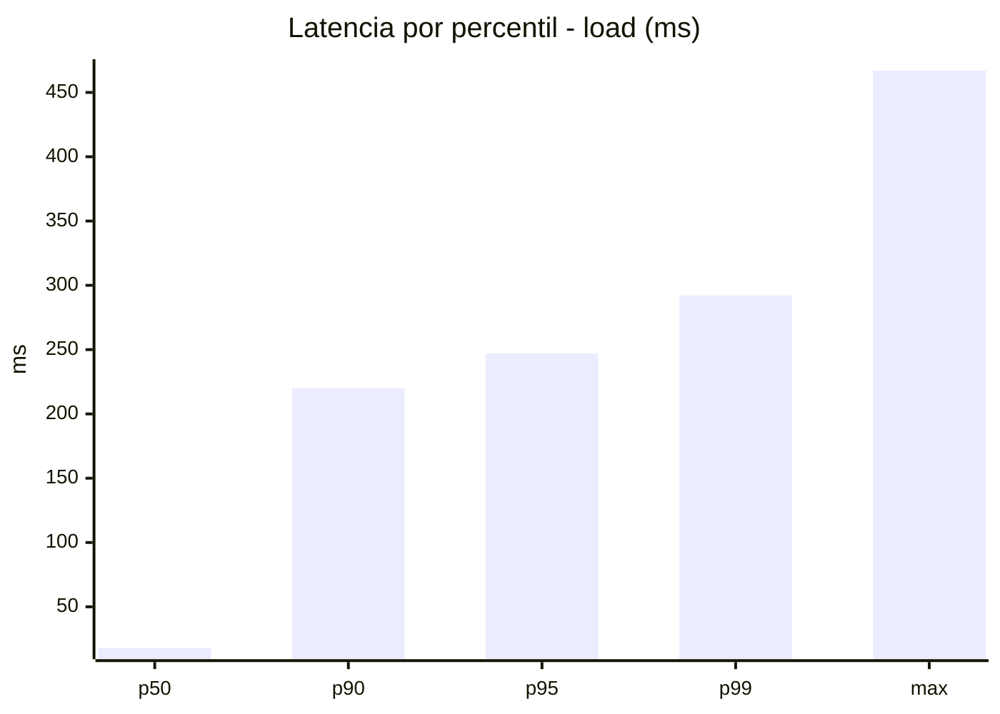
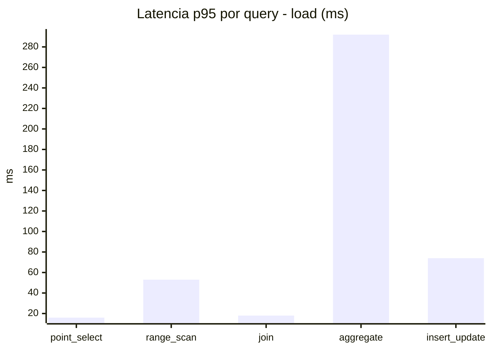
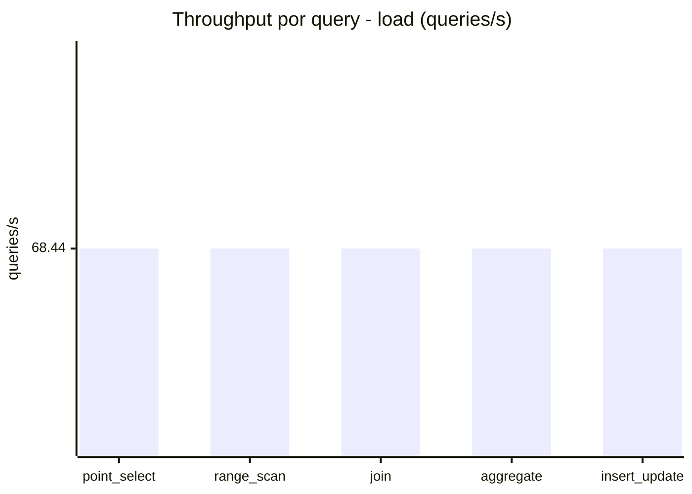
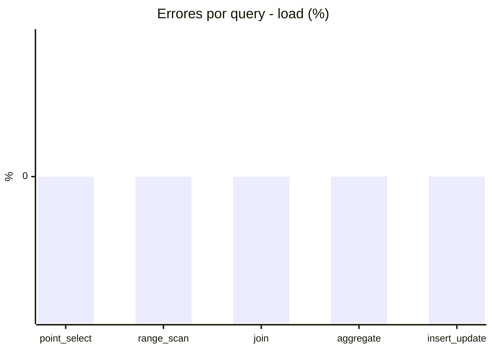
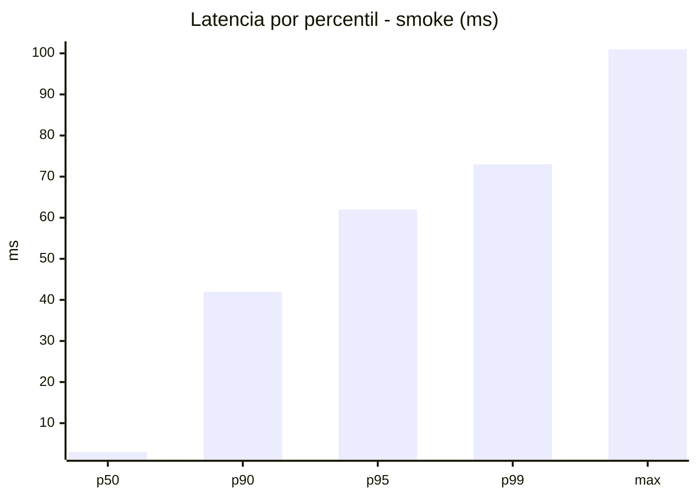
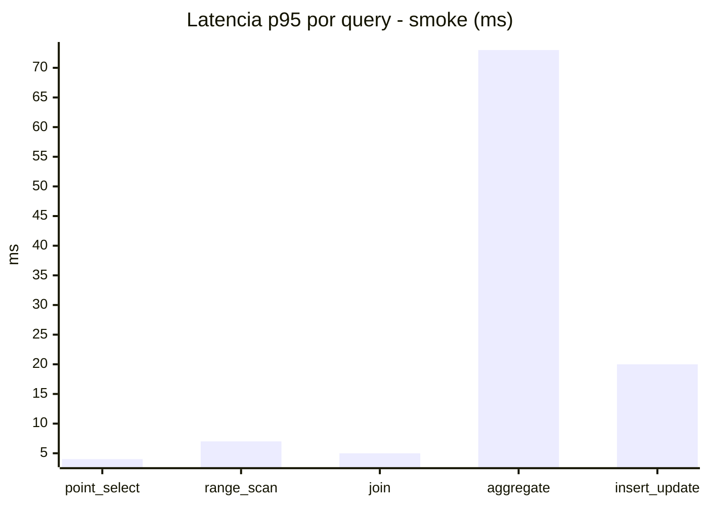
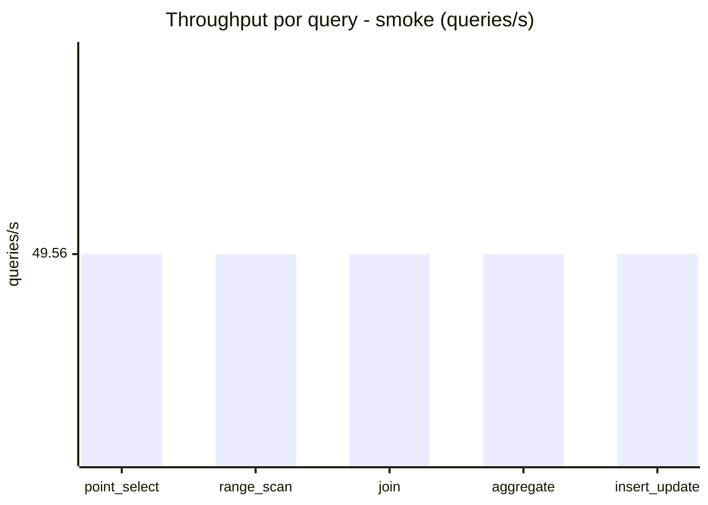
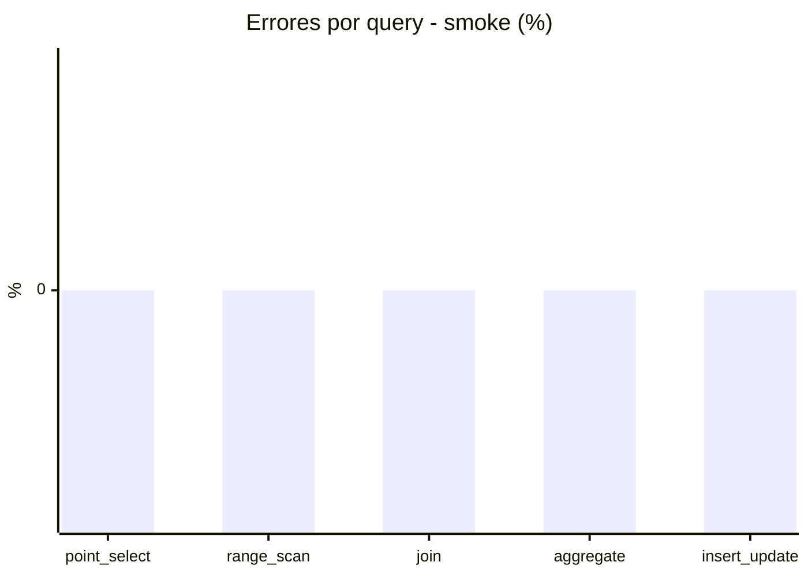

# Reporte de performance - SQL Server (k6)

**Fecha:** 2026-11-24 01:04 UTC  
**Veredicto (SLO):** `WARN`  
**Corrida:** [ver en GitHub Actions](https://github.com/lrbg/k6-sqlserver-lab/actions/runs/45301979297)  

## Analisis del agente de IA

WARN (fallback por umbrales)

- Error maximo: 0%
- p95 maximo: 247 ms

## Resultados

### Escenario: `load`

| Metrica | Valor |
| --- | --- |
| Queries ejecutadas | 20595 |
| Errores | 0 (0%) |
| Latencia media | 58.4 ms |
| p50 / p90 / p95 / p99 | 18 / 220 / 247 / 292 ms |
| Min / Max | 0 / 467 ms |
| Throughput | 342.21 queries/s |
| Duracion | 60.2 s |

Detalle por query

| Query | Ejecuciones | Error % | avg | p95 | p99 | q/s |
| --- | --- | --- | --- | --- | --- | --- |
| point_select | 4119 | 0% | 5.9 | 16 | 20 | 68.44 |
| range_scan | 4119 | 0% | 24 | 53 | 69 | 68.44 |
| join | 4119 | 0% | 8.8 | 18 | 22 | 68.44 |
| aggregate | 4119 | 0% | 217.2 | 292 | 317.8 | 68.44 |
| insert_update | 4119 | 0% | 35.9 | 74 | 92 | 68.44 |

### Escenario: `smoke`

| Metrica | Valor |
| --- | --- |
| Queries ejecutadas | 7445 |
| Errores | 0 (0%) |
| Latencia media | 12.1 ms |
| p50 / p90 / p95 / p99 | 3 / 42 / 62 / 73 ms |
| Min / Max | 0 / 101 ms |
| Throughput | 247.8 queries/s |
| Duracion | 30 s |

Detalle por query

| Query | Ejecuciones | Error % | avg | p95 | p99 | q/s |
| --- | --- | --- | --- | --- | --- | --- |
| point_select | 1489 | 0% | 0.9 | 4 | 5 | 49.56 |
| range_scan | 1489 | 0% | 3.4 | 7 | 11 | 49.56 |
| join | 1489 | 0% | 1.7 | 5 | 5 | 49.56 |
| aggregate | 1489 | 0% | 48.3 | 73 | 78 | 49.56 |
| insert_update | 1489 | 0% | 6 | 20 | 25 | 49.56 |

