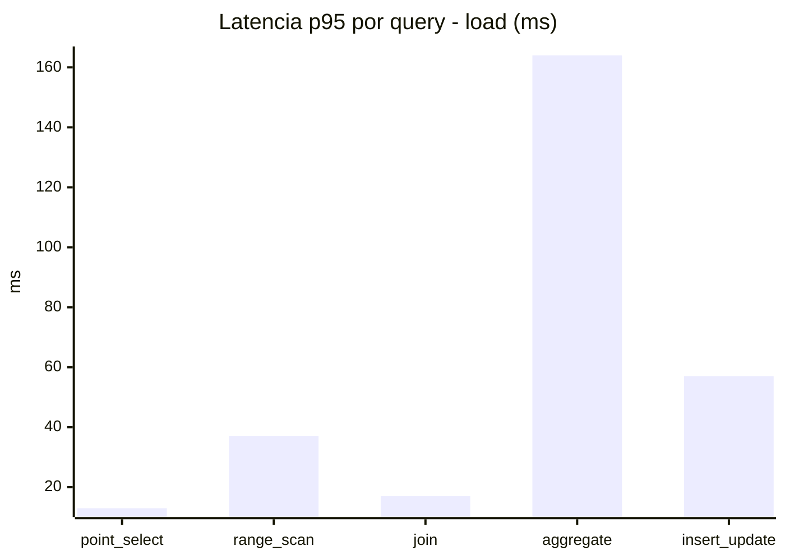
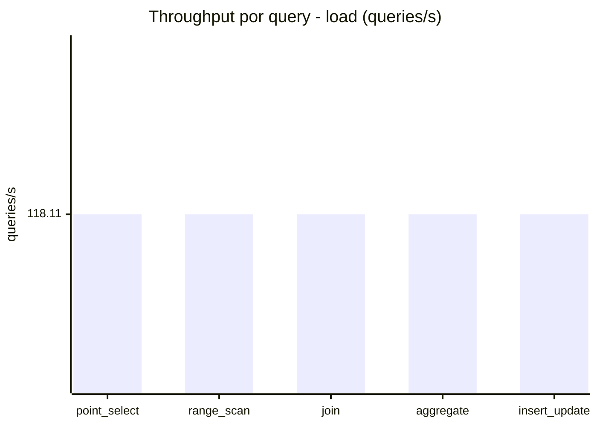
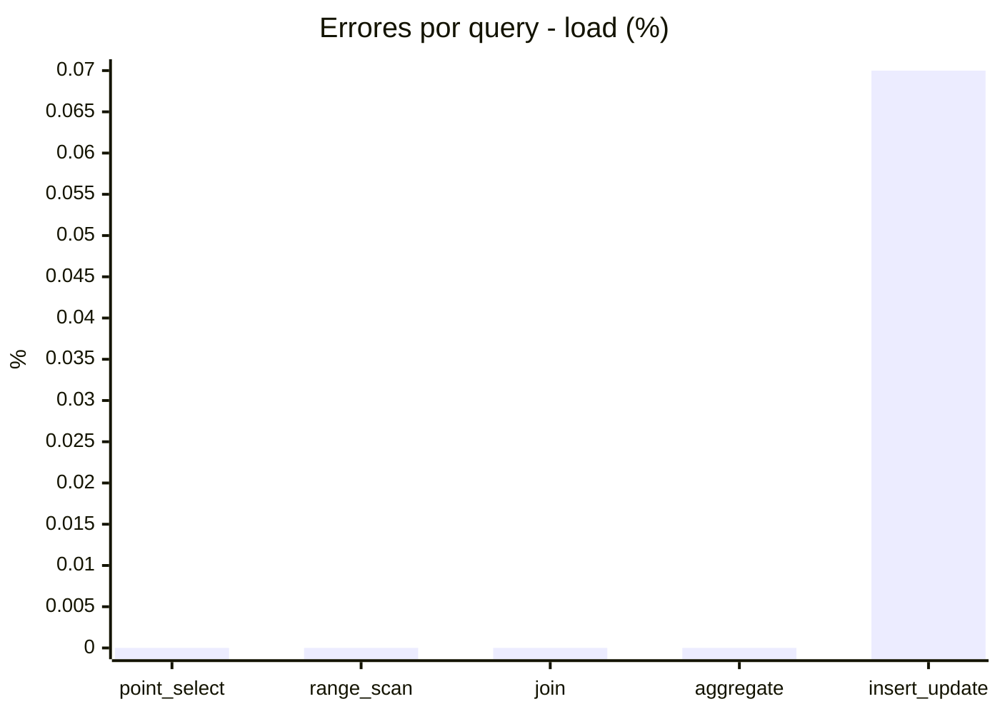
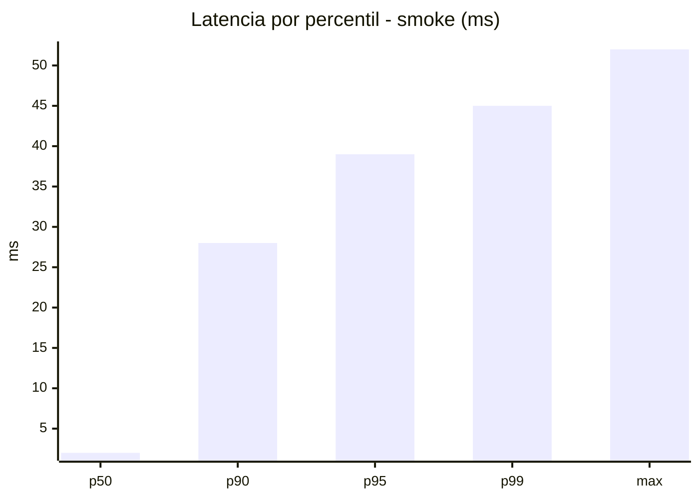
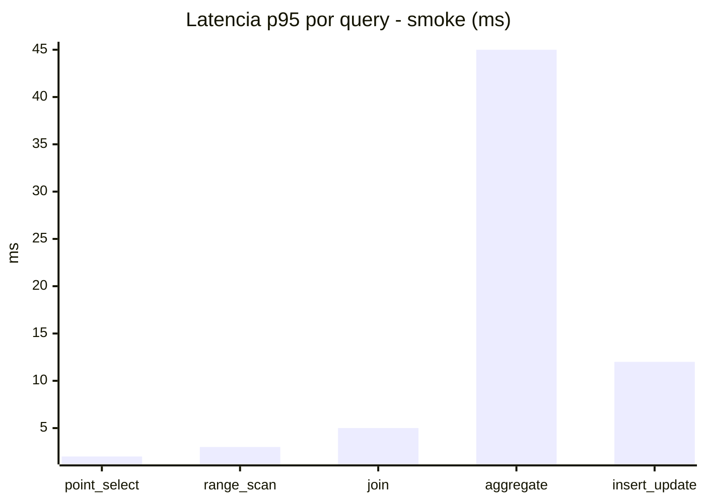
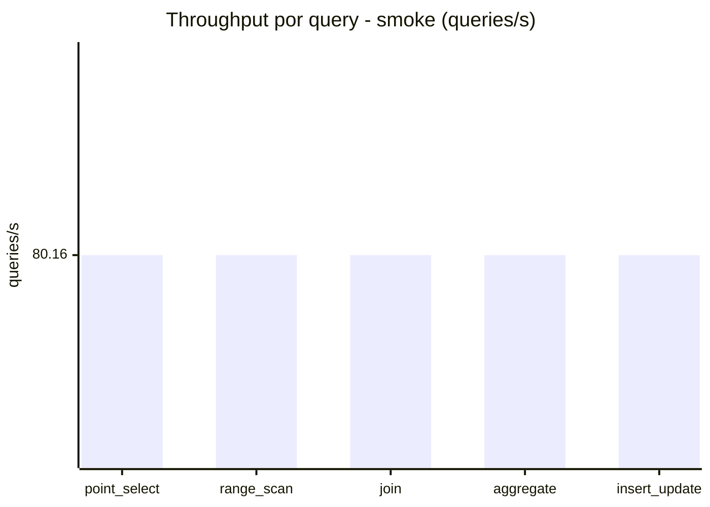
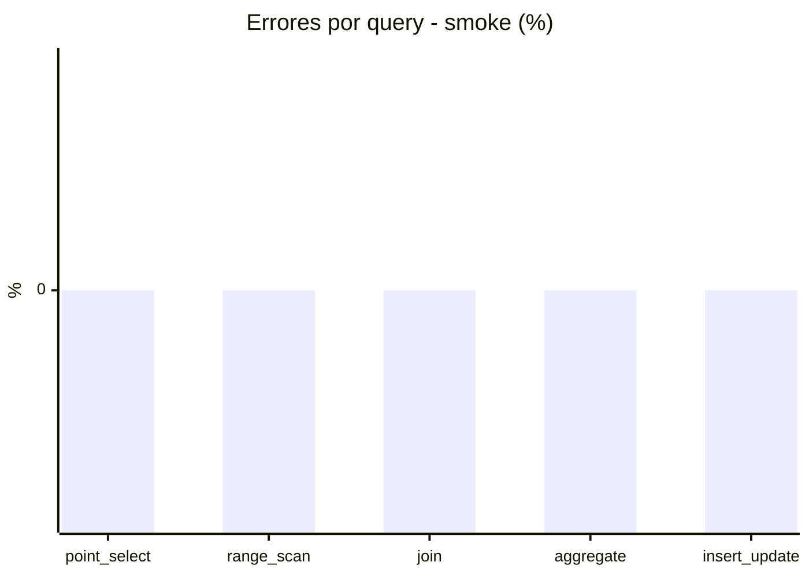

# Reporte de performance - SQL Server (k6)

**Fecha:** 2026-11-24 23:09 UTC  
**Veredicto (SLO):** `PASS`  
**Corrida:** [ver en GitHub Actions](https://github.com/lrbg/k6-sqlserver-lab/actions/runs/45507234982)  

## Analisis del agente de IA

PASS (fallback por umbrales)

- Error maximo: 0.01%
- p95 maximo: 139 ms

## Resultados

### Escenario: `load`

| Metrica | Valor |
| --- | --- |
| Queries ejecutadas | 35510 |
| Errores | 5 (0.01%) |
| Latencia media | 33.8 ms |
| p50 / p90 / p95 / p99 | 12 / 121 / 139 / 164 ms |
| Min / Max | 0 / 200 ms |
| Throughput | 590.57 queries/s |
| Duracion | 60.1 s |

Detalle por query

| Query | Ejecuciones | Error % | avg | p95 | p99 | q/s |
| --- | --- | --- | --- | --- | --- | --- |
| point_select | 7102 | 0% | 3.9 | 13 | 17 | 118.11 |
| range_scan | 7102 | 0% | 16.1 | 37 | 51 | 118.11 |
| join | 7102 | 0% | 6.8 | 17 | 20 | 118.11 |
| aggregate | 7102 | 0% | 118.9 | 164 | 174 | 118.11 |
| insert_update | 7102 | 0.07% | 23.4 | 57 | 74 | 118.11 |

### Escenario: `smoke`

| Metrica | Valor |
| --- | --- |
| Queries ejecutadas | 12030 |
| Errores | 0 (0%) |
| Latencia media | 7.5 ms |
| p50 / p90 / p95 / p99 | 2 / 28 / 39 / 45 ms |
| Min / Max | 0 / 52 ms |
| Throughput | 400.79 queries/s |
| Duracion | 30 s |

Detalle por query

| Query | Ejecuciones | Error % | avg | p95 | p99 | q/s |
| --- | --- | --- | --- | --- | --- | --- |
| point_select | 2406 | 0% | 0.5 | 2 | 4 | 80.16 |
| range_scan | 2406 | 0% | 2 | 3 | 7.9 | 80.16 |
| join | 2406 | 0% | 1.3 | 5 | 5 | 80.16 |
| aggregate | 2406 | 0% | 30.3 | 45 | 48 | 80.16 |
| insert_update | 2406 | 0% | 3.2 | 12 | 17 | 80.16 |

