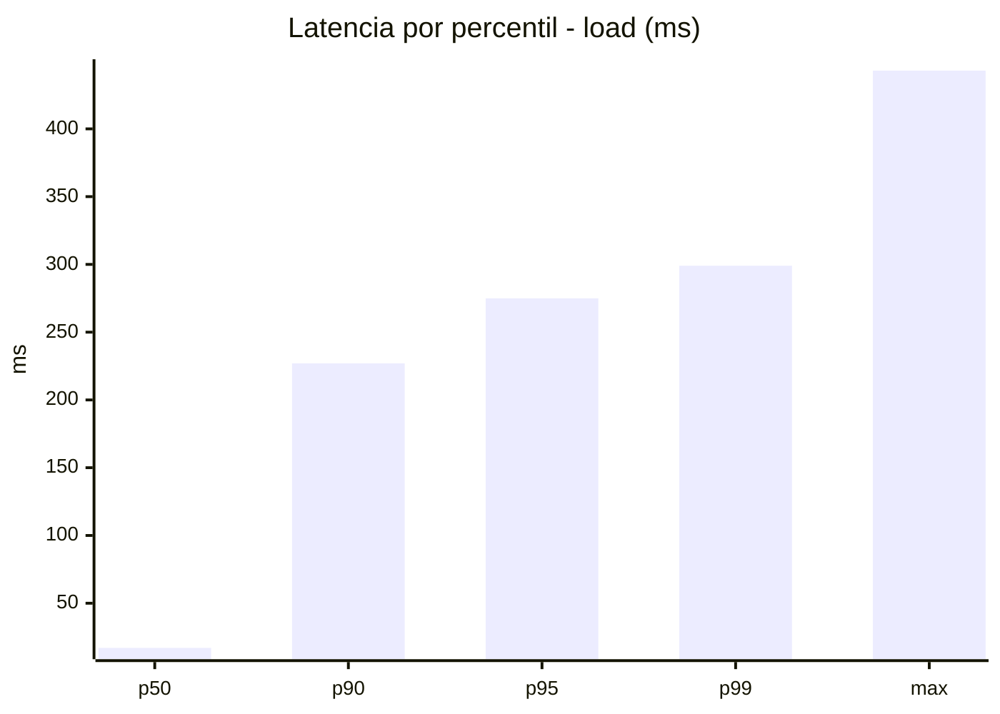
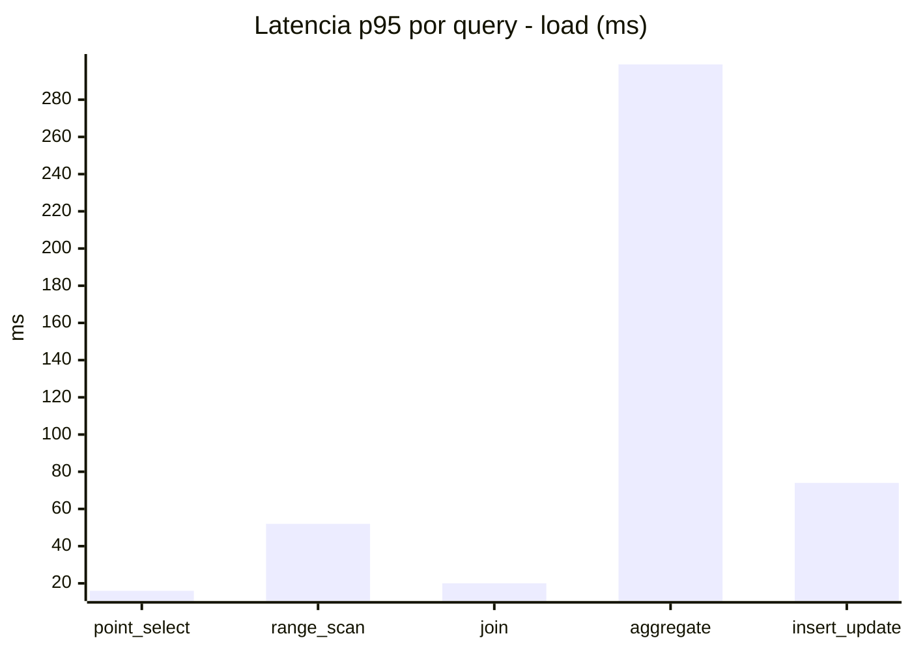
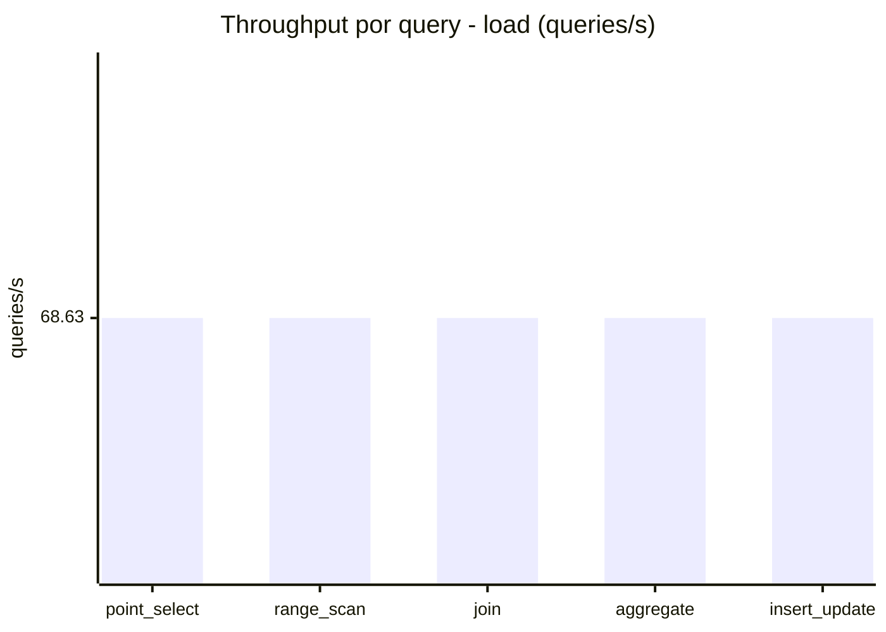
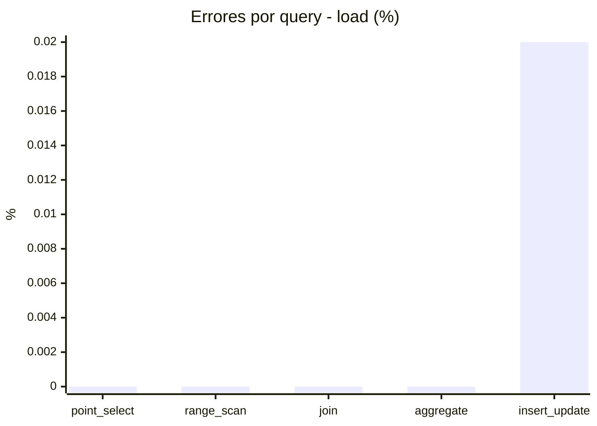
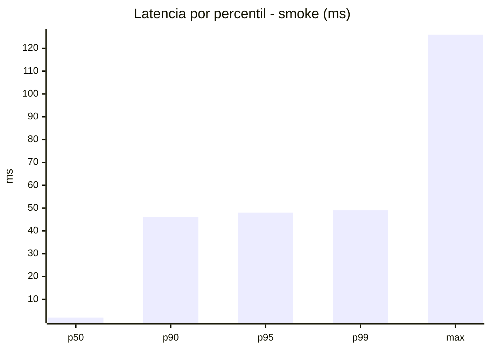
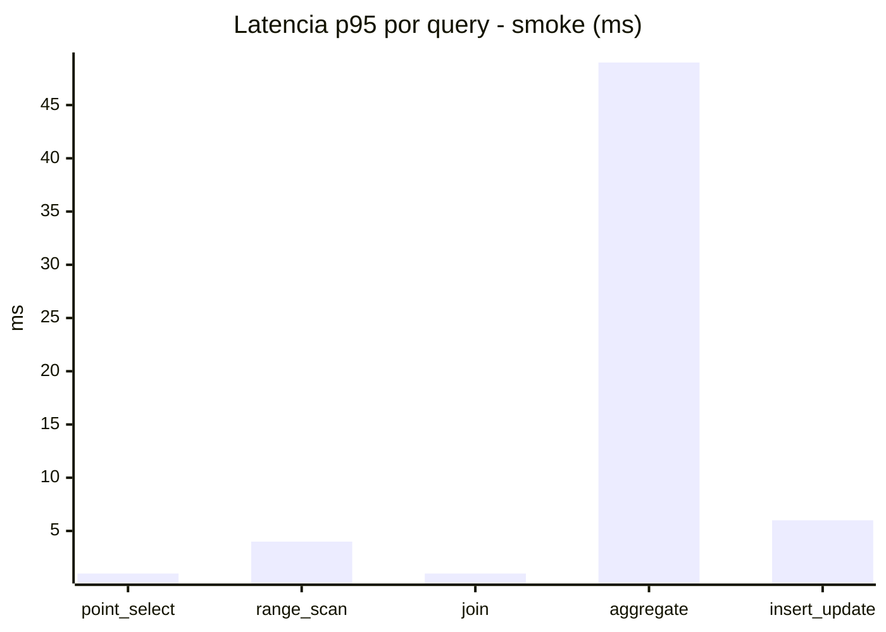
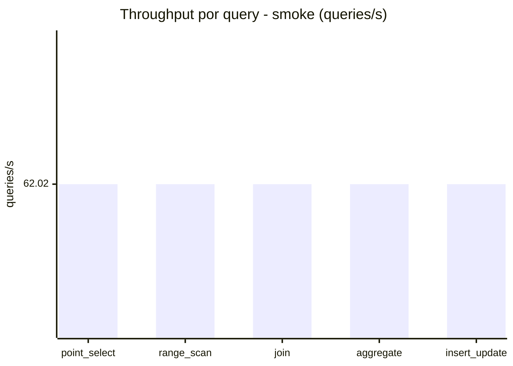
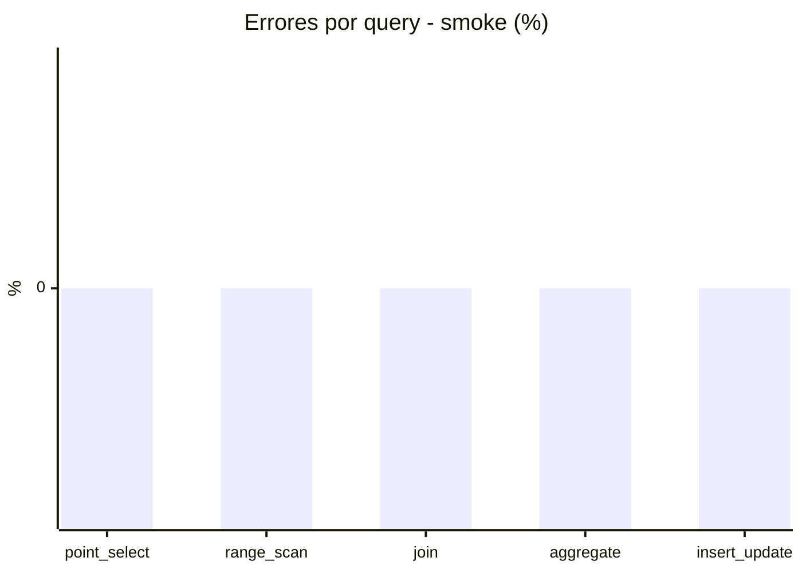

# Reporte de performance - SQL Server (k6)

**Fecha:** 2026-11-25 22:39 UTC  
**Veredicto (SLO):** `WARN`  
**Corrida:** [ver en GitHub Actions](https://github.com/lrbg/k6-sqlserver-lab/actions/runs/45714832530)  

## Analisis del agente de IA

WARN (fallback por umbrales)

- Error maximo: 0%
- p95 maximo: 275 ms

## Resultados

### Escenario: `load`

| Metrica | Valor |
| --- | --- |
| Queries ejecutadas | 20640 |
| Errores | 1 (0%) |
| Latencia media | 58.2 ms |
| p50 / p90 / p95 / p99 | 17 / 227 / 275 / 299 ms |
| Min / Max | 0 / 443 ms |
| Throughput | 343.17 queries/s |
| Duracion | 60.1 s |

Detalle por query

| Query | Ejecuciones | Error % | avg | p95 | p99 | q/s |
| --- | --- | --- | --- | --- | --- | --- |
| point_select | 4128 | 0% | 5.5 | 16 | 20 | 68.63 |
| range_scan | 4128 | 0% | 23 | 52 | 70 | 68.63 |
| join | 4128 | 0% | 8.5 | 20 | 22 | 68.63 |
| aggregate | 4128 | 0% | 219.5 | 299 | 325 | 68.63 |
| insert_update | 4128 | 0.02% | 34.6 | 74 | 93 | 68.63 |

### Escenario: `smoke`

| Metrica | Valor |
| --- | --- |
| Queries ejecutadas | 9310 |
| Errores | 0 (0%) |
| Latencia media | 9.6 ms |
| p50 / p90 / p95 / p99 | 2 / 46 / 48 / 49 ms |
| Min / Max | 0 / 126 ms |
| Throughput | 310.1 queries/s |
| Duracion | 30 s |

Detalle por query

| Query | Ejecuciones | Error % | avg | p95 | p99 | q/s |
| --- | --- | --- | --- | --- | --- | --- |
| point_select | 1862 | 0% | 0.5 | 1 | 2 | 62.02 |
| range_scan | 1862 | 0% | 2.8 | 4 | 6 | 62.02 |
| join | 1862 | 0% | 0.9 | 1 | 3 | 62.02 |
| aggregate | 1862 | 0% | 41 | 49 | 53 | 62.02 |
| insert_update | 1862 | 0% | 3 | 6 | 11 | 62.02 |

