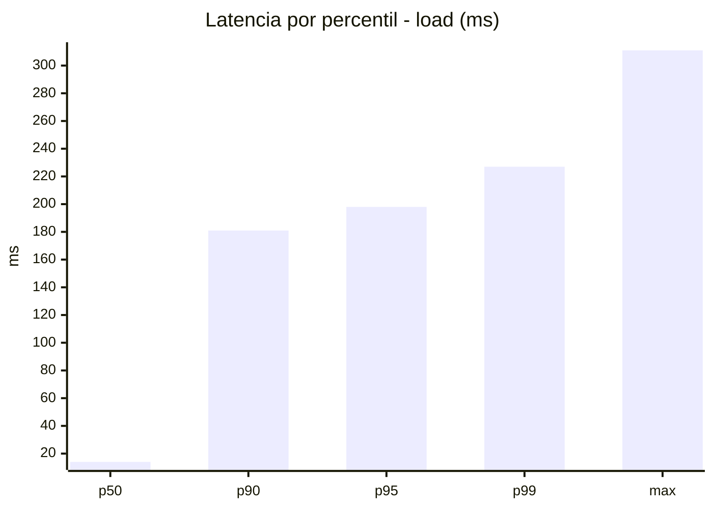
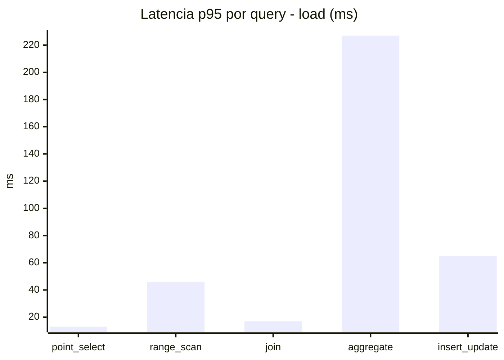
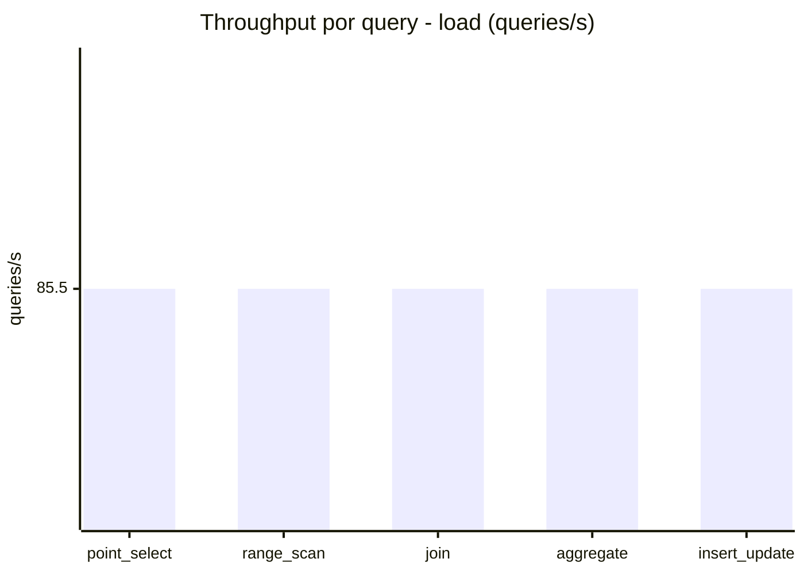
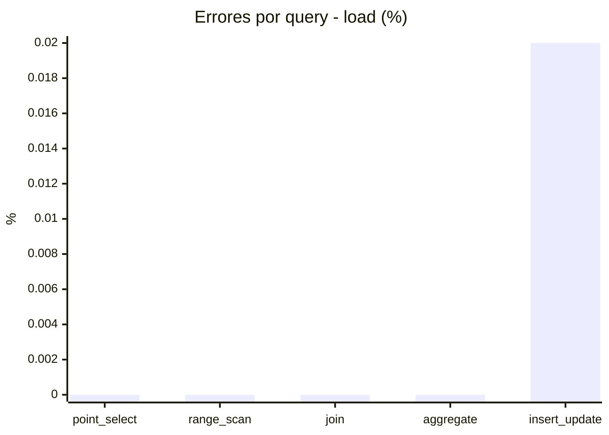
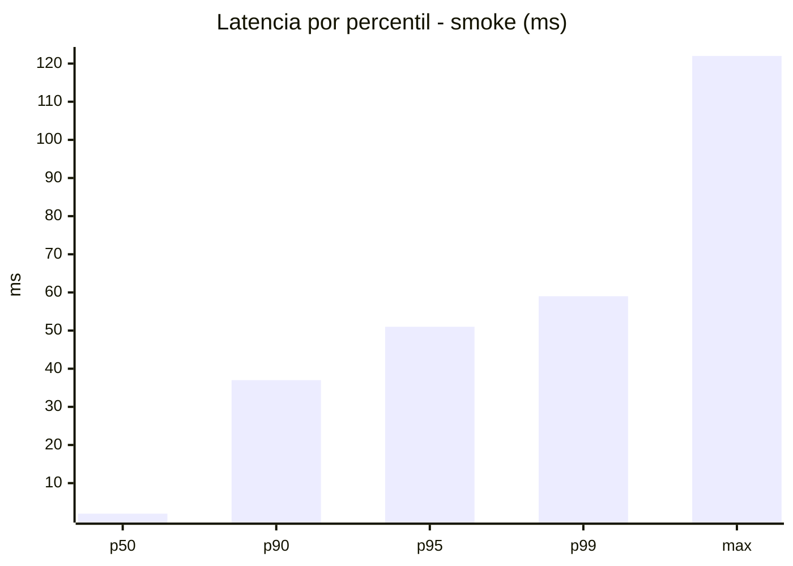
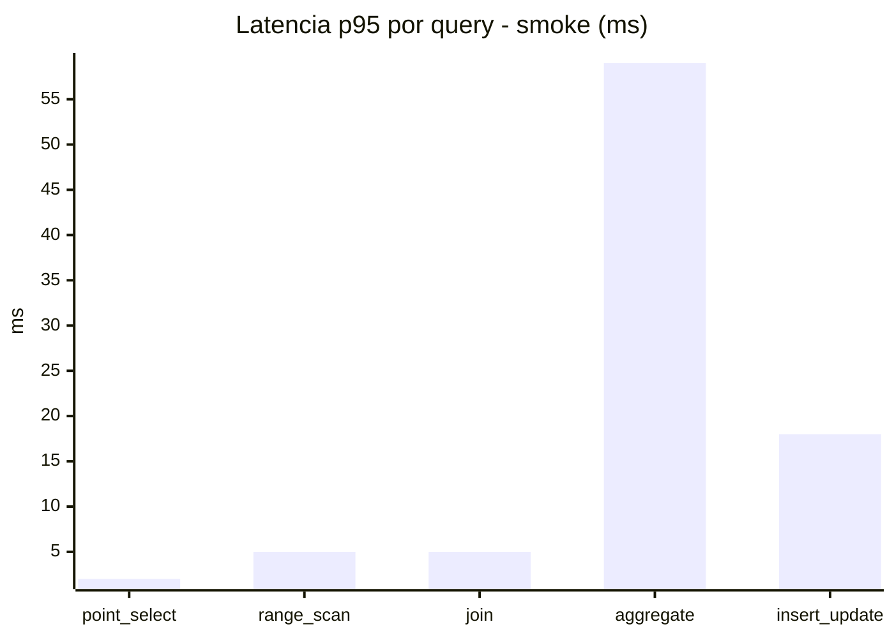
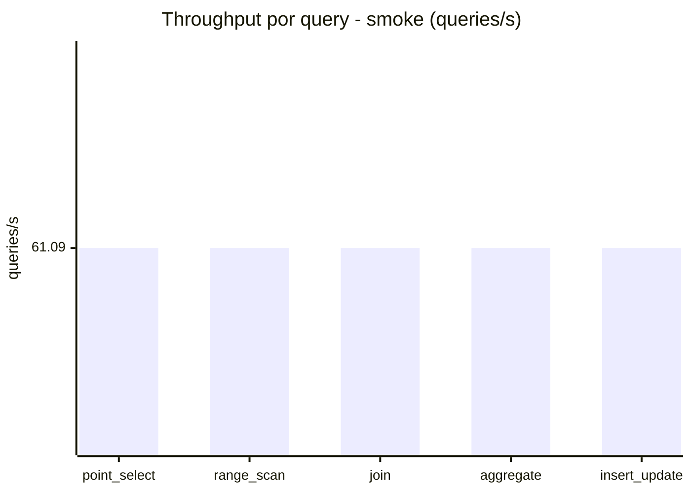
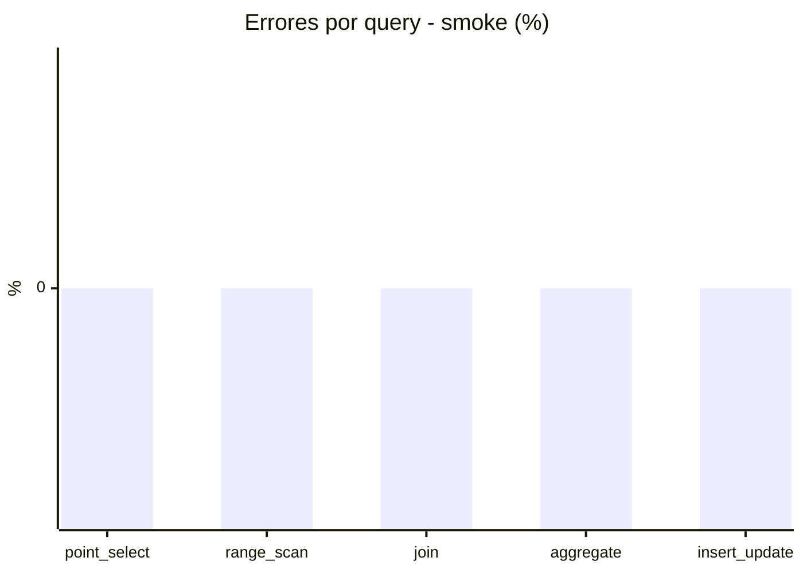

# Reporte de performance - SQL Server (k6)

**Fecha:** 2026-11-26 22:29 UTC  
**Veredicto (SLO):** `PASS`  
**Corrida:** [ver en GitHub Actions](https://github.com/lrbg/k6-sqlserver-lab/actions/runs/45904932857)  

## Analisis del agente de IA

PASS (fallback por umbrales)

- Error maximo: 0%
- p95 maximo: 198 ms

## Resultados

### Escenario: `load`

| Metrica | Valor |
| --- | --- |
| Queries ejecutadas | 25725 |
| Errores | 1 (0%) |
| Latencia media | 46.7 ms |
| p50 / p90 / p95 / p99 | 14 / 181 / 198 / 227 ms |
| Min / Max | 0 / 311 ms |
| Throughput | 427.5 queries/s |
| Duracion | 60.2 s |

Detalle por query

| Query | Ejecuciones | Error % | avg | p95 | p99 | q/s |
| --- | --- | --- | --- | --- | --- | --- |
| point_select | 5145 | 0% | 4.2 | 13 | 18 | 85.5 |
| range_scan | 5145 | 0% | 19 | 46 | 67 | 85.5 |
| join | 5145 | 0% | 7.4 | 17 | 21 | 85.5 |
| aggregate | 5145 | 0% | 174.6 | 227 | 244 | 85.5 |
| insert_update | 5145 | 0.02% | 28.1 | 65 | 84 | 85.5 |

### Escenario: `smoke`

| Metrica | Valor |
| --- | --- |
| Queries ejecutadas | 9180 |
| Errores | 0 (0%) |
| Latencia media | 9.8 ms |
| p50 / p90 / p95 / p99 | 2 / 37 / 51 / 59 ms |
| Min / Max | 0 / 122 ms |
| Throughput | 305.47 queries/s |
| Duracion | 30.1 s |

Detalle por query

| Query | Ejecuciones | Error % | avg | p95 | p99 | q/s |
| --- | --- | --- | --- | --- | --- | --- |
| point_select | 1836 | 0% | 0.6 | 2 | 4 | 61.09 |
| range_scan | 1836 | 0% | 2.5 | 5 | 11 | 61.09 |
| join | 1836 | 0% | 1.4 | 5 | 5 | 61.09 |
| aggregate | 1836 | 0% | 39.6 | 59 | 63 | 61.09 |
| insert_update | 1836 | 0% | 4.9 | 18 | 24 | 61.09 |

