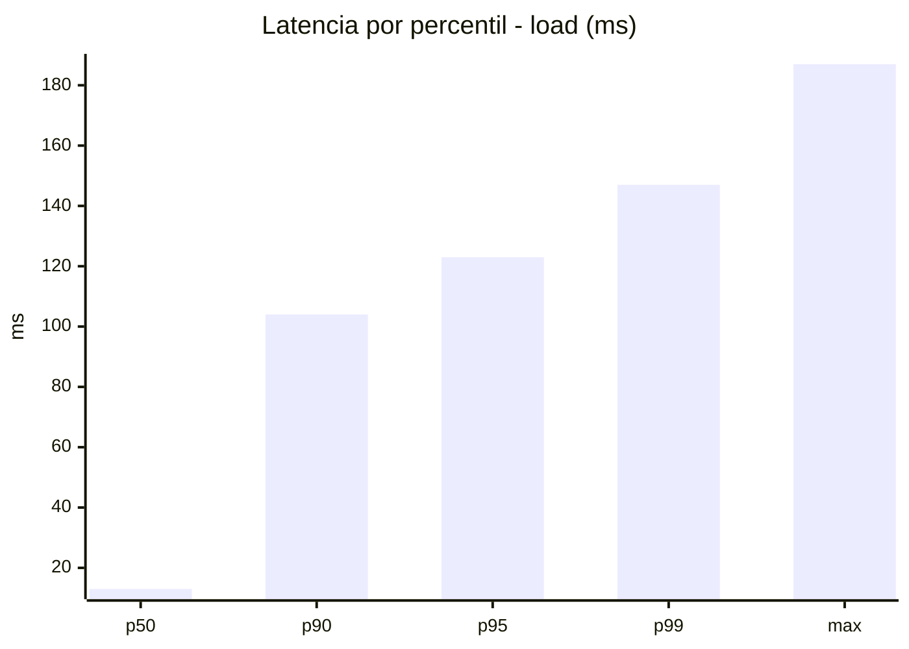
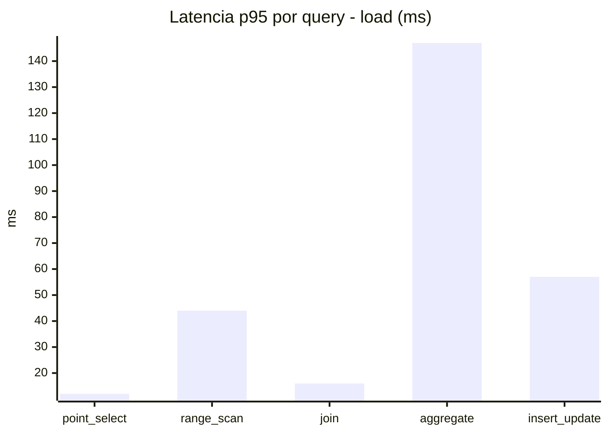
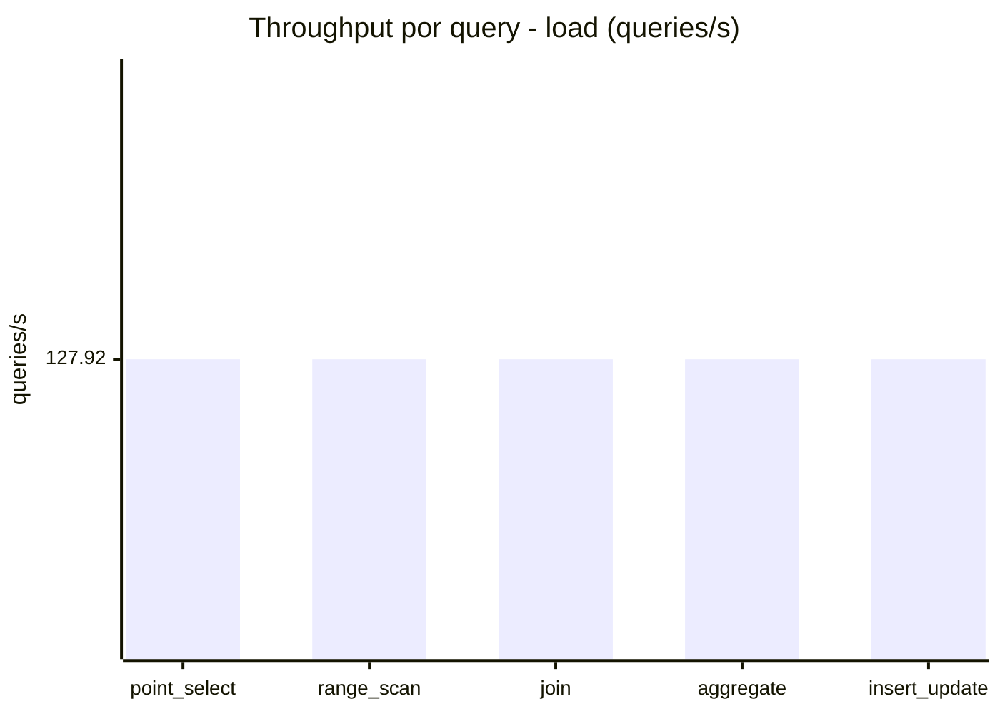
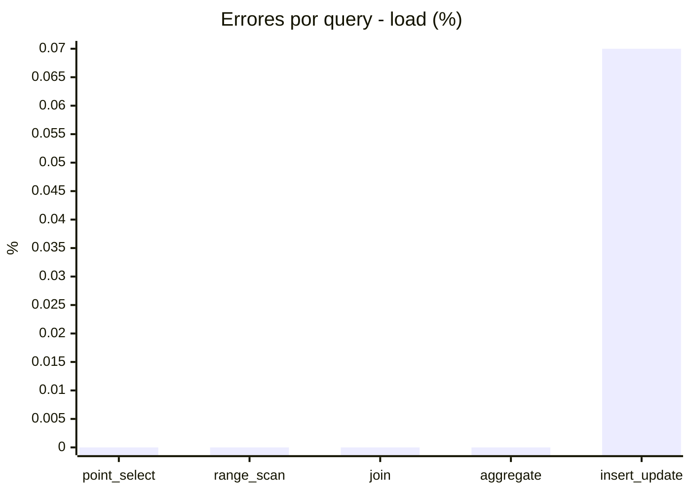
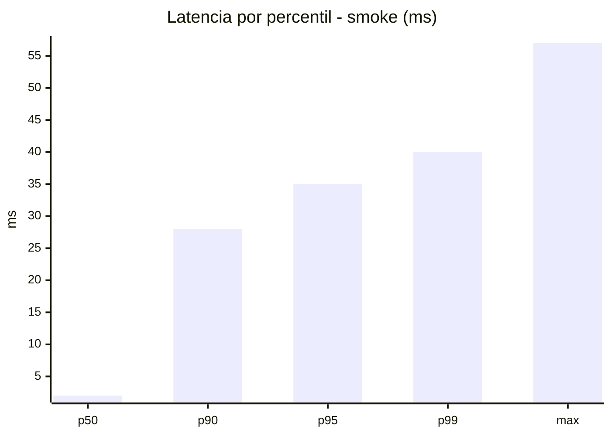
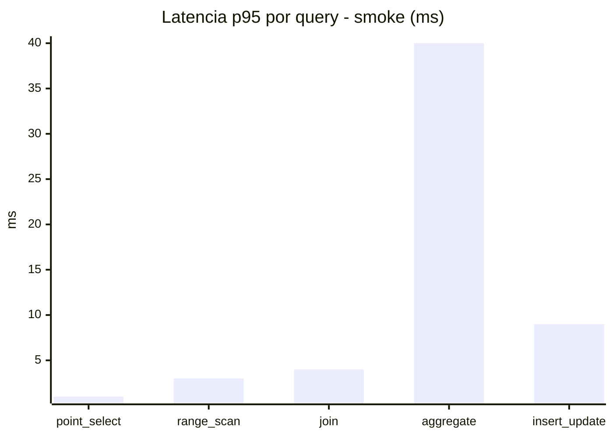
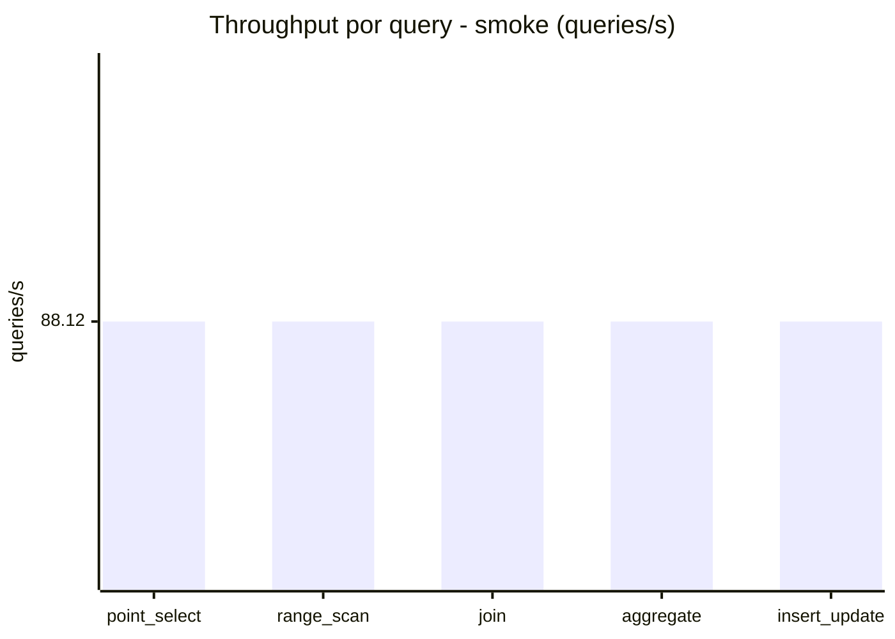
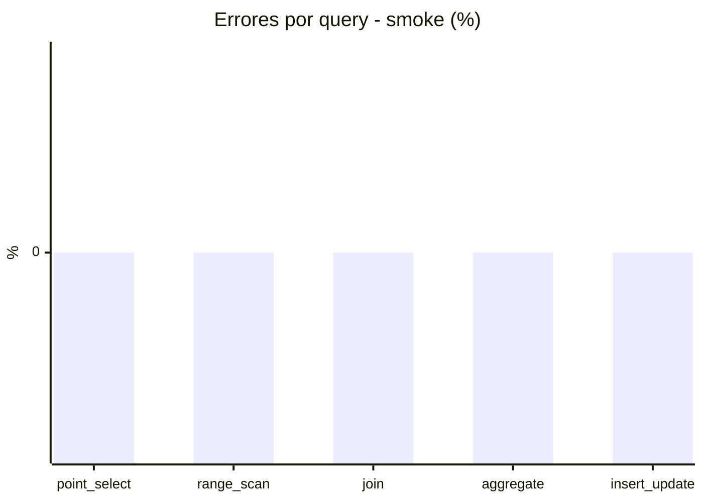

# Reporte de performance - SQL Server (k6)

**Fecha:** 2026-11-27 22:11 UTC  
**Veredicto (SLO):** `PASS`  
**Corrida:** [ver en GitHub Actions](https://github.com/lrbg/k6-sqlserver-lab/actions/runs/46074849047)  

## Analisis del agente de IA

PASS (fallback por umbrales)

- Error maximo: 0.01%
- p95 maximo: 123 ms

## Resultados

### Escenario: `load`

| Metrica | Valor |
| --- | --- |
| Queries ejecutadas | 38445 |
| Errores | 5 (0.01%) |
| Latencia media | 31.2 ms |
| p50 / p90 / p95 / p99 | 13 / 104 / 123 / 147 ms |
| Min / Max | 0 / 187 ms |
| Throughput | 639.62 queries/s |
| Duracion | 60.1 s |

Detalle por query

| Query | Ejecuciones | Error % | avg | p95 | p99 | q/s |
| --- | --- | --- | --- | --- | --- | --- |
| point_select | 7689 | 0% | 3.7 | 12 | 18 | 127.92 |
| range_scan | 7689 | 0% | 18.4 | 44 | 63 | 127.92 |
| join | 7689 | 0% | 6.4 | 16 | 20 | 127.92 |
| aggregate | 7689 | 0% | 103.1 | 147 | 158 | 127.92 |
| insert_update | 7689 | 0.07% | 24.7 | 57 | 75 | 127.92 |

### Escenario: `smoke`

| Metrica | Valor |
| --- | --- |
| Queries ejecutadas | 13230 |
| Errores | 0 (0%) |
| Latencia media | 6.8 ms |
| p50 / p90 / p95 / p99 | 2 / 28 / 35 / 40 ms |
| Min / Max | 0 / 57 ms |
| Throughput | 440.58 queries/s |
| Duracion | 30 s |

Detalle por query

| Query | Ejecuciones | Error % | avg | p95 | p99 | q/s |
| --- | --- | --- | --- | --- | --- | --- |
| point_select | 2646 | 0% | 0.4 | 1 | 2 | 88.12 |
| range_scan | 2646 | 0% | 1.9 | 3 | 7 | 88.12 |
| join | 2646 | 0% | 1.2 | 4 | 5 | 88.12 |
| aggregate | 2646 | 0% | 27.2 | 40 | 42 | 88.12 |
| insert_update | 2646 | 0% | 3.2 | 9 | 14 | 88.12 |

